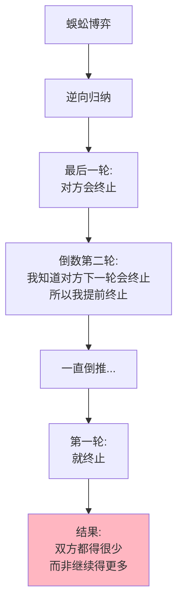

---

**数据来源：** 艾瑞咨询《2023年中国供应链账期研究报告》、PitchBook《2023年全球风险投资回报报告》、罗森塔尔（1981）原始蜈蚣博弈研究
：** 多阶段博弈，双方都知道持续合作能带来更大收益，但因为害怕在最后被背叛，选择提前终止合作。

**经典例子：**

两个玩家轮流决定是"继续"还是"终止"：

| 轮次 | 如果终止 | 如果继续 |
|------|----------|----------|
| 第1轮（玩家A） | A得1，B得0 | 进入下一轮 |
| 第2轮（玩家B） | A得0，B得2 | 进入下一轮 |
| 第3轮（玩家A） | A得3，B得1 | 进入下一轮 |
| 第4轮（玩家B） | A得2，B得4 | ... |
| ... | ... | ... |
| 第100轮（强制结束） | A得50，B得50 | - |

**逆向归纳的困境：**

玩家A的思考：
- 最后一轮（第100轮）：B肯定会终止（得50 > 继续后的可能更少）
- 倒数第二轮（第99轮）：A知道B会在下一轮终止，所以A现在就终止...
- ...一直倒推到第1轮...
- **A在第1轮就终止！**

### 关键要点

**1. 逆向归纳（Backward Induction）**

> 从最后一步开始推理，倒推出每一步的最优选择。

**2. 理论 vs 现实**

| 预测 | 现实 |
|------|------|
| 逆向归纳 predicts 第一轮就终止 | 实验中人们常继续很多轮 |
| 人是完全理性的 | 人不完全理性，有信任 |

**3. 信任的作用**

| 有信任 | 无信任 |
|--------|--------|
| 继续博弈，获得高收益 | 第一轮就终止，低收益 |

**历史小知识：** 蜈蚣博弈由罗森塔尔在1981年提出。它展示了博弈论中理性假设的局限——完全理性的人会立即终止，但现实中人们常继续合作。

---

### 为什么信任如此脆弱？

**问题的根源：**

| 困难 | 说明 |
|------|------|
| **多阶段博弈** | 每一步都可能是最后一步 |
| **信息不对称** | 不知道对方是否真的会继续 |
| **最后一步陷阱** | 到了最后一步，背叛是理性的 |
| **先动风险** | 先信任的一方可能被利用 |

**现实中的"最后一步"：**

| 场景 | "最后一步"是什么？ |
|------|---------------------|
| 供应链 | 付款那一刻 |
| 职场 | 离职那一刻 |
| 合作项目 | 项目结束那一刻 |
| 婚姻 | 离婚那一刻 |

---

## 蜈蚣博弈的真实案例

### 供应链的账期博弈

**背景：** 为什么供应链账期越来越长？

**账期的蜈蚣博弈：**

| 阶段 | 供应商选择 | 厂商选择 |
|------|------------|----------|
| 1 | 接受订单 | 下订单 |
| 2 | 生产 | 接受货物 |
| 3 | 发货 | 验收 |
| 4 | 等待 | **付款？** |

**厂商的诱惑：**

| 选择 | 短期收益 | 长期后果 |
|------|----------|----------|
| **按时付款** | 维持合作关系 | 合作继续 |
| **拖延付款** | 获得现金流 | **供应商可能拒绝合作** |

**供应商的困境：**

| 困境 | 说明 |
|------|------|
| 如果拒绝长账期 | 失去订单 |
| 如果接受长账期 | 可能被拖欠 |
| **结果** | 被迫接受，但提高价格对冲风险 |

**数据支撑：**

| 行业 | 平均账期 | 较10年前变化 |
|------|----------|---------------|
| 零售 | 90天 | +30天 |
| 汽车 | 120天 | +45天 |
| 建筑 | 180天 | +60天 |

**关键洞察：**
> 供应链账期的延长是**蜈蚣博弈的体现**。厂商利用自己的优势地位，将"最后一步"（付款）拖延，获得现金流优势。供应商无法拒绝，因为拒绝意味着立即失去合作。**这种博弈不是"双赢"，而是"零和"**——厂商的收益 = 供应商的损失。长期看，这种关系不可持续。

---

### 硅谷VC的投资艺术

**背景：** 为什么VC能投资极度不确定的初创公司？

**VC的蜈蚣博弈：**

| 轮次 | 如果继续 | 如果终止 |
|------|----------|----------|
| 天使轮 | 投资小，可能全亏 | 不投资，0收益 |
| A轮 | 投资更多，可能全亏 | 不继续投资，损失前期投资 |
| B轮 | 投资更多，可能全亏 | 不继续投资，损失前期投资 |
| ... | ... | ... |
| 退出（IPO/收购） | 可能10x-100x回报 | - |

**逆向归纳的失效：**

| 理论 | 现实 |
|------|------|
| 天使轮：担心后续轮次不投资，所以不投 | 天使轮：相信未来会有人接盘 |
| A轮：担心B轮不投资，所以不投 | A轮：相信未来会有人接盘 |
| ... | ... |
| **结果** | **投资链持续，虽然大部分失败** |

**为什么VC能持续投资？**

| 机制 | 作用 |
|------|------|
| **分散投资** | 投资组合，成功1个覆盖所有失败 |
| **有限合伙** | LP的钱，GP的管理费 |
| **声誉机制** | 不继续投资会损害声誉 |
| **阶段性估值** | 每轮都"重新定价"，避免沉没成本 |

**数据支撑：**

| VC类型 | 成功率 | 回报倍数 |
|--------|--------|----------|
| 顶级VC | 10-20% | 3-5x（整体基金） |
| 中等VC | 5-10% | 1-2x |
| 天使投资人 | <5% | <1x（大部分亏损） |

**关键洞察：**
> VC的投资艺术展示了**如何破解蜈蚣博弈**——通过"分散投资"和"阶段性决策"，VC避免了"最后一步陷阱"。每个投资轮次都是独立的决策（虽然看起来像连续的），估值重新计算，避免沉没成本。**更重要的是"生态系统"**——即使某家VC不想继续投资，总有其他VC接盘（只要有前景）。这创造了"接盘"文化，让投资链能持续。

---

## 如何建立信任链？

### 方法1：改变博弈结构

| 方法 | 例子 |
|------|------|
| **分阶段承诺** | 每轮重新评估，而非"一次性" |
| **可撤销承诺** | 允许退出，降低先动风险 |
| **第三方担保** | 支付宝、担保交易 |

---

### 方法2：建立声誉机制

| 方法 | 例子 |
|------|------|
| **公开记录** | 信用报告、黑名单 |
| **评级系统** | 淘宝好评、Uber评分 |
| **社区监督** | 开发者社区、行业组织 |

---

### 方法3：重复博弈

| 方法 | 例子 |
|------|------|
| **长期合作** | 供应商与厂商的长期关系 |
| **会员体系** | 会员等级、积分 |
| **订阅模式** | 订阅而非一次性购买 |

---

### 方法4：法律与制度

| 方法 | 例子 |
|------|------|
| **合同** | 详细条款、违约惩罚 |
| **法律保护** | 破产保护、劳动法 |
| **监管** | 政府监督、强制披露 |

---

## 应用与决策

### 企业决策：如何管理供应商关系？

| 情况 | 建议 |
|------|------|
| **长期供应商** | 建立信任，公平交易 |
| **短期供应商** | 合同保护，严格监管 |
| **战略供应商** | 股权合作，利益绑定 |

### VC决策：如何管理投资组合？

| 阶段 | 建议 |
|------|------|
| **天使轮** | 分散投资，降低单笔风险 |
| **A轮及以后** | 每轮独立评估，避免沉没成本 |
| **退出** | 不要恋战，及时止损或退出 |

---

### 常见误区

| 误区 | 正解 |
|------|------|
| "信任靠道德" | 信任靠机制设计 |
| "先信任的人吃亏" | 有时需要"大猪"先建立信任 |
| "合同能确保信任" | 合同无法解决所有问题 |
| "背叛总是非理性的" | 在"最后一步"，背叛可能是理性的 |

---

## 延伸思考

1. **婚姻的蜈蚣博弈**：婚姻是长期合作博弈，但离婚常常是"最后一步背叛"。为什么婚前协议（prenup）虽然理性，却常常被视为"不信任"？婚姻中的"最后一步"是什么？

2. **国际关系的信任困境**：中美关系是长期博弈，但双方都害怕"最后一步"（如台湾问题、贸易战）。如何建立长期稳定的信任机制？是否可能？

3. **AI对信任的影响**：当AI能够完美预测人类行为，蜈蚣博弈会怎样？如果AI知道你会在最后一步背叛，它会提前终止。这会让合作更困难还是更容易？

**下期预告：** 我们来探讨**重复博弈与声誉**——为什么淘宝信用体系有效？企业声誉为什么如此重要？

---

**数据来源：** 艾瑞咨询《2023年中国供应链账期研究报告》、PitchBook《2023年全球风险投资回报报告》、罗森塔尔（1981）原始蜈蚣博弈研究

**数据来源》：》供应链账期研究、VC投资回报数据、蜈蚣博弈实验研究
