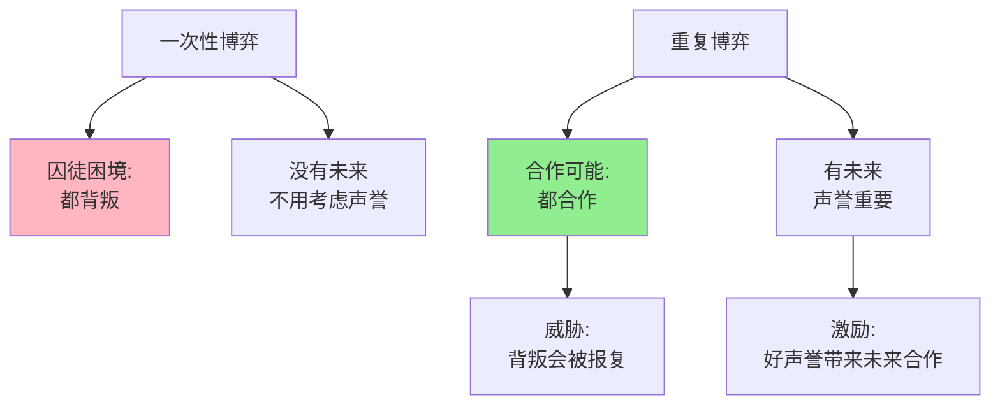

---

**数据来源：** 《中国电子商务平台研究》（2023）、哈佛商学院《企业声誉价值评估》（2022）、罗伯特·阿克塞尔罗德（1984）《合作的演化》

**简单说就是：** 当你知道还要和对方"再见面"，你会更愿意合作。

### 关键要点

**1. 重复博弈 vs 一次性博弈**

| 维度 | 一次性博弈 | 重复博弈 |
|------|------------|----------|
| **时间视野** | 只看当前收益 | 考虑未来收益 |
| **策略** | 背叛可能最优 | 合作可能最优 |
| **声誉** | 不重要 | **非常重要** |
| **报复机制** | 无效 | **有效** |

**2. 无限期重复博弈**

> 当博弈没有明确的结束时间，合作可以成为纳什均衡。

**"以牙还牙"策略（Tit-for-Tat）：**

| 步骤 | 策略 |
|------|------|
| 第一步 | 先选择合作 |
| 之后 | 模仿对方上一步的选择 |

**3. 声誉机制（Reputation Mechanism）**

> 当你有好声誉，更多人愿意和你合作 → 未来收益增加 → 维持好声誉是理性的。

**历史小知识：** 重复博弈理论由罗伯特·阿克塞尔罗德在1980年代的实验中深入研究。他发现"以牙还牙"是最成功的策略——简单、善良、可激怒、宽容。

---

### 为什么声誉如此重要？

**问题的根源：**

| 一次性博弈 | 重复博弈 |
|------------|----------|
| "坑你这一次，反正以后不见面" | "坑你一次，以后没人跟我合作" |
| 合同可能无法执行 | 声誉损失比违约更严重 |

**声誉的经济学价值：**

| 价值 | 说明 |
|------|------|
| **降低交易成本** | 有好声誉的人不需要详细合同 |
| **吸引合作机会** | 更多人和你合作 |
| **溢价能力** | 人们愿意为好声誉付费 |

---

## 重复博弈的真实案例

### 淘宝信用体系

**背景：** 为什么淘宝能建立信任？

**淘宝的声誉机制：**

| 机制 | 作用 |
|------|------|
| **好评/差评** | 公开记录，影响未来生意 |
| **店铺评分** | 累积声誉，影响流量 |
| **退款保障** | 平台担保，降低先动风险 |
| **先发货，后付款** | 基于声誉的信任 |

**重复博弈的效果：**

| 店铺类型 | 好评率 | 月销量 |
|----------|--------|--------|
| 新店 | 未知 | 很少 |
| 中等店（好评率95%） | 95% | 中等 |
| **皇冠店（好评率99%+）** | **99%+** | **很高** |

**为什么卖家不敢坑人？**

| 计算结果 | 说明 |
|----------|------|
| 坑人一次赚100元 | 短期收益 |
| 好评率下降1% | 每月损失1000元 |
| **结论** | 坑人一次 < 未来损失 |

**数据支撑：**

研究显示：
- 好评率99%+的店铺，销量是95%店铺的5-10倍
- 皇冠店（1万+好评）的转化率是新店的20倍以上
- 一个差评可能让店铺损失500-2000元未来收入

**关键洞察：**
> 淘宝信用体系展示了**重复博弈如何创造合作**。当买卖双方知道未来还会"见面"（更多交易），背叛（坑人）的长期成本远大于短期收益。**好评/差评系统将"声誉"可视化、可量化**，让声誉变成真金白银。这比任何合同都有效——合同可能无法执行，但声誉损失是实实在在的。

---

### 企业声誉建设

**背景：** 为什么企业愿意花巨资建立声誉？

**声誉的资产价值：**

| 公司 | 声誉危机 | 股价下跌 | 长期影响 |
|------|----------|----------|----------|
| Facebook | 隐私丑闻 | -20% | 持续负面影响 |
| 三星 | Note7爆炸 | -15% | 恢复缓慢 |
| 丰田 | 刹车门 | -10% | 长期品牌损害 |

**企业为什么要建立声誉？**

| 动机 | 说明 |
|------|------|
| **吸引客户** | 好声誉带来更多客户 |
| **降低成本** | 不需要大量广告和营销 |
| **溢价能力** | 客户愿意为品牌付费 |
| **吸引人才** | 好公司吸引好员工 |
| **投资者信心** | 好声誉吸引投资 |

**声誉投资回报：**

| 行业 | 声誉投资 | 回报方式 |
|------|----------|----------|
| **奢侈品** | 品牌故事、质量 | 溢价定价 |
| **服务业** | 客户体验、口碑 | 复购率 |
| **B2B** | 可靠性、专业性 | 长期合同 |

**数据支撑：**

| 指标 | 高声誉公司 | 低声誉公司 |
|------|------------|------------|
| 客户留存率 | 85%+ | 60% |
| 员工留存率 | 75%+ | 50% |
| 营销成本占比 | 5% | 15% |
| **净利润率** | **15%+** | **5%** |

**关键洞察：**
> 企业声誉是**长期重复博弈的结果**。好声誉不是"做广告"建立的，而是通过无数次"正面互动"积累的。**声誉的经济学本质是"未来收益的折现"**——好声誉意味着未来会有更多合作机会、更高溢价、更低成本。这也是为什么企业愿意花巨资保护声誉——声誉损失=未来收益损失。

---

## 如何建立和维护声誉？

### 企业视角

**方法1：投资声誉**

| 行动 | 说明 |
|------|------|
| **质量保证** | 产品/服务质量要稳定 |
| **客户体验** | 售后服务、客户支持 |
| **透明沟通** | 问题及时公开、诚实 |
| **社会责任** | CSR、环保、公益 |

**方法2：保护声誉**

| 行动 | 说明 |
|------|------|
| **危机管理** | 快速响应、真诚道歉 |
| **监控声誉** | 舆情监控、及时处理 |
| **法律保护** | 打击造谣、恶意攻击 |

**方法3：将声誉货币化**

| 行动 | 说明 |
|------|------|
| **品牌溢价** | 好声誉=高价格 |
| **会员体系** | 将声誉转化为忠诚度 |
| **推荐奖励** | 利用客户声誉带来新客户 |

---

### 个人视角

**方法1：建立专业声誉**

| 行动 | 说明 |
|------|------|
| **持续产出** | 文章、演讲、项目 |
| **公开承诺** | 公开目标，接受监督 |
| **帮助他人** | 建立互助网络 |

**方法2：利用平台**

| 平台 | 作用 |
|------|------|
| **GitHub** | 开源贡献记录 |
| **LinkedIn** | 职业推荐 |
| **知乎/小红书** | 知识分享 |
| **大众点评** | 服务评价 |

**方法3：避免声誉风险**

| 风险 | 应对 |
|------|------|
| **过度承诺** | 保守承诺，超预期交付 |
| **争议话题** | 谨慎表达 |
| **不当行为** | 私德也影响职业声誉 |

---

## 应用与决策

### 企业决策

| 决策 | 声誉视角 |
|------|----------|
| **产品决策** | 短期利润 vs 长期声誉 |
| **危机处理** | 快速真诚回应 |
| **合作选择** | 选择声誉好的合作伙伴 |

### 个人决策

| 决策 | 声誉视角 |
|------|----------|
| **跳槽** | 不要频繁跳槽，影响稳定性 |
| **社交媒体** | 注意公开言论 |
| **承诺** | 不要过度承诺 |

---

### 常见误区

| 误区 | 正解 |
|------|------|
| "声誉=营销" | 声誉是长期行为的结果 |
| "声誉可以快速建立" | 声誉需要时间积累 |
| "声誉只能受损，不能恢复" | 有些声誉危机可以恢复 |
| "小公司不需要声誉" | 小公司更需要声誉竞争 |

---

## 延伸思考

1. **算法时代的声誉**：当算法评分决定你的声誉（如Uber司机评分、外卖骑手评分），这更公平还是更残酷？算法声誉能否真正反映服务质量？

2. **国际关系的声誉**：国家也有声誉——"信守承诺"的国家更容易获得盟友。但特朗普的"美国优先"破坏了美国声誉，这对国际关系有何长期影响？

3. **Web3的去中心化声誉**：区块链试图建立"不可篡改"的声誉系统（如NFT、DAO贡献记录）。这是否能解决当前平台垄断声誉的问题？

**下期预告：** 我们来探讨**拍卖机制设计**——为什么Google广告拍卖如此成功？深圳车牌拍卖为什么价格虚高？如何避免"赢家诅咒"？

---

**数据来源：** 《中国电子商务平台研究》（2023）、哈佛商学院《企业声誉价值评估》（2022）、罗伯特·阿克塞尔罗德（1984）《合作的演化》
