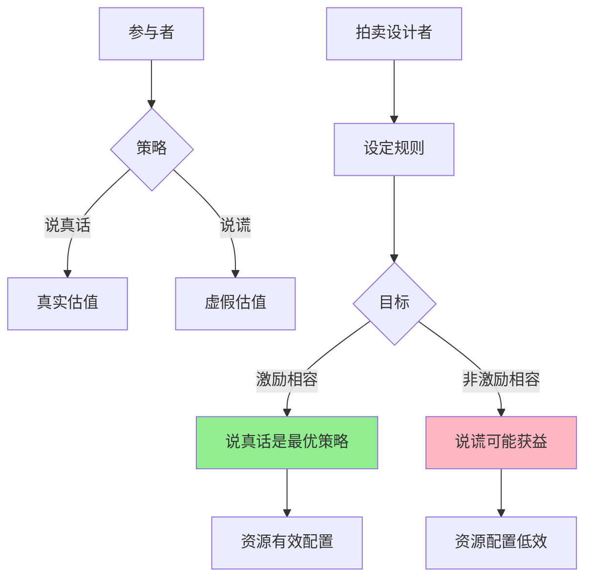

---

**数据来源：** Google财报（2010-2023）、深圳车牌拍卖数据（2015-2023）、Google广告机制说明、拍卖理论文献

**定义：** 设计规则，让参与者在追求自己利益的同时，达到设计者想要的结果。

**简单说就是：** 设计"让人说真话"的机制。

### 关键要点

**1. 拍卖类型**

| 类型 | 规则 | 例子 |
|------|------|------|
| **英式拍卖** | 价高者得，公开叫价 | 艺术品拍卖 |
| **荷式拍卖** | 价格下降，先接受者得 | 花卉拍卖 |
| **一级价格密封拍卖** | 密封投标，价高者得实际支付 | 政府采购 |
| **二级价格密封拍卖（维克里拍卖）** | 密封投标，价高者得支付第二高价 | Google广告 |

**2. 维克里拍卖（Vickrey Auction）**

> 密封投标，价高者得，但支付第二高的投标价格。

**为什么维克里拍卖让人说真话？**

| 你的投标 | 第二高价格 | 你支付 | 结果 |
|----------|------------|--------|------|
| 你的真实估值（100元） | 80元 | 80元 | 赢且获利20元 ✅ |
| 虚高投标（120元） | 80元 | 80元 | 赢但无额外收益 |
| 虚低投标（70元） | 80元 | - | 输了，错过获利机会 ❌ |

**结论：** 说真话是占优策略！

**3. 赢家诅咒（Winner's Curse）**

> 赢家往往高估价值，因为赢家的信息是最乐观的。

**历史小知识：** 威廉·维克里1961年提出二级价格拍卖理论，1996年获得诺贝尔经济学奖。他的核心洞察是：好的拍卖机制应该让参与者说真话。

---

### 为什么拍卖设计很重要？

**问题的根源：**

| 拍卖问题 | 后果 |
|----------|------|
| **信息不对称** | 拍卖者不知道真实价值 |
| **策略性行为** | 参与者不说真话 |
| **合谋** | 参与者串通压价 |
| **赢家诅咒** | 赢家后悔中标 |

**好的拍卖机制：**

| 目标 | 说明 |
|------|------|
| **激励相容** | 说真话是最优策略 |
| **配置效率** | 物品归最看重它的人 |
| **收入最大化** | 拍卖者收入最大（有时与效率冲突） |

---

## 拍卖机制的真实案例

### Google广告拍卖

**背景：** 为什么Google能垄断搜索广告市场？

**Google的拍卖机制：**

| 因素 | 权重 | 说明 |
|------|------|------|
| **出价** | 重要但非唯一 | 广告主愿意付多少钱 |
| **广告质量** | 非常重要 | 相关性、着陆页质量 |
| **点击率** | 重要 | 用户点击历史 |
| **扩展性** | 考虑 | 广告格式、附加信息 |

**真实拍卖过程：**

| 广告主 | 出价 | 质量分 | 广告排名 | 实际支付 |
|--------|------|--------|----------|----------|
| A | 5元 | 2（低） | 10 | - |
| B | 3元 | 8（高） | 24 | 排第2位的价格 |
| C | 4元 | 5（中） | 20 | 排第3位的价格 |
| D | 2元 | 10（很高） | 20 | 排第4位的价格 |

**为什么Google不用"价高者得"？**

| 问题 | "价高者得" | Google机制 |
|------|------------|------------|
| 低质量广告 | 可以排名第一 | 被降权 |
| 用户体验 | 差 | 更好 |
| 点击率 | 低 | 更高 |
| **Google收入** | **短期高，长期低** | **短期可能低，长期高** |

**数据支撑：**

| 年份 | Google广告收入 | 市场份额 |
|------|----------------|----------|
| 2010 | 280亿美元 | 40% |
| 2015 | 670亿美元 | 55% |
| 2023 | 2240亿美元 | 60%+ |

**关键洞察：**
> Google广告拍卖展示了**机制设计的力量**。Google不只用"出价"，而是用"质量×出价"决定排名。这解决了"价高者得"的困境——低质量广告不能靠砸钱获得好位置。**更重要的是，Google用二级价格拍卖**——广告主支付"排在下一位所需的价格"，而非自己的出价。这激励广告主说真话（真实估值），因为虚高投标不会带来额外收益。

---

### 深圳车牌拍卖

**背景：** 为什么深圳车牌拍卖价格这么高？

**深圳车牌拍卖机制：**

| 要素 | 说明 |
|------|------|
| **拍卖方式** | 密封投标，价高者得 |
| **配额** | 每月有限配额 |
| **底价** | 1万元起拍 |
| **支付** | 一级价格（支付自己投标价） |

**价格演变：**

| 年份 | 成交价 | 变化 |
|------|--------|------|
| 2015 | 2万 | - |
| 2018 | 6万 | +200% |
| 2020 | 5万 | -17% |
| 2023 | 4万 | -20% |

**为什么价格这么高？**

| 原因 | 说明 |
|------|------|
| **供不应求** | 配额远少于需求 |
| **刚需** | 摇号中签率极低（<0.5%） |
| **投资属性** | 车牌可转让，成投资品 |
| **一级价格拍卖** | 赢家诅咒风险高 |

**赢家诅咒：**

| 估值 | 投标价 | 结果 |
|------|--------|------|
| 真实需求（值3万） | 4万 | 买贵了，亏损1万 |
| 投资需求（预期5万） | 5万 | 如果预期错误，亏损 |

**深圳的改进：**

| 改革 | 效果 |
|------|------|
| 设置熔断价 | 超过价不再成交，改为摇号 |
| 增加配额 | 略微缓解紧张 |
| 限制转让 | 降低投资属性 |

**关键洞察：**
> 深圳车牌拍卖展示了**一级价格拍卖的问题**。因为赢家支付自己的投标价，有"赢家诅咒"风险——中标者往往高估价值。**如果深圳用二级价格拍卖**（赢家支付第二高的投标价），价格可能会下降，因为：
> - 如果真实需求是3万，投标3万就够
> - 不需要担心"投3万但输给投3.5万的人"
> **但深圳选择了一级价格拍卖 + 熔断机制**，可能是为了收入最大化而非配置效率。

---

## 如何设计好的拍卖机制？

### 设计原则

**1. 激励相容（Incentive Compatibility）**

> 说真话是最优策略。

| 检验问题 | 说明 |
|----------|------|
| 参与者有激励说真话吗？ | 如果说谎能获利，机制有缺陷 |

**2. 个体理性（Individual Rationality）**

> 参与拍卖比不参与更好。

| 检验问题 | 说明 |
|----------|------|
| 参与者愿意参与吗？ | 如果预期收益<0，不会参与 |

**3. 配置效率（Allocative Efficiency）**

> 物品归最看重它的人。

| 检验问题 | 说明 |
|----------|------|
| 赢家是真实估值最高的人吗？ | 如果不是，效率损失 |

**4. 收入最大化（Revenue Maximization）**

> 拍卖者收入最大。

| 检验问题 | 说明 |
|----------|------|
| 拍卖者获得最大可能收入吗？ | 有时与效率冲突 |

---

### 常见拍卖类型对比

| 类型 | 优点 | 缺点 | 适用场景 |
|------|------|------|----------|
| **英式拍卖** | 简单、透明 | 容易合谋 | 艺术品、房地产 |
| **荷式拍卖** | 快速 | 需要实时系统 | 花卉、 fish |
| **一级价格密封** | 简单 | 不说真话、赢家诅咒 | 政府采购 |
| **二级价格密封** | **说真话** | **可能收入较低** | **Google广告** |

---

## 应用与决策

### 什么时候应该用拍卖？

| 情况 | 建议 |
|------|------|
| **物品价值不确定** | 用拍卖发现价格 |
| **有多个竞标者** | 用拍卖分配资源 |
| **希望透明公正** | 用公开拍卖 |

### 如何选择拍卖方式？

| 目标 | 推荐 |
|------|------|
| **发现真实价值** | 二级价格拍卖 |
| **收入最大化** | 一级价格拍卖（或英式拍卖） |
| **简单快速** | 一级价格密封拍卖 |

---

### 常见误区

| 误区 | 正解 |
|------|------|
| "价高者得总是最好的" | 不考虑质量，价高者得可能导致低效 |
| "拍卖总是能发现真实价值" | 赢家诅咒可能导致价格虚高 |
| "公开拍卖总是最好的" | 公开拍卖可能导致合谋 |
| "二级价格拍卖收入低" | 长期可能更高，因为更准确 |

---

## 延伸思考

1. **AI时代的拍卖**：当AI参与拍卖，它会改变博弈吗？AI是否会学会"说谎"？如果所有参与者都是AI，拍卖机制需要重新设计吗？

2. **NFT拍卖的疯狂**：为什么NFT拍卖能卖出天价？是"赢家诅咒"的极致案例，还是真的发现了新价值？泡沫破裂后，NFT拍卖会怎样？

3. **碳排放权拍卖**：碳市场本质上是一个拍卖市场。如何设计碳拍卖，既发现真实碳价，又避免市场操纵？

**下期预告：** 我们来探讨**威胁与承诺**——为什么腾讯vs网易的版权诉讼持续多年？专利战是创新还是阻碍？

---

**数据来源：** Google财报（2010-2023）、深圳车牌拍卖数据（2015-2023）、Google广告机制说明、拍卖理论文献
