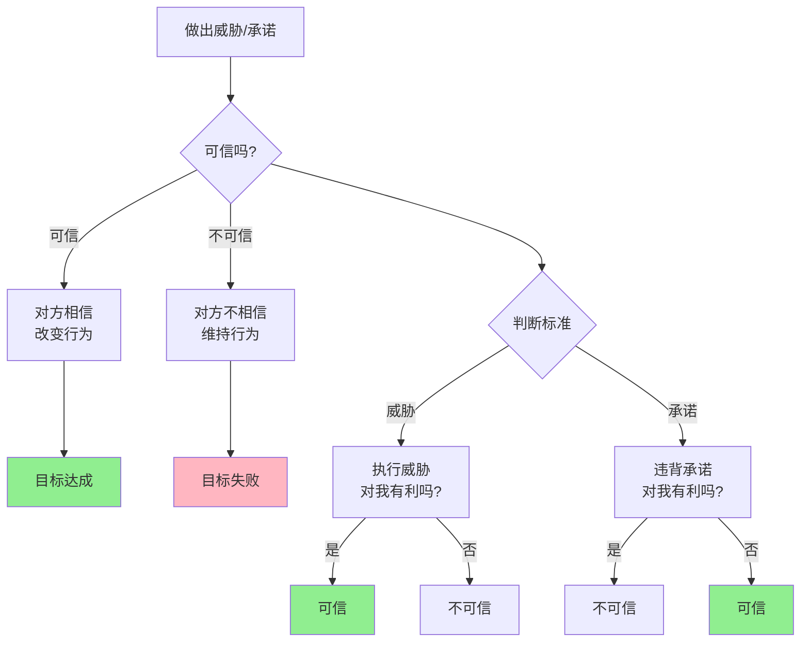

---

**数据来源：** 腾讯音乐财报、网易云音乐财报（2015-2023）、苹果与三星专利诉讼案例研究、谢林（1960）《冲突的策略》

> 威胁或承诺是否可信，取决于**执行是否符合执行者的利益**。

### 关键要点

**1. 可信威胁（Credible Threat）**

> 威胁只有在"执行威胁对威胁者有利"时才可信。

**例子：**

| 威胁 | 可信？ | 原因 |
|------|--------|------|
| "你再欺负我，我就自杀" | ❌ 不可信 | 自杀对威胁者更不利 |
| "你再侵犯版权，我就起诉" | ✅ 可信 | 起诉可能胜诉，获得赔偿 |

**2. 可信承诺（Credible Commitment）**

> 承诺只有在"违背承诺对承诺者不利"时才可信。

**例子：**

| 承诺 | 可信？ | 原因 |
|------|--------|------|
| "我保证下次不迟到" | ❌ 不可信 | 违背承诺没有成本 |
| "我押1000元，保证下次不迟到" | ✅ 可信 | 违背承诺会损失1000元 |

**3. 如何建立可信度？**

| 方法 | 原理 | 例子 |
|------|------|------|
| **建立声誉** | 违背的长期成本 > 短期收益 | 品牌、信用 |
| **签订合同** | 违背的法律成本 | 违约惩罚 |
| **抵押/保证金** | 违背的直接损失 | 押金、定金 |
| **第三方监督** | 违背的声誉成本 | 公证、仲裁 |

**历史小知识：** 托马斯·谢林1960年出版《冲突的策略》，系统阐述了可信威胁和承诺的概念。2005年，他因此获得诺贝尔经济学奖。

---

### 为什么可信度如此重要？

**问题的根源：**

| 困境 | 说明 |
|------|------|
| **空口承诺** | 没有成本，不可信 |
| **理性背叛** | 违背承诺符合短期利益 |
| **信息不对称** | 对方不知道你是否真的会执行 |

**可信度的经济学价值：**

| 价值 | 说明 |
|------|------|
| **降低交易成本** | 不需要详细合同 |
| **促成合作** | 双方敢投入 |
| **威慑不良行为** | 不需要真的"惩罚" |

---

## 威胁与承诺的真实案例

### 腾讯vs网易：音乐版权的博弈

**背景：** 为什么腾讯能在音乐版权战中获胜？

**腾讯的威胁：**

| 威胁 | 可信性分析 |
|------|------------|
| "如果你侵权，我就起诉" | ✅ 可信——腾讯有钱、有法务团队，胜诉概率高 |
| "如果你不授权，我就封杀你" | ✅ 可信——腾讯有平台（QQ音乐、微信） |

**网易的选择：**

| 选项 | 短期 | 长期 |
|------|------|------|
| **对抗** | 继续侵权，节省成本 | 持续被起诉，可能被迫下架 |
| **和解** | 支付版权费 | 合法运营，共享曲库 |

**为什么和解？**

| 因素 | 说明 |
|------|------|
| **腾讯的威胁可信** | 腾讯真的起诉，且胜诉 |
| **合作收益 > 对抗收益** | 共享曲库 > 独家运营 |
| **长期关系** | 双方需要长期共存 |

**数据支撑：**

| 年份 | 腾讯音乐市场份额 | 网易云音乐市场份额 |
|------|------------------|---------------------|
| 2015 | 40% | 20% |
| 2018 | 60% | 15% |
| 2023 | 70%+ | 20% |

**关键洞察：**
> 腾讯vs网易的版权战展示了**可信威胁的力量**。腾讯不只是"威胁"，而是真的起诉（多次），让威胁变得可信。**更重要的是"承诺"**——双方最终达成交叉授权协议，这既是"威胁"的结果（如果不合作，持续对抗），也是"承诺"的体现（如果合作，共享曲库）。**可信威胁和承诺的结合，促成了合作均衡**。

---

### 专利战：创新还是阻碍？

**背景：** 为什么大公司之间不断打专利战？

**专利战的博弈论分析：**

| 公司A策略 | 公司B起诉 | 公司B不起诉 |
|------------|-----------|-------------|
| **起诉** | 双方都损失 | A可能胜诉，B损失 |
| **不起诉** | B可能胜诉，A损失 | 双方合作 |

**为什么专利战持续？**

| 原因 | 说明 |
|------|------|
| **威慑价值** | 展示"我有钱、有专利、会起诉" |
| **谈判筹码** | 用专利战逼迫和解 |
| **时间差** | 起诉期间可以继续"侵权" |

**苹果vs三星专利战：**

| 阶段 | 苹果 | 三星 |
|------|------|------|
| 2011 | 起诉三星侵权 | 反诉苹果侵权 |
| 2012 | 获胜，获10亿美元赔偿 | 上诉 |
| 2018 | 和解，交叉授权 | 和解，交叉授权 |

**为什么最终和解？**

| 因素 | 说明 |
|------|------|
| **战争成本** | 双方都花费数亿美元法律费用 |
| **不确定性** | 谁胜谁负不确定 |
| **长期关系** | 三星是苹果供应链，也是竞争对手 |
| **交叉授权** | 共享专利池，降低未来冲突 |

**专利战的积极一面：**

| 观点 | 说明 |
|------|------|
| **保护创新** | 专利保护激励创新 |
| **技术转移** | 交叉授权促进技术扩散 |
| **市场准入** | 小公司可以用专利对抗大公司 |

**关键洞察：**
> 专利战展示了**威胁与承诺的双重性**。起诉是"威胁"——如果你侵权，我会起诉。但最终和解是"承诺"——如果我们交叉授权，双方都受益。**专利战不一定是坏事**，它是技术市场的一种谈判机制。通过威胁（起诉）和承诺（和解），技术得以在保护创新和促进扩散之间找到平衡。

---

## 如何建立可信威胁和承诺？

### 建立可信威胁

**方法1：做出"无法撤回"的行动**

| 行动 | 例子 |
|------|------|
| **公开声明** | "我一定会起诉"（公开后，不执行会丢声誉） |
| **预先投入** | 花钱请律师（不起诉就浪费） |
| **建立"自动"机制** | 条款触发自动起诉 |

**方法2：限制自己的选择**

| 方法 | 例子 |
|------|------|
| **授权给第三方** | 法务部门有独立起诉权 |
| **建立规则** | "如果侵权，一定起诉"（无例外） |

**方法3：让威胁符合自身利益**

| 方法 | 例子 |
|------|------|
| **确保起诉有利** | 起诉能获得赔偿 |
| **让不起诉更糟** | 不起诉会鼓励更多侵权 |

---

### 建立可信承诺

**方法1：提供"抵押"**

| 抵押类型 | 例子 |
|----------|------|
| **金钱** | 押金、违约金 |
| **声誉** | 公开承诺 |
| **关系** | 伤害长期关系 |

**方法2：分散决策**

| 方法 | 例子 |
|------|------|
| **第三方监督** | 仲裁、公证 |
| **自动执行** | 智能合约 |
| **多边协议** | 条约、联盟 |

**方法3：让违背承诺成本高昂**

| 成本类型 | 例子 |
|----------|------|
| **法律成本** | 违约惩罚 |
| **声誉成本** | 信用评级下降 |
| **关系成本** | 失去合作伙伴 |

---

## 应用与决策

### 商业谈判

| 场景 | 威胁/承诺策略 |
|------|---------------|
| **价格谈判** | "如果你降价X，我订购Y量"（承诺） |
| **合同谈判** | "如果违约，我将起诉"（威胁） |
| **合作谈判** | "如果合作，我投资Z"（承诺） |

### 职场

| 场景 | 威胁/承诺策略 |
|------|---------------|
| **加薪谈判** | "如果达到X目标，奖励Y"（承诺） |
| **项目管理** | "如果延期，扣除Z"（威胁） |
| **团队合作** | "如果完成，大家共享奖励"（承诺） |

---

### 常见误区

| 误区 | 正解 |
|------|------|
| "威胁越狠越有效" | 只有可信的威胁才有效 |
| "承诺只要说出来就行" | 没有成本的承诺不可信 |
| "威胁和承诺是对立的" | 常常需要结合使用 |
| "一旦做出就不能改变" | 有时需要灵活调整 |

---

## 延伸思考

1. **核威慑的可信度**：核武器国家的"相互保证毁灭"（MAD）是可信威胁吗？如果对方真的发动核攻击，你会真的反击（导致全球毁灭）吗？

2. **父母的威胁**："如果你再哭，我就把你扔在这"——孩子知道这是不可信威胁（父母不会真的这么做），所以继续哭。如何建立可信的育儿威胁？

3. **国家的承诺**：国家承诺"保护产权"——为什么有些国家可信，有些不可信？是制度问题、文化问题，还是其他？

**下期预告：** 模块三完成！接下来进入**模块四：企业战略与竞争**。我们将探讨**竞争策略图谱**——中国白酒行业为何利润丰厚？全球航空业为何长期亏损？

---

**数据来源：** 腾讯音乐财报、网易云音乐财报（2015-2023）、苹果与三星专利诉讼案例研究、谢林（1960）《冲突的策略》
