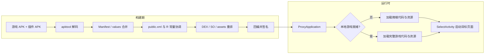
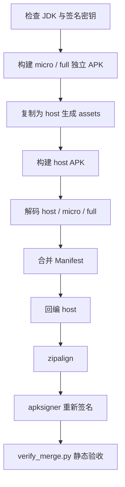
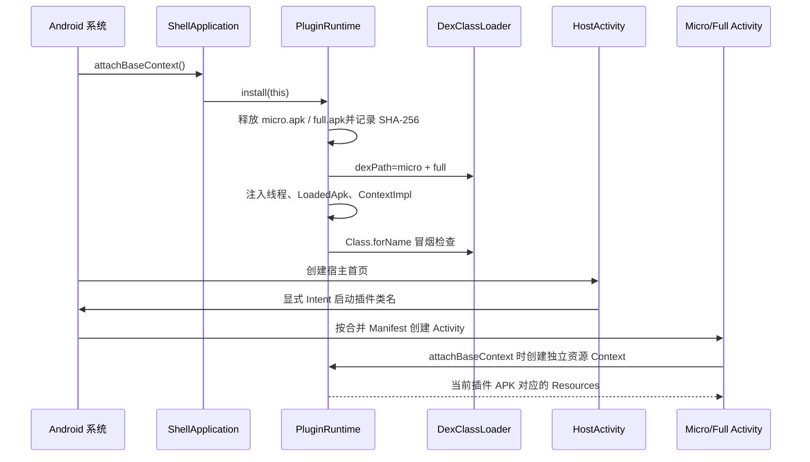

> 手头有两个能够独立安装、独立运行的 APK：一个负责微端云游戏，一个负责完整游戏。能不能只给用户一个安装包，在壳里按需进入两套代码和两套资源？
>
> 这篇文章从一个可运行的最小工程出发，完整走通 **独立构建双插件 → 内嵌 host assets → 合并 Manifest → 回编签名 → DexClassLoader 注入 → 每插件独立 Resources → 真机切换验证**。同时对照 splitgame 原工程，说明教学 Demo 保留了哪些核心思想，又刻意删去了哪些生产级复杂度。
>
> 阅读前提：了解 Android Activity、Manifest、`R` 类和基本 Gradle 构建即可。文中的关键机制有源码对应，实测结果有静态验收报告或真机记录对应；真机环境为 **小米 13 Pro（Android 16 / API 36）与小米 6（Android 9 / API 28）**，启动毫秒数均为各自单次记录，不用于设备间性能比较或推导性能收益。

---

## 一、问题提出：为什么不能把两个 APK 当成 ZIP 直接拼接

APK 确实是 ZIP，但“都是 ZIP”只说明容器格式相同，不代表应用语义可以相加。若把两个文件按字节首尾相接，第二套中央目录和偏移无法组成一个合法 APK，连安装解析这一关都过不了；若解包后把文件复制到同一目录再重打包，也至少会撞上四层障碍。

| 层次 | 两个独立 APK 各自拥有 | 解包混装后的问题 |
|---|---|---|
| 代码 | `classes.dex`、可能还有更多 DEX | 同名文件互相覆盖；改成 multidex 虽能进入宿主加载路径，却让代码失去插件边界，同名类也会冲突 |
| 资源 | `resources.arsc`、`res/`、编译进代码的 `R` 常量 | 两边应用资源通常都使用 `0x7f` 包段，同名或同数值 ID 会错位 |
| 组件 | `AndroidManifest.xml` 中的 Activity 等声明 | 最终包只能有一份主 Manifest；未声明的插件 Activity 无法按正常组件链路创建 |
| 签名 | 覆盖整个 APK 内容的签名 | 任意回编、增删文件都会使旧签名失效，必须重新对齐并签名 |

先看代码层。把两个 DEX 按 `classes.dex`、`classes2.dex` 等多 dex 规则放进同一个 APK，宿主 `PathClassLoader` 确实会把它们纳入搜索路径；问题不是“系统完全加载不到”，而是**代码从此并入宿主命名空间，无法再按原 APK 保持独立边界，完整类名相同的类还会冲突**。本文使用 DexClassLoader，正是为了保留两个完整插件 APK 的代码边界，而不是为了否定 multidex 本身的加载能力。并且，即使类能加载，Manifest、资源表和签名问题仍然原样存在。

资源层更隐蔽。Java 代码里的 `R.layout.activity_plugin` 不是资源名查找，而是一个编译期写死的整数。两个 APK 独立编译时，完全可能让同一个整数分别指向 micro 的蓝色页面和 full 的橙色页面。只合并资源表、不改代码，或者只改代码、不统一资源表，都会出现“能打开页面，却显示了另一套文字和颜色”的错位。

组件层决定系统“认不认识”这个页面。`DexClassLoader` 能让 `Class.forName("com.example.merge.micro.MicroActivity")` 成功，却不会自动把该类注册成 Activity。反过来，只把 Activity 写进 Manifest、不提供可加载的类，典型表现则是 `Unable to instantiate activity`，其 cause 中包含 `ClassNotFoundException`。

最后是签名。只要对 host 解包、修改 Manifest 并回编，原 host 签名就不再可信。于是“合并”必须是一条完整流水线，而不是一次 ZIP 复制：

```text
可安装的双 APK 合并包
= 可发现的组件声明
+ 可加载的插件代码
+ 不串台的资源解析
+ 对最终产物重新建立的签名
```

这四件事也正是 Demo 的四个验收维度。

---

## 二、splitgame 原理解析：构建期和运行时各有一条链

splitgame 的目标比本文 Demo 大得多：它还处理 DEX 转 C/VMP、资源加密、Native 库、游戏资源下载与微端/完整游戏切换。不过，把加固和业务逻辑暂时剥离，可以看到一条清晰的双链路。

### 2.1 构建期：先合并声明和资源，再处理插件自身的 ID

原工程的构建入口之一在 `dex2c/src/main/java/com/netease/dex2c/tools/ApkManager.java`。

`insertPluginStyles()` 从 `ApkManager.java:926` 开始。它用两个线程分别解码游戏 APK 与插件 APK（`ApkManager.java:933-968`），随后依次进行：

1. 预处理双方 Manifest，并调用 `replaceGameManifest()` 合并（`ApkManager.java:989-1003`）；
2. 合并 styles、strings、colors、attrs 等 values 项（`ApkManager.java:1005-1017`）；
3. 回编游戏临时 APK，拆分游戏资源（`ApkManager.java:1080-1084`）；
4. 调用 `DexUtils.repairPluginPath()` 进入插件资源后处理（`ApkManager.java:1086-1087`）。

Manifest 的核心实现位于 `replaceGameManifest()`（`ApkManager.java:1462-1567`）。它把 `uses-permission`、`permission`、`uses-feature` 插到 `<application>` 前，把 Activity、Provider、Service、Receiver 插到 `</application>` 前，并注入壳自己的 `SelectActivity`、初始化 Provider 和下载组件。`insertXml()` 在 `ApkManager.java:1433-1460` 中处理去重；Provider 会额外参考 `android:authorities`，而不是只看类名。

values 合并并不是“整个文件覆盖”。`replaceValues()` 读取双方 XML（`ApkManager.java:1398-1415`），`replaceGameStyles()` 再按资源名补充插件独有项（`ApkManager.java:1417-1430`）。但仅做文本合并还不够：插件代码中的 `R` 常量仍记得旧 ID。

这正是 `plugin_res_tools/src/main/java/com/sq/ResTool.java` 存在的意义。它的 `main()` 在 `ResTool.java:49-67` 串起资源引用提取、资源包处理、签名和 DEX 处理。`handleResPkg()`（`ResTool.java:146-186`）先取得宿主与插件的 `public.xml`，再调用 `handlePublicXml()` 和 `handlePluginRes()`：

- `handlePublicXml()` 备份插件原始 `public.xml`，以宿主侧筛选后的资源 ID 为基础，合并插件独有项，最后通过 `PublicAndRHelper.handle()` 更新 R 文件（`ResTool.java:364-415`）。
- `handlePluginRes()` 将 arm64 SO 转移到壳的资源目录，并移动 DEX/Smali 供后续处理（`ResTool.java:271-310`）。

因此，原工程不是简单地“把资源塞在一起”，而是同时维护 **资源表、R 常量、组件声明、代码与 Native 文件去向** 的一致性。

### 2.2 运行时：选择模式，加载代码，再让资源路径匹配模式

壳入口是 `dex_decryption_apk_v2/src/main/java/com/netease/dexshell/ProxyApplication.java`。其 `attachBaseContext()` 位于 `ProxyApplication.java:104-158`：

- 先初始化 meta-data，并附着 Native 库路径；
- `AssetsHelper.isLocalGameReady(context)` 为 false 时，走微端 DEX 加载 `IO00OI0o0()`；
- 为 true 时，先重定向 Unity 所需的 `sourceDir`，再调用 `loadGameDex()`。

`isLocalGameReady()` 在 `micro/AssetsHelper.java:298-319`，综合检查 `assets_ext.apk`、SO、游戏 DEX、启动时间、版本与解压成功标记，不是只看一个文件是否存在。

微端路径的 `IO00OI0o0()` 从 `ProxyApplication.java:471` 开始，释放并解密 DEX、构造元素数组，最终通过 native 方法替换 `dexElements`（`ProxyApplication.java:588-619`）。完整游戏路径的 `loadGameDex()` 也在组装游戏 DEX 与 holder DEX 后替换元素（`ProxyApplication.java:160-205`）。这里要注意：**当前原工程的 DEX 加载并不等同于简单 new 一个 DexClassLoader**，它还保留了加密、顺序和 holder 等逻辑。

`NewClassLoaderInjector` 则集中体现了 ClassLoader 注入的兼容性处理。本文引用的是 `dex_decryption_apk_v2/src/main/java/com/dynamicressdk/loader/NewClassLoaderInjector.java`：其 `createNewClassLoader()`（`NewClassLoaderInjector.java:25-132`）组合原有 DEX、补丁 DEX 与 Native 路径，并根据 `useDLC` 开关和系统版本选择 `DelegateLastClassLoader` 或 `HookedClassLoader`，不是只按版本号决定。`doInject()`（`NewClassLoaderInjector.java:146-175`）依次修改线程上下文 ClassLoader、`ContextImpl.mClassLoader`、`LoadedApk.mClassLoader`，并尝试修正 Resources 相关引用。`AssetsHelper.attachNativeLibrary()` 在 `AssetsHelper.java:463-476` 使用这套注入器处理 Native 路径；该调用传入的 `useDLC=false`，走 `HookedClassLoader` 分支。仓库另一处 `dynamicressdk/` 模块还有同名实现，以上行号特指前述壳模块文件。

资源侧同样按模式分支。`AssetsHelper.replaceResources()`（`AssetsHelper.java:341-396`）先通过 `addAssetPath()` 加入插件或完整游戏资源；微端模式会替换 ContextImpl、LoadedApk 与 ActivityThread 中的 Resources，完整游戏模式则进入 `TinkerResourcePatcher`。最后，`SelectActivity.java:42-49` 根据已确定的入口类创建 Intent 并启动真正的游戏或微端页面。

把原工程压缩成一张图，就是：



本文 Demo 保留的是这条链的骨架，不复刻加固、下载和全局资源补丁。

---

## 三、Demo 总体架构：四个模块，三个边界清楚的责任层

工程目录如下：

```text
apk-merge-demo/
├── host/                         # 壳 Application、宿主页面
├── plugin-api/                   # 共享运行时与资源 Context
├── plugin-micro/                 # 可独立安装的 micro APK
├── plugin-full/                  # 可独立安装的 full APK
├── tools/
│   ├── merge_plugins.py          # Manifest 合并、回编、对齐、签名
│   ├── verify_merge.py           # 静态验收
│   └── test_merge_plugins.py     # 合并器单元测试
├── build_demo.py                 # 一键构建入口
├── images/                       # 真机截图
└── results/                      # 构建、静态验收与真机证据
```

`PluginRuntime` 放在 `plugin-api` 是一个有意为之的依赖决策。host 要查询插件路径，micro/full 要继承 `BasePluginActivity` 并使用运行时，如果运行时放在 host，插件就会反向依赖 host；放在任一插件里，另一个插件也会产生不合理依赖。共享 library 让依赖方向统一为：

```text
host ─────────┐
              ├──> plugin-api
micro ────────┤         （BasePluginActivity / PluginRuntime）
full ─────────┘
```

运行时则只有一个共享 `DexClassLoader`，其 dexPath 同时包含 micro 与 full。类的全限定名保持独立：

- `com.example.merge.micro.MicroActivity`
- `com.example.merge.full.FullActivity`

资源不走全局替换，而是在每个插件 Activity 的 `attachBaseContext()` 阶段创建一个只挂当前插件 APK 的资源上下文。这样，两个插件可以保留各自编译出的 `0x7f` 资源 ID，不必修改 R 类。

与原工程相比，简化点非常明确：

| 能力 | splitgame 原工程 | 本 Demo |
|---|---|---|
| 插件输入 | 游戏 APK + 微端插件 APK | 两个教学 APK |
| Manifest | 多类声明、壳组件、alias、queries、meta-data 等 | 仅 `uses-permission` 与四大组件声明；插件仅验证 Activity |
| 资源 | 构建期重排 ID + 运行时全局/混合资源补丁 | 每个插件 Activity 独立 Resources |
| DEX | 加密释放、元素顺序、holder、模式分支 | 一个 DexClassLoader 同时加载两个原始 APK |
| Application | 壳代理与业务初始化链路 | 只有 ShellApplication |
| Native / 下载 / 热更新 | 有完整业务逻辑 | 不实现 |
| 目的 | 生产构建与微端切换 | 解释机制并提供可复现证据 |

这不是“缩小版生产框架”，而是一个把关键因果链暴露出来的教学切片。

---

## 四、先让两个插件各自成立：独立 Activity 与同名不同值资源

两个插件都是 `com.android.application`，而不是 library。它们各自拥有 applicationId、Launcher Activity 和完整资源表，因此可以先独立构建 APK。

`plugin-micro/src/main/java/com/example/merge/micro/MicroActivity.java:9-22` 的页面逻辑很短：

```java
public class MicroActivity extends BasePluginActivity {
    @Override
    protected void onCreate(Bundle savedInstanceState) {
        super.onCreate(savedInstanceState);
        setContentView(R.layout.activity_plugin);

        TextView runtimeInfo = findViewById(R.id.plugin_runtime_info);
        runtimeInfo.setText(getString(R.string.plugin_proof)
                + "\nActivity=" + getClass().getName()
                + "\nClassLoader=" + getClass().getClassLoader()
                + "\nAPK=" + PluginRuntime.getPluginApkForClass(getClass().getName()));

        findViewById(R.id.back_button).setOnClickListener(v -> finish());
    }
}
```

`FullActivity` 在 `plugin-full/src/main/java/com/example/merge/full/FullActivity.java:9-22`，类名不同，其余页面证明逻辑一致。它们都调用 `setContentView(R.layout.activity_plugin)`，都读取 `R.string.plugin_proof`，但运行的应当是自己 APK 中的资源。

两边的 `res/layout/activity_plugin.xml` 也使用同一组引用：`@color/plugin_background`、`@string/plugin_title`、`@string/plugin_description`。真正的差异放在 values 中：

```xml
<!-- plugin-micro/src/main/res/values/strings.xml -->
<string name="plugin_title">微端云游戏插件</string>
<string name="plugin_description">这个页面由 micro.apk 中的 MicroActivity 创建。</string>
<string name="plugin_proof">资源校验：MICRO_RESOURCE_0x7f</string>

<!-- plugin-full/src/main/res/values/strings.xml -->
<string name="plugin_title">完整游戏插件</string>
<string name="plugin_description">这个页面由 full.apk 中的 FullActivity 创建。</string>
<string name="plugin_proof">资源校验：FULL_RESOURCE_0x7f</string>
```

颜色同样同名不同值：

| 资源名 | micro | full |
|---|---|---|
| `plugin_background` | `#E8F4FF`，浅蓝 | `#FFF0E5`，浅橙 |
| `plugin_text` | `#0B3D91`，深蓝 | `#8A2D0B`，橙色 |

这个设计比“两个插件使用不同资源名”更有验证价值。若资源串台，页面会直接显示另一插件的标题、证明字符串和颜色，无需靠推测判断。

---

## 五、build_demo.py：把构建顺序固定成一条可重复流水线

一键入口是 `build_demo.py`。它没有把关键步骤藏在 IDE 操作里，而是按固定顺序调用 Gradle、apktool、zipalign、apksigner 和验收脚本。

### 5.1 统一 JDK 与签名，再分别构建插件

AGP 版本是 7.1.0（根 `build.gradle:7`），运行时使用 JDK 11。`gradle.properties:2` 固定了 `org.gradle.java.home`，`build_demo.py:20-26` 又把 Java 工具链放入同一套环境。

签名检查不能简单理解为“有 debug.keystore 就行”。`keystore_is_compatible()`（`build_demo.py:104-133`）实际调用 keytool 读取密钥；失败时保留原文件，改用项目级 JKS（`build_demo.py:150-170`）。`signing_properties()`（`build_demo.py:136-143`）随后把同一份密钥注入三个 APK 的构建。

先构建两个独立插件（`build_demo.py:172-181`）：

```python
run_command(
    [
        GRADLEW,
        ":plugin-micro:assembleDebug",
        ":plugin-full:assembleDebug",
        *gradle_signing,
    ],
    env,
    log,
)
```

这里让三个 APK 使用同一密钥，是为了保持产物来源一致，并满足后续可能存在的签名校验需求；**DexClassLoader 本身并不要求插件与宿主同签名**。系统真正校验的是最外层合并 APK 的签名，内嵌插件不会因为带了签名就自动获得安装或执行资格。

### 5.2 把完整 APK 当作 assets 内嵌，而不是拆掉插件

插件构建完成后，脚本建立 `host/build/generated/plugin_assets/plugins/`，将产物命名为 `micro.apk` 与 `full.apk` 复制进去（`build_demo.py:183-196`）。host 的 `build.gradle:26-30` 把这个生成目录加入 assets：

```groovy
sourceSets {
    main {
        assets.srcDirs = ['src/main/assets', 'build/generated/plugin_assets']
    }
}
```

于是 host 构建后，两个插件以如下形式存在：

```text
assets/
└── plugins/
    ├── micro.apk   # 内部仍是完整 APK，含 classes.dex 与 resources.arsc
    └── full.apk
```

这一步保留了插件的资源表和代码边界，也是后面能按插件创建独立 Resources 的前提。接着 `build_demo.py:198` 构建 host，`build_demo.py:200-226` 调用合并器，`build_demo.py:227-242` 调用静态验收。

完整顺序是：



`run_command()`（`build_demo.py:45-66`）记录完整命令和输出，并以 `check=True` 让任一失败立即终止，避免把“中间步骤失败但旧 APK 还在”误判为构建成功。

---

## 六、merge_plugins.py：合并的是系统注册信息，不是简单复制 XML

合并器位于 `tools/merge_plugins.py`。它先以 `apktool d -f -s` 解码 host 和两个插件（`merge_plugins.py:171-178`），`-s` 保留原 DEX，不把精力浪费在 smali 反编译上。然后调用 `merge_manifests()`，最后回编 host、zipalign、签名（`merge_plugins.py:192-221`）。

### 6.1 相对类名必须按“声明它的包”规范化

插件 Manifest 中写的是 `.MicroActivity`，直接塞进 host 后，如果按 host 包名解释，就会变成错误的 `com.example.merge.host.MicroActivity`。因此必须在读取插件节点时，用**插件自己的 package** 转成完整类名：

```python
def qualify_class_name(name, package):
    """Return a component class name qualified by its declaring package."""
    if name is None or not name.strip():
        raise MergeError("Component is missing android:name")
    name = name.strip()
    if name.startswith("."):
        return package + name
    if "." not in name:
        return f"{package}.{name}"
    return name
```

这段代码对应 `merge_plugins.py:24-33`，同时覆盖 `.MicroActivity`、`MicroActivity` 和已经带包名的类三种形式。`merge_manifests()` 在 `merge_plugins.py:109-115` 深拷贝节点后立即规范化，再追加到 host。

### 6.2 `uses-permission` 去重与四类组件合并

`COMPONENT_TAGS` 包含 Activity、Service、Receiver、Provider（`merge_plugins.py:12`）。host 已有的 `uses-permission` 先进入集合（`merge_plugins.py:74-79`）；插件的 `uses-permission` 只在不重复时插到 `<application>` 前（`merge_plugins.py:100-107`）。本 Demo 不合并 `permission`、`uses-feature`、`queries`、`activity-alias` 或 application 级 `meta-data`，不能把这些未处理项理解为已支持。

组件则按“类型 + 规范化类名”去重（`merge_plugins.py:80-89,126-134`）。这里不会把插件 `<application>` 的 label、theme、meta-data 整体并入 host，避免悄悄改变宿主应用级行为。这也意味着插件 Application 主题和初始化逻辑不能被默认视为已支持。

### 6.3 插件不能再抢桌面入口

两个插件独立构建时都带 MAIN/LAUNCHER。若原样合并，安装后会出现多个桌面图标，也模糊了“先进壳”的启动约束。`strip_launcher()`（`merge_plugins.py:36-54`）只删除同时含 MAIN 与 LAUNCHER 的 intent-filter，并把该组件设为 `exported=false`：

```python
if (
    "android.intent.action.MAIN" in actions
    and "android.intent.category.LAUNCHER" in categories
):
    component.remove(intent_filter)
    removed = True
if removed:
    component.set(ANDROID_EXPORTED, "false")
```

最终 Manifest 的实际结果位于 `build/merged/AndroidManifest.xml:4-13`：宿主保留唯一 Launcher，`MicroActivity` 与 `FullActivity` 都是完整类名且 `exported=false`。宿主与插件同进程、同 UID，宿主仍可用显式 Intent 启动它们。

### 6.4 Provider 不能只看类名，还要看 authorities

Provider 的 authority 是跨进程访问地址。两个不同 Provider 类若声明同一 authority，合并后会产生冲突。合并器先记录 host 的 authority 所有者（`merge_plugins.py:81-89`），处理插件时检查（`merge_plugins.py:116-124`）：

```python
owner = authority_owners.get(authority)
if owner is not None and owner != name:
    raise MergeError(
        f"Provider authority {authority!r} belongs to both "
        f"{owner} and {name}"
    )
```

这里选择**遇冲突直接失败**，而不是静默保留其中一个。对构建工具而言，明确失败比产出一个运行时才出错的 APK 更安全。

### 6.5 单元测试：10/10 通过

实际执行：

```bash
python -B -m unittest discover -s tools -p "test_merge_plugins.py" -v
```

结果：

```text
Ran 10 tests in 0.078s

OK
```

测试位于 `tools/test_merge_plugins.py`，覆盖：

- 三种类名规范化与空类名拒绝；
- 双插件权限去重、组件合并、Launcher 移除；
- Provider authority 冲突；
- 按完整类名去重；
- 缺 package、缺 application 等异常输入；
- 必须恰好两个插件参数；
- 解码 → 合并 → 回编 → 对齐 → 签名的命令编排。

命令编排测试使用 mock 隔离外部进程，不能拿它替代真实 APK 构建；真正的产物正确性由后面的 `verify_merge.py` 和真机测试继续验收。

---

## 七、ShellApplication 与 PluginRuntime：先释放，再注入，最后让系统创建组件

运行时的关键不是“DexClassLoader 能 loadClass”这一点，而是**初始化的时机和系统对象里的 ClassLoader 是否一致**。

### 7.1 为什么放在 attachBaseContext

`host/src/main/java/com/example/merge/host/ShellApplication.java:8-18` 只做一件事：

```java
@Override
protected void attachBaseContext(Context base) {
    super.attachBaseContext(base);
    try {
        PluginRuntime.install(this);
    } catch (Exception exception) {
        throw new IllegalStateException("插件运行时初始化失败", exception);
    }
}
```

插件 Activity 是系统按合并 Manifest 创建的。如果等到宿主 `HostActivity.onCreate()` 才初始化 ClassLoader，那么其他组件可能早已进入创建链路。把安装动作放在壳 Application 的 `attachBaseContext()`，可以在首个 Activity 之前完成代码路径准备。

这也解释了 Demo 的 Application 边界：系统只创建 `ShellApplication`，不会因为我们把两个插件 Manifest 的 Activity 合并进来，就自动创建两个插件 Application。

### 7.2 释放两个 APK，并记录真实 SHA-256

`PluginRuntime.install()`（`plugin-api/src/main/java/com/example/merge/api/PluginRuntime.java:37-72`）先在应用私有目录创建 `files/plugins/`，再调用 `extractPlugin()` 分别释放两个 assets。

释放逻辑在 `PluginRuntime.java:74-112`：从 `assets/plugins/<name>` 读取，写入 `.tmp`，检查非空，替换目标文件并设为只读。完成后计算文件 SHA-256 并打日志（`PluginRuntime.java:109-110`）。

哈希在这里承担的是**证据核对**：静态报告里的 micro/full 哈希，应当与设备释放后的哈希一致。它不是完整的信任机制——当前代码没有拿哈希与白名单比较，也没有据此阻止加载。若未来支持下载插件，必须另行设计签名/哈希强制验证和版本策略。

### 7.3 一个 DexClassLoader 同时装两个 APK

释放后，`PluginRuntime.java:50-65` 创建优化目录，并用冒号分隔两个 APK 路径：

```java
String dexPath = microApk.getAbsolutePath()
        + File.pathSeparator + fullApk.getAbsolutePath();
DexClassLoader loader = new DexClassLoader(
        dexPath,
        optimizedDirectory.getAbsolutePath(),
        null,
        application.getClassLoader());
installIntoLoadedApk(application, loader);

Class.forName("com.example.merge.micro.MicroActivity", false, loader);
Class.forName("com.example.merge.full.FullActivity", false, loader);
```

父 ClassLoader 是宿主原有 ClassLoader，因此共享的 `plugin-api` 类可以沿用宿主定义，避免两个插件各自加载一套共享基类而造成类型不一致。两个 `Class.forName(..., false, loader)` 是初始化前的显式冒烟检查，只加载类而不执行静态初始化。

### 7.4 只 new ClassLoader 还不够：要改 LoadedApk 等引用

`installIntoLoadedApk()`（`PluginRuntime.java:137-160`）做三组赋值：

```java
Thread.currentThread().setContextClassLoader(loader);

Field baseField = ContextWrapper.class.getDeclaredField("mBase");
baseField.setAccessible(true);
Object base = baseField.get(application);

Field packageInfoField = base.getClass().getDeclaredField("mPackageInfo");
packageInfoField.setAccessible(true);
Object loadedApk = packageInfoField.get(base);

Field loadedApkClassLoaderField = loadedApk.getClass().getDeclaredField("mClassLoader");
loadedApkClassLoaderField.setAccessible(true);
loadedApkClassLoaderField.set(loadedApk, loader);
```

随后还尝试设置 `ContextImpl.mClassLoader`；若系统没有该字段，则记录兼容日志并跳过（`PluginRuntime.java:153-159`）。

这三层各有意义：线程上下文影响部分按上下文加载的代码；`LoadedApk` 影响当前应用包后续组件的类加载；ContextImpl 则让已有 Context 与新的加载路径保持一致。遗漏任何一层，都可能在某些系统版本或调用路径上出现“手动 Class.forName 成功，系统创建 Activity 却失败”。

完整时序如下：



宿主按钮不使用隐式 Action，而是 `HostActivity.java:32-38` 的 `new Intent().setClassName(this, className)`。组件名与 Manifest 中规范化后的完整类名完全一致。

---

## 八、资源 ID 冲突：为什么独立 Resources 能让两个 0x7f 和平共处

### 8.1 冲突的本质是“整数解释表不同”

Android 应用资源 ID 通常写作 `0xPPTTEEEE`：

- `PP`：包 ID，应用自身资源通常是 `0x7f`；
- `TT`：资源类型，例如 layout、string、color；
- `EEEE`：该类型下的条目编号。

micro 与 full 都是独立 application，AAPT 分别给它们分配资源。于是完全可能出现：

```text
micro: R.string.plugin_proof = 0x7fXXXXXX ─┐
                                           ├─ 数值相同，语义不同
full:  R.string.plugin_proof = 0x7fXXXXXX ─┘
```

即使两个整数不恰好相同，另一组 `TT/EEEE` 也可能已经指向别的资源。运行时调用 `getString(id)` 并不会重新按 `plugin_proof` 名字搜索，而是拿整数去当前 `Resources` 对应的表里查。**当前 Resources 是哪一张表，决定了这个整数被解释成什么。**

本 Demo 解码后的两份 `public.xml` 还给出了完全相同数值的真实例子（`build/merge-work/micro/res/values/public.xml` 与 `build/merge-work/full/res/values/public.xml`）：

| 资源 | micro 与 full 中相同的实际 ID |
|---|---|
| `color/plugin_background` | `0x7f010000` |
| `layout/activity_plugin` | `0x7f030000` |
| `string/plugin_proof` | `0x7f040002` |
| `string/plugin_title` | `0x7f040003` |

因此这里的冲突不是假设：同一个 `0x7f040002` 在 micro 表中对应 `MICRO_RESOURCE_0x7f`，在 full 表中对应 `FULL_RESOURCE_0x7f`。若共用错误的 Resources，读取结果必然由表的位置而不是 Java 包名决定。

原工程选择构建期协调 public.xml 与 R 常量，并配合运行时资源补丁。本 Demo 则利用一个更小的不变量：两个插件 APK 始终完整保留，代码和资源表不被拆开重编。因此，只要让 micro 的代码始终查询 micro 的表、full 的代码始终查询 full 的表，就没必要修改任何 R 常量。

### 8.2 每个插件 Activity 创建自己的 AssetManager 与 Resources

`BasePluginActivity` 是所有插件 Activity 的共同基类。它在 `attachBaseContext()` 中调用 `PluginRuntime.createPluginContext()`，再把返回的 Context 交给 `super.attachBaseContext()`（`plugin-api/src/main/java/com/example/merge/api/BasePluginActivity.java:8-18`）。此时早于 `onCreate()` 和 `setContentView()`，后续布局 inflate 与 `getString()` 才能统一使用新资源。

`createPluginContext()` 位于 `PluginRuntime.java:162-182`：

```java
Constructor<AssetManager> constructor = AssetManager.class.getDeclaredConstructor();
constructor.setAccessible(true);
AssetManager assets = constructor.newInstance();
Method addAssetPath = AssetManager.class.getDeclaredMethod("addAssetPath", String.class);
addAssetPath.setAccessible(true);
int cookie = (Integer) addAssetPath.invoke(assets, pluginApk.getAbsolutePath());
if (cookie == 0) {
    throw new IOException("插件资源路径添加失败: " + pluginApk.getAbsolutePath());
}

Resources resources = new Resources(
        assets,
        base.getResources().getDisplayMetrics(),
        new Configuration(base.getResources().getConfiguration()));
return new PluginResourceContext(base, resources);
```

这里做了三个关键选择：

1. **新建 AssetManager**，不复用宿主对象，避免把两个插件路径混到同一个资源集合里；
2. **只添加当前类所属插件 APK**，由 `getPluginApkForClass()` 按类名前缀选择 micro 或 full（`PluginRuntime.java:184-195`）；
3. **复制宿主显示指标和 Configuration**，让尺寸、方向、 locale 等配置跟随当前设备状态，同时资源表仍属于插件。

`cookie == 0` 被视为挂载失败并立即抛错，防止带着空资源表继续进入页面。

`PluginResourceContext`（`plugin-api/src/main/java/com/example/merge/api/PluginResourceContext.java:8-25`）很薄，只覆盖两个查询入口：

```java
@Override
public Resources getResources() {
    return resources;
}

@Override
public AssetManager getAssets() {
    return resources.getAssets();
}
```

于是，`MicroActivity` 中的 `getString(R.string.plugin_proof)` 经由当前 Activity Context 进入 micro Resources；`FullActivity` 的同一行代码则进入 full Resources。两套 `0x7f` 不再共用一张解释表，自然不必互相改名。

### 8.3 这套方案不是什么

它不是 `AssetManager` 全局注入，也不是 `ResourcesManager.mActiveResources` 替换，更没有尝试修改宿主和所有第三方 Context。它的适用范围应准确表述为：

> **在继承 BasePluginActivity 的页面里，通过该 Activity Context 进行的常规资源查询，使用当前插件的 Resources。**

如果闭源 SDK 自己缓存了 Application Resources、在别的 Context 中 inflate、依赖插件 Application 主题，或者绕过 Activity Context 读取资源，仍可能错位。`ContextWrapper` 持有一个 host base Context，也不等于宿主应用资源已加入这张新 AssetManager：当前实现只挂载插件 APK，插件若还要访问宿主应用资源，必须另行设计资源挂载与查询路径。屏幕旋转、配置变更、多进程和复杂主题也需要额外测试。本次真机结果证明的是 Demo 页面这条路径成立，不证明任意 APK 都能零修改接入。

---

## 九、构建、静态验证与真机实测：让每一层都有证据

### 9.1 真实构建命令与结果

复现环境为 Windows、JDK 11、可编译 `compileSdk 31` 的 Android SDK、Python 3 与 ADB；设备验证另需开启 USB 调试。请保持 `apk-merge-demo/` 位于 splitgame 仓库内，因为脚本会使用仓库根目录的 `gradlew.bat` 和 `tools/`。工程的 SDK 配置为 `minSdk 21 / targetSdk 28 / compileSdk 31`，`minSdk` 只是声明的最低安装版本，不代表本文已经完成 API 21—36 的全量兼容测试。

本机 JDK 11 路径同时配置在 `gradle.properties:2` 和 `build_demo.py:17`；换机器时两处都要改，避免 Gradle 与 keytool/apksigner 使用不同 JDK。然后在 `apk-merge-demo/` 下执行：

```bash
python build_demo.py
```

`results/build.log` 记录了两次 Gradle 构建均为：

```text
BUILD SUCCESSFUL in 1s
```

随后 apktool 完成三个 APK 的解码、host 回编，输出：

```text
D:\Code\NetEase\splitgame\apk-merge-demo\build\merged\merged.apk
```

最终 APK：`build/merged/merged.apk`。

### 9.2 静态验收：检查嵌套内容、文本组件声明、入口和签名

`verify_merge.py` 不只看文件是否存在。`inspect_plugins()`（`verify_merge.py:39-65`）会读取外层 ZIP 中的两个内嵌 APK，再分别打开它们，要求每个都包含 `classes.dex` 和 `resources.arsc`，并记录字节数与 SHA-256。

`inspect_manifest()`（`verify_merge.py:68-108`）检查的是构建脚本传入的**文本** `build/merged/AndroidManifest.xml`：micro/full Activity 是否存在，MAIN/LAUNCHER 是否只有一个且指向 HostActivity。它不会再次从 merged.apk 中解码二进制 Manifest，因此不能仅凭这个 JSON 声称“APK 内组件注册已直接验证”；后文真机创建两个 Activity 才是本次对最终安装包组件链路的运行时印证。`verify_signature()`（`verify_merge.py:111-130`）则直接检查 merged.apk，调用 apksigner 并要求输出包含 `Verifies`。

本次 `results/verification.json` 的核心结果：

| 检查项 | 实际结果 |
|---|---|
| 合并 APK 大小 | 45,788 bytes |
| 合并 APK SHA-256 | `caea94c66851742fbf7c31bd2f29ef74f1983e99ab7d70b7b7668d5a2f039481` |
| micro.apk | 18,350 bytes；SHA-256 `2933087b7df57acff8c946fd8cbc78c5e5a294550354100bbc525e707a3afff0` |
| full.apk | 18,351 bytes；SHA-256 `5528222c5f912cc7f7923215016b5d6d7af12dad940413a899b2e7eda8b516e8` |
| 文本 Manifest 中的 Activities | `com.example.merge.host.HostActivity`、`com.example.merge.micro.MicroActivity`、`com.example.merge.full.FullActivity` |
| 文本 Manifest 中的 Launcher | 仅 `com.example.merge.host.HostActivity` |
| 签名 | `signatureVerified=true` |

这些静态检查证明内嵌插件结构、文本声明和最终签名符合预期，但不能单独证明系统会按预期创建组件，更不能证明资源不串台，所以还必须上设备。

### 9.3 设备与安装过程

本次使用两台真机验证同一个 `merged.apk`，设备环境、安装结果与单次启动记录如下：

| 设备 | Android | API | 安装结果 | 首次启动单次耗时（TotalTime / WaitTime） | 冷启动单次耗时（TotalTime / WaitTime） |
|---|---|---|---|---|---|
| 小米 13 Pro（`2210132C`） | 16 | 36 | 首次 `adb install` 返回 `INSTALL_FAILED_USER_RESTRICTED`；用户授权后 `pm install` 返回 `Success` | 503 / 512 ms | 340 / 344 ms |
| 小米 6 | 9 | 28 | `adb install -r -g` 直接返回 `Success` | 601 / 628 ms | 275 / 288 ms |

表中耗时都是各自单次 `am start -W` 记录，只用于对应启动完成的现场记录，不做设备间性能比较。两台设备的应用包名均为 `com.example.merge.host`，版本均为 `versionName=1.0`、`versionCode=1`，应用 SDK 配置为 `minSdk 21 / targetSdk 28 / compileSdk 31`。小米 13 Pro 的系统记录为 MIUI `V816`、HyperOS build `OS3.0.312.0.WMBCNXM`；小米 6 的屏幕为 1080 × 1920。

小米 13 Pro 上首次执行 `adb install -r -g merged.apk`，真实返回：

```text
Performing Streamed Install
adb.exe: failed to install .../merged.apk: Failure [INSTALL_FAILED_USER_RESTRICTED: Install canceled by user]
```

这不是“安装一路顺畅”。随后由用户允许设备安装，并在本次授权后通过以下命令安装成功：

```bash
adb push build/merged/merged.apk /data/local/tmp/apk-merge-demo.apk
adb shell pm install -r -g /data/local/tmp/apk-merge-demo.apk
adb shell pm path com.example.merge.host
```

`pm install` 返回 `Success` 后，再通过 `pm path` 与 `dumpsys package` 确认目标包已安装，具体过程保留在 `results/device.md:18-20`。这只是本次授权后的成功路径，不是其他设备或安装限制的通用处理方案。

小米 6 则直接执行 `adb install -r -g merged.apk` 返回 `Success`，未出现 `INSTALL_FAILED_USER_RESTRICTED`，也未使用 push/`pm install` 备用链路。因此，备用安装方式只是小米 13 Pro 本次遇到安装限制后的处理，并非所有设备的必经步骤。小米 6 的安装与环境记录见 [results/mi6_device.md](results/mi6_device.md)。

### 9.4 小米 13 Pro 宿主首页：两个插件已经释放到私有目录

启动命令：

```bash
adb shell am force-stop com.example.merge.host
adb shell am start -W -n com.example.merge.host/.HostActivity
```

首次记录：

```text
Status: ok
LaunchState: COLD
Activity: com.example.merge.host/.HostActivity
TotalTime: 503
WaitTime: 512
Complete
```


*图 1：宿主首页。两个按钮分别进入 micro 与 full；下方路径显示二者已释放到 `/data/user/0/com.example.merge.host/files/plugins/`。*

这张图证明宿主正常启动，并且运行时能查询到两个插件文件。它还不能证明插件页面可用，所以继续通过宿主 UI 进入插件，而不是用 shell 绕过正常入口。

### 9.5 小米 13 Pro micro：类来自共享 ClassLoader，资源来自 micro.apk


*图 2：MicroActivity 页面。标题为“微端云游戏插件”，资源校验为 `MICRO_RESOURCE_0x7f`，页面使用蓝色资源；ClassLoader 的 DexPathList 同时列出 micro/full，当前 APK 为 micro.apk。*

这张图同时给出三类证据：类名确实是 `com.example.merge.micro.MicroActivity`；共享 DexClassLoader 中包含两个 APK；当前页面字符串、颜色和资源路径都来自 micro，而不是 full 或 host。

对应日志（`results/device_logcat.txt:5-6`）：

```text
插件资源上下文创建完成: Activity=com.example.merge.micro.MicroActivity,
APK=/data/user/0/com.example.merge.host/files/plugins/micro.apk, cookie=16
插件 Activity=com.example.merge.micro.MicroActivity,
ClassLoader=dalvik.system.DexClassLoader[DexPathList[[zip file ".../micro.apk",
zip file ".../full.apk"], ...]]
```

`cookie=16` 是本次 `addAssetPath()` 的非零返回值，说明本次挂载成功；不应把这个数值当成跨设备固定常量。

### 9.6 小米 13 Pro full：同名资源没有串到 micro


*图 3：FullActivity 页面。标题为“完整游戏插件”，资源校验为 `FULL_RESOURCE_0x7f`，页面使用橙色资源；共享 ClassLoader 不变，当前 APK 切换为 full.apk。*

这张图是资源隔离最直接的视觉证据。两个页面使用相同布局引用与同名 values 资源，最终却分别得到 micro 的蓝色文案和 full 的橙色文案，没有出现“FullActivity 显示 MICRO_RESOURCE”的错位。

对应日志（`results/device_logcat.txt:7-8`）也记录了 `full.apk` 的非零 cookie 和 `FullActivity` 创建。设备释放后的 SHA-256 与静态报告逐项一致：micro 为 `293308...afff0`，full 为 `552822...516e8`；冷启动后再次释放，日志中的哈希仍一致（`results/device_logcat.txt:17-19`）。

### 9.7 小米 13 Pro：重复切换与额外冷启动

验收没有停在“三张图各打开一次”。实际还执行了：

1. 两轮完整的宿主 → micro → 返回 → full → 返回，自动步骤 **18/18** 成功；
2. 再次 force-stop 并冷启动宿主，`LaunchState: COLD`；
3. 冷启动后再走一轮双插件切换，自动步骤 **9/9** 成功，最终回到宿主。

额外冷启动输出为：

```text
Status: ok
LaunchState: COLD
Activity: com.example.merge.host/.HostActivity
TotalTime: 340
WaitTime: 344
Complete
```

`503 ms` 与 `340 ms` 是两次不同启动的单次 `am start -W` 记录，不是同一条件下的统计实验，不能据此声称“优化了 163 ms”或推导出任何性能收益。它们在这里只用于证明启动完成。

最后，对 `results/device_logcat.txt` 检查以下关键字均为 0 匹配：`FATAL EXCEPTION`、`ClassNotFoundException`、`Resources$NotFoundException`、`ActivityNotFoundException`。完整操作与证据索引见 [results/device.md](results/device.md)。其中 **18/18、9/9 的步骤计数来自该验收记录，仓库未另存 UI 自动化逐步日志**；本文不把它们包装成可独立重放的自动化测试报告。

这组结果说明本机、本版本、本路径通过，不外推为所有 ROM 和任意插件的兼容性承诺。本次做的是完整链路的正向验收，没有分别删除 Manifest 合并、ClassLoader 注入等步骤制作失败对照；前文对每层必要性的说明属于基于系统调用链的机制分析，而不是逐项消融实验。

### 9.8 小米 6：Android 9 / API 28 对照验证

对照设备为 Xiaomi MI 6（Android 9 / API 28，1080 × 1920）。安装的是与 9.2 静态报告及小米 13 Pro 验证完全相同的 `merged.apk`，SHA-256 为 `caea94c66851742fbf7c31bd2f29ef74f1983e99ab7d70b7b7668d5a2f039481`，不是为另一台设备重新构建的产物。首轮通过宿主 UI 依次进入 micro 和 full，未用 shell 直接启动插件 Activity。


*图 4：小米 6 宿主首页。*

这张图显示宿主标题和两个插件入口均正常，micro/full 已释放到 `/data/user/0/com.example.merge.host/files/plugins/`。它证明 Android 9 设备上的宿主启动与插件文件释放成功，后续插件页面仍通过这两个 UI 入口进入。


*图 5：小米 6 上的 MicroActivity 页面。*

页面显示蓝色“微端云游戏插件”和 `MICRO_RESOURCE_0x7f`，Activity 为 `com.example.merge.micro.MicroActivity`，当前 APK 路径为 micro.apk；共享 `DexClassLoader` 的 DexPathList 同时包含 micro/full。这些内容与运行时日志共同证明，当前创建的是 micro 的类，页面读取的也是 micro 的资源。


*图 6：小米 6 上的 FullActivity 页面。*

页面显示橙色“完整游戏插件”和 `FULL_RESOURCE_0x7f`，Activity 为 `com.example.merge.full.FullActivity`，当前 APK 路径切换为 full.apk。与图 5 对照，同名布局引用和 values 资源没有串到 micro，构成这台设备上的资源隔离证据。

对应日志中，micro/full 的 `addAssetPath()` 均返回非零 `cookie=5`。它与小米 13 Pro 本次的 `cookie=16` 不同，再次说明 cookie 不是跨设备固定常量。设备释放后的 micro/full SHA-256 分别为 `2933087b7df57acff8c946fd8cbc78c5e5a294550354100bbc525e707a3afff0` 和 `5528222c5f912cc7f7923215016b5d6d7af12dad940413a899b2e7eda8b516e8`，与 9.2 静态报告一致。

回归没有停在首轮三张页面：在当前宿主进程内额外完成两轮“宿主 → micro → 返回 → full → 返回”，随后 force-stop 并冷启动宿主，再完成一轮相同切换，均通过。冷启动后的新 PID 再次完成插件释放、运行时初始化和双插件进入。对 [results/mi6_logcat.txt](results/mi6_logcat.txt) 检查 `FATAL EXCEPTION`、`ClassNotFoundException`、`Resources$NotFoundException`、`ActivityNotFoundException`，均无匹配。

冷启动轮次首次导出 micro UI 结构时，UiAutomator 出现一次 `null root node returned by UiTestAutomationBridge`；重新从宿主进入 micro 后补采成功。这是一次 UI 结构采集重试，未观察到应用崩溃。完整操作、截图及补采说明见 [results/mi6_device.md](results/mi6_device.md)，运行日志见 [results/mi6_logcat.txt](results/mi6_logcat.txt)，首次与冷启动原始输出见 [results/mi6_am_start.txt](results/mi6_am_start.txt) 和 [results/mi6_am_start_cold.txt](results/mi6_am_start_cold.txt)。

**双设备结果汇总：**

| 验收项 | [小米 13 Pro（Android 16 / API 36）](results/device.md) | [小米 6（Android 9 / API 28）](results/mi6_device.md) |
|---|---|---|
| 安装 | 首次遇到 `USER_RESTRICTED`；用户授权后 `pm install` 返回 `Success` | `adb install -r -g` 直接返回 `Success` |
| 宿主、micro、full 三页面 | 首轮均通过（图 1—3） | 首轮均通过（图 4—6） |
| 额外两轮重复切换 | 通过；自动步骤记录 18/18 | 通过 |
| 冷启动及随后一轮双插件切换 | 通过；自动步骤记录 9/9 | 通过 |
| 最终结果 | 通过，指定异常关键字无匹配 | 通过，指定异常关键字无匹配 |

小米 6 的 601/275 ms 与小米 13 Pro 的 503/340 ms 都是不同设备上的单次 TotalTime 记录，不作性能比较或优化结论。双设备通过证明的是这两台设备、这个 APK 和上述路径的实测结果，不外推为所有 ROM/API 的兼容性承诺。

---

## 十、常见错误与排查顺序：先看产物，再看注册，再看类，最后看资源

插件化问题经常多层叠加。建议固定按下面顺序查，避免在资源层反复修改，实际却是插件 APK 根本没进去。

### 10.1 密钥库读取/JDK 兼容性：HmacPBESHA256 not available

本次 `results/build.log:2-4` 的真实错误为：

```text
java.io.IOException: Integrity check failed:
java.security.NoSuchAlgorithmException: Algorithm HmacPBESHA256 not available
```

含义是当前 JDK/安全提供者无法按现有全局 debug.keystore 所需的算法完成完整性检查，**这不是 merged APK 签名损坏的证据**。keytool 读取失败还可能由密码错误、storetype 不匹配或密钥库文件损坏引起，需结合完整错误输出判断，不能一概归因于 JDK 算法兼容性。不要直接删除或覆盖用户全局密钥。正确排查顺序：

1. 用当前 JDK 的 keytool `-list` 读取密钥并查看完整错误，区分路径、密码、storetype、文件损坏与算法兼容性问题；
2. 保留原密钥，本 Demo 可使用项目级兼容 JKS；
3. 让 host、micro、full 和最终 merged 使用预期密钥；
4. 修改或回编后重新 zipalign/apksigner，并执行 `apksigner verify`。

`build_demo.py` 已按这个顺序处理。需要注意，项目级 JKS 在 Demo 中是**新生成的签名身份**，不是对原密钥的转换；生产包不能用更换密钥的方式覆盖升级，必须保住原发布密钥。项目密钥也不能默认提交到公开仓库，应按签名材料进行保密管理。密钥库读取是构建环境问题，最终 APK 签名又是另一道检查，二者都不要跳过。

### 10.2 安装阶段：INSTALL_FAILED_USER_RESTRICTED

如果 APK 已通过 `signatureVerified=true`，但设备安装仍失败，应先区分“包无效”与“用户/设备安装限制”。`INSTALL_FAILED_USER_RESTRICTED` 属于用户/设备安装限制，具体原因需结合设备提示核实；USB 安装开关未允许、MDM/设备管理策略、用户取消确认都只是可能原因。

处理方式是在设备上允许安装并保留真实失败日志，不要把它写成权限脚本可以自动绕过的问题。本次获得用户授权后，通过以下命令安装并用 `pm path` 确认目标包路径：

```bash
adb push build/merged/merged.apk /data/local/tmp/apk-merge-demo.apk
adb shell pm install -r -g /data/local/tmp/apk-merge-demo.apk
adb shell pm path com.example.merge.host
```

这只是本次授权后的成功路径；`pm install` 不是必要条件，也不是通用绕过方案。企业管理设备应遵守设备管理策略并联系管理员，不应尝试绕过安装限制。

### 10.3 类加载阶段：ClassNotFoundException

若系统已经尝试创建插件类，按以下顺序查：

1. 外层 APK 是否真有 `assets/plugins/micro.apk`、`full.apk`；
2. 内嵌 APK 是否含目标 DEX 和类，而不只是一个同名 ZIP；
3. 设备释放路径是否存在、非空、可读，SHA-256 是否与构建报告一致；
4. DexClassLoader 的 dexPath 是否同时包含两个真实路径；
5. 类名是否使用插件包名，而不是被 host 包名错误改写；
6. `PluginRuntime.install()` 是否在组件创建前完成；
7. 线程、LoadedApk、ContextImpl 的 ClassLoader 是否都已处理。

先看 `ApkMerge` 的“插件释放完成”和“插件运行时初始化完成”日志，再查异常堆栈，通常比直接改 Manifest 更快。

### 10.4 组件创建阶段：ActivityNotFoundException

类能加载不代表组件已注册。依次检查：

- `build/merged/AndroidManifest.xml` 是否包含插件 Activity；
- `.MicroActivity` 是否在合并前按插件包名规范化；
- host 是否仍保留唯一 MAIN/LAUNCHER；
- 启动 Intent 的完整类名是否与合并 Manifest 完全一致；
- 是否试图从外部直接启动 `exported=false` 的插件页面。

本 Demo 的正常路径是宿主按钮发显式 Intent。若合并后遗漏 Activity，应修合并器；若类名错误，应修规范化；不要通过给所有插件重新加 Launcher 来掩盖问题。

### 10.5 资源挂载阶段：addAssetPath 返回 0

`addAssetPath()` 返回 0 时，Demo 会立即抛出“插件资源路径添加失败”。优先检查：

1. 路径是否是设备上真实存在的完整 APK，而不是 assets 内的逻辑路径；
2. 文件是否释放完整、可读，是否仍是有效 ZIP/APK；
3. 当前系统对反射构造 AssetManager 与调用 `addAssetPath` 是否有限制；
4. 是否在 Activity `attachBaseContext()` 阶段完成资源 Context 创建。

不要为了继续运行而忽略 0 返回值，否则后面的异常只会变成更难定位的资源缺失或空白页面。

### 10.6 页面显示阶段：资源错位、另一插件的文字或颜色

若页面能开但内容串台，先确认当前 Activity 的 Resources，而不是先全局改资源 ID：

1. 插件 Activity 是否继承 `BasePluginActivity`；
2. 是否在 `super.attachBaseContext()` 前创建了正确插件的 Context；
3. `getPluginApkForClass()` 是否把类名前缀映射到正确 APK；
4. AssetManager 是否只挂当前插件，而非把 micro/full 都挂上；
5. 页面代码是否通过当前 Activity Context 查询资源；
6. 是否有第三方 SDK 缓存了 Application 或其他 Context 的 Resources；
7. 是否错误复用了插件 Application 主题或跨插件共享布局缓存。

同名不同值资源是最直观的探针：FullActivity 若显示 `MICRO_RESOURCE_0x7f`，就说明资源上下文仍然错了，而不是 full 的 strings.xml 写错。

---

## 十一、与原工程的差异和边界：不要把它夸大成通用生产框架

跑通最小链路之后，更需要明确没有跑通什么。

### 11.1 插件 Application 不会自动执行

合并器只追加四类组件，不建立三个 Application 的代理关系。插件若把初始化放在自己的 `Application.onCreate()`，在 Demo 中不会按独立应用那样执行。生产接入要么显式拆分初始化，要么设计代理 Application 与调用时序，并处理异常和重复初始化。

### 11.2 Service、Receiver、Provider 的声明合并不等于完整支持

`merge_plugins.py` 的确能合并四类声明，但端到端只验证了 Activity。Service 的启动与绑定、Receiver 的导出与权限、Provider 的早期初始化和跨进程访问，都有各自生命周期与安全约束。尤其 Provider 不能只解决 authority 冲突就认为可用；其资源、进程和初始化顺序仍需验证。

### 11.3 Native 库完全在 Demo 范围之外

当前 DexClassLoader 第三个参数为 `null`，日志中的 nativeLibraryDirectories 也只有系统目录。插件 SO 需要 ABI 选择、释放、目录注入、加载顺序和重复加载隔离。原工程在 `ResTool.handlePluginRes()`、`AssetsHelper.attachNativeLibrary()` 与 `NewClassLoaderInjector` 中有专门处理，本 Demo 没有复刻。

### 11.4 每插件 Resources 不覆盖所有资源访问方式

它适用于本 Demo 的 Activity 页面，不等于 splitgame 的全局 Resources 替换。合并器没有复制插件 `<application>` 的 theme 等属性，Demo 使用宿主 Application 主题；`PluginResourceContext` 也没有重写 `getTheme()`。插件 Activity 引用的主题、闭源 SDK 内部 inflate、跨 Context 查询、配置变更与多进程都要单独设计和回归。若目标 APK 不允许修改基类，这套方案也不能无侵入套用。

### 11.5 私有 API 与第三方闭源 SDK 是额外兼容风险

`LoadedApk.mClassLoader`、`ContextImpl.mClassLoader`、`AssetManager.addAssetPath` 都不是稳定的公开扩展接口。本次在 **Android 9 / API 28（小米 6）和 Android 16 / API 36（小米 13 Pro）两台设备上运行 targetSdk 28 的 Demo 均通过**，这是两台设备、当前路径的实测事实，不是对所有 ROM/API 的兼容性保证；系统的 hidden API 兼容策略还与 targetSdk 等因素有关，不能把它理解为 targetSdk 36 或其他 ROM/API 也同样可用。接入闭源 SDK 前，还要审查它是否假设默认 ClassLoader、默认 Resources、特定 Application、固定包名或固定签名。

### 11.6 动态代码必须有信任边界

本 Demo 加载的是构建期内嵌的已知 APK，且 SHA-256 只用于日志核对。若扩展为下载或热更新，必须增加来源认证、强制签名校验、版本与回滚策略，绝不能加载任意网络 APK。合并 Manifest 也无法靠单纯覆盖旧 APK 自动更新，必须同步更新外层包声明。

因此，最准确的定位是：**这是 splitgame 核心机制的可运行教学 Demo，不是任意 APK 的零修改合并器，也不是完整热更新或生产插件化框架。**

---

## 十二、总结：把四条链路分别打通，才算真正“合并”

回顾整个实战，ZIP 只是载体，真正让两个 APK 在一个壳里运行的是四组一一对应的关系：

1. **Manifest 合并**解决“系统能否发现组件”：权限去重、类名按原包规范化、只留宿主 Launcher、Provider authority 冲突显式失败；
2. **ClassLoader 注入**解决“系统创建组件时能否找到类”：先释放两个完整 APK，再建立共享 DexClassLoader，并在首个 Activity 前修正线程、LoadedApk 与 ContextImpl；
3. **每插件独立 Resources**解决“R 常量去哪张表查资源”：不重写 `0x7f`，而是让 micro/full 各自保留完整资源表，在 Activity `attachBaseContext()` 时选择当前插件；
4. **回编、对齐、重新签名与验收**解决“最终包能否安装且结果可信”：静态报告、单元测试、设备日志、截图和重复切换共同构成证据链。

原 splitgame 在此之上还要处理资源 ID 重排、加密 DEX、Native、完整游戏资源与全局资源补丁。理解最小 Demo 后，再回看那些复杂代码，会更容易分清每一层究竟在解决什么问题，而不是把所有异常都笼统归因于“插件化不兼容”。

### 复现与证据入口

- [工程 README 与环境说明](README.md)
- [一键构建脚本](build_demo.py)
- [Manifest 合并器](tools/merge_plugins.py)
- [合并器单元测试](tools/test_merge_plugins.py)
- [静态验收脚本](tools/verify_merge.py)
- [静态验收报告](results/verification.json)
- [真机验收记录](results/device.md)
- [真机运行日志](results/device_logcat.txt)
- 本文详细原理对应：`PluginRuntime.java`、`BasePluginActivity.java`、`PluginResourceContext.java`，均位于 `plugin-api/src/main/java/com/example/merge/api/`。

从 `python build_demo.py` 开始，先让 `results/verification.json` 通过，再按 README 的宿主入口进入两个插件。不要跳过静态验收直接凭一张首页截图判断成功；只有宿主、micro、full 三类页面与资源都各自正确，才说明这条双 APK 合并链路真正闭环。
