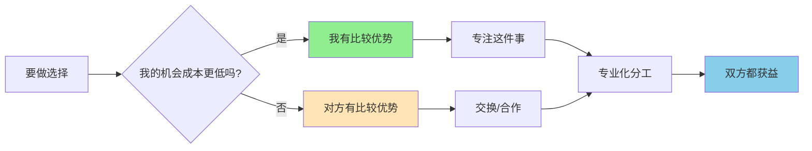
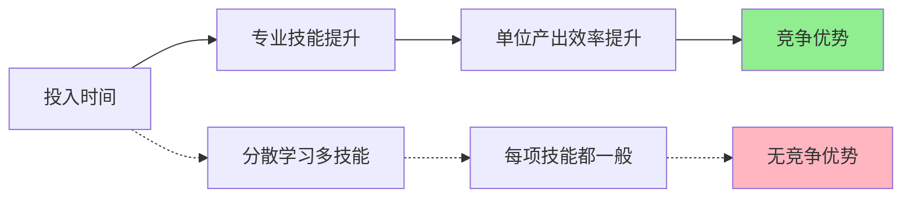

> 专业化的本质，是用你最擅长的事，换取你需要的价值

---

## 小王的困惑：我应该继续"多面手"吗？

小王是一家创业公司的产品经理，技术背景出身。他不仅负责产品规划，还写代码、设计UI、偶尔还帮忙做市场运营。

老板常夸他："你是公司的瑞士军刀，什么都能干！"

小王也觉得全能挺好——至少不会被裁员。

但年底晋升时，技术岗升了技术最强的老张，设计岗升了设计最好的小李，而小王——什么都会，却什么都不是最擅长的，原地踏步。

**为什么"全能型"反而不如"专才"？**

这背后藏着一个经济学核心原理：**比较优势（Comparative Advantage）**。

---

## 比较优势

**定义：** 一个人或国家在生产某种产品时，**机会成本**低于其他人或国家。

**简单说就是：** 即使你在所有事情上都比别人强，你仍然应该专注于你最擅长的事。

### 关键要点

**绝对优势 vs 比较优势**

| 概念 | 定义 | 决策依据 |
|------|------|----------|
| **绝对优势** | 在所有事情上都比别人更高效 | 谁更快/更好 |
| **比较优势** | 在某件事上机会成本更低 | 谁的牺牲更小 |

**举个例子：**

假设你和同事都要做PPT和写代码：

| 人物 | 1小时做PPT页数 | 1小时写代码行数 |
|------|----------------|----------------|
| 你 | 10页 | 100行 |
| 同事 | 5页 | 80行 |

**表面上看：** 你在两件事上都有绝对优势

**但看机会成本：**

| 人物 | 1页PPT的机会成本 | 1行代码的机会成本 |
|------|------------------|------------------|
| 你 | 10行代码 | 0.1页PPT |
| 同事 | 16行代码 | 0.0625页PPT |

**结论：**
- 你在做PPT上有比较优势（机会成本10行 < 16行）
- 同事在写代码上有比较优势（机会成本0.06页 < 0.1页）

**最优分工：** 你做PPT，同事写代码 → **双方都受益**

---

### 为什么专业化让你更值钱？

**1. 学习曲线效应**

**数据支撑：**
- 专注一个领域10000小时 → 成为专家
- 分散到5个领域 → 每个领域2000小时 → 都是新手

**2. 专业化带来的分工收益**

| 维度 | 专业化 | 多能型 |
|------|--------|--------|
| 技能深度 | 深厚，不可替代 | 浅薄，易被替代 |
| 单位效率 | 高（熟能生巧） | 低（频繁切换） |
| 市场价值 | 高（稀缺性） | 低（可替代性） |
| 合作需求 | 必须合作 | 可以独立 |
| 总产出 | **更高（通过交换）** | **更低（独自完成）** |

**历史小知识：** 1776年，亚当·斯密在《国富论》中用"针厂"例子说明分工：10个人分工协作，一天能生产48000枚针；如果每个人独立完成所有工序，一天连20枚针都做不出来。

---

## 比较优势如何塑造经济格局

### 中国制造 vs 德国制造：谁是赢家？

**背景：** 中国和德国都是制造业大国，但发展方向完全不同。

**2023年制造业数据对比：**

| 指标 | 中国 | 德国 |
|------|------|------|
| 制造业增加值 | 4.9万亿美元 | 7500亿美元 |
| 主要优势 | 规模、成本、速度 | 技术、品牌、精密制造 |
| 代表产业 | 纺织、电子组装、新能源设备 | 汽车、机械、精密仪器 |

**表面上看：** 德国在高端制造上有绝对优势

**但中国的比较优势在哪里？**

| 产品 | 中国的机会成本 | 德国的机会成本 | 谁有比较优势？ |
|------|----------------|----------------|----------------|
| 纺织品 | 低（劳动力丰富） | 高（劳动力昂贵） | 中国 |
| 汽车制造 | 中（正在追赶） | 低（技术积累深） | 德国 |
| 新能源电池 | 低（产业链完整） | 高（产业链不完整） | 中国 |

**结果：**
- 中国专注于纺织品、新能源电池等劳动密集型、新兴行业
- 德国专注于汽车、机械等资本密集型、高技术行业
- **双方通过贸易都获得了更大收益**

**关键洞察：**
> 比较优势不是"谁更优秀"，而是"谁的牺牲更小"。中国不需要在所有领域都超越德国，只需要在自己机会成本最低的领域做到最好，然后通过贸易交换其他产品，双方都能获益。

---

### 医生与护士：为什么需要分工？

**背景：** 医院里，医生负责诊断和开处方，护士负责执行护理工作。

**如果医生什么都做？**

| 任务 | 医生亲自做 | 护士做 | 差异 |
|------|------------|--------|------|
| 诊断 | 1小时 | 无法做 | 医生必须做 |
| 输液 | 10分钟 | 10分钟 | 医生时间更贵 |
| 换药 | 15分钟 | 15分钟 | 医生时间更贵 |
| 病历记录 | 30分钟 | 30分钟 | 医生时间更贵 |

**时间成本分析：**

假设：
- 医生时薪500元，护士时薪100元

**医生亲自做护理的成本：**
- 输液（10分钟）= 83元
- 换药（15分钟）= 125元
- 病历（30分钟）= 250元
- **总计：458元**

**护士做同样工作的成本：**
- 输液（10分钟）= 17元
- 换药（15分钟）= 25元
- 病历（30分钟）= 50元
- **总计：92元**

**节省成本：458 - 92 = 366元/天**

**关键洞察：**
> 专业化分工的本质不是"谁会做"，而是"谁做更划算"。医生当然会打针，但医生打针的机会成本是放弃诊断一个病人。通过让护士做护理，医生可以专注诊断，医院的整体效率大幅提升。

---

## 如何用比较优势思维做决策？

### 决策三步法

**步骤1：识别你的比较优势**

问自己：**我在什么事情上，机会成本最低？**

| 问题 | 思考方向 |
|------|----------|
| 我做什么比别人快？ | 效率优势 |
| 我做什么比别人好？ | 质量优势 |
| 我做什么比别人更享受？ | 热情优势（长期可持续） |
| 别人做什么比我更划算？ | 应该外包的事 |

**步骤2：评估交换的可行性**

| 情况 | 建议 |
|------|------|
| 你的比较优势有市场需求 | 专注它，通过合作获取其他需要的东西 |
| 你的比较优势没有市场需求 | 要么调整方向，要么当作副业 |
| 你找不到合作对象 | 小范围内部分工，或用钱购买服务 |

**步骤3：专注你的比较优势**

**行动清单：**
- [ ] 列出你所有会做的事情
- [ ] 评估每件事的机会成本
- [ ] 找到你机会成本最低的1-2件事
- [ ] 将其他事情外包/合作/放弃
- [ ] 持续深化你的比较优势

---

### 常见误区

| 误区 | 正解 |
|------|------|
| "我什么都应该会一点" | 你应该**精深**一件事，其他通过交换获取 |
| "全能型人才更安全" | 专业化才有**不可替代性**，全能型人才最容易被替代 |
| "分工意味着我会失去控制" | 分工让你**专注**高价值活动，整体产出更高 |
| "我还年轻，应该什么都尝试" | 尝试是为了**发现**你的比较优势，不是做"万金油" |
| "外包太贵了" | 算算你的**时间价值**，自己做可能更贵 |

---

## 延伸思考

1. **AI时代的专业化危机**：AI让很多技能变得廉价（写代码、设计、写作），传统意义上的"专业技能"还能维持比较优势吗？未来的比较优势会是什么？

2. **通才vs专才的悖论**：管理者需要"通才"（了解多个领域），但成为通才又可能失去比较优势。如何解决这个悖论？是先专后通，还是先通后专？

3. **国家的产业升级**：中国从"世界工厂"向"科技创新"转型，本质上是比较优势的变化。在这个过程中，哪些行业会受益？哪些行业会被淘汰？

**下期预告：** 我们来探讨**看不见的手**——为什么淘宝比计划经济更繁荣？价格机制如何协调亿万人的行为？

---

**数据来源：** 世界银行、中国统计局、德国联邦统计局、医院管理研究
