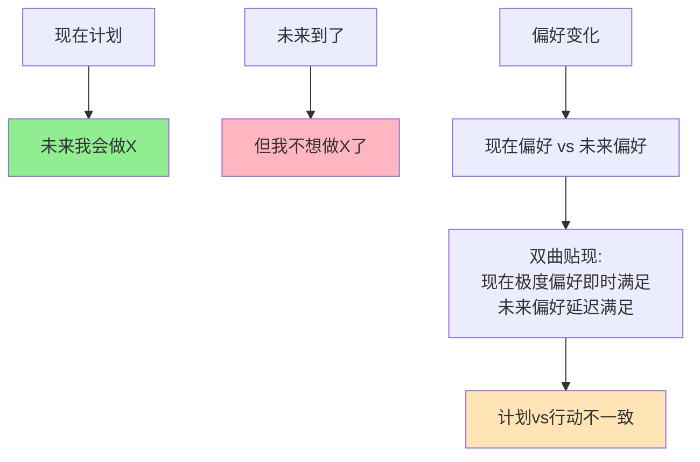

> 跨期选择的自我冲突

---

**数据来源：** 健身房会员使用研究（2019-2023）、分期付款行为研究（2018-2023）、斯特罗茨《时间不一致性偏好》（1955）、拉伊布森《双曲贴现模型》（1997）

## 健身房的年卡悖论

小王想健身，办了年卡2000元。

他想："一年下来，每次只要16元，超值！"

结果：
- 第一个月去了5次
- 第二个月去了2次
- 之后基本不去了

年底一算，每次健身成本 = 2000元/7次 ≈ 285元！

**问题：** 为什么我们总是"雄心勃勃，后继无力"？
**更深的问题：** 为什么"现在的我"和"未来的我"想法不一样？

这背后藏着一个行为经济学核心概念：**时间不一致性（Time Inconsistency）**。

---

## 时间不一致性

**定义：** 人们的偏好随时间变化，导致"现在计划"与"未来行动"不一致。

**简单说就是：** "现在的我"想做的事，"未来的我"不想做。

### 关键要点

**双曲贴现（Hyperbolic Discounting）：**

> 人们对"即时"的贴现率远高于对"未来"的贴现率。

| 时间 | 贴现率 | 说明 |
|------|--------|------|
| **现在 vs 明天** | 极高 | 现在就要！ |
| **明天 vs 后天** | 高 | 明天就要！ |
| **明年 vs 后年** | 低 | 差不多 |

**指数贴现 vs 双曲贴现：**

| 贴现类型 | 贴现模式 | 时间一致性 |
|----------|----------|------------|
| **指数贴现** | 贴现率恒定 | **一致**（经济学假设） |
| **双曲贴现** | 贴现率递减 | **不一致**（现实） |

**承诺机制（Commitment Device）：**

> 为了约束未来的自己，现在采取的行动。

| 机制 | 例子 |
|------|------|
| **强制储蓄** | 自动扣款 |
| **会员制** | 年费（沉没成本） |
| **公开承诺** | 告诉朋友你的目标 |
| **惩罚机制** | 失败的代价 |

**历史小知识：** 时间不一致性由斯特罗茨（1955）和Pollak（1968）提出。Laibson（1997）用双曲贴现模型化。泰勒和Sunstein在《助推》（2008）中讨论了承诺机制。

---

### 为什么时间不一致性如此普遍？

**进化论的解释：**

| 原因 | 说明 |
|------|------|
| **即时生存** | 原始环境需要即时行动 |
| **不确定性** | 未来不确定，现在重要 |
| **自我控制** | 大脑前额叶（理性）vs 边缘系统（冲动） |

**心理机制：**

| 机制 | 影响 |
|------|------|
| **现在偏见** | "现在的我"更重要 |
| **乐观偏差** | "未来的我会更好" |
| **计划谬误** | 低估未来任务的困难 |

---

## 时间不一致性的真实案例

### 健身房年卡

**背景：** 为什么健身房年卡总是"办卡热，去得少"？

**健身房的时间不一致性机制：**

| 机制 | 说明 |
|------|------|
| **现在偏见** | "现在办卡"比"以后每次付钱"更有吸引力 |
| **乐观偏差** | "未来我会经常去" |
| **沉没成本** | 年卡=沉没成本，应该去（但实际不去） |

**"现在的我"vs"未来的我"：**

| 时间点 | 想法 |
|--------|------|
| **办卡时（现在）** | "我会每周去3次，一年下来超值！" |
| **第一周（未来）** | "这周很忙，下周去吧" |
| **第二周（未来）** | "天气不好，下周吧" |
| **...** | ... |
| **年底（未来）** | "算了，明年重新办卡..." |

**数据支撑：**

研究显示：
- 约50%的健身房会员去得少于每月1次
- 约80%的会员去得少于每周1次
- 健身房依赖"办卡热"维持收入（"幽灵会员"）

**关键洞察：**
> 健身房年卡是**时间不一致性的完美案例**：
> - **办卡时**："现在的我"想象"未来的我"会勤奋健身
> - **实际使用时**："未来的我"总是找借口不去
> - **年卡的设计**：利用时间不一致性，锁定收入
> **这不是"非理性"**，而是**自我冲突**：
> - "现在的我"想健身，但"未来的我"想偷懒
> - 年卡是"现在的我"对"未来的我"的承诺机制
> - **但承诺机制失效了**，因为"未来的我"总有借口

---

### 分期付款的诱惑

**背景：** 为什么分期付款让我们买更多？

**分期付款的时间不一致性机制：**

| 机制 | 说明 |
|------|------|
| **现在获得** | "现在的我"立即得到商品 |
| **未来支付** | "未来的我"分期付款 |
| **支付痛苦分离** | 使用和支付的时间分离 |

**"现在 vs 未来"的非对称：**

| 支付方式 | 心理感受 |
|----------|----------|
| **一次性付款** | 现在付大钱，痛苦大 |
| **分期付款** | 现在付小钱，痛苦小 |
| **未来付款** | 现在完全不付，无痛苦 |

**双曲贴现的计算：**

| 选项 | 现在 | 未来 | 选择 |
|------|------|------|------|
| 一次性付1000元 | -1000（大痛苦） | +1000（商品） | 可能不买 |
| 分期12期×100元 | -100（小痛苦）×12 | +1000（商品） | **更容易买** |

**数据支撑：**

研究显示：
- 分期付款使购买意愿增加30-50%
- "0利率分期"使购买意愿增加更多
- 约60%的人会低估分期付款的总成本

**关键洞察：**
> 分期付款利用了**时间不一致性+双曲贴现**：
> - **现在获得，未来支付**："现在的我"得到商品，"未来的我"付钱
> - **支付痛苦分离**：使用和支付的时间分离，降低支付痛苦
> - **双曲贴现**：现在的100元比未来的100元更重要
> **这不是"免费"**，而是**时间借贷**：
> - 你在用"未来的自己"的钱，满足"现在的自己"
> - 商家收取利息（或更高价格）作为"时间成本"
> - **分期付款让"现在的我"更愿意消费**，但"未来的我"要还债。

---

## 如何应对时间不一致性？

### 个人策略

**策略1：承诺机制**

| 机制 | 例子 |
|------|------|
| **强制储蓄** | 自动转账到储蓄账户 |
| **会员制** | 月付而非次付（强制使用） |
| **公开承诺** | 告诉朋友你的目标 |
| **惩罚机制** | StickK（不完成就捐款给讨厌的慈善） |

**策略2：改变支付时间**

| 策略 | 例子 |
|------|------|
| **预付** | 健身房次卡→年卡（但需谨慎） |
| **自动扣款** | 信用卡自动还款 |
| **延迟消费** | "30天法则"（30天后再决定是否购买） |

**策略3：绑定长期目标**

| 策略 | 例子 |
|------|------|
| **愿景可视化** | 想象未来的自己 |
| **长期绑定** | 与长期目标关联（如"为了健康"） |
| **习惯养成** | 将行动变成习惯（降低未来决策成本） |

---

### 企业/政策视角

**利用时间不一致性：**

| 策略 | 例子 |
|------|------|
| **免费试用期** | "现在免费，以后付费" |
| **分期付款** | "现在获得，未来支付" |
| **自动续费** | 默认选项 |

**帮助用户克服时间不一致性：**

| 策略 | 例子 |
|------|------|
| **默认选项** | 自动储蓄（退出而非加入） |
| **承诺机制** | 健身APP的"打卡"功能 |
| **提醒机制** | 到期提醒、自动续费提醒 |

---

## 应用与决策

### 个人决策

| 决策 | 时间不一致性陷阱 | 策略 |
|------|------------------|------|
| 健身 | "现在办卡，以后去" | 月付或次付 |
| 购物 | "现在买，以后付" | 延迟决策 |
| 储蓄 | "以后再存" | 自动扣款 |
| 学习 | "明天开始" | 今天就开始，哪怕5分钟 |

### 商业策略

| 策略 | 时间不一致性应用 |
|------|---------------------|
| 定价 | 分期付款降低"价格门槛" |
| 会员 | 年费锁定未来收入 |
| 营销 | "限时优惠"（现在偏见） |

---

### 常见误区

| 误区 | 正解 |
|------|------|
| "时间不一致性都是非理性的" | 有时反映真实偏好变化 |
| "承诺机制总是有效" | 承诺可能被未来的自己打破 |
| "只有个人有时间不一致性" | 企业、政府也有 |
| "消除时间不一致性就能理性" | 可以管理，无法消除 |

---

## 延伸思考

1. **"未来的自己"的伦理**：我们是否可以为了"现在的自己"而牺牲"未来的自己"？这是"自我剥削"吗？

2. **AI的承诺机制**：当AI能预测"未来的你"的行为，能否帮助设计更有效的承诺机制？还是会创造新的时间不一致性陷阱？

3. **气候变化的时间不一致性**：为什么当代人不愿意为未来世代牺牲？"现在的我们"vs"未来的我们"——如何跨越代际的时间不一致性？

**下期预告：** 我们来探讨**过度自信与控制幻觉**——为什么创业者总是过度乐观？为什么我们总觉得能控制局面？

---

**数据来源：** 健身房会员使用研究（2019-2023）、分期付款行为研究（2018-2023）、斯特罗茨《时间不一致性偏好》（1955）、拉伊布森《双曲贴现模型》（1997）
