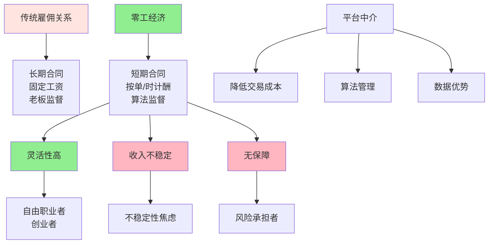

> 平台经济的双刃剑

---

**数据来源：** 外卖骑手研究（2020-2023）、零工经济数据（McKinsey, 2023）、平台工作研究、Tina Brown《零工经济》（2009）、卡西尔·桑斯坦《平台经济》（2016）

## 外卖骑手的困境与自由

小李是一名外卖骑手。

**优势：**
- 时间自由（想接单就接单）
- 不受老板管（没有直属上司）
- 多劳多得（跑单越多，赚得越多）

**劣势：**
- 没有社保、医保
- 收入不稳定（旺季赚钱，淡季亏）
- 算法管理（平台监控、配送时间限制）

**问题：** 为什么零工经济增长如此之快？
**更深的问题：** 平台工作是"自由"还是"陷阱"？

这背后藏着一个经济学概念：**零工经济与平台工作（Gig Economy and Platform Work）**。

---

## 零工经济与平台工作

**定义：**
- **零工经济**：短期、临时、自由职业的工作模式
- **平台工作**：通过数字平台（外卖、网约车、自由职业平台）获得工作

**简单说就是：**
- 零工经济 = "接零活"、"兼职"
- 平台工作 = "平台+自由职业"

### 关键要点

**零工经济的特征：**

| 特征 | 零工经济 | 传统雇佣 |
|------|----------|----------|
| **合同期限** | 短期、临时 | 长期 |
| **收入** | 不稳定 | 稳定 |
| **保障** | 无/少 | 有（社保、医保） |
| **自由度** | 高 | 低 |
| **风险** | 高 | 低 |

**平台工作的特征：**

| 特征 | 说明 |
|------|------|
| **算法管理** | 平台用算法分配任务、监控绩效 |
| **数据驱动** | 平台用数据优化匹配、定价 |
| **网络效应** | 双边市场（司机-乘客、骑手-顾客） |
| **规模经济** | 平台越大，效率越高 |

**效率 vs 公平的权衡：**

| 维度 | 平台优势 | 工人劣势 |
|------|----------|----------|
| **效率** | 匹配效率高 | 被算法控制 |
| **灵活** | 时间自由 | 收入不稳定 |
| **规模** | 规模经济 | 无保障 |

**历史小知识：** 零工经济（Gig Economy）一词由 Tina Brown 于 2009 年提出。平台工作（Uber、Upwork等）是零工经济的数字化形式。

---

### 为什么零工经济增长如此之快？

**技术驱动：**

| 技术 | 影响 |
|------|------|
| **移动互联网** | 随时随地接单 |
| **算法匹配** | 高效匹配供需 |
| **支付系统** | 即时支付 |
| **GPS定位** | 实时追踪 |

**需求驱动：**

| 需求 | 说明 |
|------|------|
| **灵活用工需求** | 企业需要灵活用工（降低成本） |
| **即时需求** | 即时配送、出行 |
| **个性化需求** | 多样化、个性化服务 |

**供给驱动：**

| 供给 | 说明 |
|------|------|
| **失业/不充分就业** | 零工经济提供就业机会 |
| **追求自由** | 年轻人追求"自由"而非稳定 |
| **副业需求** | 主业+副业增加收入 |

---

## 零工经济的真实案例

### 外卖骑手

**背景：** 为什么外卖骑手数量增长如此之快？

**外卖骑手的平台工作特征：**

| 特征 | 说明 |
|------|------|
| **按单计酬** | 多劳多得，无底薪 |
| **算法管理** | 平台分配订单、监控配送时间、评价 |
| **灵活时间** | 想工作就工作，不想休息 |
| **无保障** | 无社保、医保、失业保险 |

**平台算法的双刃剑：**

| 功能 | 优点 | 缺点 |
|------|------|------|
| **订单分配** | 高效匹配 | 算法控制（"不公平"分配） |
| **路线优化** | 减少配送时间 | 更高强度工作 |
| **评价系统** | 激励服务 | 顾客评价压力 |
| **动态定价** | 高峰期价格高 | 收入不稳定 |

**收入分析：**

| 情况 | 月收入 | 时薪 |
|------|--------|------|
| **旺季** | 8000-10000元 | 25-30元/小时 |
| **淡季** | 4000-6000元 | 15-20元/小时 |
| **平均** | 6000-8000元 | 20-25元/小时 |

**成本分析：**

| 成本类型 | 骑手承担 | 平台承担 |
|----------|------------|----------|
| **车辆折旧** | ✅ | ❌ |
| **油费/充电费** | ✅ | ❌ |
| **保险** | ❌ | ❌（商业险有限） |
| **社保/医保** | ❌ | ❌ |
| **风险（事故）** | ✅ | ❌（部分） |

**数据支撑：**

研究显示：
- 外卖骑手月均收入约6000-8000元
- 但工作时长达10-12小时/天
- 约60%骑手没有社保/医保
- 职业受伤率是制造业的3-5倍

**关键洞察：**
> 外卖骑手的平台工作是**灵活性+算法控制+风险承担**的组合：
> - **灵活性**：工作时间自由，多劳多得
> - **算法控制**：平台通过算法分配订单、监控绩效
> - **风险承担**：骑手承担车辆、保险、意外风险
> - **这看似"自由"**：
>   - 没有老板，但有"算法"
>   - 可以选择工作时间，但收入不稳定
> - **平台算法的双刃剑**：
>   - 一方面：提高匹配效率、降低交易成本
>   - 另一方面：控制骑手行为、榨取剩余价值
> - **零工经济的"效率vs 公平"**：
>   - **效率**：平台匹配效率高，消费者享受便利
>   - **公平**：骑手承担风险，平台获得利润
>   - **自由职业者"还是"算法劳工**？
>     - 名义上是"自由职业者"
>     - 实际上是"算法控制的劳工"
>   - **对零工经济的启示**：
>     - **"自由"是有代价的**：无保障、不稳定、风险高
>     - **平台创造价值**：降低交易成本、提高匹配效率
>     - **但需要监管**：保护骑手权益、算法透明

---

### 滴滴司机、Upwork自由职业

**背景：** 为什么越来越多人选择平台自由职业？

**网约车司机的平台工作：**

| 特征 | 说明 |
|------|------|
| **时间自由** | 想开就开，不想开休息 |
| **收入透明** | 收入实时可见 |
| **无老板** | 平台分配订单，但无直属监督 |
| **车费自理** | 油费、维修、折旧 |

**自由职业者的困境：**

| 困境 | 说明 |
|------|------|
| **收入不稳定** | 旺季多，淡季少 |
| **无保障** | 无社保、医保、失业保险 |
| **孤独感** | 缺乏同事、团队 |
| **自我激励** | 需要自我约束 |

**平台的价值：**

| 价值 | 说明 |
|------|------|
| **降低交易成本** | 连接司机-乘客、客户-自由职业者 |
| **信任机制** | 评价系统、双向评价 |
| **支付保障** | 平台担保、自动扣款 |

**数据支撑：**

| 平台 | 用户数 | 自由职业者数 |
|------|--------|--------------|
| **滴滴** | 5亿+ | 数百万司机 |
| **Upwork** | 1200万+ | 1200万自由职业者 |
| **Fiverr** | 400万+ | 数十万自由职业者 |

**关键洞察：**
> 平台自由职业是**交易成本降低+算法管理+网络效应**的组合：
> - **交易成本降低**：平台连接供需，降低搜索、谈判、支付成本
> - **信任机制**：评价系统、担保制度创造信任
> - **网络效应**：平台越大，价值越高（用户多→自由职业者多→用户多...）
> - **但这创造了新的"依赖"**：
>   - 自由职业者依赖平台（失去直接客户关系）
>   - 平台抽取佣金（10-20%）
>   - 算法控制匹配、定价
> - **平台工作的"自由幻觉"**：
>   - 名义上是"自由职业"
>   - 实际上是"平台依赖"
> - **零工经济的未来**：
>   - **增长趋势**：零工经济将继续增长（技术驱动、需求驱动）
>   - **监管需求**：需要保护零工权益（社保、算法透明）
>   - **分类监管**：区分"零工"和"员工"，提供相应保障

---

## 如何应对零工经济？

### 个人策略

**策略1：计算"真正"的时薪**

| 计算 | 说明 |
|------|------|
| **总收入** | 包括所有来源 |
| **总时间** | 包括准备、等待、工作时间 |
| **成本** | 包括车辆、设备、保险、社保 |

**策略2：建立"财务缓冲"**

| 策略 | 说明 |
|------|------|
| **储蓄** | 淡季收入缓冲 |
| **保险** | 商业保险、社保自行购买 |
| **多渠道收入** | 不依赖单一平台 |

**策略3：投资"人力资本"**

| 投资 | 说明 |
|------|------|
| **技能提升** | 提高时薪、竞争力 |
| **品牌建设** | 建立个人品牌 |
| **网络** | 建立客户网络，降低平台依赖 |

---

### 企业/政策

**策略1：提供"混合"工作模式**

| 模式 | 说明 |
|------|------|
| **核心+零工** | 核心员工+零工补充 |
| **灵活用工** | 根据需求灵活调整 |
| **项目制** | 项目团队，而非固定部门 |

**策略2：保障零工权益**

| 措施 | 说明 |
|------|------|
| **算法透明** | 平台公开算法逻辑 |
| **社保覆盖** | 为零工提供社保、医保 |
| **集体谈判** | 允许零工集体谈判 |

---

## 应用与决策

### 个人决策

| 决策 | 零工经济视角 |
|------|----------------|
| 职业选择 | 评估"自由"的价值vs 成本 |
| 平台选择 | 选择佣金低、流量大的平台 |
| 风险管理 | 建立财务缓冲、保险 |

### 企业/政策

| 策略 | 零工经济应用 |
|------|---------------------|
| 用工策略 | 核心员工+灵活用工组合 |
| 政策设计 | 保护零工权益，不抑制创新 |

---

### 常见误区

| 误区 | 正解 |
|------|------|
| "零工经济=自由" | 有自由，但也有风险、不稳定 |
| "平台总是剥削" | 平台创造价值，但也需监管 |
| "零工会取代传统雇佣" | 两种模式会共存 |
| "零工经济总是坏事" | 提供灵活性、就业机会 |

---

## 延伸思考

1. **AI时代的零工经济**：当AI能完成更多任务，零工经济会如何变化？AI是否会成为"超级平台"（直接连接供需，消除中介）？

2. **全球零工平台**：Upwork、Fiverr等全球零工平台创造了"全球劳动力套利"。这是否会导致发达国家工人工资下降？还是会创造新机会？

3. **零工的"阶级固化"**：零工经济是否创造了"零工阶级"（无保障、不稳定）？如何防止零工经济的"不平等"？

**下期预告：** 模块六（劳动与人力资本）5篇完成！接下来进入**模块七：宏观经济与周期**。我们将探讨**GDP与经济增长**——中国增长模式有何特点？硅谷创新的源泉是什么？

---

**数据来源：** 外卖骑手研究（2020-2023）、零工经济数据（McKinsey, 2023）、平台工作研究、Tina Brown《零工经济》（2009）、卡西尔·桑斯坦《平台经济》（2016）
