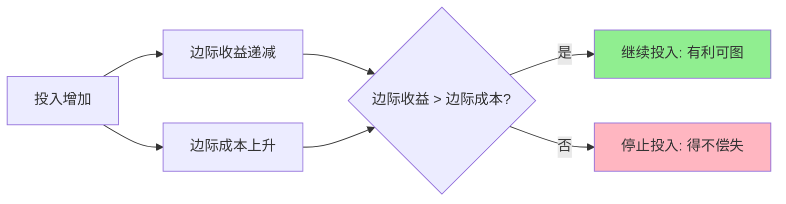

> 努力不等于成果，多投入不一定多回报

---

## "这周加了五天班，项目进度反而慢了"

小李是某互联网公司的产品经理，面对KPI压力，他选择了"996"——早上9点上班，晚上9点下班，一周工作6天。起初效果显著，产品迭代速度明显加快。但一个月后，他发现问题：代码bug率上升、会议决策效率下降、团队成员纷纷请假...

**为什么更努力了，产出反而变少了？**

很多人相信"只要努力就有回报"，但经济学告诉我们一个反直觉的真相：**决定你决策质量的，不是总量，而是边际量。**

---

## 什么是边际思维？

**边际收益（Marginal Benefit）**：每多增加一单位投入带来的额外收益

**边际成本（Marginal Cost）**：每多增加一单位投入产生的额外成本

**简单说就是：** 决策时不要看"总量够不够"，而要看"多这一点值不值"。

**黄金法则：**
> 当边际收益 > 边际成本时，继续投入；当边际收益 < 边际成本时，停止投入。

### 一个直观的例子：吃包子

- 第一个包子：特别香（边际收益高）
- 第五个包子：有点撑（边际收益降低）
- 第十个包子：痛苦（边际收益为负）

这就是**边际收益递减规律**：在其他条件不变的情况下，连续增加某一投入，每新增一单位投入带来的收益会逐渐减少。

### 关键要点

| 思维方式 | 错误思维 | 边际思维 |
|----------|----------|----------|
| 决策依据 | "总量够不够" | "多这一点值不值" |
| 工作时长 | "工作时间越长越好" | "加班1小时带来的产出 > 成本吗" |
| 产品功能 | "功能越多越好" | "这个新增功能用户愿意付费吗" |

---

## 边际思维如何影响决策

### 996的边际陷阱

**背景：** 2019年，互联网行业掀起996讨论热潮。马云称"996是修来的福报"，但实际效果如何？

**边际分析：**

| 工作时长 | 日产出 | 边际产出 | 累计产出 |
|----------|--------|----------|----------|
| 8小时 | 100% | - | 100% |
| 10小时 | 120% | +20% | 120% |
| 12小时 | 130% | +10% | 130% |
| 14小时 | 135% | +5% | 135% |
| 16小时 | 130% | -5% | 130% |

**数据支撑：**
- 根据斯坦福大学（John Pencavel, 2014）发表在《The Economic Journal》的研究显示：每周工作超过50小时后，每小时产出急剧下降；超过55小时，产出增加几乎为零；超过70小时，**总产出反而下降**

**996的真实边际成本：**
- 健康成本：长期疲劳、亚健康
- 创意成本：大脑疲劳导致创新能力下降
- 人员成本：员工离职率上升
- 机会成本：用来学习和成长的时间被占用

**关键洞察：**
> 第1个小时的加班可能高效，但第5个小时的加班不仅产出低，还会损害第二天的工作状态。996的问题不是"累"，而是**边际收益早已低于边际成本**。

---

### Amazon Prime 的定价艺术

**背景：** 2005年，Amazon推出Prime会员服务，年费79美元（现在是139美元）。这个定价是如何确定的？

**Amazon的边际思维分析：**

| 定价选项 | 预计会员数 | 年收入 | 边际收益分析 |
|----------|------------|--------|--------------|
| $49 | 2亿人 | $98亿 | 单价低，但运营成本高 |
| $79 | 1.5亿人 | $118.5亿 | **平衡点** |
| $99 | 1亿人 | $99亿 | 收入下降 |

**关键洞察：**
- Amazon不是计算"利润最大化的价格"，而是计算"用户增长与利润的最佳平衡点"
- $79的定价，让**新增一个会员的边际收益 ≈ 边际成本**
- 免运等服务对Amazon的边际成本很低（仓储物流已有规模效应）

**结果：**
Prime会员数从2005年的数十万增长到2023年的超过2亿，成为Amazon生态的核心护城河。

---

## 如何用边际思维改善决策？

### 决策三步法

**步骤1：识别边际量**
问自己：再增加一个单位投入（时间、金钱、功能），能带来多少额外收益？

**步骤2：比较边际收益与边际成本**

| 类型 | 包含内容 |
|------|----------|
| 边际收益 | 额外产出、额外收入、额外满足感 |
| 边际成本 | 额外时间、额外精力、隐形成本 |

**步骤3：找到停止点**
当边际收益 < 边际成本时，停止投入。

---

### 常见误区

| 误区 | 正解 |
|------|------|
| "我已经投入了这么多，不能停" | 这是**沉没成本谬误**，应该看边际收益 |
| "多做多得" | 只在**边际递减前**成立 |
| "功能越多越好" | 功能的**边际价值**会快速下降 |
| "规模越大越好" | 超过临界点后，**边际成本 > 边际收益** |

---

## 延伸思考

1. **学习的边际收益**：为什么有时候"学会"一个技能只需要20小时，但"精通"需要10000小时？什么时候该停止追求完美？

2. **社交的边际成本**：为什么企业家都要维护人脉，但马斯克说"我基本不社交"？社交的边际收益何时递减？

3. **AI时代的边际革命**：当AI让很多任务的边际成本趋近于0，我们的价值在哪里？

**下期预告：** 我们来探讨**激励机制设计**——为什么KPI设计不当会适得其反？Google的20%时间制度为什么能孵化出Gmail？阿里、腾讯的绩效体系有何不同？

---

**数据来源：** 斯坦福大学（John Pencavel, 2014, "The Productivity of Working Hours"）、Amazon 2023年财报、智联招聘《2023年职场加班现状报告》
