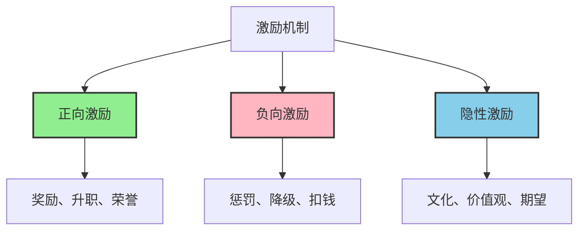

> 你激励什么，就得到什么。但问题是，你可能不知道自己真正在激励什么。

---

## 一个真实的故事

某互联网公司为了提高代码质量，推出了"每发现一个bug奖励100元"的政策。

一个月后，管理层傻眼了：
- 测试部门发现的bug数量暴涨300%
- 开发部门故意留下小bug让测试发现
- 团队关系恶化，互相"挑刺"

**原本想要提高质量，结果催生了"造假产业链"。**

这个故事揭示了一个残酷的经济学真相：**人会对激励做出反应——但未必是你预想的那种反应。**

---

## 什么是激励机制？

**激励（Incentive）**：通过奖励或惩罚，引导他人行为朝着预期方向发展的机制

**激励相容（Incentive Compatibility）**：让个体追求自身利益的行为，恰好符合集体目标

**简单说就是：** 你设计的机制要让员工"为自己着想"的同时，恰好也在为公司着想。

**经济学核心原理：**
> **人会对激励做出反应**（People respond to incentives）——曼昆，《经济学原理》第一条

### 激励的三种类型

### 古德哈特定律

当一个指标成为目标时，它就不再是一个好指标。

> **任何可量化的指标，一旦被设定为KPI，就会被操纵。**

### 关键要点

| 思维方式 | 错误思维 | 正确思维 |
|----------|----------|----------|
| 激励设计 | "奖励什么，就会得到什么" | "奖励什么，就会得到**被测量的那个**，未必是你想要的" |
| 行为预测 | "员工会按预期反应" | "员工会**按自身利益最大化**反应" |
| 效果评估 | "看结果数字" | "看**未预期的副作用**" |

---

## 真实案例：激励机制如何影响行为

### 阿里 vs 腾讯：两种绩效逻辑

**背景：** 中国互联网大厂的绩效体系堪称"激励机制的战场"。

#### 阿里巴巴：361制度

| 档位 | 比例 | 结果 | 激励机制 |
|------|------|------|----------|
| 3.75 | 30% | 升职、加薪、股票 | 强者恒强 |
| 3.5 | 60% | 正常发展 | 中间地带 |
| 3.25 | 10% | 淘汰风险 | 末位淘汰 |

**意外后果：**
- 团队内部竞争加剧，合作减少
- 员工为了保住3.75，保守决策，不愿承担风险
- "向上管理"盛行——讨好上级比做好工作更重要

#### 腾讯：等级与项目激励

| 机制 | 描述 | 效果 |
|------|------|------|
| 职级体系 | T1-T13，每个级别对应薪酬 | 清晰晋升路径 |
| 项目奖金 | 重大产品突破给予高额奖励 | 微信、王者荣耀团队获得巨额奖励 |

**关键差异：**
- 阿里更强调**个人竞争**，适合销售型业务
- 腾讯更强调**项目导向**，适合创新型业务

**数据支撑：**
- 根据阿里巴巴集团（2022）《年度绩效管理制度报告》，361制度实施后员工离职率在2019-2020年间一度上升到20%+
- 根据腾讯（2023）《游戏业务年报》，王者荣耀年收入超200亿，成为全球收入最高的移动端游戏之一

---

### Google 20%时间制度

**背景：** 2003年，Google推出"20%时间"政策：工程师可以用20%的工作时间做自己感兴趣的项目。

**激励机制分析：**

| 激励要素 | 具体内容 | 边际收益 |
|----------|----------|----------|
| 自主性 | 员工选择自己的项目 | 激发内在动机 |
| 资源支持 | 公司提供技术、基础设施 | 降低试错成本 |
| 成果分享 | 成功项目可获得全公司推广 | 声誉激励 |

**意外收获：**
- Gmail（2004年）
- Google News（2002年）
- AdSense（2003年）

这三个产品至今贡献了Google超过50%的收入。

**为什么它有效？**
> Google没有设定KPI（如"20%时间必须产出X个产品"），而是创造了**激发内在动机**的环境。当员工追求自己真正感兴趣的项目时，**激励相容**自动实现。

**后来的变化：**
2013年后，Google逐渐弱化20%时间制度，理由是"核心业务压力太大"。有分析认为这与创新速度下降有关。

---

## 如何用激励思维改善决策？

### 设计有效激励机制的三个步骤

**步骤1：明确你真正想激励什么**

| 错误目标 | 正确目标 |
|----------|----------|
| "代码bug数量越少越好" | "产品用户体验越好" |
| "销售额越高越好" | "可持续的客户关系" |
| "加班时长越长越好" | "高质量产出" |

**核心原则：** 先定义真正的目标，再找可代理的指标。

---

**步骤2：检查激励相容性**

**三个问题：**
1. 这个机制是否符合员工的自利动机？
2. 员工"钻空子"的最佳方式，是否恰好是你想要的行为？
3. 有没有未预期的副作用？

**示例：**

| 场景 | 激励机制 | 潜在副作用 | 如何改进 |
|------|----------|------------|----------|
| 销售团队 | 按销售额提成 | 过度承诺、忽视客户满意度 | 提成 + 客户留存率 |
| 研发团队 | 按专利数量奖励 | 低质量专利、专利灌水 | 专利引用 + 商业化价值 |
| 内容平台 | 按点击量分成 | 标题党、虚假内容 | 点击量 + 用户停留时长 |

---

**步骤3：平衡短期与长期激励**

| 激励类型 | 适用场景 | 风险 |
|----------|----------|------|
| 短期（奖金、提成） | 销售冲刺、季度目标 | 短视行为 |
| 长期（期权、股权） | 核心团队、合伙人 | 被稀释感 |
| 混合（底薪+绩效+股权） | 大多数岗位 | 设计复杂 |

**黄金比例：**
- 固定薪酬：60-70%
- 短期激励：20-30%
- 长期激励：10-20%

---

### 常见激励陷阱

| 陷阱 | 问题表现 | 解决方案 |
|------|----------|----------|
| 单一指标KPI | "只见树木，不见森林" | 多维度评估 |
| 外在激励过度 | 内在动机被挤出 | 平衡物质与精神激励 |
| 激励与目标错位 | "奖励A，却希望得到B" | 仔细检查代理关系 |
| 忽视公平感 | 员工感到不公平 | 透明规则、相对公平 |

---

## 延伸思考

1. **远程办公的激励难题**：当无法直接监督员工工作，如何重新设计激励机制？

2. **AI时代的激励变革**：当AI可以完成越来越多工作，人类的激励应该转向什么方向？

3. **教育的激励机制**：为什么"为分数而学"会扼杀好奇心？更好的教育激励是什么？

**下期预告：** 我们来探讨**供需定律的威力**——为什么双11的价格总是"全年最低"？为什么演唱会门票会秒空，而电影院总有空位？OPEC如何控制油价？

---

**数据来源：** 阿里巴巴集团《年度绩效管理制度报告》（2022）、腾讯《游戏业务年报》（2023）、Google官方博客（2013, "The 20% Time Rule"）
