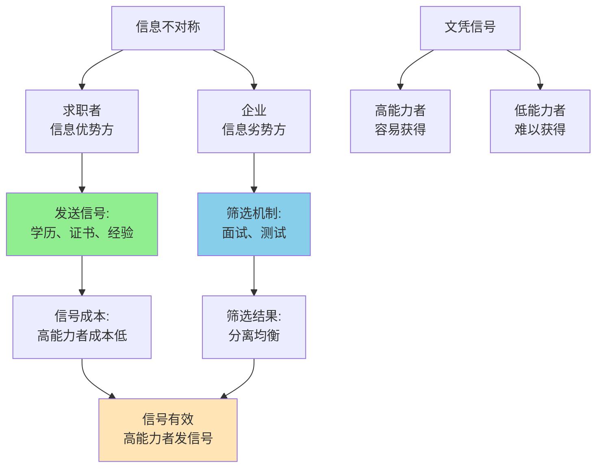

> 学历不只是能力，更是信号

---

**数据来源：** 985/211毕业生收入研究（2018-2023）、常春藤效应研究、信号与筛选理论文献、迈克尔·斯彭斯《劳动力市场中的信号》（1973）、约瑟夫·斯蒂格利茨《筛选理论》（1975）

## 简历筛选的"985/211"门槛

某互联网大厂招聘HR："我们只招985/211毕业生。"

小王（普通一本，能力强）："为什么不给我机会面试？"
HR："我们简历太多，985/211是一个筛选标准。"

**问题：** 为什么企业用"985/211"作为筛选标准？
**更深的问题：** 为什么"信号"比"实际能力"更重要？

这背后藏着一个经济学核心概念：**信号与筛选（Signaling and Screening）**。

---

## 信号与筛选

**定义：**
- **信号（Signaling）**：信息优势方通过可观察的行为传递信息
- **筛选（Screening）**：信息劣势方设计机制，让信息优势方自我选择

**简单说就是：**
- 信号 = "我做这件事证明我有能力"
- 筛选 = "我设计测试，让你自我暴露能力"

### 关键要点

**信号理论（Signaling Theory）：**

> 迈克尔·斯彭斯1973年提出，用于解释劳动力市场。

| 信号 | 发送者 | 接收者 | 有效性 |
|------|--------|--------|--------|
| **学历** | 求职者 | 企业 | ✅ 有效（如果是筛选性教育） |
| **证书** | 专业人士 | 客户 | ✅ 有效（如果严格） |
| **推荐信** | 申请人 | 学校/公司 | ⚠️ 部分有效 |
| **外表** | 申请人 | HR | ❌ 无效（歧视） |

**筛选机制（Screening Mechanism）：**

| 机制 | 设计者 | 目的 |
|------|--------|------|
| **简历筛选** | HR | 快速淘汰不合格者 |
| **测试** | 企业 | 直接测试能力 |
| **试用期** | 企业 | 观察实际表现 |
| **学历要求** | 企业 | 利用教育系统筛选 |

**分离均衡（Separating Equilibrium）：**

> 好的信号机制能让高能力和低能力者选择不同的行为，从而区分。

| 能力 | 发送信号的成本 | 决策 |
|------|----------------|------|
| **高能力** | 低（容易获得985学位） | 发送信号（读985） |
| **低能力** | 高（难以获得985学位） | 不发送信号（不读985） |

**历史小知识：** 迈克尔·斯彭斯1973年提出信号理论，2001年获诺贝尔经济学奖。约瑟夫·斯蒂格利茨1975年提出筛选理论，2001年获诺贝尔经济学奖。

---

### 为什么信号如此重要？

**信息不对称问题：**

| 问题 | 说明 |
|------|------|
| **隐藏特征** | 求职者知道自己能力，企业不知道 |
| **隐藏行动** | 工作后，企业不知道员工是否努力 |
| **隐藏信息** | 员工知道自己是否想长期工作 |

**信号的作用：**

| 作用 | 说明 |
|------|------|
| **降低不确定性** | 信号提供能力证明 |
| **降低交易成本** | 简历筛选比能力测试更便宜 |
| **社会排序** | 学历提供社会地位信号 |

---

## 信号与筛选的真实案例

### 985/211学历信号

**背景：** 为什么985/211学历如此重要？

**学历作为信号的机制：**

| 机制 | 说明 |
|------|------|
| **能力信号** | 985/211=高能力（统计上） |
| **筛选信号** | 高考筛选=已经过一次筛选 |
| **社会信号** | 985/211=社会地位 |

**为什么985/211是有效信号？**

| 特征 | 说明 |
|------|------|
| **成本差异** | 对高能力者成本低（容易考上），对低能力者成本高（难考上） |
| **可观察性** | 容易验证（真假学历可查） |
| **合法性** | 社会接受、法律允许 |

**筛选均衡：**

| 能力 | 高考选择 | 大学选择 | 信号 |
|------|----------|----------|------|
| **高能力** | 努力 | 985/211 | ✅ 发送信号 |
| **中能力** | 努力 | 普通一本 | ⚠️ 部分信号 |
| **低能力** | 不努力 | 不上大学 | ❌ 无信号 |

**数据支撑：**

研究显示：
- 985/211毕业生平均收入比普通一本高30-50%
- 但能力差距可能只有10-20%
- **溢价中约50%是"信号溢价"，而非"能力溢价"**

**关键洞察：**
> 985/211学历的价值是**能力+信号+筛选**的组合：
> - **能力信号**：统计上，985/211学生能力更高
> - **筛选信号**：高考已经筛选过一次
> - **社会信号**：社会地位、人脉网络
> - **这是"分离均衡"**：
>   - 高能力者更容易获得985/211学位
>   - 低能力者难以获得（或成本高）
>   - 所以985/211=能力信号
> - **但这不完美**：
>   - 有些985/211学生能力一般
>   - 有些普通一本学生能力很强
>   - **但统计上，985/211是一个"合理"的筛选标准**
> **对人力资本投资的启示**：
> - **学历不仅是"能力"，更是"信号"**
> - **投资学历=投资"可观察的信号"**
> - **但也可以投资其他信号**（证书、作品、经验）

---

### 常春藤效应

**背景：** 为什么常春藤毕业生收入更高？

**常春藤效应的信号机制：**

| 机制 | 说明 |
|------|------|
| **能力信号** | 常春藤=高能力（统计上） |
| **人脉网络** | 常春藤=精英网络 |
| **品牌效应** | 常春藤=社会地位 |

**收入对比：**

| 学校类型 | 毕业生20年后收入 |
|----------|------------------|
| **常春藤** | $100,000+ |
| **其他顶尖私立** | $80,000+ |
| **公立旗舰大学** | $70,000+ |
| **其他大学** | $50,000+ |

**常春藤的"超额收益"分析：**

| 收益来源 | 说明 |
|----------|------|
| **能力差异** | 常春藤学生能力更强 |
| **人脉网络** | 常春藤校友网络 |
| **品牌效应** | 常春藤品牌本身 |
| **地理优势** | 常春藤多在城市/精英地区 |

**数据支撑：**

研究显示：
- 常春藤毕业生收入比其他大学高约30-50%
- 但能力差异只能解释约15-25%
- **约一半的"常春藤溢价"是"品牌+人脉"**
- 而非"能力"本身

**关键洞察：**
> 常春藤效应是**能力+品牌+人脉**的组合：
> - **能力**：常春藤招生严格，学生能力强
> - **品牌**：常春藤品牌本身就有价值
> - **人脉**：校友网络是巨大资源
> - **这超出"纯信号"**：
>   - 常春藤不只是"信号能力"
>   - 更是"提供实际价值"（人脉、品牌）
> - **常春藤的"筛选"更严格**：
>   - 不只看成绩，还看"全面发展"
>   - 不只看"现在能力"，还看"未来潜力"
> - **对人力资本投资的启示**：
>   - **顶尖学校的价值不只是"教育"，更是"网络"**
>   - **"你认识谁"有时比"你学什么"更重要**
>   - **但也警惕"品牌迷信"**：有些成功来自个人能力，而非学校品牌

---

## 如何利用信号与筛选？

### 个人策略：发送有效信号

**策略1：投资"硬信号"**

| 信号 | 有效性 |
|------|--------|
| **学历** | ✅ 有效（如果来自筛选性学校） |
| **证书** | ✅ 有效（如果严格、难获得） |
| **作品集** | ✅ 有效（直接展示能力） |
| **推荐信** | ⚠️ 部分有效（取决于推荐人） |

**策略2：建立"个人品牌"**

| 策略 | 说明 |
|------|------|
| **开源贡献** | GitHub、论文、博客 |
| **竞赛获奖** | ACM、数学建模等 |
| **项目经验** | 实际项目、实习 |
| **社交媒体** | 专业账号（LinkedIn等） |

**策略3：利用"分离均衡"**

| 策略 | 说明 |
|------|------|
| **选择"困难"路径** | 选择能证明能力的路径 |
| **展示"承诺"** | 投入时间、金钱证明承诺 |
| **持续学习** | 显示持续学习能力 |

---

### 企业策略：设计筛选机制

**策略1：多阶段筛选**

| 阶段 | 筛选方式 |
|------|----------|
| **简历筛选** | 学历、经验、证书 |
| **能力测试** | 笔试、在线编程测试 |
| **面试** | 行为面试、技术面试 |
| **试用期** | 实际工作表现 |

**策略2：设计"自我选择"机制**

| 机制 | 说明 |
|------|------|
| **低底薪+高奖金** | 高能力者愿意接受（风险偏好） |
| **长期合同** | 高能力者愿意承诺（风险偏好） |
| **绩效工资** | 高能力者愿意接受（绩效偏好） |

---

## 应用与决策

### 个人决策

| 决策 | 信号策略 |
|------|----------|
| 教育选择 | 选择"信号强"的学校/专业 |
| 技能学习 | 投资"可验证"的技能（证书） |
| 职业选择 | 选择"信号清晰"的职业 |

### 企业/政策

| 策略 | 信号/筛选应用 |
|------|---------------------|
| 招聘 | 多阶段筛选 |
| 培训 | 提供认证、证书 |
| 晋升 | 基于绩效（而非信号） |

---

### 常见误区

| 误区 | 正解 |
|------|------|
| "信号=能力" | 信号只是"能力的证明" |
| "最好的信号是学历" | 最有效信号是"直接展示能力" |
| "所有信号都有效" | 只有"有成本"的信号才有效 |
| "消除信号就能公平" | 信号降低交易成本，但可能不公平 |

---

## 延伸思考

1. **AI时代的"信号"**：当AI能测试实际能力，学历信号还会重要吗？还是会出现新的"信号"（AI竞赛、开源贡献）？

2. **"假信号"的泛滥**：当学历证书可以"买到"、"刷单"可以造假，信号的"有效性"下降了吗？如何设计"防伪"机制？

3. **证书通胀**：当所有人都有"证书"，证书的信号价值下降。这是否会导致"学历通胀"、"证书军备竞赛"？

**下期预告：** 我们来探讨**委托代理问题**——为什么国企高管薪酬备受争议？硅金手铐如何留住人才？

---

**数据来源：** 985/211毕业生收入研究（2018-2023）、常春藤效应研究、信号与筛选理论文献、迈克尔·斯彭斯《劳动力市场中的信号》（1973）、约瑟夫·斯蒂格利茨《筛选理论》（1975）
