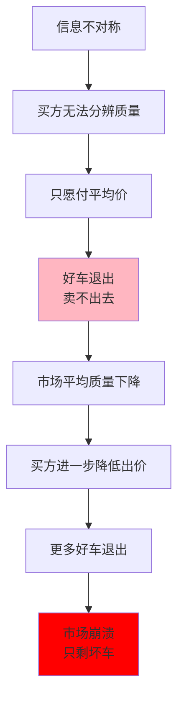

> 信息不对称会摧毁一个市场

---

## 买车人的噩梦

小王想买一辆二手车，预算10万。

他在二手车市场看中了几辆车：
- 车A：8万，看起来不错
- 车B：10万，车况很好
- 车C：5万，有点小问题

小王很纠结：
- "车A看起来不错，但会不会有大问题？"
- "车B价格高，但真的值得吗？"
- "车C便宜，但维修成本会不会很高？"

最后小王决定不买了——**他根本无法分辨哪辆车是真正的好车。**

**问题：** 为什么二手车市场充满怀疑？为什么好车也卖不出好价格？

这背后藏着一个经济学经典问题：**柠檬市场（Lemons Market）**。

---

## 柠檬市场

**定义：** 信息不对称导致劣质产品驱逐优质产品的市场。

**简单说就是：** 当买方无法区分产品质量时，只愿意付"平均质量"的价格，结果好车退出市场，只剩下坏车。

### 关键要点

**1. 信息不对称（Information Asymmetry）**

| 类型 | 定义 | 例子 |
|------|------|------|
| **事前不对称** | 交易前，一方知道另一方不知道的信息 | 二手车卖家知道车况，买家不知道 |
| **事后不对称** | 交易后，一方行为无法被另一方观察 | 买了保险后更不谨慎（道德风险） |

**2. 逆向选择（Adverse Selection）**

> 信息不对称导致"坏"的参与者更可能参与交易，"好"的参与者退出。

| 市场 | 信息不对称 | 逆向选择结果 |
|------|------------|--------------|
| 二手车 | 卖家知道车况 | 好车退出，只剩坏车 |
| 保险 | 投保人知道自己健康 | 不健康的人更愿意投保 |
| 信贷 | 借款人知道自己还款能力 | 高风险借款人更愿意借款 |

**3. 信号传递（Signaling）**

> 拥有信息的一方通过可观察的行为传递信息。

| 信号 | 发送者 | 接收者 | 有效性 |
|------|--------|--------|--------|
| **保修承诺** | 好车卖家 | 买家 | ✅ 有效（坏车不敢承诺） |
| **学历** | 求职者 | 雇主 | ✅ 有效（筛选能力强的人） |
| **品牌** | 企业 | 消费者 | ✅ 有效（建立信任） |

**历史小知识：** 乔治·阿克洛夫（George Akerlof）1970年在《经济学季刊》（Quarterly Journal of Economics）发表经典论文《"柠檬"市场：质量不确定性与市场机制》（"The Market for 'Lemons': Quality Uncertainty and the Market Mechanism"），开创了信息经济学研究。2001年，他与斯宾塞、斯蒂格利茨共同获得诺贝尔经济学奖。

---

### 为什么柠檬市场难以避免？

**问题的根源：**

| 困难 | 说明 |
|------|------|
| **质量难以观察** | 需要专业知识或长期使用才能发现 |
| **信任成本高** | 验证信息的成本可能超过商品价值 |
| **坏人有激励伪装** | 卖坏车的人会伪装成好车 |

**市场的反应：**

| 反应 | 效果 |
|------|------|
| **降低出价** | 买家只愿付"预期质量"的价格 |
| **退出市场** | 好车卖家因价格低退出 |
| **中介介入** | 专业检测、品牌认证 |
| **制度解决** | 保修、退货、法律保护 |

---

## 柠檬市场的真实案例

### 二手车市场的困境

**背景：** 为什么二手车市场充满不信任？

**信息不对称的循环：**

| 买家想法 | 结果 | 市场变化 |
|----------|------|----------|
| "可能是坏车" | 只愿付6万（平均价） | 好车（价值8万）退出 |
| "市场上都是坏车" | 只愿付4万 | 中等车（价值6万）退出 |
| "只敢买便宜车" | 只愿付2万 | 只剩坏车（价值2万） |

**数据支撑：**

根据美国联邦贸易委员会（FTC, 2019）《二手车市场调查报告》和Akerlof（1970）的研究：
- 二手车卖家出售的车辆中，约30%存在未披露的严重问题（"柠檬"）
- 买家出价通常比市场平均价低20-30%以对冲风险
- 约20%车况良好的二手车因价格过低而退出市场

根据《中国共享经济发展报告（2023）》数据：
| 年份 | 直播带货市场规模 | 头部主播粉丝数 |
|------|------------------|----------------|
| 2019 | 4338亿 | 数百万 |
| 2022 | 3.5万亿 | 数千万 |
| 2023 | 4.9万亿 | 上亿 |

**解决机制：**

| 机制 | 如何解决 | 效果 |
|------|----------|------|
| **第三方检测** | 专业验车 | 降低信息不对称 |
| **品牌认证** | 4S店认证二手车 | 建立信任 |
| **保修承诺** | 坏车不敢承诺 | 信号传递 |
| **平台担保** | 淘宝"先行赔付" | 降低风险 |

**关键洞察：**
> 二手车市场的困境展示了**信息不对称的毁灭性力量**。当买家无法分辨好坏，理性选择是"假设都是坏的"，结果是好车被驱逐出市场。**解决之道是建立"信任机制"**：第三方检测、品牌认证、保修承诺——这些都降低了信息不对称，让好车能够卖出好价格。

---

### 直播带货的信任游戏

**背景：** 为什么直播带货能建立信任？

**传统电商的信息问题：**

| 问题 | 说明 |
|------|------|
| **图文不真实** | 修图、虚假宣传 |
| **评论不可信** | 刷单、删差评 |
| **售后困难** | 维权成本高 |

**直播带货的"信任机制"：**

| 机制 | 如何建立信任 |
|------|--------------|
| **实时展示** | 看到真实产品，不是修图 |
| **主播试穿/试用** | 可以看到效果，不是空口说 |
| **实时互动** | 可以提问，得到回答 |
| **粉丝关系** | 主播珍惜声誉，不敢欺骗粉丝 |

**主播声誉机制：**

| 行为 | 对主播的影响 |
|------|--------------|
| **推荐好产品** | 粉丝增加，长期收益增加 |
| **推荐差产品** | 粉丝流失，声誉受损 |
| **卖假货** | 可能被封杀，职业生涯结束 |

**数据支撑：**

| 年份 | 直播带货市场规模 | 头部主播粉丝数 |
|------|------------------|----------------|
| 2019 | 4338亿 | 数百万 |
| 2022 | 3.5万亿 | 数千万 |
| 2023 | 4.9万亿 | 上亿 |

**为什么直播能建立信任？**

| 传统电商 | 直播带货 |
|----------|----------|
| 卖家匿名 | 主露脸，有身份 |
| 信息单向 | 实时互动 |
| 一次性交易 | 建立长期关系 |
| 声誉不重要 | 声誉就是资产 |

**关键洞察：**
> 直播带货的成功不是"技术"的成功，而是**信任机制的成功**。通过实时展示、互动、建立长期关系，直播带货降低了信息不对称。**主播的声誉就是"信号"**——粉丝愿意为主播信任背书的商品支付溢价。这种"人格化"的信任，是冷冰冰的电商平台无法建立的。

---

## 如何应对柠檬市场？

### 企业视角：如何传递质量信号？

**策略1：保修承诺**

| 机制 | 原理 |
|------|------|
| 提供保修 | 坏产品不敢承诺（成本太高） |
| 无理由退货 | 对产品质量有信心 |

**策略2：品牌建设**

| 机制 | 原理 |
|------|------|
| 品牌投资 | 一次性投入，长期受益 |
| 代言人 | 花钱买声誉（不敢卖假货） |

**策略3：第三方认证**

| 机制 | 原理 |
|------|------|
| ISO认证 | 独立机构背书 |
| 用户评价 | 真实用户反馈 |

---

### 消费者视角：如何避免被"坑"？

| 策略 | 说明 |
|------|------|
| **选择可信号号** | 品牌、认证、保修 |
| **利用中介** | 专业检测、平台担保 |
| **分散风险** | 不要一次投入太多 |
| **建立信任关系** | 找可信赖的卖家长期合作 |

---

### 常见误区

| 误区 | 正解 |
|------|------|
| "便宜有好货" | 信息不对称下，便宜通常意味着质量差 |
| "贵的就是好" | 高价也可以是"信号"，不等于质量 |
| "我能分辨好坏" | 专业领域的信息不对称很难克服 |
| "市场会自我纠正" | 柠檬市场会持续萎缩，需要制度干预 |

---

## 延伸思考

1. **劳动力市场的柠檬问题**：招聘时，企业无法分辨员工能力。这是为什么学历、证书、工作经验如此重要？它们是"能力信号"还是"形式主义"？

2. **在线交友的信息不对称**：网恋中的"照骗"、虚假资料——这是一个巨大的柠檬市场。Tinder、陌陌等平台如何建立信任？实名认证是解决方案吗？

3. **医疗柠檬市场**：患者无法分辨医生好坏。为什么医生的声誉如此重要？在线评价（如好大夫）能否改善医疗市场的信息不对称？

**下期预告：** 我们来探讨**搜寻理论**——为什么链家中介模式能成功？如何找到"足够好"的选择而不用遍历所有选项？

---

**数据来源：** 美国联邦贸易委员会（FTC）《二手车市场调查报告》（2019）、《中国共享经济发展报告（2023）》、直播带货行业报告（QuestMobile, 2023）、阿克洛夫（Akerlof, 1970）《柠檬市场》论文
