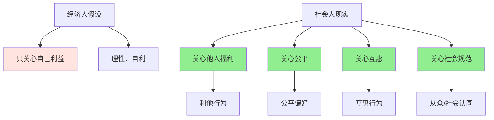

> 人不只是"经济人"

---

**数据来源：** 直播打赏行为研究（2020-2023）、Kickstarter与Indiegogo众筹数据（2015-2023）、企业社会责任（CSR）报告、恩斯特·费尔《不平等厌恶》（2000）、沃纳·古思《最后通牒博弈》（1982）

## 直播打赏的谜题

小王在刷直播，主播在唱歌跳舞。

主播说："感谢榜一大哥送的火箭！"

小王想："送个火箭要花500元，主播又不会真的对我好。"

但看到屏幕上不断飘过的礼物，小王还是送了一个小礼物——花了10元。

**问题：** 为什么我们愿意花钱给主播，却得不到任何实际回报？
**更深的问题：** 为什么人会牺牲自己利益帮助他人？

这背后藏着一个行为经济学核心概念：**社会偏好（Social Preferences）**。

---

## 社会偏好

**定义：** 人们不仅关心自己的利益，还关心他人的福利、公平、互惠等社会因素。

**简单说就是：** 人不只是"经济人"，也是"社会人"。

### 关键要点

**社会偏好的类型：**

| 类型 | 定义 | 例子 |
|------|------|------|
| **利他主义** | 牺牲自己利益帮助他人 | 慈善捐款、志愿服务 |
| **公平偏好** | 希望分配公平 | 最后通牒博弈 |
| **互惠偏好** | 善待善意，报复恶意 | 信任博弈、报复 |
| **社会认同** | 希望被群体接受 | 从众、社会压力 |

**最后通牒博弈（Ultimatum Game）：**

> 两人分一笔钱，提议者提出分配方案，回应者可以接受或拒绝。如果拒绝，两人都得不到钱。

| 回应者决定 | 理性经济人 | 现实中人 |
|------------|------------|----------|
| **提议1元（总额100元）** | 接受（1元 > 0元） | **拒绝（不公平）** |
| **提议40元** | 接受 | 接受 |
| **提议50元** | 接受 | 接受 |

**囚徒困境的社会偏好解：**

| 选择 | 纯自利 | 社会偏好 |
|------|--------|----------|
| **背叛** | 理性 | 不理性（损害他人） |
| **合作** | 不理性 | **理性**（考虑他人福利） |

**历史小知识：** 社会偏好的研究源于实验经济学。恩斯特·费尔2000年代通过实验发现"不公平厌恶"（Inequity Aversion）。最后通牒博弈由沃纳·古思（Werner Güth）1982年提出。

---

### 为什么社会偏好如此重要？

**进化论的解释：**

| 原因 | 说明 |
|------|------|
| **群体选择** | 利他群体比自私群体更成功 |
| **互惠利他** | "我帮你，你帮我" |
| **亲缘选择** | 帮助亲属（基因相似） |
| **社会凝聚力** | 利他行为增强群体凝聚力 |

**心理机制：**

| 机制 | 影响 |
|------|------|
| **共情能力** | 感受他人痛苦 |
| **内疚感** | 不帮助他人时内疚 |
| **自豪感** | 帮助他人时自豪 |
| **社会压力** | 不帮助时被排斥 |

---

## 社会偏好的真实案例

### 直播打赏

**背景：** 为什么直播打赏如此盛行？

**直播打赏的社会偏好机制：**

| 机制 | 说明 |
|------|------|
| **社会认同** | 打赏=获得主播感谢=获得群体认同 |
| **互惠关系** | 主播互动→粉丝打赏→主播互动 |
| **公平感知** | 主播努力表演，应该"给点钱" |
| **社会证明** | 其他人打赏→我也要打赏 |

**打赏的"货币"：**

| 货币 | 成本 | 收益 |
|------|------|------|
| **金钱** | 几元到几百元 | 主播感谢、排名 |
| **时间** | 观看时长 | 陪伴、娱乐 |
| **情感** | 互动、关注 | 社交满足 |

**数据支撑：**

研究显示：
- 约80%的观众从未打赏
- 约15%偶尔打赏
- 约5%"土豪"贡献90%打赏收入
- 打赏者中，约70%表示"看到别人打赏，我也想打赏"

**关键洞察：**
> 直播打赏的社会偏好是**社会认同+互惠+公平**的组合：
> - **社会认同**：打赏=在群体中获得认可（主播念名字）
> - **互惠关系**：主播提供娱乐，粉丝"付费"
> - **公平感知**：主播"工作努力"，应该"给点小费"
> - **社会证明**：别人打赏=这"是正确的事"
> **这不是"纯经济交易"**：
> - 打赏者不是在"购买"具体服务
> - 而是在"购买"社会关系、认同、情感
> - **直播打赏的本质是"数字社会关系"**：
>   - 主播和粉丝形成"虚拟社区"
>   - 打赏是"参与"社区的方式
>   - **虽然看似"非理性"，但在社会偏好框架下是理性的**。

---

### 众筹

**背景：** 为什么众筹能成功？

**众筹的社会偏好机制：**

| 机制 | 说明 |
|------|------|
| **利他主义** | 帮助他人实现梦想 |
| **互惠预期** | 现在帮别人，以后别人帮我 |
| **社会认同** | 支持"有意义的"项目 |
| **公平感知** | 好项目应该得到支持 |

**众筹的"社会货币"：**

| 货币 | 例子 |
|------|------|
| **金钱** | 几元到几千元 |
| **时间** | 分享、评论、关注 |
| **社交资本** | 介绍给朋友 |
| **声誉** | 成为"早期支持者" |

**众筹类型：**

| 类型 | 社会偏好 |
|------|----------|
| **慈善众筹** | 利他主义 |
| **产品众筹** | 互惠（预购产品） |
| **创意众筹** | 社会认同 |
| **医疗众筹** | 公平+利他 |

**数据支撑：**

| 平台 | 筹款成功率 | 平均金额 |
|------|------------|----------|
| Kickstarter | ~35% | $10,000 |
| Indiegogo | ~20% | $15,000 |
| 水滴筹（中国） | ~30% | $5,000 |

**关键洞察：**
> 众筹的社会偏好是**利他+互惠+社会认同**的组合：
> - **利他主义**：帮助陌生人实现梦想
> - **互惠预期**："众筹是'pre-order'，但我也是在帮助创业者"
> - **社会认同**：支持"好项目"=成为"好人"
> - **公平感知**："有才华的人应该得到支持"
> **众筹不是"纯商业交易"**：
> - 支持者不是在"投资"（没有股权）
> - 而是在"参与"创造过程
> - **众筹的本质是"社区创建"**：
>   - 支持者形成"早期社区"
>   - 项目成功=社区成功
> - **虽然看似"非理性"**（支持陌生人），但在社会偏好框架下是理性的。

---

### 企业社会责任（CSR）

**背景：** 为什么企业要做CSR？

**CSR的社会偏好机制：**

| 机制 | 说明 |
|------|------|
| **社会许可** | 企业需要社会接受 |
| **消费者偏好** | 消费者偏好"有社会责任"的企业 |
| **员工激励** | 员工为"好公司"工作更努力 |
| **品牌声誉** | CSR提升品牌价值 |

**CSR的"商业价值"：**

| 价值 | 说明 |
|------|------|
| **风险降低** | 减少监管、诉讼风险 |
| **人才吸引** | 优秀员工偏好有CSR的公司 |
| **品牌溢价** | 消费者愿为"好公司"付费 |
| **客户忠诚** | CSR提升客户忠诚度 |

**CSR类型：**

| 类型 | 例子 |
|------|------|
| **环境责任** | 减少排放、可持续采购 |
| **社会责任** | 员工福利、社区投资 |
| **经济责任** | 创造就业、纳税 |
| **慈善责任** | 捐赠、志愿者 |

**数据支撑：**

研究显示：
- 约70%的消费者愿意为"有社会责任"的品牌多付5%
- 约80%的 millennials偏好CSR公司
- CSR公司的员工流失率低25-50%

**关键洞察：**
> 企业CSR的社会偏好是**社会许可+消费者偏好+员工偏好**的组合：
> - **社会许可**：企业需要社会接受才能经营
> - **消费者偏好**：消费者偏好"有社会责任"的企业
> - **员工激励**：员工为"有意义"的公司工作更努力
> - **长期价值**：CSR创造长期价值，而非短期利润
> **CSR不是"慈善"**（虽然常被这样看待）：
> - CSR是"长期利润最大化"的策略
> - **CSR的本质是"社会价值创造"**：
>   - 企业为利益相关者创造价值
>   - 利益相关者回报企业（忠诚、口碑）
> - **虽然看似"牺牲利润"**，但长期看是"投资"。

---

## 如何利用社会偏好？

### 个人视角

**利用社会偏好做好事：**

| 策略 | 例子 |
|------|------|
| **公开承诺** | 告诉朋友你的目标 |
| **社会压力** | 参加团体（健身、学习） |
| **互惠关系** | 建立帮助网络 |

**避免社会偏好的负面：**

| 策略 | 说明 |
|------|------|
| **警惕"道德绑架"** | 不是所有"善意"都是好的 |
| **理性慈善** | 评估慈善的有效性 |
| **避免从众** | 不是所有"别人做的"都是对的 |

---

### 企业/政策视角

**利用社会偏好设计机制：**

| 策略 | 例子 |
|------|------|
| **透明化** | 公开CSR行为 |
| **社区创建** | 建立品牌社区 |
| **互惠设计** | 会员制度、推荐奖励 |

**政策应用：**

| 政策 | 社会偏好应用 |
|------|----------------|
| **器官捐献** | 默认同意（退出制） |
| **慈善税收减免** | 鼓励利他行为 |
| **公开透明** | 企业CSR报告 |

---

## 应用与决策

### 个人决策

| 决策 | 社会偏好应用 |
|------|----------------|
| 慈善 | 选择有效慈善 |
| 消费 | 购买"有社会责任"产品 |
| 职业 | 选择有意义的工作 |

### 企业战略

| 策略 | 社会偏好应用 |
|------|----------------|
| CSR | 长期价值创造 |
| 营销 | 强调社会价值 |
| 产品 | 解决社会问题 |

---

### 常见误区

| 误区 | 正解 |
|------|------|
| "社会偏好总是利他" | 也可能是"有害"（群体内偏见） |
| "消除自利就能利他" | 自利和社会偏好共存 |
| "社会偏好总是好的" | 可能导致"道德绑架" |
| "只有个人有社会偏好" | 企业、政府也有 |

---

## 延伸思考

1. **数字时代的"社会偏好"**：社交媒体让我们更容易"看到"他人的善行，这是否强化了社会偏好（表演性利他）？还是真的增加了利他行为？

2. **文化的"社会偏好"差异**：东方文化vs西方文化——他们的社会偏好有何不同？中国文化中的"关系"、"面子"如何影响社会偏好？

3. **AI的"社会偏好"**：当AI被训练为"帮助人类"，AI会有"社会偏好"吗？AI的"利他"是真实的，还是程序设定的？

**下期预告：** 模块五完成！接下来进入**模块六：劳动与人力资本**。我们将探讨**人力资本投资**——为什么互联网大厂薪资高？硅谷工程师的薪资溢价从何而来？

---

**数据来源：** 直播打赏行为研究（2020-2023）、Kickstarter与Indiegogo众筹数据（2015-2023）、企业社会责任（CSR）报告、恩斯特·费尔《不平等厌恶》（2000）、沃纳·古思《最后通牒博弈》（1982）
