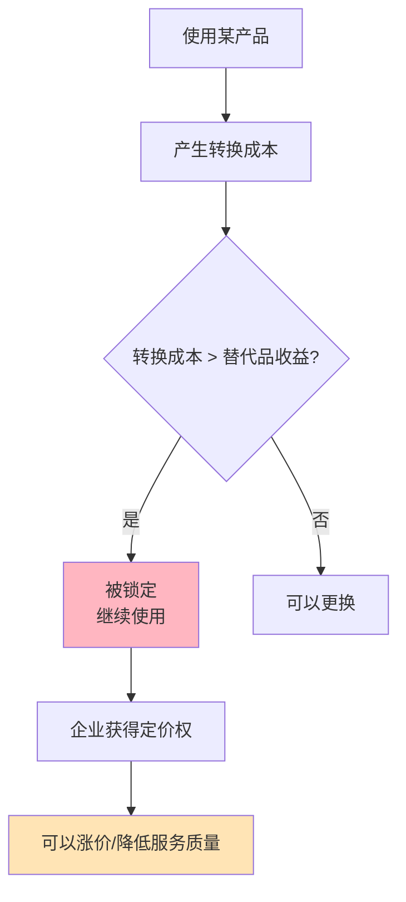

> 一旦进入，难以离开

---

## 换手机的噩梦

小王想换掉iPhone，换成安卓手机。

他算了笔账：
- iPhone用了5年，买了20个APP（共500元）
- AirPods Pro（1999元）——安卓也能用，但功能受限
- Apple Watch（2999元）——安卓完全不能用
- iCloud订阅（每月68元）——存了5年的照片
- 儿子的iPad Pro、老婆的MacBook——家庭共享会失效

小王叹气："换个手机，要换掉整个生态，成本太高了。"

**问题：** 为什么换手机这么难？为什么苹果生态如此"粘人"？

这背后藏着一个经济学概念：**锁定效应（Lock-In Effect）**。

---

## 锁定效应

**定义：** 用户因为转换成本过高，而难以更换产品或服务的状态。

**简单说就是：** 一旦使用某产品，想要换别的，成本太高，被"锁死"了。



### 关键要点

**转换成本的类型：**

| 类型 | 定义 | 例子 |
|------|------|------|
| **财务成本** | 直接的金钱损失 | 取消费、重新购买 |
| **时间成本** | 学习、迁移花费的时间 | 学习新系统 |
| **心理成本** | 不确定性、习惯改变 | 对新系统的不安 |
| **数据成本** | 数据迁移的困难 | 历史数据无法转移 |

**路径依赖（Path Dependence）：**

> 过去的选择限制了未来的选择范围——"因为以前选了A，所以现在只能继续选A"。

**QWERTY键盘的经典案例：**

| 键盘布局 | 打字效率 | 为什么仍在使用？ |
|----------|----------|------------------|
| QWERTY | 不是最优 | 所有人都用，键盘、培训、习惯——转换成本太高 |
| Dvorak | 更优 | 无法推广 |

**历史小知识：** 路径依赖的概念源于经济学对技术标准的研究。保罗·戴维在1985年用QWERTY键盘案例说明了路径依赖如何导致"次优选择"的持续。

---

### 为什么锁定效应普遍存在？

**企业主动创造锁定：**

| 策略 | 目的 | 例子 |
|------|------|------|
| **不兼容设计** | 增加转换成本 | iOS vs Android |
| **会员体系** | 增加沉没成本 | 会员等级、积分 |
| **数据锁定** | 难以迁移 | 微信聊天记录 |
| **生态协同** | 多产品互相强化 | 苹果全家桶 |

**用户的理性选择：**

| 决策 | 逻辑 |
|------|------|
| 继续使用当前产品 | 转换成本 > 替代品收益 |
| 不考虑替代品 | 搜索成本、不确定性 |
| 加大投入 | 规模经济、习惯强化 |

**结果：**

| 阶段 | 用户状态 |
|------|----------|
| 早期 | 自由选择，多个竞争者 |
| 中期 | 逐渐被锁定，选择减少 |
| 成熟 | **深度锁定，难以退出** |

---

## 锁定效应的真实案例

### 苹果生态：温柔的牢笼

**背景：** 为什么苹果用户如此"忠诚"？

**苹果的锁定矩阵：**

| 产品 | 转换成本 | 金额估算 |
|------|----------|----------|
| **iPhone** | 学习成本、习惯 | 低（基础） |
| **APP购买** | 重新购买 | 500-2000元 |
| **AirPods** | 功能损失 | 1000-2000元 |
| **Apple Watch** | 完全不能用 | 2000-4000元 |
| **MacBook** | 生态协同损失 | 8000-20000元 |
| **iCloud数据** | 数据迁移困难 | 无价 |
| **家庭共享** | 多人协调成本 | 高 |

**锁定机制的协同：**

```
iPhone → AirPods → Apple Watch → MacBook → iPad
   ↑                                              ↓
   ←←←←←←←←←←← 生态协同，互相强化  ←←←←←←←←←←←
```

**数据支撑：**

根据IDC《2023年全球智能手机市场报告》研究：
- 苹果用户的留存率高达90%以上
- 拥有3个以上苹果产品的用户，换安卓意愿<5%
- 美国苹果用户的平均家庭拥有苹果产品数量：5.6个

根据艾瑞咨询《2023年中国第三方支付市场报告》：
| 年份 | 微信支付 | 支付宝 | 市场格局 |
|------|----------|--------|----------|
| 2016 | 38% | 55% | 支付宝领先 |
| 2020 | 39% | 55% | 双寡头格局 |
| 2023 | 40% | 54% | 僵持状态 |

**苹果的定价权：**

| 产品 | 定价策略 | 原因 |
|------|----------|------|
| iPhone | 高价 | 锁定用户，可承受涨价 |
| iCloud | 中价 | 锁定数据，轻度涨价 |
| 服务（Apple Music等） | 低价 | 增加锁定 |

**关键洞察：**
> 苹果的护城河不是单一产品，而是**生态系统锁定**。每个产品都增加整体转换成本，形成"多产品锁定陷阱"。当你拥有iPhone、AirPods、Apple Watch、MacBook时，换安卓的成本可能超过5万元。**苹果的"忠诚"不是情感忠诚，而是理性计算——转换成本太高。**

---

### 微信支付vs支付宝：支付战争的僵局

**背景：** 为什么微信支付和支付宝无法互相击败？

**双方的锁定策略：**

| 策略 | 微信支付 | 支付宝 |
|------|----------|--------|
| **社交锁定** | 朋友转账、红包 | 无 |
| **习惯锁定** | 聊天时顺手支付 | 专门打开APP |
| **场景锁定** | 小程序支付 | 芝麻信用、花呗 |
| **数据锁定** | 社交数据+消费数据 | 消费+信用数据 |

**市场份额的僵持：**

| 年份 | 微信支付 | 支付宝 |
|------|----------|--------|
| 2016 | 38% | 55% |
| 2020 | 39% | 55% |
| 2023 | 40% | 54% |

**为什么无法打破僵局？**

| 困难 | 说明 |
|------|------|
| **社交关系链** | 微信的社交护城河无法突破 |
| **用户习惯** | 转换成本高，用户不愿意换 |
| **商家双重接受** | 商家同时接受两者，无法差异化 |

**关键洞察：**
> 微信支付和支付宝的僵局展示了**双向锁定的稳定状态**。双方都有自己的锁定机制（微信=社交，支付宝=信用），用户转换成本都不低。**结果是市场双寡头垄断，互相无法击败**——这是锁定效应的典型结果。

---

## 如何应对锁定效应？

### 企业视角：如何创造锁定？

**策略1：增加财务转换成本**

| 方法 | 例子 |
|------|------|
| **会员体系** | 会员等级、积分 |
| **预付费模式** | 会员年卡、储值 |
| **套餐绑定** | 打包优惠 |

**策略2：增加学习转换成本**

| 方法 | 例子 |
|------|------|
| **独特操作逻辑** | iOS手势、Adobe软件 |
| **生态系统** | AutoCAD、专业软件 |

**策略3：增加数据转换成本**

| 方法 | 例子 |
|------|------|
| **专有格式** | .docx、.psd |
| **云服务锁定** | iCloud、Google Photos |
| **社交数据** | 微信聊天记录 |

**策略4：增加关系转换成本**

| 方法 | 例子 |
|------|------|
| **社交网络** | Facebook、微信 |
| **协作工具** | Slack、钉钉 |
| **多人游戏** | 王者荣耀、原神 |

---

### 消费者视角：如何避免被锁定？

**策略1：保持"退出选项"**

| 行动 | 说明 |
|------|------|
| **多平台备份** | 数据不依赖单一平台 |
| **避免深度绑定** | 不要"all in"某个生态 |
| **定期评估替代品** | 了解市场上其他选择 |

**策略2：计算"总拥有成本"**

| 成本 | 考虑因素 |
|------|----------|
| **初始成本** | 购买价格 |
| **转换成本** | 未来换产品的成本 |
| **锁定成本** | 生态系统的总成本 |

**策略3：选择开放标准**

| 选择 | 原因 |
|------|------|
| **开放格式** | .txt、.pdf、.mp3 |
| **兼容设备** | 而非专有接口 |
| **可导出数据** | 而非数据锁定 |

---

### 常见误区

| 误区 | 正解 |
|------|------|
| "锁定总是坏事" | 锁定可以带来稳定和协同效应 |
| "用户忠诚=产品质量" | 很多"忠诚"是转换成本导致的 |
| "打破锁定很难" | 技术变革可以打破锁定（如诺基亚） |
| "我应该避免所有锁定" | 不现实，选择性地接受锁定 |

---

## 延伸思考

1. **SaaS的锁定陷阱**：企业软件（如Salesforce、Workday）有巨大的转换成本（数据迁移、员工培训、流程改造）。这是否给了厂商"收割"用户的机会？企业如何保护自己？

2. **云服务商的锁定**：AWS、Azure、Google Cloud——每个云服务商都有专有服务，导致难以迁移。多云策略是解决方案还是增加了复杂度？

3. **操作系统的终极锁定**：操作系统是终极锁定平台。当苹果、微软、Google控制了操作系统，他们就控制了整个数字世界。监管应该介入吗？

**下期预告：** 模块二完成！接下来进入**模块三：博弈与策略**。我们将探讨**囚徒困境与破局**——为什么滴滴和快的打得头破血流？可乐双雄为什么默契涨价？

---

**数据来源：** IDC《2023年全球智能手机市场报告》、艾瑞咨询《2023年中国第三方支付市场报告》、Gartner《2023年企业软件迁移报告》、Klemperer（1987）《Markets with Switching Costs》

**数据来源：》苹果用户留存率研究、中国第三方支付报告、锁定效应理论文献
