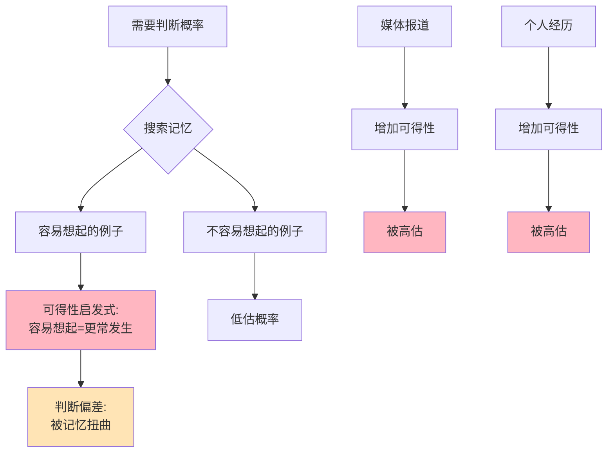

> 记忆欺骗现实

---

**数据来源：** P2P行业数据（2018年爆雷潮）、2008金融危机研究、卡尼曼与特沃斯基《可得性启发式》（1973）、泰勒与桑斯坦《助推》（2008）

## P2P爆仓的教训

2018年，P2P平台大量爆雷。

小张投了10万元在一个P2P平台，平台跑路，钱全没了。

朋友劝他："P2P风险太高了，不要再投了。"

小张说："我知道，但我的朋友在另一个平台投了2年，每年收益10%，没事。"

**问题：** 为什么我们总是根据"听说的例子"做决策，而非统计规律？
**更深的问题：** 为什么"容易想起"的事，我们觉得"更常发生"？

这背后藏着一个行为经济学核心概念：**可得性启发式（Availability Heuristic）**。

---

## 可得性启发式

**定义：** 人们根据"容易想起"的程度来判断事件的可能性或频率。

**简单说就是：** "我能轻易想到的例子，一定更常发生。"

### 关键要点

**可得性启发式的机制：**

| 因素 | 影响 | 例子 |
|------|------|------|
| **记忆强度** | 记忆越深，越容易想起 | 911事件、金融危机 |
| **时间远近** | 越近的事，越容易想起 | 最近的事 |
| **媒体报道** | 媒体报道越多，越容易想起 | 恐怖袭击、飞机失事 |
| **个人经历** | 亲身经历，记忆深刻 | 自己的车祸 |

**现成偏差（Availability Bias）：**

> 被"容易想起"的信息扭曲判断。

| 判断 | 现实 | 可得性扭曲 |
|------|------|------------|
| "飞机失事很常见" | 实际很罕见 | 但每次都大报道 |
| "谋杀很常见" | 实际比交通事故少 | 但更惊悚 |
| "P2P暴雷很常见" | 实际部分平台安全 | 但暴雷更被报道 |

**小样本推理（Small Sample Fallacy）：**

> 从小样本过度推断。

| 样本 | 推断 | 问题 |
|------|------|------|
| **小样本** | "我的朋友投P2P赚了" | 样本太小，无法推断整体 |
| **大样本** | 统计数据 | 更可靠 |

**历史小知识：** 可得性启发式由阿莫斯·特沃斯基和丹尼尔·卡尼曼1973年提出。他们发现，人们用"容易想起的程度"代替"概率"，导致系统性偏差。

---

### 为什么可得性如此强大？

**进化论的解释：**

| 原因 | 说明 |
|------|------|
| **生存优先** | 记住危险事物更重要 |
| **快速决策** | 启发式简化决策 |
| **社交学习** | 从他人经历学习 |

**心理机制：**

| 机制 | 影响 |
|------|------|
| **记忆强化** | 重复、情绪、新颖性强化记忆 |
| **检索容易度** | 记忆越容易检索，越"真实" |
| **情绪强度** | 情绪强的事件记忆更深 |

---

## 可得性启发式的真实案例

### P2P爆仓教训

**背景：** 为什么P2P平台爆雷时，还有人投资？

**P2P的可得性偏差机制：**

| 机制 | 说明 |
|------|------|
| **正面例子** | "朋友赚了钱"→容易想起 |
| **负面例子** | "平台爆雷"→但如果没亲身经历，不容易想起 |
| **媒体报道** | 爆雷时大报道，但平时不报道 |

**"我的朋友没事"的谬误：**

| 推理 | 问题 |
|------|------|
| "我的朋友投了2年，赚了10%" | 小样本（1个朋友） |
| "所以P2P是安全的" | **从1个例子推断整体** |
| **统计现实** | "约50%的P2P平台暴雷" |

**P2P的风险分布：**

| 结果 | 概率（统计） | 可得性（直觉） |
|------|--------------|----------------|
| **正常收益** | 50% | 高（朋友成功） |
| **延迟兑付** | 30% | 中（偶尔听说） |
| **跑路/爆雷** | 20% | 低（除非亲身经历） |
| **直觉判断** | "大部分安全" | **高估安全概率** |

**数据支撑：**

2018年P2P爆雷潮：
- 约6000家P2P平台
- 约3000家暴雷（50%）
- 投资者损失数千亿

**关键洞察：**
> P2P投资的可得性偏差是**小样本推理+可得性不对称**的组合：
> - **小样本推理**：从"1个朋友成功"推断"整体安全"
> - **可得性不对称**：
>   - 正面例子（朋友赚钱）→ 容易想起 → 高估概率
>   - 负面例子（平台爆雷）→ 不容易想起 → 低估概率
> - **媒体放大效应**：
>   - 成功时，朋友告诉你
>   - 失败时，媒体报道（但你会想"不会是我"）
> **理性的做法应该是**：
> - 看统计数据，而非单个例子
> - 理解" survivor bias"（存活者偏差）
> - **但人性是"从例子学习"**，而非"从数据学习"。

---

### 2008金融危机

**背景：** 为什么2008金融危机前，大多数人没有预见？

**金融危机的可得性偏差机制：**

| 机制 | 危机前 | 危机后 |
|------|--------|--------|
| **可得性** | "房价一直涨" → 容易想起 | "危机记忆" → 容易想起 |
| **媒体** | 报道"房价创新高" | 报道"金融危机" |
| **个人经历** | 朋友买房赚了 | 朋友失业、房子贬值 |

**"房价永远涨"的错觉：**

| 时间 | 经验 | 可得性判断 |
|------|------|------------|
| 2000-2006 | 房价每年涨10%+ | "房价永远涨" |
| 2007-2008 | 房价跌30%+ | **但人们仍然相信"很快反弹"** |
| 2009-2012 | 房价持续低迷 | "这次不同"（错误） |

**历史记忆的淡化：**

| 事件 | 记忆强度 | 影响 |
|------|----------|------|
| **1929大萧条** | 淡（年代久远） | 不被重视 |
| **2000互联网泡沫** | 中（年代较近） | 部分重视 |
| **2008金融危机** | 强（亲身经历） | 深刻影响 |
| **2020疫情** | 非常强（正在经历） | 深刻影响 |

**数据支撑：**

美联储调查：
- 2005年：70%的购房者认为"房价会继续涨"
- 2007年：50%仍认为"房价会反弹"
- 2009年：30%认为"已经到底"

**关键洞察：**
> 2008金融危机前的可得性偏差是**记忆淡化+可得性不对称**：
> - **记忆淡化**：1929大萧条的记忆太遥远，不被重视
> - **可得性不对称**：
>   - "房价涨"的例子多、近、容易想起
>   - "房价跌"的例子少、远、不容易想起
> - **这次不同**：
>   - 每次泡沫前，人们都说"这次不同"
>   - 实际上"这次永远相同"
> **危机后的可得性变化**：
> - 危机后，"危机记忆"变得容易想起
> - 人们过度谨慎，可能错过机会
> - **记忆随时间淡化**，泡沫可能再次发生

---

## 如何应对可得性启发式？

### 个人策略

**策略1：寻找统计数据**

| 行动 | 说明 |
|------|------|
| **问"概率是多少？"** | 而非"有没有例子" |
| **查官方统计** | 而非"听说的" |
| **看长期趋势** | 而非短期波动 |

**策略2：调整样本**

| 行动 | 说明 |
|------|------|
| **增加样本** | 不要只问1个朋友 |
| **寻找反面例子** | 主动寻找失败案例 |
| **考虑基率** | "总体成功率是多少？" |

**策略3：延迟判断**

| 行动 | 说明 |
|------|------|
| **等24小时** | 激情过后再决定 |
| **冷静期** | 大额投资的冷静期 |
| **列清单** | 列出所有考虑因素 |

---

### 企业/政策视角

**利用可得性（营销）：**

| 策略 | 例子 |
|------|------|
| **故事化** | 用故事而非数据 |
| **案例展示** | 成功客户案例 |
| **情绪化** | 创造记忆点 |

**防范可得性（决策）：**

| 策略 | 例子 |
|------|------|
| **数据驱动** | 强制看统计数据 |
| **红队挑战** | 挑战"常识" |
| **多样性** | 不同背景的人 |

---

## 应用与决策

### 个人决策

| 决策 | 可得性陷阱 | 策略 |
|------|------------|------|
| 投资决策 | "听说XX赚钱" | 看统计数据 |
| 风险评估 | "我没听说过坏事" | 主动搜索负面信息 |
| 职业选择 | "成功案例" | 考虑失败率 |

### 企业战略

| 策略 | 可得性应用/防范 |
|------|---------------------|
| 营销 | 用案例、故事 |
| 风险管理 | 不只依赖"经验" |
| 决策 | 数据+直觉 |

---

### 常见误区

| 误区 | 正解 |
|------|------|
| "可得性总是导致错误" | 有时是合理的启发式 |
| "统计数据总是对的" | 统计数据也可能有偏差 |
| "消除可得性就能理性" | 可以管理，无法消除 |
| "只有个人有可得性" | 企业、专家也有 |

---

## 延伸思考

1. **社交媒体的"可得性放大器"**：算法推荐让我们只看到"相似"的内容，这是否强化了可得性偏差？如何打破"信息茧房"？

2. **专家的"可得性"**：为什么专家、分析师也有可得性偏差？2008金融危机前，为什么几乎所有专家都错了？

3. **"案例教学"的悖论**：商学院用"成功案例"教学，这是否创造了扭曲的可得性？是否应该多教"失败案例"？

**下期预告：** 我们来探讨**框架效应与助推**——为什么退休储蓄默认选项能提高参与率？垃圾分类如何通过"助推"改变行为？

---

**数据来源：** P2P行业数据（2018年爆雷潮）、2008金融危机研究、卡尼曼与特沃斯基《可得性启发式》（1973）、泰勒与桑斯坦《助推》（2008）
