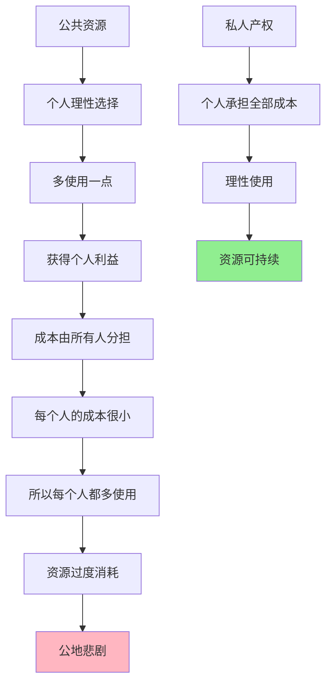

> 当资源属于所有人，它就不属于任何人

---

## "免费"的共享单车，最后没人能用

2023年，北京街头。

你扫码一辆共享单车，发现：
- 车座被划烂了
- 链条掉了
- 甚至车牌被涂掉了

你气愤地说："素质太差了！"

但问题来了：**为什么人人都在用，却没人在乎？**

小张想："我就骑一次，稍微粗暴点没关系。"
小李想："别人都不爱护，我为什么要爱护？"
维修师傅想："修好马上又被破坏，何必费劲？"

**结果：共享单车变成了"共享垃圾"。**

这背后藏着一个经济学经典困境：**公地悲剧（Tragedy of the Commons）**。

---

## 什么是公地悲剧？

**定义：** 当资源是公共所有时，个人理性使用会导致资源过度使用和最终枯竭。

**简单说就是：** 属于所有人的东西，最终没人负责。

### 关键要点

**1. 公共品的特征**

| 特征 | 私人品 | 公共品/公共资源 |
|------|--------|-----------------|
| **排他性** | ✅ 不付费不能使用 | ❌ 无法阻止他人使用 |
| **竞争性** | ✅ 一人使用他人无法使用 | ❌ 一人使用不影响他人（公共品） ✅ 一人使用减少他人可用的（公共资源） |

**2. 外部性（Externality）**

| 类型 | 定义 | 案例 |
|------|------|------|
| **负外部性** | 行为损害他人，但无需赔偿 | 污染、破坏共享单车 |
| **正外部性** | 行为造福他人，但无法收费 | 疫苗接种、教育 |

**3. 搭便车问题（Free Rider Problem）**

> 当公共品的受益无法排除任何人时，理性人会选择"搭便车"——不付出成本，享受他人创造的收益。

---

### 为什么公地悲剧难以避免？

**经济学解释：激励不相容**

| 行为 | 个人收益 | 个人成本 | 理性选择 |
|------|----------|----------|----------|
| 爱护共享单车 | 0（被别人用） | 努力（我付出） | ❌ 不爱护 |
| 破坏共享单车 | 便利（我享受） | 摊薄（所有人分担） | ❌ 可能破坏 |
| 举报破坏行为 | 无（别人受益） | 时间+报复风险 | ❌ 不举报 |

**心理学解释：**

1. **责任分散效应**
   - "又不是我一个人的事"
   - "这么多人用，凭什么我负责"

2. **破窗效应**
   - 看到别人破坏，心理底线降低
   - "反正已经坏了，我这样也没关系"

3. **从众效应**
   - 大家都破坏，我不破坏显得"傻"
   - "别人不爱护，我为什么要爱护"

**历史小知识：** 1968年，加勒特·哈丁（Garrett Hardin）在《科学》（Science）杂志发表论文《公地的悲剧》（"The Tragedy of the Commons"），用牧民在公共草地放牧的例子说明：每个牧民都倾向于增加自己的牲畜数量以最大化个人收益，最终导致草地过度放牧而枯竭。

---

## 公地悲剧的真实案例

### 共享单车的死亡螺旋

**背景：** 2016-2018年，中国共享单车经历了从疯狂到崩溃的过程。

**发展时间线：**

| 时间 | 事件 | 单车数量 | 结果 |
|------|------|----------|------|
| 2016年初 | ofo、摩拜成立 | 0 | 开始运营 |
| 2017年 | 疯狂融资投放 | 2300万辆 | 遍布街头 |
| 2017年中 | 问题爆发 | 2500万辆 | 大量损坏、堆积 |
| 2018年 | ofo危机 | 2000万辆 | 退押金困难 |
| 2020年 | ofo倒闭 | - | 1500万人等待退押金 |

**为什么会失败？**

**1. 公地悲剧的典型表现**

| 问题 | 产权属性 | 行为结果 |
|------|----------|----------|
| 私自上锁 | 公共品变私用品 | 损害他人利益 |
| 故意破坏 | 不需承担成本 | 破坏成本低 |
| 乱停乱放 | 无人监管 | 城市混乱 |
| 拆解卖零件 | 公共资源私有化 | 直接盗窃 |

**2. 成本与收益的错配**

| 行为 | 收益（私人） | 成本（私人） | 社会成本 |
|------|--------------|--------------|----------|
| 正常使用 | 便利 | 1元 | 无 |
| 破坏使用 | 便利+快感 | 0 | 车辆损坏 |
| 私自占有 | 全部价值 | 法律风险（低） | 他人的损失 |

**3. 企业的囚徒困境**

| 企业选择 | 不投放 | 投放 |
|----------|--------|------|
| **不投放** | 都稳定盈利 | 对方占领市场 |
| **投放** | 失去市场份额 | **双方过度投放，都亏损** |

**关键洞察：**
> 共享单车的失败不是因为"商业模式错误"，而是因为无法解决公地悲剧。当资源是公共的，个人理性使用会导致集体非理性结果。后来的哈啰单车通过：
> 1. 押金模式（增加破坏成本）
> 2. 信用体系（破坏影响个人信用）
> 3. 技术升级（智能锁、GPS定位）
> 才部分缓解了这个问题。

---

### 办公室冰箱的过期食物

**背景：** 某互联网公司办公室，冰箱里总有发霉的食物。

**公司政策：** 冰箱是公共资源，员工可以自由放食物。

**实际发生的情况：**

| 行为 | 动机 | 结果 |
|------|------|------|
| 放食物不清理 | "明天会吃的" | 忘记，食物过期 |
| 不清理过期食物 | "不是我的"或"太麻烦" | 冰箱越来越脏 |
| 乱放食物 | "找个空位就行" | 别人的食物被挤压 |

**经济学分析：**

| 维度 | 私人冰箱 | 办公室冰箱 |
|------|----------|------------|
| 产权 | 完全私有 | 公共所有 |
| 清理责任 | 自己承担 | 没人负责 |
| 混乱成本 | 自己承担 | 摊薄到所有人 |
| **结果** | **干净整洁** | **脏乱差** |

**公司的尝试与失败：**

| 政策 | 结果 | 原因 |
|------|------|------|
| 发邮件提醒 | 无效 | 没有执行机制 |
| 贴标语"请保持清洁" | 无效 | 道德劝说无效 |
| 周五强制清理 | 部分有效 | 依赖行政力量 |

**最终解决方案：**

1. **分配专属格子**（建立类产权）
   - 每个人有固定位置
   - 对自己位置负责

2. **定期清理 + 公开曝光**
   - 每周清理拍照发群
   - 社交压力

3. **安装摄像头**
   - 监管成本 → 行为改变

**关键洞察：**
> 办公室冰箱的困境告诉我们：道德劝说无法解决公地悲剧。只有通过改变激励机制——建立产权、增加违规成本、加强监管——才能真正解决问题。

---

## 如何解决公地悲剧？

### 方案1：建立产权（Privatization）

| 案例 | 解决方式 | 效果 |
|------|----------|------|
| 土地公地悲剧 | 土地私有化 | 所有者爱护土地 |
| 渔场过度捕捞 | 配额制度（可交易） | 恢复可持续 |
| 无线电频谱 | 拍卖频谱使用权 | 高效利用 |

**局限性：**
- 不是所有资源都能私有化（空气、海洋）
- 私有化可能导致垄断

---

### 方案2：政府监管（Regulation）

| 工具 | 案例 | 效果 |
|------|------|------|
| 配额制度 | 渔业捕捞配额 | 限制总量 |
| 税收 | 碳税、排污税 | 内部化外部性 |
| 禁止 | 禁止塑料袋 | 直接禁止 |

**局限性：**
- 监管成本高
- 容易产生寻租和腐败

---

### 方案3：社区自治（Self-Governance）

| 案例 | 解决方式 | 效果 |
|------|----------|------|
| 传统灌溉系统 | 村民共同制定规则 | 可持续使用 |
| 渔村共管 | 社区监督 | 自发遵守 |

**埃莉诺·奥斯特罗姆的发现：**
> 2009年诺贝尔经济学奖得主证明：公共资源的管理不只有"市场"和"政府"两个选项，社区自治也能有效管理公共资源。

**成功的条件：**
1. 清晰的边界（谁有权使用）
2. 成本与收益对称（使用者承担成本）
3. 参与式决策（使用者参与规则制定）
4. 监督机制（有人监督执行）
5. 分级制裁（违规有后果）

---

### 方案4：技术手段（Technology）

| 案例 | 技术方案 | 效果 |
|------|----------|------|
| 共享单车 | GPS定位 + 电子围栏 | 减少乱停乱放 |
| 办公室冰箱 | 摄像头 + 人脸识别 | 识别乱放者 |
| 数字内容 | DRM版权保护 | 防止盗版 |

**技术改变了成本结构：**
- 监管成本降低
- 违规成本提高
- 行为可追踪

---

## 应用与决策

### 识别公地陷阱

| 场景 | 是否公地悲剧？ | 症状 |
|------|----------------|------|
| 小区公共绿地 | ✅ 是 | 没人维护、被占用 |
| 公司加班文化 | ✅ 是 | 都想"搭便车" |
| 开源软件 | ❌ 否（声誉机制） | 社区维护良好 |
| 公共交通 | ✅ 是 | 拥挤、不爱护 |

### 决策框架

当你参与公共资源使用时，问自己：

**评估参与成本**
- [ ] 我的行为是否损害他人利益？
- [ ] 这种损害是否被定价？

**评估长期影响**
- [ ] 如果每个人都像我这样，资源会怎样？
- [ ] 我能通过某种方式改变这个结果吗？

**寻找解决方案**
- [ ] 是否可以建立产权？
- [ ] 是否可以引入监管？
- [ ] 是否可以建立社区规则？

---

## 延伸思考

1. **数字公地**：维基百科、开源软件、社交媒体——这些数字公共资源如何避免公地悲剧？是因为"数字资源不会枯竭"吗？还是有什么不同的机制在起作用？

2. **气候变化**：地球大气是最大的"公地"。为什么全球气候合作如此困难？有什么机制可以解决这个全球性公地悲剧？

3. **公司内部公地**：办公室的公共物品（咖啡、零食、会议室）总是被过度使用或浪费。如何在公司内部设计机制，避免公地悲剧？

**下期预告：** 我们来探讨**帕累托效率**——什么是"最好的"资源配置？为什么效率不等于公平？工资差距是必要的吗？

---

**数据来源：** 《中国共享经济发展报告》（2023）、实验经济学研究（Fehr & Schmidt, 1999）、埃莉诺·奥斯特罗姆（Elinor Ostrom, 1990）《公共事物的治理之道》（Governing the Commons: The Evolution of Institutions for Collective Action）（奥斯特罗姆获2009年诺贝尔经济学奖）
