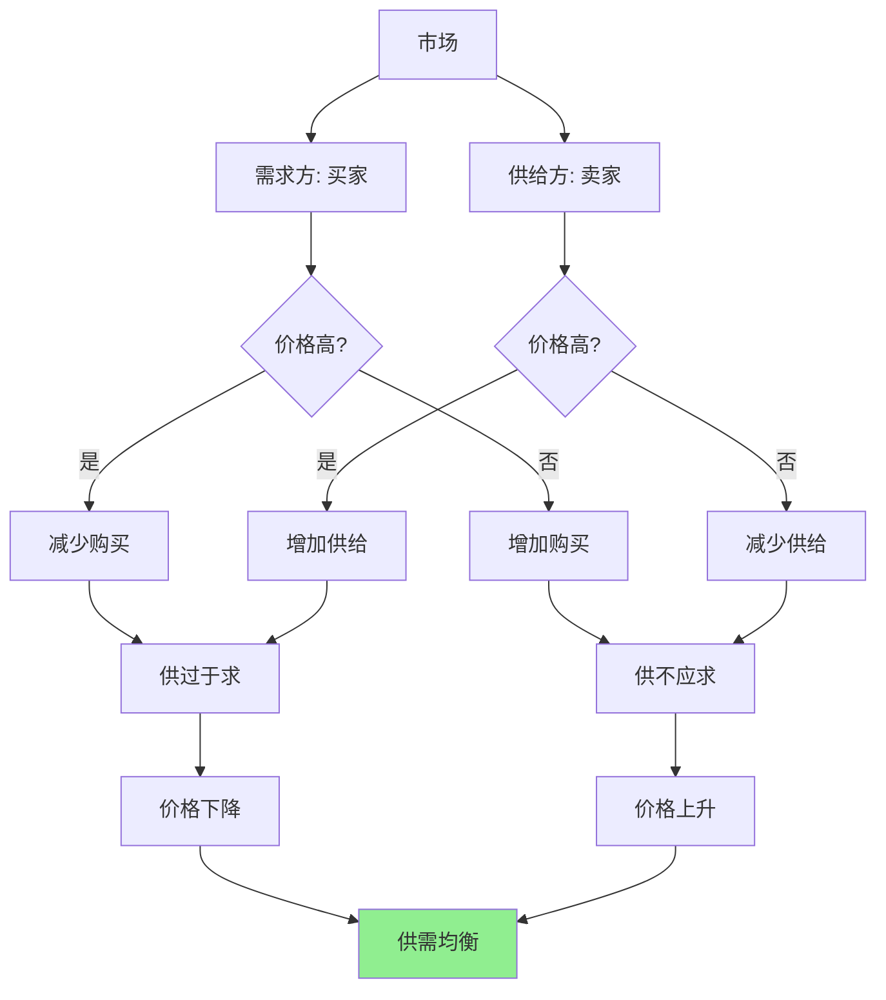

> 价格不是由商家决定的，而是由无数买卖双方共同决定的

---

## 双11的"低价奇迹"

2023年双11，天猫交易额突破3000亿。

你发现很多商品价格确实比平时低：
- iPhone 15 Pro 平时7999元，双11到手7299元
- 某品牌面膜平时99元一盒，双11买一送一
- 某家电品牌直降1000元，还能叠加优惠券

**问题来了：**
- 为什么商家愿意"亏本"降价？
- 为什么只有双11能这样降价？
- 平时为什么不降价？

**更深的问题：** 价格到底是由什么决定的？是商家"想卖多少钱"，还是别的什么？

这背后藏着一个经济学最基础的原理：**供需定律（Law of Supply and Demand）**。

---

## 供需定律

**定义：** 价格由供给和需求的相互作用决定。

**简单说就是：**
- **需求定律**：价格越高，需求量越少；价格越低，需求量越多
- **供给定律**：价格越高，供给量越多；价格越低，供给量越少



### 关键要点

**1. 需求曲线（Demand Curve）**

| 价格 | 需求量 | 原因 |
|------|--------|------|
| 高 | 少 | 只有最需要的人才买 |
| 低 | 多 | 更多的人买得起 |

**2. 供给曲线（Supply Curve）**

| 价格 | 供给量 | 原因 |
|------|--------|------|
| 高 | 多 | 利润高，更多生产者进入 |
| 低 | 少 | 利润低，生产者退出 |

**3. 均衡价格（Equilibrium Price）**

> 供给量 = 需求量时的价格——市场"出清"，没有过剩也没有短缺。

**4. 价格弹性（Price Elasticity）**

| 弹性类型 | 定义 | 例子 |
|----------|------|------|
| **富有弹性** | 价格变化1%，需求量变化>1% | 奢侈品、可有可无的商品 |
| **缺乏弹性** | 价格变化1%，需求量变化<1% | 必需品、药品、燃油 |
| **完全无弹性** | 价格变化，需求量不变 | 急救药品 |

**历史小知识：** 供需定律的思想可以追溯到18世纪，但直到阿尔弗雷德·马歇尔1890年的《经济学原理》中，才将需求和供给曲线结合起来，形成了现代意义上的供需分析框架。

---

### 为什么供需定律容易被误解？

**常见误解：**

| 误解 | 正解 |
|------|------|
| "成本决定价格" | 成本影响供给，但价格由供需决定 |
| "商家可以随意定价" | 商家只能"建议"价格，实际价格由市场决定 |
| "价格高 = 暴利" | 价格高可能因为成本高、需求大或供给少 |
| "降价一定刺激需求" | 只有需求富有弹性时，降价才有意义 |

**心理学解释：**

1. **因果关系混淆**
   - 我们看到"商家定价"，就以为商家"决定"价格
   - 实际上，商家只是"发现"市场均衡价格

2. **可观察性偏差**
   - 成本、商家定价策略——看得见
   - 供需关系、消费者偏好——看不见

---

## 供需定律的真实应用

### 双11的供需博弈

**背景：** 为什么双11能"全网最低价"？

**双11前的市场状态：**

| 价格 | 需求量 | 供给量 | 结果 |
|------|--------|--------|------|
| 7999元（平时） | 正常 | 正常 | 供需均衡 |
| 8999元（涨价） | 大幅下降 | 增加 | 供过于求 → 库存积压 |
| 7299元（降价） | 大幅增加 | 不变 | **供不应求 → 爆发式销售** |

**为什么双11降价有利可图？**

**1. 需求价格弹性大**

| 商品类型 | 价格弹性 | 降价效果 |
|----------|----------|----------|
| iPhone（奢侈品） | 高 | 降价10% → 需求增加30% |
| 粮食（必需品） | 低 | 降价10% → 需求几乎不变 |

**双11卖的是高弹性商品**：降价带来的销量增加 > 价格下降损失。

**2. 规模经济效应**

| 成本类型 | 小批量 | 大批量 |
|----------|--------|--------|
| 采购成本 | 高 | 低（批量折扣） |
| 物流成本 | 高 | 低（满仓发货） |
| 营销成本 | 高 | 低（集中推广） |

**算笔账：**

| 项目 | 平时 | 双11 |
|------|------|------|
| 售价 | 7999元 | 7299元（降8.7%） |
| 成本 | 6000元 | 5500元（规模效应） |
| 利润 | 1999元 | 1799元 |
| 销量 | 1万台 | 10万台（增长900%） |
| **总利润** | **1999万** | **1.8亿（增长800%）** |

根据MIT研究（Anderson & Simester, 2003, "Effects of $10-off Coupons on the Price and Quantity Sold of an Item"），消费者对高弹性商品的价格敏感度显著高于必需品。

**3. 库存压力**

| 时间 | 库存状态 | 商家压力 |
|------|----------|----------|
| 平时 | 库存可控 | 正常销售 |
| 年底 | 库存积压 | 需要清库存 |
| 双11 | 集中清库存 | 降价也要卖 |

**关键洞察：**
> 双11"低价"不是商家"发善心"，而是供需博弈的结果。年底库存压力大（供给增加），如果不降价，商品会积压（供过于求）。降价虽然降低单品利润，但通过规模效应和销量暴增，总利润反而更高。**这就是供需定律的威力**：价格不是由成本决定的，而是由供需关系决定的。

---

### OPEC的石油定价游戏

**背景：** 石油输出国组织（OPEC）控制着全球约30%的石油产量，通过协调产量影响油价。

**供需定律视角：**

| OPEC行为 | 供给变化 | 价格变化 | 收入变化 |
|----------|----------|----------|----------|
| **减产** | 供给减少 | 价格上升 | 取决于需求弹性 |
| **增产** | 供给增加 | 价格下降 | 取决于需求弹性 |

**石油的需求弹性：**

| 时间跨度 | 需求弹性 | 原因 |
|----------|----------|------|
| **短期**（1年内） | 极低 | 消费者无法快速转换能源 |
| **长期**（5-10年） | 中等 | 可以转向电动车、节能技术 |

**OPEC的困境：**

**短期策略：**
```
减产10% → 价格上升20% → 收入增加（✅ 成功）
```

**长期问题：**
```
长期高油价 → 消费者转向新能源 → 石油需求下降 → OPEC收入下降（❌ 失败）
```

**2020年油价战：**

| 事件 | OPEC决策 | 市场反应 |
|------|----------|----------|
| 2020年初 | 谈判减产支撑油价 | - |
| 沙特俄罗斯谈崩 | 沙特反而增产抢占市场 | 油价暴跌（甚至负油价） |
| 2020年4月 | WTI原油期货 -37美元/桶 | **历史性负油价** |

根据EIA（美国能源信息署）2020年油价数据和OPEC+月度报告

**为什么会出现负油价？**

| 因素 | 作用 |
|------|------|
| 供过于求 | OPEC+增产，新冠疫情需求暴跌 |
| 库存满了 | 没有地方储存石油 |
| 期货到期 | 多头必须平仓，宁愿倒贴钱卖出 |

**关键洞察：**
> OPEC的石油定价游戏展示了供需定律的残酷性。短期可以通过减产提高价格，但长期高油价会刺激替代能源发展，最终摧毁自己的市场。**2020年负油价极端案例证明：当供给远超需求，价格可以是任何数字——甚至是负数。** 这也提醒我们：价格是供需关系的信号，而不是任何人能"控制"的。

---

## 如何用供需定律思维分析价格？

### 决策三步法

**步骤1：分析需求侧**

| 问题 | 思考方向 |
|------|----------|
| 谁在买？ | 买家数量、支付能力 |
| 需求弹性如何？ | 价格变化对需求量的影响 |
| 需求在增加还是减少？ | 长期趋势是什么 |

**步骤2：分析供给侧**

| 问题 | 思考方向 |
|------|----------|
| 谁在卖？ | 卖家数量、成本结构 |
| 供给弹性如何？ | 价格变化对供给量的影响 |
| 供给在增加还是减少？ | 长期趋势是什么 |

**步骤3：判断价格趋势**

| 供需组合 | 价格趋势 | 例子 |
|----------|----------|------|
| 需求↑ + 供给不变 | 价格↑ | 疫情前的口罩 |
| 需求↓ + 供给不变 | 价格↓ | 直播带货的商品 |
| 需求不变 + 供给↑ | 价格↓ | 技术进步的产品 |
| 需求↑ + 供给↓ | 价格↑↑ | 2020年芯片 |

---

### 常见误区

| 误区 | 正解 |
|------|------|
| "成本上升，价格必然上升" | 成本上升 → 供给减少 → 价格上升（如果需求不变） |
| "商家降价，消费者一定买单" | 只有需求富有弹性时，降价才有意义 |
| "垄断者可以随意定价" | 垄断者也要考虑需求曲线，定价过高会损失利润 |
| "囤积居奇总能赚钱" | 囤积会改变供需关系，如果需求弹性低，可能失败 |

---

## 延伸思考

1. **动态定价的伦理**：航空公司、Uber根据供需动态定价——高峰期价格上涨。这是"趁火打劫"还是"市场效率"？应该如何监管？

2. **负价格的启示**：2020年负油价、欧洲负利率、某些地区负电价——当价格可以为负时，我们如何理解"价值"？价格和价值的区别是什么？

3. **平台经济的供需扭曲**：外卖平台、网约车平台通过补贴扭曲供需关系。短期看起来"双赢"（消费者便宜、司机收入高），长期会有什么后果？

**下期预告：** 我们来探讨**替代品与互补品**——为什么茶和咖啡的价格互相影响？电动车如何影响燃油车市场？手机APP生态如何形成？

---

**数据来源：** 阿里巴巴集团《2023年双11战报》、OPEC《2023年度报告》、EIA（美国能源信息署）石油市场数据、国家统计局农产品价格监测数据（2023）
