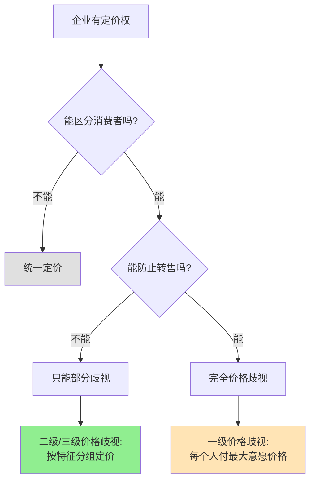

> 同样的商品，不同的价格——这是歧视还是效率？

---

## 飞机上的"价格之谜"

你坐在飞机上，和邻座聊天。

你说："我买了这趟机票花了800元。"
邻座惊讶："什么？我花了1200元！"

你俩看向另一边的乘客："你们花了多少钱？"
- 乘客A："我提前一个月订的，500元。"
- 乘客B："我临时出差，花了2000元！"

**同一架飞机，同一个目的地，同一时间——为什么每个人的票价都不一样？**

这背后藏着经济学的一个重要概念：**价格歧视（Price Discrimination）**。

---

## 价格歧视

**定义：** 对相同商品或服务，向不同消费者收取不同价格。

**简单说就是：** 不是因为你得到的商品不同，而是因为"你"不同，所以价格不同。

### 关键要点

**价格歧视的三个等级：**

| 级别 | 定义 | 例子 | 效率 |
|------|------|------|------|
| **一级** | 每个人付最大意愿价格 | 私人拍卖、定制服务 | 最有效 |
| **二级** | 按购买数量/版本定价 | 批发折扣、软件版本 | 有效 |
| **三级** | 按消费者特征分组 | 学生票、会员价格 | 有效 |

**价格歧视成功的条件：**

| 条件 | 说明 | 例子 |
|------|------|------|
| **市场势力** | 企业有定价权 | 垄断或寡头市场 |
| **可区分消费者** | 能识别不同支付意愿 | 学生证、会员身份 |
| **防止转售** | 无法低价买入高价卖出 | 服务类产品、数字产品 |

**历史小知识：** 价格歧视的概念由英国经济学家阿瑟·塞西尔·庇古（Arthur Cecil Pigou）在1920年的《福利经济学》（The Economics of Welfare）中系统提出。但价格歧视的实践远早于理论——古代商人就知道对富人要价更高。

---

### 为什么价格歧视"不好"却广泛存在？

**看似"不公平"：**

| 看法 | 问题 |
|------|------|
| "同样的商品，应该同样价格" | 忽视了消费者的支付意愿不同 |
| "价格歧视是剥削" | 可能扩大了市场，让更多人能消费 |

**实际的好处：**

| 利益 | 说明 |
|------|------|
| **企业利润增加** | 能从高支付意愿者获得更多收益 |
| **消费者剩余转移** | 高支付意愿者的剩余转移给企业 |
| **市场扩大** | 低支付意愿者也能消费（学生票） |

**总福利分析：**

| 定价方式 | 企业利润 | 消费者剩余 | 总福利 |
|----------|----------|------------|--------|
| 统一定价（高价） | 高（但销量少） | 低（只有高支付意愿者买） | 低 |
| 统一定价（低价） | 低 | 高（但企业可能亏损） | 中 |
| **价格歧视** | **最高** | **中等** | **最高** |

---

## 价格歧视的真实案例

### 航空公司的定价艺术

**背景：** 为什么航空公司能实现近乎完美的价格歧视？

**航空公司的定价策略：**

| 消费者特征 | 价格 | 原因 |
|------------|------|------|
| **商务旅客** | 高（临时购票） | 时间敏感，支付意愿高 |
| **休闲旅客** | 低（提前预订） | 时间灵活，价格敏感 |
| **学生/老人** | 更低 | 收入低，支付意愿低 |

**航空公司的"消费者识别"机制：**

| 信号 | 消费者类型 | 定价策略 |
|------|------------|----------|
| **提前预订时间** | 长 = 休闲，短 = 商务 | 提前越久，价格越低 |
| **是否过夜** | 不愿过夜 = 商务 | 周末航班更便宜 |
| **是否退改签** | 不需要 = 休闲 | 不可退改机票更便宜 |

**价格歧视的"漏洞"：**

| 策略 | 说明 |
|------|------|
| **隐藏城市票** | A→C经B，但A→B更便宜，买了A→C在B下机 |
| **分段购票** | A→B→C比A→C更便宜 |
| **空肚购票** | 不托运行李，避免被识别为商务客 |

**数据支撑：**

研究显示（根据民航局《2023年航空运输市场报告》），同一航班的价格差异可达10倍：
- 提前2个月预订：500元
- 临时购票：5000元
- 航空公司的收入比统一定价高出30%以上

**关键洞察：**
> 航空公司的价格歧视之所以有效，是因为**服务无法转售**（你不能买了票再卖给别人）且**能精确识别消费者类型**（通过购买行为）。这种"精准歧视"让航空公司能够从每个消费者那里榨取最大的支付意愿，同时让价格敏感的消费者也能出行。**结果是效率最大化**——虽然看起来"不公平"，但总福利最高。

---

### 外卖会员的"千人千价"

**背景：** 为什么外卖平台给不同用户的会员价格不一样？

**外卖平台的定价策略：**

| 用户特征 | 会员价格 | 原因 |
|----------|----------|------|
| **高频用户** | 优惠多 | 价格敏感，容易流失 |
| **低频用户** | 优惠少 | 价格不敏感 |
| **新用户** | 巨额优惠 | 获客成本高 |
| **老用户** | 优惠少 | 已形成习惯 |

**大数据的"价格歧视"：**

| 数据维度 | 用途 |
|----------|------|
| **地理位置** | 富裕区 vs 贫困区 |
| **手机型号** | iPhone用户支付意愿高 |
| **历史订单** | 价格敏感度 |
| **点击行为** | 购买意愿 |

**外卖会员的"歧视矩阵"：**

| 用户类型 | 折扣力度 | 逻辑 |
|----------|----------|------|
| 价格敏感型 | 高（8折） | 不给优惠就流失 |
| 价格不敏感型 | 低（9.5折） | 给不给优惠都会买 |
| 新用户 | 极高（首单5折） | 获客 |
| 流失风险用户 | 高（召回优惠） | 留存 |

**为什么外卖能实现"个性化定价"？**

| 特点 | 说明 |
|------|------|
| **数据丰富** | 平台掌握用户全方位数据 |
| **实时调整** | 价格可以实时变化 |
| **无法比价** | 每个人看到的页面不同 |
| **无法转售** | 服务类产品，无法转卖 |

**关键洞察：**
> 外卖平台的大数据定价展示了**价格歧视的未来**——不是粗放地按"学生/成人"分组，而是**精确到每个个人的个性化定价**。这种"一级价格歧视"的近似实现，让平台能从每个消费者那里获得最大利润。**但这也带来了隐私和公平问题**——当算法知道你的支付意愿，你是否还有"议价权"？

---

## 价格歧视的应用

### 企业视角：如何设计价格歧视？

**步骤1：识别不同消费者群体**

| 维度 | 分析问题 |
|------|----------|
| 支付意愿 | 谁愿意付更多？为什么？ |
| 价格敏感度 | 谁会因涨价流失？ |
| 转换成本 | 谁不容易流失？ |

**步骤2：设计"筛选机制"**

| 机制 | 例子 |
|------|------|
| **时间筛选** | 提前购票优惠 |
| **版本筛选** | 标准版 vs 专业版 |
| **数量筛选** | 批发折扣 |
| **身份筛选** | 学生票、老年票 |

**步骤3：防止套利**

| 方法 | 说明 |
|------|------|
| **限制转售** | 服务、数字产品 |
| **实名制** | 机票、火车票 |
| **差异化服务** | 不同等级不同服务 |

---

### 消费者视角：如何应对价格歧视？

| 策略 | 说明 |
|------|------|
| **隐藏支付意愿** | 不要暴露你急需、不差钱 |
| **利用价格歧视** | 换个账号、换个设备、换个时间看价格 |
| **等待优惠** | 价格歧视通常有"时间优惠" |
| **集体议价** | 团购、拼单 |

---

### 常见误区

| 误区 | 正解 |
|------|------|
| "价格歧视总是坏事" | 可能扩大市场，让更多人消费 |
| "商家可以随意定价" | 价格歧视受市场竞争和监管限制 |
| "价格歧视等于暴利" | 价格歧视可能让总福利最大 |
| "我能避免价格歧视" | 几乎所有行业都有某种价格歧视 |

---

## 延伸思考

1. **算法定价的伦理**：当AI能精确预测你的支付意愿，价格歧视将变得"个性化"到极致。这是效率还是剥削？需要监管吗？

2. **医疗价格歧视**：同样的药物，富国价格高、穷国价格低——这是药品公司的"慈善"，还是利润最大化的策略？如果穷国药品被转卖回富国（灰色市场），谁应该负责？

3. **教育价格歧视**：大学对不同收入家庭收取不同学费（财务援助）。这是公平的价格歧视，还是另一种形式的不平等？

**下期预告：** 我们来探讨**信息与柠檬市场**——为什么二手车市场充满了劣质车？直播带货如何建立信任？信息不对称如何导致市场失灵？

---

**数据来源：** 民航局《2023年航空运输市场报告》、国家铁路集团票价政策数据（2023）、外卖平台大数据分析（QuestMobile, 2023）、价格歧视理论文献（Pigou, 1920）
