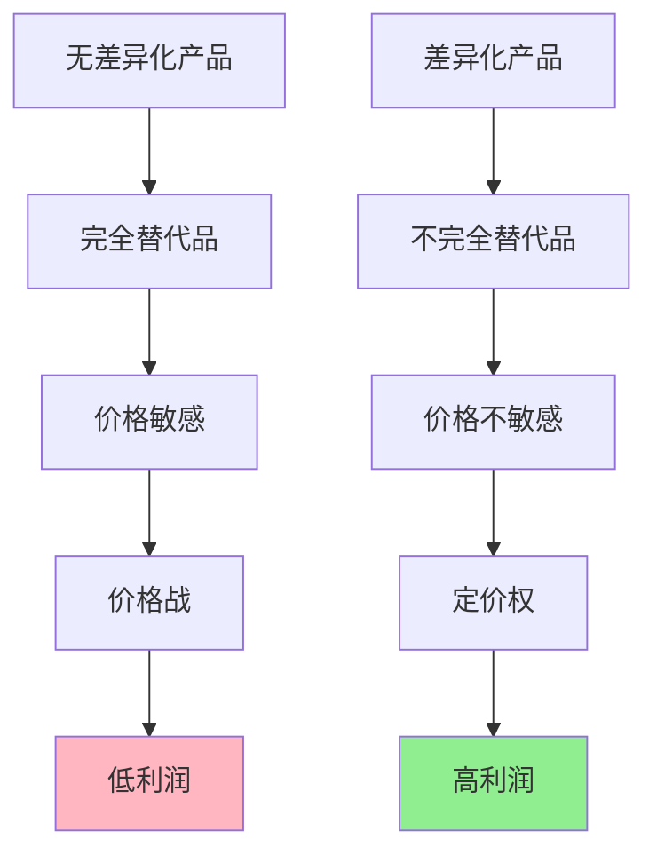

> 差异化是竞争的解药

---

**数据来源：** 星巴克财报（2018-2023）、蜜雪冰城门店数据（2023）、W. 钱·金与勒妮·莫博涅《蓝海战略》（2005）、爱德华·张伯伦《垄断竞争理论》（1933）

## 咖啡的价差之谜

星巴克一杯拿铁：35元
瑞幸一杯拿铁：18元
便利店一杯拿铁：10元
速溶咖啡：2元

**问题：** 为什么同样是"咖啡"，价格差距如此巨大？
**更深的问题：** 如何通过差异化避开价格战？

这背后藏着一个经济学核心概念：**产品差异化（Product Differentiation）**。

---

## 产品差异化

**定义：** 通过产品特性、品牌、服务等方面，使自己的产品与竞争对手的产品有所区别。

**简单说就是：** 让消费者认为"你的产品不是别人的产品的完美替代品"。



### 关键要点

**差异化的类型：**

| 类型 | 定义 | 例子 |
|------|------|------|
| **水平差异化** | 偏好差异，无"好坏" | 可乐vs百事、红色vs蓝色 |
| **垂直差异化** | 质量差异，有"高低" | iPhonevs山寨机、奔驰vs奇瑞 |

**差异化的来源：**

| 来源 | 例子 |
|------|------|
| **物理特性** | 更快、更轻、更耐用 |
| **品牌形象** | 奢侈品、环保、科技感 |
| **服务体验** | 更好的客服、更快的配送 |
| **地理位置** | 便利性、社区感 |
| **时间** | 先发优势、最新款 |

**蓝海战略（Blue Ocean Strategy）：**

> 创造新市场空间，而非在现有市场血战。

| 红海 | 蓝海 |
|------|------|
| 现有市场 | 新市场 |
| 竞争激烈 | 竞争缺乏 |
| 利润微薄 | 利润丰厚 |
| 价格战 | 价值创新 |

**历史小知识：** 爱德华·张伯伦1933年在《垄断竞争理论》中首次系统阐述了产品差异化概念。W. 钱·金和勒妮·莫博涅2005年出版《蓝海战略》，将差异化推向新高度。

---

### 为什么差异化如此重要？

**价格战的死循环：**

```
无差异化 → 完全替代 → 价格敏感 → 价格战 → 利润→0
```

**差异化的出路：**

```
差异化 → 不完全替代 → 价格不敏感 → 定价权 → 高利润
```

**消费者为何愿意付溢价？**

| 原因 | 例子 |
|------|------|
| **质量信号** | 昂贵=高质量（有时） |
| **社会地位** | 奢侈品、豪车 |
| **情感连接** | 品牌、故事、价值观 |
| **便利性** | 位置、时间、精力 |
| **风险规避** | 知名品牌更可靠 |

---

## 差异化的真实案例

### Starbucks：卖的不是咖啡

**背景：** 为什么星巴克能卖出高溢价？

**星巴克的差异化矩阵：**

| 维度 | 星巴克 | 便利店咖啡 | 差异化价值 |
|------|--------|------------|------------|
| **产品** | 精品咖啡豆、标准化 | 普通、不稳定 | ✅ |
| **环境** | "第三空间" | 无 | ✅✅✅ |
| **服务** | 友好、个性化 | 交易性 | ✅✅ |
| **品牌** | 生活方式象征 | 无 | ✅✅✅ |

**星巴克的"第三空间"概念：**

| 场所 | 功能 |
|------|------|
| 家 | 私人空间 |
| 工作/学校 | 工作空间 |
| **星巴克** | **"第三空间"——社交、休闲、办公** |

**为什么愿意付溢价？**

| 价值 | 说明 |
|------|------|
| **便利性** | 随处都有，不用找 |
| **一致性** | 全球一个味道 |
| **体验** | 环境好、WiFi、插座 |
| **社交货币** | "我在星巴克"发朋友圈 |

**数据支撑：**

| 指标 | 星巴克 | 便利店 |
|------|--------|--------|
| 拿铁价格 | 35元 | 10元 |
| 毛利率 | ~75% | ~50% |
| 会员留存率 | 75%+ | <30% |
| 单店年营收 | 1000万+ | 200万 |

**关键洞察：**
> 星巴克的差异化不是"更好的咖啡"，而是"完全不同的东西"。**星巴克卖的是"空间"和"体验"，而非咖啡本身**。当你买星巴克，你买的是：
> - 一个可以办公、社交、放松的地方
> - 一个身份标签（"我喝星巴克"）
> - 一个可预期的体验（全球一致）
> **这就是差异化的本质**：不是"更好"，而是"不同"——不同到无法比较，也就没有价格战。

---

### 蜜雪冰城：下沉市场的王者

**背景：** 为什么蜜雪冰城能以3元奶茶攻占下沉市场？

**蜜雪冰城的差异化：**

| 维度 | 蜜雪冰城 | 喜茶/奈雪 |
|------|----------|-----------|
| **价格** | 3-8元 | 15-30元 |
| **定位** | 下沉市场、小镇青年 | 一二线城市、白领 |
| **产品** | 基础款、经典款 | 创新、时令款 |
| **选址** | 学校、社区、小城镇 | 商场、写字楼 |

**蜜雪冰城的"不可能三角"破解：**

| 三角 | 传统观点 | 蜜雪冰城 |
|------|----------|----------|
| **价格低** | 与成本冲突 | ✅ 规模经济 |
| **质量好** | 与价格冲突 | ✅ 专注核心款 |
| **门店多** | 与管理冲突 | ✅ 加盟模式 |

**为什么能这么便宜？**

| 原因 | 说明 |
|------|------|
| **自建供应链** | 自己生产原料，降低成本 |
| **规模经济** | 2万+门店，采购成本极低 |
| **简化产品** | 只做经典款，减少创新成本 |
| **加盟模式** | 加盟商承担主要成本 |

**数据支撑：**

| 指标 | 蜜雪冰城 | 行业平均 |
|------|----------|----------|
| 门店数量 | 2.3万+ | 100-500 |
| 平均客单价 | 8元 | 15-25元 |
|毛利率 | ~50% | ~65% |
| 净利率 | ~15% | ~10% |

**关键洞察：**
> 蜜雪冰城的差异化是**定位差异化**——不是和喜茶、奈雪在同一市场竞争，而是开辟了"下沉市场"这个蓝海。**蜜雪冰城的成功不是"低价"本身，而是"低价+可达性+品质一致性"的组合**：
> - 低价让小镇青年消费得起
> - 门店无处不在（2.3万+）
> - 品质一致（不像山寨店）
> **蜜雪冰城证明了差异化不一定是"高端"，也可以是"大众"**——关键是找到你的目标客户，并满足他们的需求。

---

## 如何建立差异化？

### 差异化策略

**策略1：产品差异化**

| 方法 | 例子 |
|------|------|
| **质量领先** | iPhone、戴森 |
| **功能创新** | 特斯拉（电动车）、戴森（无叶风扇） |
| **设计领先** | Apple、Dyson |

**策略2：服务差异化**

| 方法 | 例子 |
|------|------|
| **极致服务** | 海底捞、丽思卡尔顿 |
| **便利性** | 7-Eleven、Amazon Prime |
| **个性化**| 推荐算法、定制服务 |

**策略3：品牌差异化**

| 方法 | 例子 |
|------|------|
| **奢侈品** | 爱马仕、劳力士 |
| **价值观** | Patagonia（环保）、Tesla（可持续） |
| **故事** | 故事化品牌（褚橙、老干妈） |

**策略4：定位差异化**

| 方法 | 例子 |
|------|------|
| **高端定位** | 奔驰、宝马 |
| **下沉定位** | 蜜雪冰城、拼多多 |
| **利基市场** | Lululemon（瑜伽）、GoPro（运动相机） |

---

### 蓝海战略框架

**四步动作框架：**

| 动作 | 问题 | 例子 |
|------|------|------|
| **消除** | 哪些应该被消除？ | 消除不需要的功能 |
| **减少** | 哪些应该减少到行业标准以下？ | 减少SKU、简化流程 |
| **增加** | 哪些应该增加到行业标准以上？ | 增加服务、体验 |
| **创造** | 哪些从未提供过？ | 创造新价值 |

**例子： Cirque du Soleil（太阳马戏团）**

| 动作 | 传统马戏团 | 太阳马戏团 |
|------|------------|------------|
| **消除** | 动物表演 | ✅ |
| **减少** | 明星表演者 | ✅ |
| **增加** | 艺术性、音乐、故事 | ✅✅✅ |
| **创造** | 马戏团+剧场结合 | ✅ |

---

## 应用与决策

### 企业决策

| 情况 | 建议 |
|------|------|
| **同质化竞争** | 找到差异化方向 |
| **价格战** | 退出红海，寻找蓝海 |
| **新进入者** | 寻找利基市场 |

### 个人职业

| 选择 | 建议 |
|------|------|
| **技能差异化** | 不要只做"通用型人才" |
| **个人品牌** | 建立独特声誉 |
| **利基市场** | 找到"小而美"的定位 |

---

### 常见误区

| 误区 | 正解 |
|------|------|
| "差异化=高质量" | 差异化可以是任何方向，包括"低价" |
| "差异化一定赚钱" | 差异化需要消费者认可和付费 |
| "差异化一旦建立就永久" | 差异化需要持续维护 |
| "所有人都是我的客户" | 差异化意味着放弃一部分客户 |

---

## 延伸思考

1. **AI时代的差异化**：当AI能让所有公司都快速"复制"差异化（如AI设计、AI客服），差异化还有意义吗？新的差异化来源会是什么？

2. **"伪差异化"的陷阱**：有些"差异化"只是营销噱头（如"有机"、"无添加"被滥用）。消费者如何识别真伪差异化？监管应该介入吗？

3. **差异化的伦理问题**：奢侈品的差异化很大程度上是"品牌故事"和"社会地位"——这是一种"制造"的差异，还是有真实价值？

**下期预告：** 我们来探讨**进入壁垒与退出壁垒**——为什么社交网络壁垒如此之高？芯片行业为什么难以进入？

---

**数据来源：** 星巴克财报、蜜雪冰城门店数据（2023）、W. 钱·金与勒妮·莫博涅《蓝海战略》（2005）、爱德华·张伯伦《垄断竞争理论》（1933）
