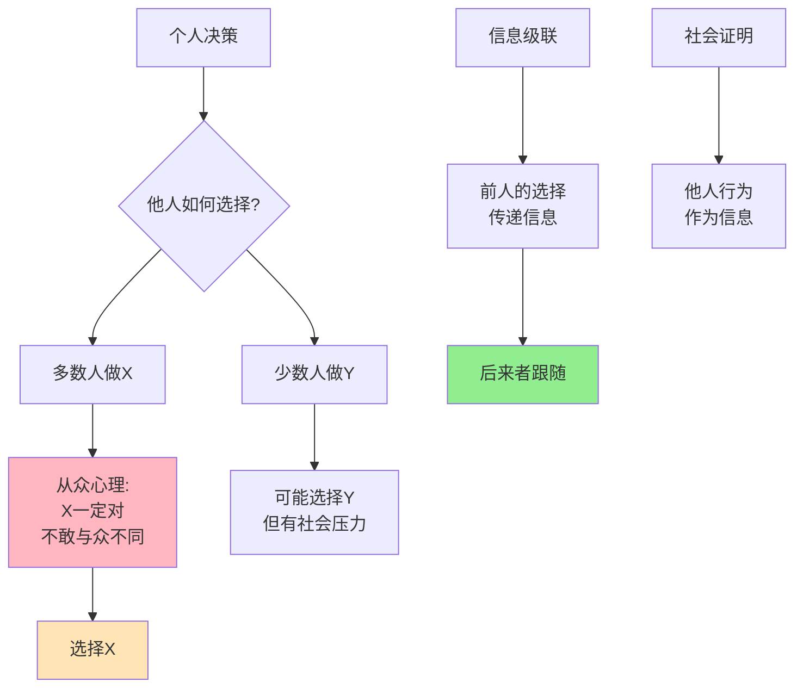

> 个人理性，集体疯狂

---

**数据来源：** 网红店排队行为研究（2022-2023）、GameStop逼空事件数据（2021）、所罗门·阿希线段实验（1951）、比克查达尼等《信息级联》（1992）

## 网红店的排队之谜

某网红奶茶店开业，排队2小时。

小李路过，心想："这么多人排队，一定很好喝。"
于是他也排了。

实际上，奶茶味道一般，但小李还是很开心——"我喝到了网红奶茶！"

**问题：** 为什么我们总跟着别人做？
**更深的问题：** 为什么"大家都在做"会成为行动的理由？

这背后藏着一个行为经济学核心概念：**从众与羊群效应（Conformity and Herd Behavior）**。

---

## 从众与羊群效应

**定义：**
- **从众（Conformity）**：个人行为受群体影响，与群体保持一致
- **羊群效应（Herd Behavior）**：个体模仿他人行为，导致集体行为

**简单说就是：** "别人都在做，我也做。"

### 关键要点

**从众的动机：**

| 动机 | 说明 |
|------|------|
| **信息性影响** | "别人知道我不知道的" |
| **规范性影响** | "不想与众不同" |
| **社会压力** | "害怕被排斥" |
| **降低决策成本** | "跟随比思考简单" |

**信息级联（Information Cascade）：**

> 前人的选择传递信息，后来者忽略自己的信息，跟随前人。

| 顺序 | A选择 | B选择 | C选择 |
|------|--------|--------|--------|
| 1 | 看到信号X，选择X | - | - |
| 2 | - | 看到信号Y，但A选X → A可能有更多信息 → 选X | - |
| 3 | - | - | 看到信号Z，但A、B都选X → 他们可能知道什么 → 选X |

**社会证明（Social Proof）：**

> 他人的行为作为"什么是正确"的证据。

| 情况 | 社会证明 |
|------|----------|
| **不确定时** | 看别人怎么做 |
| **紧急时** | 跟随多数人 |
| **陌生环境** | 模仿他人 |

**历史小知识：** 从众效应的经典实验是所罗门·阿希1951年的线段判断实验。信息级联由比克查达尼、赫什莱佛和韦尔奇1992年提出。罗伯特·席勒在《非理性繁荣》（2000）中分析了羊群效应。

---

### 为什么从众如此普遍？

**进化论的解释：**

| 原因 | 说明 |
|------|------|
| **生存优势** | 跟随群体更安全 |
| **学习机制** | 模仿是学习的重要方式 |
| **社会凝聚力** | 一致性增强群体凝聚力 |

**心理机制：**

| 机制 | 影响 |
|------|------|
| **认知简化** | 跟随比独立思考简单 |
| **错误规避** | "跟随大众，大众错了也不只我错" |
| **归属需求** | 与群体一致=被接受 |

---

## 从众与羊群效应的真实案例

### 网红店排队

**背景：** 为什么网红店总有排队？

**网红店的从众机制：**

| 机制 | 说明 |
|------|------|
| **社会证明** | "这么多人排队，一定好" |
| **FOMO（错失恐惧）** | "大家都在体验，我也要" |
| **社交货币** | "我也去过了"可以发朋友圈 |
| **从众压力** | "不去就out了" |

**排队本身的"信号"作用：**

| 观察者 | 推理 |
|--------|------|
| 路人 | "有排队=好吃/有价值" |
| 路人 | "加入排队" |
| 排队更长 | "更强信号" |
| **更多人加入** | **自我强化** |

**数据支撑：**

研究显示：
- 约70%的人会因为"他人排队"而加入排队
- 约60%的人会因"朋友推荐"而尝试（从众的延伸）
- 排队本身成为"质量信号"，即使产品质量一般

**关键洞察：**
> 网红店排队是**社会证明+信息级联**的完美案例：
> - **社会证明**：排队=质量信号
> - **信息级联**：每个人加入排队，强化信号
> - **自我强化**：排队越长，越多人加入
> **这是非理性的**：你不知道产品好不好，只是看到别人排队，就假设"一定好"。**但这也是理性的"**：在信息不完全时，跟随他人是合理的启发式策略。**商家利用从众心理，创造"虚假繁荣"**（雇人排队、刷好评），这进一步强化了羊群效应。

---

### GameStop逼空事件

**背景：** 为什么散户集体买入GameStop，导致华尔街空头损失数十亿？

**事件时间线：**

| 时间 | 事件 |
|------|------|
| 2020年 | Reddit用户注意到GameStop被大量做空 |
| 2021年1月 | 散户集体买入，股价暴涨 |
| 2021年1月28日 | 股价达483美元（年初20美元） |
| 2021年2月 | 股价回落，但散户"hold the line" |

**羊群效应机制：**

| 机制 | 说明 |
|------|------|
| **信息级联** | 前人买入传递"有利"信息 |
| **社会证明** | "大家都在买，我也要买" |
| **共同叙事** | "散户vs华尔街"的叙事 |
| **FOMO** | "不买就错过暴富机会" |

**社会媒体的作用：**

| 平台 | 作用 |
|------|------|
| **Reddit** | 信息传播、协调 |
| **Twitter/X** | 信号放大、FOMO |
| **YouTube** | 叙事构建（"散户英雄"） |

**数据支撑：**

| 指标 | 数据 |
|------|------|
| 峰值股价 | $483（1月28日） |
| 空头损失 | ~$200亿 |
| Reddit用户增长 | r/wallstreetbets从100万到1000万+ |
| 散户参与度 | 数百万散户买入 |

**关键洞察：**
> GameStop逼空是**羊群效应+社会媒体+叙事**的完美风暴：
> - **羊群效应**：散户跟随散户买入
> - **社会媒体**：Reddit、Twitter加速信息级联
> - **叙事构建**："散户vs华尔街"、"stick together"
> - **FOMO**：不买就错过暴富机会
> **这是理性的吗？** 个体可能是理性的（跟随群体），但集体结果是**非理性的泡沫**：
> - 股价远超基本面
> - 最终破裂，后期买入者亏损
> **GameStop展示了羊群效应的力量**：即使是最传统的市场（股票），也无法避免群体疯狂。

---

## 如何应对从众与羊群效应？

### 个人视角

**策略1：独立思考**

| 行动 | 说明 |
|------|------|
| **问自己** | "我真的需要/喜欢吗？" |
| **忽略信号** | 排队长度、销量不是质量信号 |
| **等待观察** | 等待更多信息，而非立即行动 |

**策略2：寻找反信号**

| 行动 | 说明 |
|------|------|
| **寻找负面信息** | 主动搜索差评、批评 |
| **等待"冷静期"** | 激情过后再决定 |
| **咨询不同意见** | 找持不同观点的人 |

**策略3：长期视角**

| 行动 | 说明 |
|------|------|
| **关注长期价值** | 而非短期热闹 |
| **忽略FOMO** | "错过"不是损失 |
| **建立个人标准** | 而非随大流 |

---

### 企业/营销视角

**利用从众效应：**

| 策略 | 例子 |
|------|------|
| **社会证明** | 用户数、好评数 |
| **制造排队** | 限量、限购 |
| **KOL/网红** | 意见领袖引导 |
| **大家都在买** | 销量、排名展示 |

**应对从众风险：**

| 风险 | 应对 |
|------|------|
| **泡沫破裂** | 不要过度依赖羊群效应 |
| **负面传播** | 监控社交媒体，及时应对 |
| **监管风险** | 从众营销可能违规 |

---

## 应用与决策

### 个人决策

| 决策 | 从众陷阱 | 理性做法 |
|------|----------|----------|
| 消费 | "大家都在买" | "我真的需要吗？" |
| 投资 | "大家都在买股票" | "基本面如何？" |
| 职业选择 | "大家都去互联网" | "我适合吗？" |

### 企业战略

| 策略 | 从众应用 |
|------|----------|
| 产品推广 | 利用"社会证明" |
| 定价策略 | 利用"锚定+从众" |
| 营销活动 | 制造"稀缺性"激发从众 |

---

### 常见误区

| 误区 | 正解 |
|------|------|
| "从众总是非理性的" | 从众有时是合理的启发式策略 |
| "独立思考总是对的" | 有时跟随群体更安全 |
| "羊群效应可以避免" | 可以管理，无法消除 |
| "只有大众有从众" | 精英、专家也有从众 |

---

## 延伸思考

1. **社交媒体的"回音室"**：算法推荐让我们只看到同质化内容，这是否强化了从众？如何打破"信息茧房"？

2. **专家的从众**：为什么专家、分析师也会从众？2008金融危机前，为什么几乎所有评级机构都给MBS最高评级？

3. **反从众的"反叛"**：有时"反从众"本身也是一种从众（"特立独行"群体）。真正的独立思考是什么？

**下期预告：** 我们来探讨**社会偏好**——为什么直播打赏如此盛行？众筹为什么能成功？企业社会责任不只是慈善？

---

**数据来源：** 网红店排队行为研究（2022-2023）、GameStop逼空事件数据（2021）、所罗门·阿希线段实验（1951）、比克查达尼等《信息级联》（1992）
