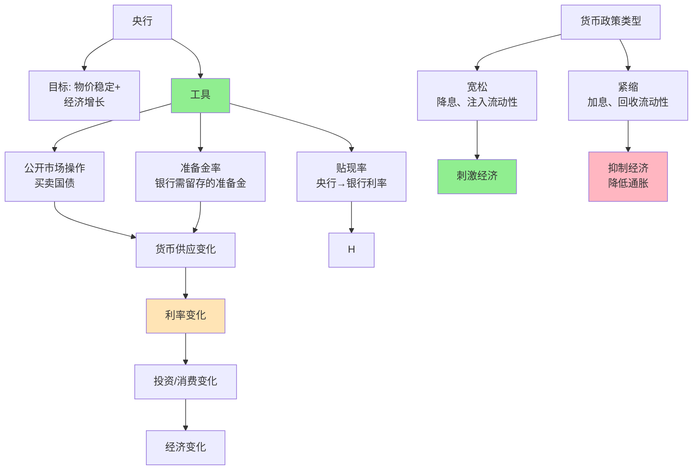

> 货币的力量

---

**数据来源：** 美联储数据、人民银行数据、货币政策理论文献、米尔顿·弗里德曼《货币的最优数量》（1969）、伯南克与格特勒《货币政策传导机制》（1995）

## 美联储加息的全球影响

2022年，美联储开始加息：
- 2022年3月：0.25%
- 2022年12月：4.25%
- 2023年7月：5.25%

**影响：**
- 全球股市下跌
- 新兴市场资本外流
- 中国被动贬值

**问题：** 为什么美联储加息影响全球？
**更深的问题：** 央行如何通过货币政策影响经济？

这背后藏着一个经济学核心概念：**货币政策与央行（Monetary Policy and Central Banking）**。

---

## 货币政策与央行

**定义：**
- **货币政策**：央行通过控制货币供应量和利率来影响经济
- **央行（中央银行）**：负责货币政策的机构（"最后贷款人"）

**简单说就是：**
- 货币政策 = "收放水"的工具
- 央行 = "控制水龙头"的机构



### 关键要点

**货币政策的类型：**

| 类型 | 定义 | 例子 |
|------|------|------|
| **宽松（扩张性）** | 增加货币供应、降低利率 | 2008金融危机后、2020年疫情期间 |
| **紧缩（收缩性）** | 减少货币供应、提高利率 | 1980年代抗通胀、2022年抗通胀 |

**货币政策工具：**

| 工具 | 定义 | 作用 |
|------|------|------|
| **公开市场操作** | 买卖国债 | 调整基础货币 |
| **贴现率** | 央行→银行利率 | 传导利率变化 |
| **准备金率** | 银行需留存的准备金比例 | 调整货币乘数 |

**货币传导机制（Transmission Mechanism）：**

```
央行政策 → 基础货币 → 商业银行货币供应 → 利率 → 投资/消费 → GDP
```

| 阶段 | 机制 | 影响 |
|------|------|------|
| **1. 央行→银行** | 基础货币↑ → 超额准备金↑ | 银行可贷资金↑ |
| **2. 银行→利率** | 可贷资金↑ → 贷款利率↓ | 借款成本↓ |
| **3. 利率→投资/消费** | 利率↓ | 投资和消费↑ |
| **4. 投资/消费→GDP** | 需求↑ | GDP↑ |

**历史小知识：** 现代央行制度源于19世纪（英格兰银行1694年成立）。美联储1913年成立，是现代央行的典范。货币政策理论由米尔顿·弗里德曼（1968年提出"货币主义"）发展。

---

### 为什么货币政策如此重要？

**经济稳定：**

| 目标 | 货币政策作用 |
|------|----------------|
| **物价稳定** | 控制通胀/通缩 |
| **充分就业** | 通过刺激/抑制经济 |
| **金融稳定** | 作为"最后贷款人" |

**长期增长：**

| 目标 | 货币政策作用 |
|------|----------------|
| **价格稳定** | 预期稳定，降低投资风险 |
| **金融中介** | 促进储蓄→投资 |
| **危机应对** | 提供流动性 |

---

## 货币政策的真实案例

### 美联储加息

**背景：** 为什么美联储加息影响全球？

**加息的逻辑：**

| 逻辑 | 链条 |
|------|------|
| **美联储加息** | → 美元利率↑ |
| 美元利率↑ | → 资本流入美国（寻求更高收益） |
| 资本流入美国 | → 美元汇率↑ |
| 美元汇率↑ | → 其他货币贬值 |
| 其他货币贬值 | → 新兴市场资本外流、通胀 |

**2022-2023加息的全球影响：**

| 影响 | 说明 |
|------|------|
| **全球股市下跌** | 美元加息→全球资金回流美国 |
| **新兴市场压力** | 资本外流、货币贬值、通胀 |
| **债务危机** | 美元加息→美元债务负担加重（斯里兰卡违约） |

**美联储的"双重使命"：**

| 使命 | 指标 | 现实 |
|------|------|------|
| **物价稳定** | 2%通胀率 | 2022年超过8% |
| **充分就业** | 4-5%失业率 | 2022年约4% |

**数据支撑：**

| 日期 | 利率 | 累计加息 |
|------|------|----------|
| 2022年3月 | 0.25-0.50% | +0.25% |
| 2022年12月 | 4.25-4.50% | +4.25% |
| 2023年7月 | 5.25-5.50% | +5.25% |

**关键洞察：**
> 美联储加息的全球影响是**美元霸权+资本流动+通胀输入**的组合：
> - **美元霸权**：美元是全球储备货币、计价货币、结算货币
> - **资本流动**：利率差→资本流动→汇率变化
> - **通胀输入**：美元升值→新兴市场进口美元商品变贵
> - **这是"全球货币政策协调"的挑战**：
>   - 美联储只考虑美国经济（美国优先）
>   - 但加息影响全球经济（资本流动、汇率、债务）
>   - **不可能三角**：
>     - 固定汇率 vs 独立货币政策 vs 资本自由流动
>     - 中国选择：管理浮动汇率+独立货币政策+资本管制
>   - **对货币政策的启示**：
>     - **全球央行的协调**：美元霸权意味着美国有"超级特权"（exorbitant privilege）
>     - **新兴市场挑战**：加息周期中，新兴市场面临"三难选择"
>     - **数字货币的潜在影响**：如果人民币/欧元数字化，美元霸权是否会削弱？

---

### 中国降准与数字货币

**背景：** 为什么中国用降准、数字货币？

**降准（降低存款准备金率）的逻辑：**

| 逻辑 | 链条 |
|------|------|
| **降准** | → 银行需要上缴的准备金↓ |
| 准备金↓ | → 银行可贷资金↑ |
| 可贷资金↑ | → 贷款利率↓ |
| 利率↓ | → 投资、消费↑ |

**数字货币的逻辑：**

| 功能 | 说明 |
|------|------|
| **支付系统 | | 数字人民币=电子现金，降低支付成本 |
| **货币政策工具** | 央行直接向个人/企业放款（数字货币） |
| **国际化** | 数字人民币=国际支付，减少美元依赖 |

**降准 vs 其他工具：**

| 工具 | 优点 | 缺点 |
|------|------|------|
| **降准** | 长期、大规模、释放银行流动性 | 信号强（可能有副作用） |
| **MLF（中期借贷便利）** | 中期、定向、灵活 | 规模有限 |
| **逆回购** | 短期、精确、灵活 | 非常短期（7天） |

**数据支撑：**

| 时期 | 政策 | M2增长 |
|------|------|---------|
| **2020年疫情期** | 降准3次、MLF大量投放 | 10%+（刺激经济） |
| **2021-2022年收紧期** | MLF缩表、严监管 | 8%左右（去杠杆） |
| **2023年宽松期** | 降准2次 | 10%+（刺激经济） |

**关键洞察：**
> 中国货币政策的**降准+数字货币**组合：
> - **降准**：长期、大规模释放流动性
> - **数字货币**：提高支付效率、降低对美元依赖
> - **中国的"三策齐下"**：
>   - **数量型工具**：降准、MLF（投放流动性）
>   - **价格型工具**：利率（影响资金成本）
>   - **宏观审慎**：窗口指导、监管（引导资金流向）
> - **数字货币的"战略意义"**：
>   - **支付效率**：降低交易成本、提高货币流通速度
>   - **货币政策直达**：央行→个人/企业（绕过商业银行）
>   - **国际化**：减少对SWIFT系统依赖、推进人民币国际化
>   - **但数字货币的挑战**：
>     - **隐私**：数字货币可追踪，匿名性消失
>     - **双花**：技术问题（虽已解决，但仍需验证）
>     - **数字威权**：央行数字货币=央行权力扩大
>   - **对货币政策的启示**：
>     - **货币政策需要"多层次工具"**：
>       - 不只依赖利率（像美国）
>       - 也用数量型工具（降准、MLF）
>       - 也用宏观审慎（监管、引导）
>     - **数字货币是"货币的未来"**：
>       - 不只是"现金的数字化"
>       - 更是"货币+数据+智能合约"的结合
>       - **但需要谨慎**：隐私、权力、技术风险

---

## 货币政策工具

### 扩张性货币政策

| 工具 | 操作 | 效果 |
|------|------|------|
| **公开市场买入** | 买国债 | 注入流动性 |
| **降息** | 降低贴现率 | 降低利率 |
| **降准** | 降低准备金率 | 释放流动性 |
| **非常规政策** | QE、收益率曲线控制、前瞻性指导 | 危度宽松 |

### 紧缩性货币政策

| 工具 | 操作 | 效果 |
|------|------|------|
| **公开市场卖出** | 卖国债 | 回收流动性 |
| **加息** | 提高贴现率 | 提高利率 |
| **加息准** | 提高准备金率 | 收缩流动性 |
| **量化紧缩** | 缩表、利率正常化 | 减少资产负债表 |

---

## 应用与决策

### 央行视角

| 决策 | 货币政策应用 |
|------|----------------|
| **通胀高企** | 加息、缩表、紧缩 |
| **经济衰退** | 降息、QE、宽松 |
| **债务危机** | 提供最后贷款人 |

### 个人/企业视角

| 决策 | 货币政策影响 |
|------|----------------|
| **买房** | 降息→房贷利率↓；加息→房贷利率↑ |
| **投资** | 降息→股市↑；加息→股市↓ |
| **企业经营** | 利率↓→融资成本↓；利率↑→融资成本↑ |

---

### 常见误区

| 误区 | 正解 |
|------|------|
| "宽松货币总是好" | 可能导致通胀、债务危机 |
| "紧缩货币总是坏" | 可能导致衰退、失业 |
| "央行全能" | 央行也受制约（经济、政治、外部） |
| "政策独立" | 全球化时代，各国政策相互影响 |

---

## 延伸思考

1. **数字货币的"货币主权"**：如果各国央行数字货币兴起，美元霸权会削弱吗？还是会形成"数字美元霸权"？

2. **货币政策的"零利率下限"**：当利率接近0%，央行如何刺激经济？QE（量化宽松）是否有效？是否有"负利率"的可能？

3. **去美元化**：俄罗斯、中国等推动"去美元化"——用本币、黄金、数字货币替代美元。这是否可能？需要什么条件？

**下期预告：** 我们来探讨**失业与就业市场**——为什么会有"35岁危机"？青年失业为何如此严重？

---

**数据来源：** 美联储数据、人民银行数据、货币政策理论文献、米尔顿·弗里德曼《货币的最优数量》（1969）、伯南克与格特勒《货币政策传导机制》（1995）
