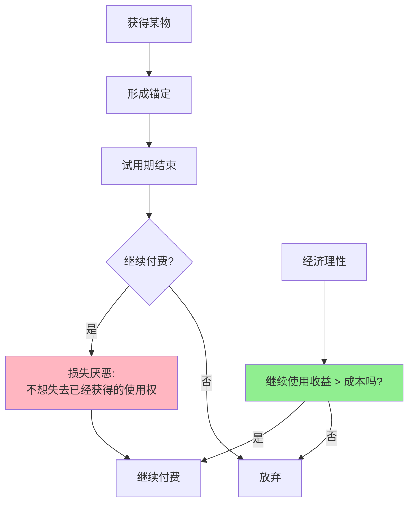

> 损失和获得，不在天平两端

---

**数据来源：** 免费试用转化率研究（2018-2023）、股民行为研究（2015-2023）、丹尼尔·卡尼曼与阿莫斯·特沃斯基《前景理论》（1979）、特沃斯基与卡尼曼《锚定与调整启发法》（1974）

## 免费试用的魔法

你看到一款新APP：
- 免费试用30天
- 30天后自动扣费9.9元/月

你想："反正免费，试试再说。"

30天后，你自动续费了。
即使你很少用这个APP，你也懒得取消。

**问题：** 为什么免费试用期如此有效？为什么我们不愿意"失去"已经获得的东西？

这背后藏着行为经济学两个核心概念：**损失厌恶与锚定**。

---

## 损失厌恶与锚定

**定义：**
- **损失厌恶（Loss Aversion）**：失去的痛苦 > 获得的快乐（约2.5倍）
- **锚定（Anchoring）**：第一印象或初始信息影响后续判断

**简单说就是：**
- 损失厌恶 = "失去100元的痛苦 > 获得100元的快乐"
- 锚定 = "第一印象影响后续判断"

### 关键要点

**损失厌恶的特征：**

| 特征 | 说明 | 比例 |
|------|------|------|
| **不对称性** | 失去 > 获得 | 约2.5:1 |
| **参照点依赖** | 相对于参照点判断得失 | 现状常是参照点 |
| **现状偏见** | 偏好维持现状 | 不想改变 |

**锚定的类型：**

| 类型 | 定义 | 例子 |
|------|------|------|
| **数值锚定** | 初始数值影响判断 | 原价、折扣价 |
| **顺序锚定** | 第一印象深刻 | 面试第一印象 |
| **范围锚定** | 给定范围影响判断 | 价格范围 |

**禀赋效应（Endowment Effect）：**

> 一旦拥有某物，对其估值上升。

| 状态 | 估值变化 |
|------|----------|
| **拥有前** | 市场价100元 |
| **拥有后** | 估值150元+ |

**历史小知识：** 丹尼尔·卡尼曼和阿莫斯·特沃斯基1979年在"前景理论"中提出损失厌恶概念。卡尼曼2002年获诺贝尔经济学奖。锚定效应由阿莫斯·特沃斯基和丹尼尔·卡尼曼在1974年提出。

---

### 为什么损失厌恶如此强大？

**进化的解释：**

| 原因 | 说明 |
|------|------|
| **生存优先** | 失去食物=死亡，获得食物=更好 |
| **风险规避** | 失去的风险 > 获得的收益 |
| **社会性** | 失去社会地位=危险 |

**心理机制：**

| 机制 | 影响 |
|------|------|
| **情绪** | 失去引发负面情绪，更强烈 |
| **注意力** | 失去比获得更引人注意 |
| **记忆** | 负面记忆更深刻 |

---

## 损失厌恶与锚定的真实案例

### 免费试用期

**背景：** 为什么免费试用期如此有效？

**免费试用的损失厌恶机制：**

| 机制 | 说明 |
|------|------|
| **获得使用权** | 试用期=获得 |
| **形成习惯** | 30天形成使用习惯 |
| **参照点转移** | 从"没有APP"到"有APP" |
| **失去痛苦** | 取消=失去使用权 |

**"损失"vs"获得"的不对称：**

| 情况 | 心理感受 |
|------|----------|
| **获得**免费试用 | 小快乐（"免费"） |
| **失去**免费试用 | **大痛苦**（"失去已经有的"） |

**数据支撑：**

| 试用类型 | 转化率 |
|----------|--------|
| **免费试用**（自动续费） | 30-40% |
| **免费试用**（手动续费） | 10-15% |
| **折扣试用**（付费试用） | 5-10% |

**关键洞察：**
> 免费试用的威力是**损失厌恶+锚定**的组合：
> - **锚定**：试用期形成"使用习惯"锚定
> - **损失厌恶**：取消=失去已经获得的习惯
> - **自动续费**：默认选项强化现状偏见
> **这不是"理性决策"**，而是**情感陷阱**：
> - 你不是在"付费续费"，而是在"避免失去"
> - 商家不是在"卖服务"，而是在"卖恐惧"
> **商家利用损失厌恶，让"理性决策"变成"情感决策"**。

---

### 股民割肉难

**背景：** 为什么股民总是"套住就不卖了"？

**股民的心理活动：**

| 股价 | 理性决策 | 损失厌恶思维 |
|------|----------|--------------|
| 50元（买入） | - | "看好这家公司" |
| 40元 | 考虑基本面是否变化 | "跌了20%，再等等反弹" |
| 30元 | 如果基本面恶化，立即止损 | **亏了40%，卖了就坐实亏损了** |
| 20元 | - | "都亏这么多了，不如等等看" |

**损失厌恶的机制：**

| 机制 | 说明 |
|------|------|
| **锚定效应** | 买入价50元成为锚定点 |
| **损失厌恶** | 卖出=承认损失，痛苦 |
| **处置效应** | "售盈持亏"——卖出赚钱的，持有亏损的 |

**数据支撑：**

研究显示：
- 散户在亏损10%时，只有30%选择止损
- 亏损达到30%时，止损率反而下降到15%
- 亏损超过50%时，绝大多数股民选择"躺平"

**关键洞察：**
> 股民割肉难的损失厌恶机制是**锚定+损失厌恶+处置效应**的组合：
> - **锚定**：买入价成为参照点
> - **损失厌恶**：承认损失=痛苦
> - **处置效应**：不卖=还有希望，卖了=坐实损失
> **这是完全非理性的**：
> - 股票的每一分钱都是你的钱，无论是盈是亏
> - 决策时不应该看"我当初买的价格"，而应该问"如果我现在没有这只股票，我会买入吗"
> - **损失厌恶让我们"等待反弹"，而反弹可能永远不来**。

---

## 如何应对损失厌恶与锚定？

### 消费者/个人视角

**应对损失厌恶：**

| 策略 | 说明 |
|------|------|
| **延迟决策** | "等24小时再做决定" |
| **反向思考** | "如果我还没拥有，我会买吗？" |
| **设置自动取消** | 试用结束前自动取消 |
| **定期审计订阅** | 每季度检查自动续费 |

**应对锚定：**

| 策略 | 说明 |
|------|------|
| **主动搜索多个锚点** | 不要只看第一个价格 |
| **设定预算** | 预先设定最高价格 |
| **货比三家** | 比较多个选项 |
| **忽略原价** | 只看"最终价格" |

---

### 企业/营销视角

**利用损失厌恶：**

| 策略 | 例子 |
|------|------|
| **免费试用** | 试用期后自动续费 |
| **会员制** | 失去会员资格=失去特权 |
| **限时优惠** | "不买就失去优惠" |
| **"损失"框架** | "不买会损失X"而非"买能获得Y" |

**利用锚定：**

| 策略 | 例子 |
|------|------|
| **高原价** | 先展示高价，再打折 |
| **套餐对比** | 三个价格选项，中间价最吸引 |
| **推荐选项** | 标记"推荐"成为锚点 |
| **价格范围** | 先展示高价格，再展示实际价格 |

---

## 应用与决策

### 个人理财

| 决策 | 损失厌恶陷阱 | 理性做法 |
|------|--------------|----------|
| 投资亏损 | "等等反弹" | "重新评估基本面" |
| 订阅续费 | "不想失去" | "评估使用价值" |
| 购物决策 | "不买就亏了" | "评估是否需要" |

### 商业策略

| 策略 | 损失厌恶/锚定应用 |
|------|---------------------|
| 定价 | 先高后低（折扣） |
| 试用 | 免费试用+自动续费 |
| 促销 | "限时优惠"（失去恐惧） |

---

### 常见误区

| 误区 | 正解 |
|------|------|
| "损失厌恶总是坏事" | 有时帮助我们规避风险 |
| "消除锚定就能理性" | 锚定有时简化决策 |
| "只有消费者有损失厌恶" | 投资者、企业也有 |
| "损失厌恶可以完全克服" | 可以管理，无法消除 |

---

## 延伸思考

1. **"损失"的文化差异**：东方文化vs西方文化——他们对"损失"的态度有何不同？中国文化中的"面子"、"集体主义"如何影响损失厌恶？

2. **AI时代的"损失"**：当AI能预测我们的行为，能否帮助我们克服损失厌恶？还是会利用损失厌恶（如"个性化定价"）？

3. **"损失"的伦理问题**：企业利用损失厌恶营销（如"限时优惠"）——这是"聪明的营销"还是"操纵消费者"？应该监管吗？

**下期预告：** 我们来探讨**从众与羊群效应**——为什么网红店总有排队？GameStop逼空背后的群体疯狂？

---

**数据来源：** 免费试用转化率研究（2018-2023）、股民行为研究（2015-2023）、丹尼尔·卡尼曼与阿莫斯·特沃斯基《前景理论》（1979）、特沃斯基与卡尼曼《锚定与调整启发法》（1974）
