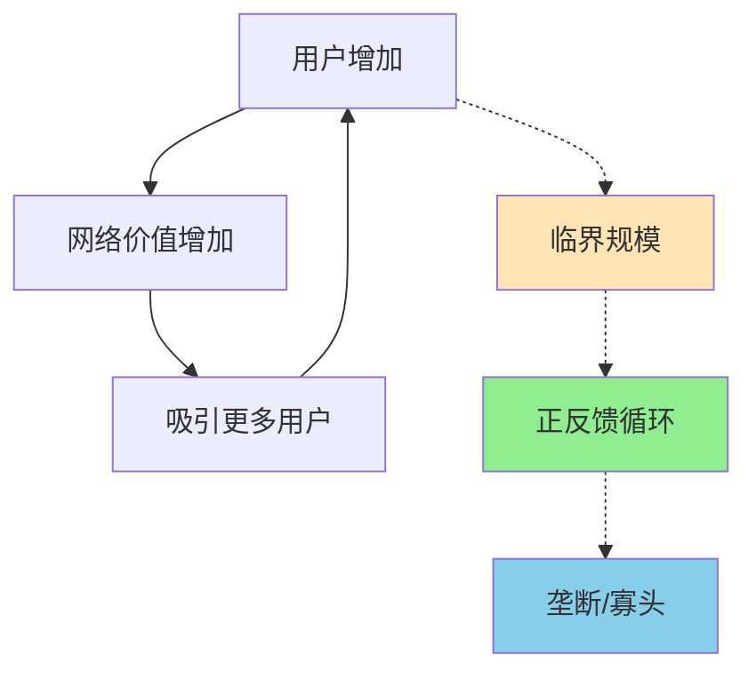

> 你的价值，取决于有多少人用

---

## 社交APP的"鸡与蛋"困境

2010年，一款叫"米聊"的APP率先上线，功能与微信几乎相同。
2011年，微信才姗姗来迟。

但一年后，微信用户突破1亿，米聊逐渐消失。

**问题：** 为什么后来者微信能击败先行者米聊？
**更深层的问题：** 为什么社交APP总是"赢家通吃"？

这背后藏着一个经济学核心概念：**网络效应（Network Effect）**。

---

## 网络效应

**定义：** 产品或服务的价值随着用户数量的增加而增加。

**简单说就是：** 用的人越多，这个产品越有价值。



### 关键要点

**1. 网络效应的类型**

| 类型 | 定义 | 例子 |
|------|------|------|
| **直接网络效应** | 用户直接从其他用户获益 | 电话、社交网络 |
| **间接网络效应** | 用户从互补产品获益 | iOS平台：用户吸引开发者，开发者吸引用户 |

**2. 双边市场（Two-Sided Market）**

> 连接两类用户，每类用户都从另一类用户的存在中获益。

| 平台 | 甲方 | 乙方 | 网络效应 |
|------|------|------|----------|
| **淘宝** | 买家 | 卖家 | 更多卖家→更多买家→更多卖家 |
| **滴滴** | 乘客 | 司机 | 更多司机→更快接单→更多乘客 |
| **美团** | 消费者 | 商家 | 更多商家→更多选择→更多消费者 |

**3. 临界规模（Critical Mass）**

> 平台突破某个用户数量后，网络效应开始自我强化，实现指数增长。

**梅特卡夫定律：** 网络价值 ≈ 用户数的平方

| 用户数 | 相对价值 |
|--------|----------|
| 100 | 10,000 |
| 1,000 | 1,000,000 |
| 10,000 | 100,000,000 |

**历史小知识：** 网络效应的概念可以追溯到电话网络早期（1900年代）。罗伯特·梅特卡夫（Robert Metcalfe，以太网发明人）在1973年提出了著名的梅特卡夫定律（Metcalfe's Law）。2014年，法国经济学家让·梯若尔（Jean Tirole）因其对市场力量和平台经济的开创性研究获得诺贝尔经济学奖。

---

### 为什么网络效应导致"赢家通吃"？

**正反馈循环：**

```
更多用户 → 更有价值 → 吸引更多用户 → 更有价值 → ...
```

**结果：**

| 阶段 | 市场状态 |
|------|----------|
| 初期 | 多个平台竞争 |
| 达到临界规模 | 领先者加速增长 |
| 成熟 | **赢家通吃**（1-2个平台垄断） |

**为什么后来者很难超越？**

| 困难 | 说明 |
|------|------|
| **转换成本高** | 用户不愿意离开朋友的网络 |
| **多归属成本** | 维持多个社交账户很累 |
| **数据积累** | 领先者有更多数据优化算法 |

---

## 网络效应的真实案例

### 微信vs米聊：后来者居上的故事

**背景：** 为什么后来者微信能击败先行者米聊？

**时间线：**

| 时间 | 米聊 | 微信 | 用户数对比 |
|------|------|------|------------|
| 2010年12月 | 上线 | - | 米聊：100万 |
| 2011年1月 | - | 上线 | 米聊：200万，微信：0 |
| 2011年4月 | - | 推出"查找附近的人" | 米聊：300万，微信：500万 |
| 2011年8月 | - | 推出"朋友圈" | 米聊：400万，微信：1500万 |
| 2012年3月 | - | 突破1亿 | 米聊：800万，微信：1亿 |
| 2013年1月 | - | 突破3亿 | 米聊：衰退，微信：3亿 |

**微信做对了什么？**

| 策略 | 如何利用网络效应 |
|------|------------------|
| **导入QQ关系链** | 直接获得亿级用户基础 |
| **语音对讲** | 降低使用门槛，吸引中老年用户 |
| **朋友圈** | 增加用户黏性，形成社交压力 |
| **附近的人** | LBS社交，扩展陌生人社交 |
| **摇一摇** | 降低陌生人社交门槛 |

**关键转折点：QQ关系链**

| 决策 | 影响 |
|------|------|
| 不导入QQ关系链 | 与米聊平等竞争，胜负未定 |
| **导入QQ关系链** | **直接获得5亿潜在用户，奠定胜局** |

**数据支撑：**

| 年份 | 微信月活 | 米聊月活 |
|------|----------|----------|
| 2011 | 3000万 | 800万 |
| 2012 | 1亿 | 500万 |
| 2013 | 3亿 | 基本消失 |
| 2023 | 13亿 | - |

**关键洞察：**
> 微信战胜米聊，不是产品更好（初期功能几乎相同），而是**网络效应**。通过导入QQ关系链，微信直接获得了亿级用户基础，突破了临界规模，进入正反馈循环。**社交APP的竞争不是产品功能的竞争，而是用户规模的竞争**——当你朋友都在用，你别无选择。

---

### 抖音的崛起：算法+网络效应

**背景：** 为什么抖音能击败快手、美拍等对手？

**抖音的网络效应：**

| 效应类型 | 机制 |
|----------|------|
| **创作者网络效应** | 更多观众 → 吸引更多创作者 → 更多内容 → 更多观众 |
| **算法网络效应** | 更多数据 → 算法更精准 → 用户粘性更高 → 更多数据 |
| **社交网络效应** | 朋友都在用 → 你也用 → 朋友更多 → 用得更多 |

**抖音vs快手的差异化：**

| 维度 | 抖音 | 快手 |
|------|------|------|
| **算法** | 中心化推荐，爆款驱动 | 去中心化，关注关系 |
| **内容** | 精品化、制作精良 | 原生态、真实 |
| **用户心智** "刷抖音"（算法推荐） "刷快手"（关注关系） |

**数据支撑：**

| 年份 | 抖音DAU | 快手DAU |
|------|---------|---------|
| 2018 | 1.5亿 | 1.2亿 |
| 2020 | 6亿 | 3亿 |
| 2023 | 8亿 | 4亿 |

**关键洞察：**
> 抖音的成功是**算法+网络效应**的结合。算法让用户看到更想看的内容（提高留存），网络效应让平台吸引更多创作者（增加供给）。**当算法的网络效应启动**——更多数据 → 更好算法 → 更高留存 → 更多数据——平台就进入了自我强化的增长飞轮。

---

### 美团：本地生活的平台战争

**背景：** 为什么美团能成为本地生活巨头？

**美团的网络效应：**

| 效应 | 机制 |
|------|------|
| **双边网络效应** | 更多商家 → 更多消费者 → 更多商家 |
| **地理网络效应** | 同区域用户越多，配送效率越高 |
| **数据网络效应** | 更多订单 → 更优路线算法 → 更低配送成本 |

**美团的"飞轮效应"：**

```
更多用户 → 更多订单 → 更多数据 → 更优算法 → 更低成本 → 更低价格 → 更多用户
```

**关键指标：订单密度**

| 指标 | 低订单密度 | 高订单密度 |
|------|------------|------------|
| 配送成本 | 高（路程远） | 低（路线优化） |
| 等待时间 | 长 | 短 |
| 商家意愿 | 低（不赚钱） | 高（赚钱） |
| **结果** | **负反馈** | **正反馈** |

**数据支撑：**

| 年份 | 美团交易额 | 市场份额 |
|------|------------|----------|
| 2015 | 500亿 | 30% |
| 2018 | 3000亿 | 60% |
| 2023 | 2.6万亿 | 65% |

**关键洞察：**
> 美团的护城河是**订单密度的网络效应**。当订单密度足够高，配送成本降到最低，等待时间最短，竞争对手难以进入。**本地生活的竞争不是补贴的竞争，而是订单密度的竞争**——谁的订单密度高，谁的成本就低，谁就能赢。

---

## 如何利用网络效应？

### 企业视角：如何突破临界规模？

**策略1：单边突破**

| 方法 | 说明 | 例子 |
|------|------|------|
| **补贴一方** | 免费吸引一方，收费另一方 | 淘宝对买家免费 |
| **种子用户** | 精心培育初始社区 | Facebook从哈佛开始 |
| **预装/导入** | 利用现有用户基础 | 微信导入QQ关系链 |

**策略2：降低启动摩擦**

| 方法 | 说明 | 例子 |
|------|------|------|
| **简化注册** | 一键注册/登录 | 手机号一键登录 |
| **冷启动内容** | 平台提供初始内容 | 知乎邀请回答 |
| **红包补贴** | 降低尝试成本 | 滴滴早期补贴 |

**策略3：增加转换成本**

| 方法 | 说明 | 例子 |
|------|------|------|
| **数据积累** | 个性化推荐 | 抖音算法 |
| **社交关系** | 朋友都在用 | 微信朋友圈 |
| **习惯养成** | 每日使用习惯 | 支付宝集五福 |

---

### 消费者视角：如何应对平台垄断？

| 现实 | 建议 |
|------|------|
| 平台垄断难以避免 | 接受现实，但保持警惕 |
| 转换成本高 | 保留"退出选项"（多平台） |
| 数据被滥用 | 保护隐私，减少数据授权 |
| 算法控制信息 | 主动寻找多元信息来源 |

---

### 常见误区

| 误区 | 正解 |
|------|------|
| "先发必胜" | 先发优势只有在快速达到临界规模时才有用 |
| "产品好就能赢" | 在网络效应市场，用户规模 > 产品功能 |
| "补贴可以换取用户" | 补贴只能获取用户，不能留住用户 |
| "小平台有机会逆袭" | 只有在大平台犯错时才有机会 |

---

## 延伸思考

1. **Web3的去中心化理想**：区块链试图构建没有中心化平台的网络。但去中心化网络如何解决冷启动问题？能否挑战Facebook、Twitter的中心化平台？

2. **AI的网络效应**：ChatGPT是否有网络效应？更多用户 → 更多数据 → 更好模型 → 更多用户——这个飞轮会形成新的垄断吗？开源AI（如LLaMA）能否打破这个循环？

3. **平台监管的困境**：当平台因为网络效应形成垄断，监管应该怎么办？拆分（如拆分FacebookInstagram）能解决问题吗？还是反而损害了网络效应的价值？

**下期预告：** 我们来探讨**锁定效应与转换成本**——为什么你离不开苹果生态？微信支付vs支付宝，如何建立用户忠诚度？

---

**数据来源：** 腾讯《2023年财报》、字节跳动内部数据、QuestMobile《2023年短视频行业报告》、美团研究院《2023年本地生活市场报告》、交通运输部《2023年网约车市场报告》
