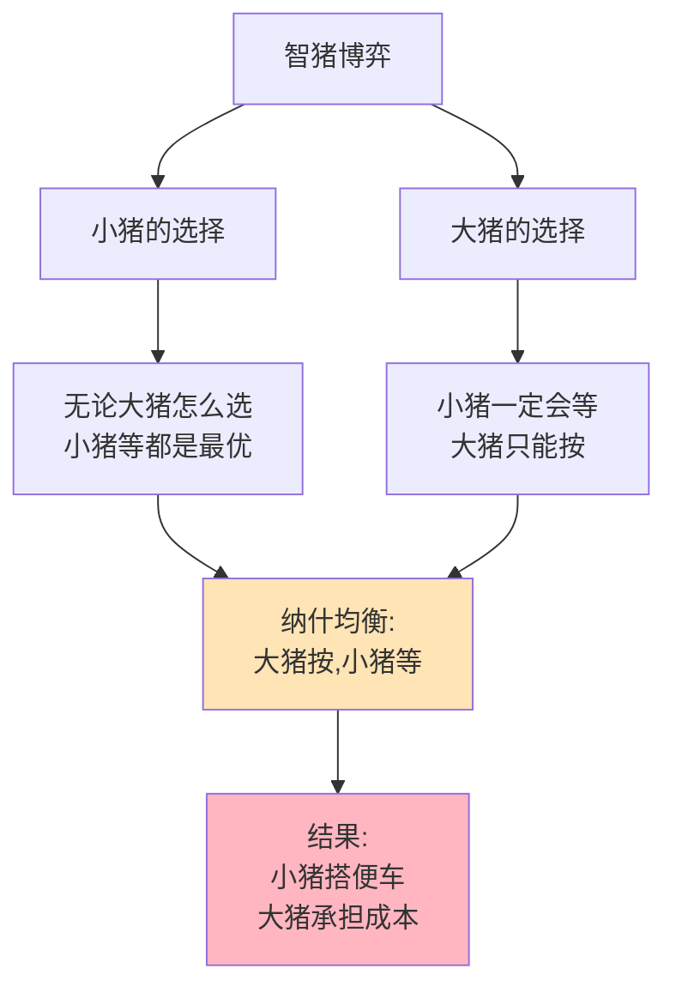

> 大猪做，小猪等——这是理性的

---

## 开源社区的"白嫖"困境

小张是一名开源开发者，他做了一个免费工具。

一年下来：
- 1000人下载使用
- 只有5个人打赏（共200元）
- 100个人提bug反馈
- 10个人提交代码改进

小张很沮丧："我花了1000小时开发，赚了200元，连电费都不够。"

**问题：** 为什么那么多人为开源项目贡献，而更多人只是"白嫖"？这种"搭便车"行为能避免吗？

这背后藏着一个博弈论经典问题：**智猪博弈（Boxed Pigs Game）**。

---

## 智猪博弈

**定义：** 在公共品供给中，大贡献者承担成本，小贡献者搭便车是最优策略。

**经典故事：**

猪圈里有一大一小两只猪，有一个按钮，按一下会有食物掉落。

| 小猪按 | 小猪等 | |
|----------|----------|------|
| **大猪按** | 大猪：1单位，小猪：4单位 | 大猪：2单位，小猪：7单位 |
| **大猪等** | 大猪：-1单位，小猪：-1单位 | 大猪：0单位，小猪：0单位 |

**小猪的推理：**
- 如果大猪按，我等最好（7 > 4）
- 如果大猪等，我按会挨饿（-1 < 0）
- **无论大猪怎么做，我等都是最优选择**

**大猪的推理：**
- 小猪肯定会等
- 如果我也不按，都挨饿（0, 0）
- 如果我按，至少有吃的（2, 7）
- **我必须按**

### 关键要点

**1. 公共品（Public Good）**

| 特征 | 定义 | 例子 |
|------|------|------|
| **非排他性** | 无法阻止他人使用 | 国防、空气、开源软件 |
| **非竞争性** | 一人使用不影响他人 | 广播、知识、数字产品 |

**2. 搭便车问题（Free Rider Problem）**

> 当公共品的收益无法排除任何人时，理性人会选择"搭便车"——不付出成本，享受他人创造的收益。

**3. 智猪博弈的启示**

| 角色 | 行为 | 原因 |
|------|------|------|
| **大猪**（大贡献者） | 承担主要成本 | 不做，大家都没得用 |
| **小猪**（小贡献者） | 搭便车 | 做了也改变不了结果 |

**历史小知识：** 智猪博弈是纳什均衡的一个应用案例，用于解释公共品供给中的不平等现象。曼库尔·奥尔森（Mancur Olson）在《集体行动的逻辑》（The Logic of Collective Action, 1965）中系统阐述了搭便车问题。

---

**数据来源：** GitHub Octoverse《2023年开源项目报告》、《中国共享经济发展报告》（2023）、ofo倒闭案例研究、曼库尔·奥尔森（1965）《集体行动的逻辑》

---

### 为什么搭便车难以避免？

**问题的根源：**

| 困难 | 说明 |
|------|------|
| **非排他性** | 无法阻止不付费者使用 |
| **理性选择** | 不付费也能用，为什么要付费？ |
| **临界规模** | 除非足够多人贡献，否则任何人都没动力 |

**心理因素：**

| 心理 | 影响 |
|------|------|
| **"我的一份不重要" | 个人贡献微不足道 |
| **"别人会做的" | 期待他人贡献 |
| **"我不做也没人知道" | 匿名性降低道德压力 |

---

## 智猪博弈的真实案例

### 开源软件的"白嫖"文化

**背景：** 为什么开源软件能存在，虽然大部分用户只是"白嫖"？

**开源的贡献者分布：**

| 贡献类型 | 占比 | 说明 |
|----------|------|------|
| **核心维护者** | 1-5% | 大部分工作 |
| **活跃贡献者** | 10-20% | 定期贡献 |
| **偶尔贡献者** | 20-30% | 偶尔提交 |
| **白嫖者** | 50-70% | 从不贡献 |

**为什么"白嫖"不可避免？**

| 用户类型 | 贡献成本 | 贡献收益 | 搭便车收益 | 理性选择 |
|----------|----------|----------|------------|----------|
| **普通用户** | 高（学习门槛） | 低（自我满足） | 高（免费使用） | **搭便车** |
| **开发者** | 低（有能力） | 中（声誉、人脉） | 高（免费使用） | **可能贡献** |
| **企业用户** | 低（有资源） | 高（品牌、影响力） | 高（免费使用） | **可能贡献** |

**开源项目的"大猪"：**

| 角色 | 为什么贡献 |
|------|------------|
| **个人开发者** | 声誉、学习、自我满足 |
| **科技公司** | 品牌、影响力、招聘、降低成本 |
| **基金会** | 使命、行业影响力 |

**数据支撑：**

GitHub研究显示（根据GitHub Octoverse 2023报告）：
- 前2%的贡献者完成50%以上的工作
- 约70%的用户从未贡献任何代码
- 企业贡献占比逐年上升（2023年约30%）

**关键洞察：**
> 开源软件的"白嫖"不是问题，而是**智猪博弈的必然结果**。核心维护者（大猪）承担主要成本，因为这是他们的职业/使命；普通用户（小猪）搭便车，因为这是理性的。**开源项目的可持续性不依赖"所有人都贡献"，而是依赖"足够多的大猪"**——企业和核心开发者。

---

### 共享单车的押金困境

**背景：** 为什么共享单车需要押金？

**押金的经济逻辑：**

| 问题 | 押金的作用 |
|------|------------|
| **公共品性质** | 单车是非排他性的（理论上） |
| **搭便车问题** | 不付钱也能用（如果破坏监管） |
| **解决方案** | 押金增加"破坏成本" |

**押金的博弈论分析：**

| 用户选择 | 不交押金 | 交押金 |
|----------|----------|--------|
| **使用单车** | 不可用 | 可用 |
| **破坏单车** | 无损失 | 损失押金 |
| **正常使用** | 不可能 | 退押金 |

**押金困境：**

| 问题 | 说明 |
|------|------|
| **资金沉淀** | 押金形成巨额资金池 |
| **挪用风险** | ofo挪用押金导致危机 |
| **监管难题** | 如何确保押金安全？ |

**信用免押金：**

| 模式 | 如何解决？ |
|------|------------|
| **芝麻信用** | 高信用用户免押金 |
| **信用担保** | 破坏行为影响信用评分 |
| **平台担保** | 平台承担部分风险 |

**数据支撑：**

| 平台 | 押金模式 | 结果 |
|------|----------|------|
| ofo | 99元-299元押金 | 挪用押金，1500万人等待退款 |
| 哈啰 | 信用免押金（部分用户） | 相对稳定 |
| 美团单车 | 信用免押金 | 相对稳定 |

**关键洞察：**
> 共享单车押金展示了**如何用机制设计解决搭便车问题**。押金本质上是"抵押品"——如果你破坏单车，就会损失押金。**信用免押金是更高级的机制**：破坏的"成本"不是押金，而是信用评分的下降。这降低了参与门槛（不用交押金），同时保持了激励（破坏会损害信用）。

---

## 如何应对搭便车问题？

### 方法1：排他性机制

| 方法 | 例子 |
|------|------|
| **收费** | 软件、会员订阅 |
| **版权** | 知识产权保护 |
| **技术壁垒** | DRM、加密 |

---

### 方法2：内在激励

| 激励 | 例子 |
|------|------|
| **声誉机制** | 开源贡献者排名、GitHub Stars |
| **社交奖励** | 点赞、评论、关注 |
| **自我表达** | 个人满足感、学习成长 |

---

### 方法3：选择性激励

| 方法 | 例子 |
|------|------|
| **等级制度** | 贡献者享受特权 |
| **实物奖励** | T恤、贴纸、周边 |
| **职业机会** | 开源贡献→工作机会 |

---

### 方法4：改变博弈结构

| 方法 | 例子 |
|------|------|
| **大猪资助** | 企业赞助开源项目 |
| **政府提供** | 公共品由政府提供 |
| **平台模式** | 广告模式（用户免费，广告商付费） |

---

## 应用与决策

### 企业决策：如何设计公共品供给？

| 情况 | 建议 |
|------|------|
| **平台有资源** | 承担"大猪"角色，如Google支持开源 |
| **依赖社区** | 设计贡献激励机制 |
| **需要盈利** | 部分排他，部分免费（freemium） |

### 个人决策：何时贡献，何时搭便车？

| 场景 | 建议 |
|------|------|
| **核心项目** | 贡献，建立声誉 |
| **偶尔使用** | 可以搭便车 |
| **商业项目** | 购买支持，或贡献换取资源 |

---

### 常见误区

| 误区 | 正解 |
|------|------|
| "搭便车总是坏事" | 某些搭便车是必要的，否则没人会做"大猪" |
| "所有人都应该贡献" | 不现实，依赖大猪贡献者是可持续模式 |
| "强迫贡献有效" | 可能降低整体参与度 |
| "收费能解决一切" | 可能降低网络效应 |

---

## 延伸思考

1. **维基百科的奇迹**：维基百科几乎完全由志愿者贡献，却击败了微软的Encarta。为什么维基百科能避免搭便车问题？是"大猪"（核心编辑者）足够多，还是其他机制？

2. **气候变化的全球搭便车**：减排是公共品——如果其他国家减排，我可以搭便车；如果其他国家不减排，我减排也无意义。如何破解这个全球性智猪博弈？

3. **公司的内部"搭便车"**：为什么团队中总有"摸鱼"的人？为什么很多人"躺平"？企业如何设计激励机制，减少内部搭便车？

**下期预告：** 我们来探讨**蜈蚣博弈与信任**——为什么供应链账期越来越长？硅谷VC如何在不确定性中投资？

---

**数据来源》：》GitHub开源项目研究、共享单车行业报告、搭便车问题理论文献
