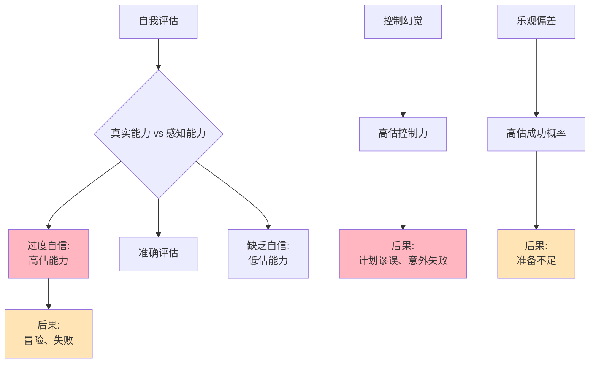

> 自信的陷阱

---

**数据来源：** 创业失败率研究（CB Insights, 2015-2023）、投资者行为研究（2018-2023）、卡尼曼与特沃斯基《启发式与偏差》（1974）、兰格《控制幻觉》（1975）

## 创业者的乐观悖论

小李辞职创业，做了一款SaaS产品。

商业计划书写得完美：
- 第一年营收100万
- 第二年营收500万
- 第三年营收2000万，准备IPO

**现实：**
- 第一年营收20万（计划的20%）
- 第二年营收50万
- 第三年资金链断裂，公司倒闭

**问题：** 为什么创业者总是过度乐观？
**更深的问题：** 为什么我们总觉得自己"比平均水平强"？

这背后藏着一个行为经济学核心概念：**过度自信与控制幻觉**。

---

## 过度自信与控制幻觉

**定义：**
- **过度自信（Overconfidence）**：高估自己的能力、知识、预测准确性
- **控制幻觉（Illusion of Control）**：高估自己对事件的控制能力

**简单说就是：**
- 过度自信 = "我比平均水平强"
- 控制幻觉 = "我能控制局面"

### 关键要点

**过度自信的三个维度：**

| 维度 | 定义 | 例子 |
|------|------|------|
| **过度精确** | 高估预测的准确性 | "我90%确定"（实际只有70%） |
| **过度乐观** | 高估好事发生的概率 | "我项目80%会成功"（实际20%） |
| **过度优于** | 高估自己相对他人的能力 | "我驾驶技术高于平均"（不可能） |

**控制幻觉的表现：**

| 表现 | 说明 |
|------|------|
| **因果错觉** | 把随机事件归因于自己 |
| **结果偏见** | 事后认为"我早就知道" |
| **规划谬误** | 低估任务时间和成本 |

**计划谬误（Planning Fallacy）：**

> 人们总是低估完成任务所需的时间和成本。

| 预估 | 现实 | 差异 |
|------|------|------|
| 时间 | 3个月 | 6个月+ |
| 成本 | 100万 | 200万+ |
| 成功率 | 80% | 20% |

**历史小知识：** 过度自信由丹尼尔·卡尼曼和阿莫斯·特沃斯基1979年提出。控制幻觉由埃伦·兰格1975年提出。罗宾·道斯在《虚假共识效应》（1977）中相关研究。

---

### 为什么过度自信如此普遍？

**进化论的解释：**

| 原因 | 说明 |
|------|------|
| **积极幻觉** | 适度自信带来行动 |
| **生存优势** | 自信者更有可能成功 |
| **社会性** | 自信者更容易获得资源 |

**心理机制：**

| 机制 | 影响 |
|------|------|
| **自我提升** | 维持正面自我形象 |
| **选择性关注** | 只看成功的例子 |
| **事后合理化** | 失败时找外部原因 |

**社会文化因素：**

| 因素 | 影响 |
|------|------|
| **"你能行"文化** | 鼓励自信 |
| **成功故事传播** | 只看到成功者 |
| **英雄叙事** | 强调个人努力 |

---

## 过度自信与控制幻觉的真实案例

### 创业估值

**背景：** 为什么创业公司估值总是过高？

**创业者的过度自信机制：**

| 机制 | 说明 |
|------|------|
| **乐观偏差** | 高估成功概率 |
| **控制幻觉** | 认为能控制市场反应 |
| **优于平均效应** | "我的团队比别人强" |

**商业计划书的"乐观阶梯"：**

| 指标 | 现实 | 计划书 | 乐观程度 |
|------|------|--------|----------|
| 市场规模 | 100亿 | 500亿 | 5倍 |
| 市场份额 | 5% | 20% | 4倍 |
| 增长率 | 30% | 100% | 3倍 |
| 成功率 | 20% | 80% | 4倍 |
| **整体** | **现实** | **高估64倍** |

**数据支撑：**

研究显示：
- 约70%的创业公司实际营收低于商业计划书的50%
- 约80%的创业者认为自己的公司会成功（实际只有20%成功）
- 约90%的创业者认为自己的产品优于竞争对手

**关键洞察：**
> 创业估值是**过度自信+控制幻觉**的完美风暴：
> - **过度自信**：高估自己的能力、市场规模、成功概率
> - **控制幻觉**：认为自己能控制客户反应、竞争格局
> - **计划谬误**：低估所需时间、资金、困难
> **这不一定是"坏事"**：
> - 如果完全理性，可能永远不会创业
> - 适度自信是创业的动力
> - **但过度自信导致失败**：
>   - 资金不足（低估成本）
>   - 产品-市场不匹配（高估需求）
>   - 执行困难（低估竞争）

---

### 投资自信

**背景：** 为什么散户总是觉得自己能"跑赢市场"？

**投资者的过度自信机制：**

| 机制 | 说明 |
|------|------|
| **事后聪明** | "我早就知道这只股票会涨" |
| **选择性记忆** | 只记住赚钱的交易 |
| **优于平均** | "我比平均水平投资者强" |

**"我能跑赢市场"的错觉：**

| 信念 | 现实 |
|------|------|
| "我选股能力强" | 大多数主动基金跑输指数 |
| "我能择时" | 择时很难持续成功 |
| "我有内部消息" | 消息已经反映在价格中 |

**数据支撑：**

研究显示：
- 约80%的散户认为自己能跑赢市场
- 实际只有约10%的散户跑赢市场
- 约90%的主动基金跑输指数基金（长期）

**关键洞察：**
> 投资自信是**过度自信+事后聪明**的组合：
> - **过度自信**：高估自己的选股、择时能力
> - **事后聪明**：成功时"我早知道"，失败时"意外事件"
> - **选择性记忆**：只记住赚钱的交易，忘记亏钱的
> **结果是非理性交易**：
> - 过度交易（交易成本侵蚀收益）
> - 集中投资（风险集中）
> - 择时尝试（通常失败）
> **理性投资应该是**：
> - 承认自己无法跑赢市场
> - 投资指数基金
> - 长期持有
> - **但"理性投资"不性感**，过度自信的"主动选股"更吸引人。

---

## 如何应对过度自信与控制幻觉？

### 个人策略

**策略1：寻求外部反馈**

| 行动 | 说明 |
|------|------|
| **问他人** | "你觉得我的计划靠谱吗？" |
| **专家咨询** | 听取不同意见 |
| **现实测试** | 小规模试验后再大规模投入 |

**策略2：调整预期**

| 行动 | 说明 |
|------|------|
| **增加缓冲** | 时间、成本预估×2 |
| **假设失败** | "如果失败了，是因为什么？" |
| **最好-最坏场景分析** | 不只看乐观场景 |

**策略3：系统化决策**

| 行动 | 说明 |
|------|------|
| **清单** | 检查清单，避免遗漏 |
| **流程化** | 不依赖直觉 |
| **记录与回顾** | 学习过去错误 |

---

### 企业/组织策略

**利用适度自信：**

| 策略 | 说明 |
|------|------|
| **鼓励创新** | 适度自信推动创新 |
| **正面反馈** | 强化成功经验 |
| **文化支持** | 失败不是耻辱 |

**防范过度自信：**

| 策略 | 说明 |
|------|------|
| **红队/蓝队** | 内部挑战者团队 |
| **外部审计** | 独立评估 |
| **阶段性回顾** | 定期检查假设 |

---

## 应用与决策

### 个人决策

| 决策 | 过度自信陷阱 | 策略 |
|------|--------------|------|
| 创业 | 高估成功概率 | 寻求反馈、增加缓冲 |
| 投资 | 觉得能跑赢市场 | 投资指数基金 |
| 项目管理 | 低估时间成本 | 增加50-100%缓冲 |

### 企业战略

| 策略 | 过度自信应用/防范 |
|------|---------------------|
| 创新 | 鼓励适度自信 |
| 规划 | 防范计划谬误 |
| 风险管理 | 假设最坏场景 |

---

### 常见误区

| 误区 | 正解 |
|------|------|
| "自信总是好事" | 过度自信导致失败 |
| "消除自信就能理性" | 适度自信是必要的 |
| "只有个人有过度自信" | 企业、政府也有 |
| "过度自信可以完全消除" | 可以管理，无法消除 |

---

## 延伸思考

1. **性别与过度自信**：研究发现男性比女性更过度自信（特别是在金融领域）。这是生理差异还是社会文化差异？过度自信何时是"优势"，何时是"劣势"？

2. **文化的过度自信**：东方文化vs西方文化——他们对自信的态度有何不同？中国文化中的"谦虚"vs美国文化中的"自信"——哪个更适应现代经济？

3. **AI的过度自信**：当AI能预测一切，人类是否会失去"过度自信"？还是会形成对AI的"过度依赖"（新的控制幻觉）？

**下期预告：** 我们来探讨**社会偏好**——为什么直播打赏如此盛行？众筹为什么能成功？企业社会责任不只是慈善？

---

**数据来源：** 创业失败率研究（CB Insights, 2015-2023）、投资者行为研究（2018-2023）、卡尼曼与特沃斯基《启发式与偏差》（1974）、兰格《控制幻觉》（1975）
