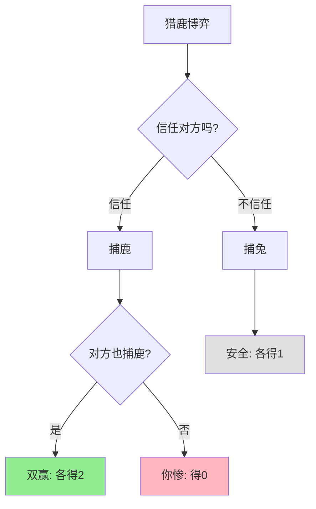

> 信任是合作的货币

---

## 标准的战争

2000年代，索尼推出蓝光DVD，东芝推出HD DVD。

两种格式互不兼容：
- 如果都支持蓝光 → 都受益（规模经济）
- 如果都支持HD DVD → 都受益（规模经济）
- 如果各自支持不同格式 → 都受损（市场分裂）

**结果：** 双方耗费数年争夺，最终索尼胜利，但期间市场混乱，消费者观望。

**问题：** 为什么明明"统一标准"对所有人都好，却难以达成一致？

这背后藏着一个博弈论概念：**猎鹿博弈（Stag Hunt Game）**。

---

## 猎鹿博弈

**定义：** 协调博弈——双方都知道合作更好，但缺乏信任，不敢冒险合作。

**经典故事：**

卢梭在《论人类不平等的起源》中描述：

两个猎人可以合作捕鹿（需要配合，收益大），也可以各自捕兔（容易，收益小）。

| 你的选择 | 对方捕鹿 | 对方捕兔 |
|----------|----------|----------|
| **捕鹿** | 各得2单位肉 | 你得0，对方得1 |
| **捕兔** | 你得1，对方得0 | 各得1单位肉 |

### 关键要点

**1. 协调博弈（Coordination Game）**

> 双方都知道某个结果更好，但需要协调行动才能实现。

**2. 帕累托优势**

| 均衡 | 收益 | 是否帕累托最优 |
|------|------|----------------|
| 捕鹿/捕鹿 | （2, 2） | ✅ 最优 |
| 捕兔/捕兔 | （1, 1） | ❌ 可以改进 |

**3. 风险占优（Risk Dominance）**

| 策略 | 最坏情况 | 风险 |
|------|----------|------|
| **捕鹿** | 得0（对方背叛） | 高风险 |
| **捕兔** | 得1（无论对方） | 低风险 |

**困境：**
- 捕鹿是"收益占优"（更好）
- 捕兔是"风险占优"（更安全）

**历史小知识：** 猎鹿博弈源于让-雅克·卢梭1755年的著作。后来由博弈论学家形式化，成为协调博弈的经典案例。布莱恩·斯基尔姆斯在《猎鹿博弈的演化》（2004）中深入研究了这一博弈。

---

### 为什么合作难以达成？

**问题的根源：**

| 困难 | 说明 |
|------|------|
| **信任缺失** | 害怕对方背叛 |
| **沟通障碍** | 无法有效协调 |
| **多重均衡** | 不知道对方会选择哪个均衡 |
| **先动劣势** | 先选择合作的一方风险更大 |

**心理因素：**

| 心理 | 影响 |
|------|------|
| **损失厌恶** | 合作失败的痛苦 > 合作成功的快乐 |
| **过度风险规避** | 宁愿要确定的1，不要冒险的2 |
| **互惠预期** | "你先，我再"的僵局 |

---

## 猎鹿博弈的真实案例

### USB标准的成功

**背景：** 为什么USB能成为统一标准？

**USB之前的混乱：**

| 接口类型 | 用途 | 问题 |
|----------|------|------|
| 串口 | 鼠标、调制解调器 | 慢、需要重启 |
| 并口 | 打印机 | 体积大 |
| PS/2 | 键盘、鼠标 | 不通用 |
| **苹果接口** | 苹果专用 | 不兼容 |

**USB的协调：**

| 公司 | 初始选择 | 最终选择 |
|------|----------|----------|
| 英特尔 | 提出USB | 积极推动 |
| 微软 | 支持USB | 集成进Windows |
| 苹果 | 自有接口 | 1998年iMac采用USB |

**为什么USB能成功？**

| 因素 | 作用 |
|------|------|
| **大企业推动** | 英特尔、微软的"大猪"角色 |
| **操作系统支持** | Windows集成降低转换成本 |
| **苹果加入** | 打破了"自有接口"的困境 |
| **开放标准** | 任何厂商都可以使用 |

**数据支撑：**

| 年份 | USB设备出货量 | 市场渗透率 |
|------|---------------|------------|
| 1996 | <100万 | <1% |
| 2000 | 1亿+ | 20% |
| 2010 | 30亿+ | 90% |
| 2023 | 50亿+ | 95%+ |

**关键洞察：**
> USB的成功展示了**如何破解猎鹿博弈**——通过"大猪"推动和"开放标准"降低信任成本。英特尔和微软承担了"先动"风险（推出USB），开放标准让所有厂商都能参与（降低协调成本），苹果的加入打破了最后的观望。**标准协调不是市场自然演化的结果，而是有意识协调的产物。**

---

### 5G标准的争夺战

**背景：** 为什么5G标准由全球合作制定？

**5G标准化的猎鹿博弈：**

| 选择 | 全球统一标准 | 各国自定标准 |
|----------|------------------|------------------|
| **如果统一** | 规模经济、全球漫游 | - |
| **如果分裂** | - | 成本高、不兼容 |

**5G标准的协调机制：**

| 机制 | 作用 |
|------|------|
| **3GPP** | 全球统一标准制定组织 |
| **专利池** | 企业共享专利，降低使用成本 |
| **中国参与** | 华为、中兴等积极参与 |
| **平衡各方利益** | 中美欧日韩都有话语权 |

**为什么没有分裂？**

| 因素 | 说明 |
|------|------|
| **历史教训** | 2G/3G分裂的代价 |
| **设备商推动** | 华为、爱立信、诺基亚需要全球市场 |
| **运营商压力** | 不想支持多个标准 |
| **中国影响力** | 中国市场太大，不能被排除 |

**数据支撑：**

| 标准 | 主要市场 | 是否统一？ |
|------|----------|------------|
| 2G | 欧洲/美国/日本 | ❌ 分裂 |
| 3G | 欧洲/美国/中国 | ❌ 分裂 |
| 4G | 全球 | ✅ 基本统一（LTE） |
| 5G | 全球 | ✅ 统一（3GPP） |

**关键洞察：**
> 5G标准的成功展示了**国际协调的可能性**。虽然中美地缘政治紧张，但在5G标准上实现了合作。**原因是"统一标准"的利益太大**——设备商需要全球市场，运营商需要规模经济，消费者需要全球漫游。**当协调利益足够大，即使政治对手也能合作**。

---

### 开源协作：Linux的成功

**背景：** 为什么Linux能成为最成功的操作系统？

**猎鹿博弈视角：**

| 公司选择 | 参与开源 | 独自开发 |
|----------|----------|----------|
| **如果其他公司参与** | 分担成本，共享收益 | 自己承担全部成本 |
| **如果其他公司不参与** | 自己承担成本，他人受益 | 独自承担成本 |

**Linux的"大猪"：**

| 公司 | 贡献 | 原因 |
|------|------|------|
| **Intel** | 内核开发、驱动 | 服务器市场需要 |
| **Red Hat** | 企业级支持 | 商业模式 |
| **Google** | Android内核 | 移动操作系统 |
| **IBM** | 企业级支持 | 咨询服务 |

**数据支撑：**

| 年份 | Linux内核贡献者 | 顶级贡献者（企业） |
|------|------------------|---------------------|
| 2005 | 500+ | 10% |
| 2010 | 1000+ | 50% |
| 2020 | 20000+ | 80%+ |

**关键洞察：**
> Linux的成功不是"志愿者"的胜利，而是**企业协调的胜利**。各大公司发现，与其各自开发Unix，不如共同维护Linux。**猎鹿博弈的破解是通过"大猪"（大企业）推动和"重复博弈"（长期合作）实现的**——当合作持续20年，信任建立，背叛成本变高。

---

## 如何破解猎鹿博弈？

### 方法1：建立信任

| 方法 | 例子 |
|------|------|
| **重复博弈** | 长期合作建立信任 |
| **声誉机制** | 背叛者声誉受损 |
| **第三方监督** | 政府或行业组织监督 |

---

### 方法2：降低合作风险

| 方法 | 例子 |
|------|------|
| **渐进式合作** | 先小项目，再大项目 |
| **保险机制** | 对背叛者有惩罚 |
| **分阶段承诺** | 逐步增加投入 |

---

### 方法3：改变收益结构

| 方法 | 例子 |
|------|------|
| **补贴合作** | 政府补贴协调项目 |
| **惩罚背叛** | 反垄断、反不正当竞争 |
| **提高不合作成本** | 税收、监管 |

---

### 方法4：强制协调

| 方法 | 例子 |
|------|------|
| **政府强制** | 法定标准 |
| **收购合并** | 消除竞争，统一标准 |
| **平台主导** | 平台制定规则 |

---

## 应用与决策

### 企业决策：何时合作，何时竞争？

| 情况 | 建议 |
|------|------|
| **标准化利益大** | 积极参与标准制定 |
| **市场增长期** | 合作做大蛋糕 |
| **市场成熟期** | 竞争抢份额 |

### 个人决策：如何建立合作？

| 场景 | 建议 |
|------|------|
| **新团队** | 先小成功，建立信任 |
| **跨部门项目** | 明确共同利益 |
| **谈判** | 寻找双赢方案 |

---

### 常见误区

| 误区 | 正解 |
|------|------|
| "合作总是好的" | 有些市场竞争更有效 |
| "先合作者吃亏" | 有时需要"大猪"先动 |
| "无法协调就不行动" | 可以渐进式协调 |
| "合同能确保合作" | 合同无法解决所有信任问题 |

---

## 延伸思考

1. **气候变化合作的困境**：全球减排是猎鹿博弈——如果各国都减排，大家都受益；但如果有些国家不减排，减排的国家吃亏。巴黎协议如何破解这个困境？为什么仍然困难？

2. **职场团队合作的挑战**：为什么团队项目常常失败？是猎鹿博弈——每个人都等待他人先行动？如何建立团队信任？

3. **婚姻的猎鹿博弈**：婚姻是长期合作博弈。为什么离婚率上升？是因为"不合作"的选项变好了（独立生活更容易），还是因为信任成本上升了？

**下期预告：** 我们来探讨**重复博弈与声誉**——为什么淘宝信用体系有效？企业如何建立品牌声誉？

---

**数据来源：** USB-IF统计数据、3GPP与GSMA行业研究报告、Linux Foundation《2020年Linux内核开发报告》、布莱恩·斯基尔姆斯（2004）《猎鹿博弈的演化》

**数据来源》：》USB发展历史、5G标准制定过程、Linux内核贡献者研究
