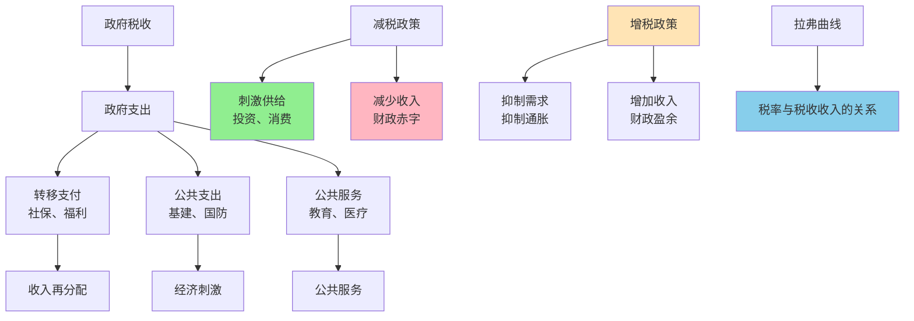

> 财政的艺术

---

**数据来源：** 财政部数据、税务局数据、财政政策研究（2018-2023）、凯恩斯《就业、利息与货币通论》（1936）、阿瑟·拉弗《拉弗曲线》（1974）

## 减税政策的争论

2024年，政府宣布减税政策：
- 企业所得税：25% → 15%
- 增值税：13% → 9%（特定行业）
- 个人所得税：起征点提高

**支持者说：** "减税能刺激经济，增加投资、消费。"
**反对者说：** "减税减少政府收入，增加财政赤字。"

**问题：** 为什么政府既要收税，又要减税？
**更深的问题：** 什么是最优税收水平？

这背后藏着一个经济学概念：**财政政策与税收（Fiscal Policy and Taxation）**。

---

## 财政政策与税收

**定义：**
- **财政政策**：政府通过税收和支出影响经济
- **税收**：政府强制征收的收入

**简单说就是：**
- 财政政策 = "政府收钱+花钱"的工具
- 税收 = "政府收钱"的方式



### 关键要点

**财政政策的类型：**

| 类型 | 定义 | 例子 |
|------|------|------|
| **扩张性财政** | 增加支出/减税 | 2008金融危机刺激 |
| **紧缩性财政** | 减少支出/增税 | 通胀时期收紧 |
| **自动稳定器** | 失业保险、累进税 | 经济衰退自动发挥作用 |

**财政乘数（Fiscal Multiplier）：**

> 政府支出/减税的"乘数效应"：1元政府支出=大于1元GDP增加。

```
乘数 = 1 / (1 - MPC)
```

| MPC（边际消费倾向） | 乘数 |
|-------------------|------|
| 0.8 | 5 |
| 0.6 | 2.5 |
| 0.4 | 1.67 |

**拉弗曲线（Laffer Curve）：**

> 税率与税收收入的关系：税率从0开始，税收收入先增加后减少。

```
税收收入 = 税率 × 税基
```

| 税率 | 税基 | 税收收入 |
|------|------|----------|
| 0% | 最大 | 0 |
| 10% | 大 | 增加 |
| 30% | 中大 | 最大 |
| 50% | 中 | 减少 |
| 100% | 小 | 0（无人工作） |

**历史小知识：** 凯恩斯1936年在《就业、利息与货币通论》中系统阐述了财政政策。拉弗曲线由阿瑟·拉弗（Arthur Laffer）1974年提出，成为"供给侧经济学"的核心。

---

### 为什么财政政策如此重要？

**经济稳定：**

| 功能 | 财政政策作用 |
|------|----------------|
| **稳定经济** | 衰退时刺激，过热时收紧 |
| **收入再分配** | 通过税收和转移支付 |
| **提供公共品** | 国防、基础设施、教育 |

**长期增长：**

| 功能 | 财政政策作用 |
|------|----------------|
| **人力资本** | 教育、医疗投资 |
| **基础设施** | 交通、通信、电力 |
| **R&D支持** | 科学研究、技术发展 |

---

## 财政政策与税收的真实案例

### 减税政策

**背景：** 为什么减税政策如此受欢迎？

**减税的经济逻辑：**

| 逻辑 | 链条 |
|------|------|
| **减税** | → 企业和个人税后收入↑ |
| 税后收入↑ | → 投资和消费↑ |
| 投资和消费↑ | → GDP↑ |
| GDP↑ | → 税基扩大 |
| 税基扩大 | → 税收收入↑（可能） |

**减税的"供给侧效应"：**

| 效应 | 说明 |
|------|------|
| **激励效应** | 税率低→工作、投资、创新激励强 |
| **效率损失减少** | 税率低→避税、逃税减少 |
| **资本形成** | 税率低→储蓄、投资增加 |

**拉弗曲线的应用：**

| 税率 | 税收收入 | 逻辑 |
|------|----------|------|
| **低税率** | 低 | 税基大，但税率低 |
| **最优税率** | 最大 | 税基较大，税率适中 |
| **高税率** | 低 | 税基小（避税、逃税、不工作） |

**数据支撑：**

| 国家 | 企业所得税变化 | 结果 |
|------|------------------|------|
| **美国（2017）** | 35% → 21% | 经济增长、税收收入增加 |
| **中国（2018）** | 部分行业 25% → 15% | 相关行业投资增加 |
| **法国（2017）** | 增税（富人税） | 资本、人才外流 |

**关键洞察：**
> 减税政策是**供给学派**的核心：
> - **逻辑**：税率降低→工作、投资、创新激励强→GDP增长
> - **拉弗曲线**：税率太高，税收收入反而下降
> - **但这不是"无条件的真理"**：
>   - 减税是否有效取决于"当前税率在拉弗曲线的哪一侧"
>   - 如果当前税率过高，减税能增加税收收入
>   - 如果当前税率适中，减税可能减少税收收入
> - **减税的"时机"很重要**：
>   - 衰退时减税：刺激需求
>   - 过热时减税：可能加剧通胀
> - **对财政政策的启示**：
>   - **税收不只是"收入"**，更是"激励"（影响工作、投资行为）
>   - **最优税率存在**：不是"越低越好"或"越高越好"
>   - **税收结构很重要**：消费税、所得税、资本税的最优组合

---

### 基建投资

**背景：** 为什么政府要投资基础设施？

**基建投资的财政乘数效应：**

| 投资 | 乘数效应 |
|------|----------|
| **政府投资100亿** | → 建筑公司收入100亿 |
| 建筑公司收入100亿 | → 建筑工人工资50亿（消费MPC=0.8） |
| 建筑工人消费40亿 | → 消费品公司收入40亿 |
| 消费品公司收入40亿 | → 消费品公司工人工资32亿（MPC=0.8） |
| **总效应** | **100+50+40+32+...= 500亿** |

**基建投资的"长期效益"：**

| 效益 | 说明 |
|------|------|
| **短期** | 刺激需求、创造就业 |
| **中期** | 降低物流成本、提高效率 |
| **长期** | 促进增长、提升竞争力 |

**基建投资的类型：**

| 类型 | 例子 |
|------|------|
| **传统基建** | 公路、铁路、机场 |
| **数字基建** | 5G、数据中心、AI平台 |
| **社会基建** | 学校、医院、保障房 |

**数据支撑：**

| 国家 | 基建投资占GDP | 经济增长 |
|------|-----------------|----------|
| **中国** | ~20-25% | 5-10%（高增长） |
| **美国** | ~3% | 2-3%（发达经济） |
| **印度** | ~10% | 6-7%（快速增长） |

**关键洞察：**
> 基建投资是**财政乘数+长期效益**的组合：
> - **短期**：财政乘数效应（1元投资→数元GDP）
> - **中期**：降低企业成本、提高效率
> - **长期**：促进经济增长
> - **但基建投资不是"无条件好"**：
>   - **如果经济过热**：基建投资可能加剧通胀
>   - **如果债务过高**：基建投资可能不可持续
>   - **如果项目选择错误**：投资可能浪费（"白象项目"）
> - **基建投资的"效率"很重要**：
>   - 不只是"投资"，更是"有效投资"
>   - 选择"高社会回报"的项目
>   - 避免"面子工程"、"政治项目"
> - **对财政政策的启示**：
>   - **财政政策需要"逆周期"**：
>     - 衰退时：增加投资
>     - 过热时：减少投资
>   - **财政政策需要"可持续"**：
>     - 债务/GDP比率需要合理
>     - 避免过度举债
>   - **财政政策需要"有效"**：
>     - 选择"高回报"项目
>     - 避免"白象项目"

---

## 税收原则与设计

### 税收原则

**原则1：效率原则**

| 目标 | 说明 |
|------|------|
| **中性** | 税收不应扭曲经济行为 |
| **简化** | 降低遵从成本 |
| **确定** | 可预测、稳定 |

**原则2：公平原则**

| 目标 | 说明 |
|------|------|
| **横向公平** | 同等收入同等税负 |
| **纵向公平** | 高收入者多纳税 |
| **支付能力** | 根据支付能力纳税 |

**原则3：便利原则**

| 目标 | 说明 |
|------|------|
| **简化** | 税制简单 |
| **透明** | 纳税人理解 |
| **便利** | 纳税便利 |

### 税收类型

| 类型 | 优点 | 缺点 |
|------|------|------|
| **所得税** | 公平（累进） | 扭曲工作/储蓄激励 |
| **消费税** | 效率高、征收简单 | 累退（穷人负担更重） |
| **财产税** | 调节财富分配 | 征管困难、避税 |
| **增值税** | 效率高、可退税 | 扭曲消费、复杂 |

---

## 应用与决策

### 财政政策应用

| 情况 | 政策 |
|------|------|
| **衰退** | 增加支出、减税 |
| **过热** | 减少支出、增税 |
| **债务危机** | 减少赤字、整顿 |

### 个人视角

| 决策 | 税收视角 |
|------|----------|
| 收入规划 | 理解税后收入 vs 税前收入 |
| 投资规划 | 理解资本利得、股息税 |
| 退休规划 | 理解退休账户税收优惠 |

---

### 常见误区

| 误区 | 正解 |
|------|------|
| "减税总是好的" | 减税可能增加赤字，不可持续 |
| "增税总是坏的" | 增税可能减少赤字，稳定经济 |
| "政府支出总是好的" | 支出效率很重要 |
| "赤字总是坏的" | 衰退时赤字是必要的 |

---

## 延伸思考

1. **全球税收竞争**：国家间减税竞争（"税率到底"）——这是"逐底竞争"（Race to the Bottom）吗？还是"效率提升"？需要全球税收协调吗？

2. **数字经济的税收挑战**：数字经济（AI、平台经济）如何征税？现有税制（基于物理存在）是否适应数字时代？

3. **税收与不平等**：累进税制 vs 比例税制——什么更公平？税收应该"劫富济贫"还是"激励创新"？

**下期预告：** 我们来探讨**货币政策与央行**——为什么美联储加息影响全球？中国降准如何释放流动性？

---

**数据来源：** 财政部数据、税务局数据、财政政策研究（2018-2023）、凯恩斯《就业、利息与货币通论》（1936）、阿瑟·拉弗《拉弗曲线》（1974）
