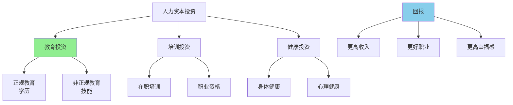

> 投资自己，回报最高

---

**数据来源：** 互联网大厂薪资数据（2023）、硅谷工程师薪资研究、人力资本投资回报研究、西奥多·舒尔茨《人力资本投资》（1961）、加里·贝克尔《人力资本》（1964）

## 互联网大厂的薪资诱惑

2024年，某互联网大厂校招：
- 算法工程师：年薪50万+股票
- 产品经理：年薪40万+股票
- 运营专员：年薪30万+股票

同期，传统行业校招：
- 工程师：年薪15万
- 文员：年薪8万

**问题：** 为什么同样学历，互联网薪资是传统行业的3-5倍？
**更深的问题：** 什么决定了人力资本的价值？

这背后藏着一个经济学核心概念：**人力资本投资（Human Capital Investment）**。

---

## 人力资本投资

**定义：** 人们在教育、培训、健康等方面的投资，以提高未来收入能力。

**简单说就是：** 投资"自己"，而非投资"资产"。



### 关键要点

**人力资本的类型：**

| 类型 | 定义 | 例子 |
|------|------|------|
| **通用人力资本** | 可在多个企业使用的技能 | 读写、数学、英语 |
| **专用人力资本** | 只在特定企业有用的技能 | 公司内部流程、人脉 |
| **知识资本** | 学术知识、专业知识 | 工程师、医生 |
| **技能资本** | 实践技能、操作技能 | 程序员、厨师 |

**教育回报率（Return on Education）：**

> 每多一年教育，未来收入增加的百分比。

| 教育水平 | 额外收入（vs前一水平） |
|----------|------------------------|
| **高中（vs初中）** | +10-15% |
| **大学（vs高中）** | +40-60% |
| **硕士（vs本科）** | +10-30% |
| **博士（vs硕士）** | +10-20% |

**技能溢价（Skill Premium）：**

> 某些技能因为稀缺性或高生产力，获得额外报酬。

| 技能类型 | 溢价 | 例子 |
|----------|------|------|
| **STEM技能** | 高 | 程序员、数据科学家 |
| **管理技能** | 高 | CEO、高管 |
| **创意技能** | 中高 | 设计师、艺术家 |
| **基础技能** | 低 | 基础文书、体力劳动 |

**历史小知识：** 人力资本理论由西奥多·舒尔茨（1960）和加里·贝克尔（1964）提出，他们因此获得诺贝尔经济学奖。雅各布·明塞尔（1958）奠定了现代劳动经济学基础。

---

### 为什么人力资本投资如此重要？

**个体层面：**

| 收益 | 说明 |
|------|------|
| **收入增加** | 教育每增加1年，收入增加约10% |
| **职业选择** | 更好的职业机会 |
| **工作满意度** | 更有意义的工作 |
| **健康** | 教育程度高，健康行为更好 |

**社会层面：**

| 收益 | 说明 |
|------|------|
| **经济增长** | 人力资本是增长源泉 |
| **创新** | 受教育者更可能创新 |
| **社会流动性** | 教育促进社会流动 |
| **公民参与** | 受教育者更积极参与社会 |

---

## 人力资本投资的真实案例

### 互联网大厂薪资

**背景：** 为什么互联网大厂薪资如此之高？

**互联网行业的人力资本特征：**

| 特征 | 说明 |
|------|------|
| **高技能要求** | 程序员、算法工程师、产品经理 |
| **快速技术变化** | 需要持续学习 |
| **高生产力** | 互联网行业人均产出高 |
| **人才稀缺** | 合格工程师供不应求 |

**薪资对比：**

| 岗位 | 互联网大厂 | 传统行业 | 溢价 |
|------|------------|----------|------|
| 算法工程师 | 50万+ | 15万 | 3.3x |
| 产品经理 | 40万+ | 15万 | 2.7x |
| 运营专员 | 30万+ | 10万 | 3.0x |

**技能溢价分析：**

| 技能 | 稀缺性 | 生产力 | 溢价 |
|------|--------|--------|------|
| **AI/ML工程师** | 极高 | 极高 | 极高（50万+） |
| **算法工程师** | 高 | 高 | 高（40万+） |
| **基础开发** | 中 | 中 | 中（20-30万） |

**数据支撑：**

研究显示：
- 计算机科学毕业生收入比其他专业高60-80%
- 每1%额外技能=约5-10%额外收入
- 互联网行业比传统行业人均产值高3-5倍

**关键洞察：**
> 互联网大厂的高薪资是**技能溢价+高生产力**的组合：
> - **技能溢价**：AI/ML、算法工程师等技能稀缺
> - **高生产力**：互联网行业人均产值高
> - **快速变化**：需要持续学习，进一步溢价
> - **这是市场决定的**：
>   - 互联网公司愿意付高薪，因为人才创造的价值更高
>   - 如果不付高薪，人才会流失到竞争对手
> **人力资本投资的启示**：
> - **投资稀缺技能**：AI、算法、数据科学
> - **持续学习**：技能快速折旧，需要持续投资
> - **通用vs 专用**：通用技能（编程）比专用技能（公司流程）更有价值

---

### 硅谷工程师的薪资溢价

**背景：** 为什么硅谷工程师薪资全球最高？

**硅谷的人力资本生态：**

| 要素 | 说明 |
|------|------|
| **人才聚集** | 全球最聪明的人聚集 |
| **知识溢出** | 从同事、公司间学习 |
| **创业文化** | 工程师文化、创新文化 |
| **风险资本** | 高风险资本支持创新 |

**薪资对比：**

| 地区 | 软件工程师中位数 | vs全美平均 |
|------|------------------|------------|
| **硅谷** | $180,000 | +80% |
| **纽约** | $140,000 | +40% |
| **芝加哥** | $120,000 | +20% |
| **全美平均** | $100,000 | - |

**技能溢价+地理溢价：**

| 溢价来源 | 说明 |
|----------|------|
| **技能溢价** | 通用技能在高需求行业 |
| **地理溢价** | 硅谷生活成本高+人才聚集 |
| **公司溢价** | Google、Apple等公司溢价 |
| **股权溢价** | 股票期权、RSU |

**数据支撑：**

研究显示：
- 硅谷工程师比全美平均高80-100%
- 其中约40%是技能溢价，约40%是地理溢价
- 股权收入可达薪资的50-100%

**关键洞察：**
> 硅谷工程师的高薪资是**技能溢价+地理溢价+股权溢价**的组合：
> - **技能溢价**：软件工程师是通用高技能
> - **地理溢价**：硅谷=人才聚集，知识溢出
> - **股权溢价**：创业公司用股权替代现金
> - **人力资本外部性**：
>   - 硅谷不只是"高薪"，更是"人力资本密集"
>   - 从同事、公司间学习（"知识溢出"）
>   - 创业文化=工程师可成为创业者
> **对人力资本投资的启示**：
> - **地理选择重要**：在"人才聚集"的地方，人力资本增值更快
> - **股权参与**：创业公司的股权是"人力资本投资"
> - **网络效应**：人力资本的价值不仅是你自己，还包括你的"人脉"

---

## 如何进行人力资本投资？

### 投资决策框架

**步骤1：评估投资成本**

| 成本类型 | 说明 |
|----------|------|
| **直接成本** | 学费、培训费、书本费 |
| **机会成本** | 学习期间放弃的收入 |
| **时间成本** | 学习、练习的时间 |
| **心理成本** | 学习压力、考试焦虑 |

**步骤2：评估投资收益**

| 收益类型 | 说明 |
|----------|------|
| **收入增加** | 未来更高的薪资 |
| **职业机会** | 更好的工作、更快的晋升 |
| **工作满意度** | 更有意义的工作 |
| **工作稳定性** | 更不易失业 |

**步骤3：计算投资回报率（ROI）**

```
ROI = (未来收益 - 投资成本) / 投资成本
```

| 教育选择 | 成本 | 收益 | ROI |
|----------|------|------|-----|
| **高中** | 3年 | +10-15%收入 | 高 |
| **大学** | 4年+学费 | +40-60%收入 | 中高 |
| **硕士** | 2年+学费 | +10-30%收入 | 中 |
| **博士** | 4-5年+学费 | +10-20%收入 | 中低（除非学术） |

---

### 投资策略

**策略1：投资高需求技能**

| 技能 | 需求趋势 | 投资建议 |
|------|----------|----------|
| **AI/ML** | 极高增长 | 重点投资 |
| **数据科学** | 高增长 | 重点投资 |
| **云计算** | 高增长 | 重点投资 |
| **传统IT** | 稳定 | 维持投资 |

**策略2：通用技能 vs 专用技能**

| 技能类型 | 风险 | 回报 |
|----------|------|------|
| **通用技能** | 低（可转移） | 中高 |
| **专用技能** | 高（不可转移） | 高（如果行业增长） |

**策略3：终身学习**

| 策略 | 说明 |
|------|------|
| **在线学习** | Coursera、edX、Udemy |
| **认证** | 行业认证、技能认证 |
| **实践** | 项目、开源、实习 |

---

## 应用与决策

### 个人决策

| 决策 | 人力资本投资视角 |
|------|---------------------|
| 教育选择 | 计算ROI，而非"兴趣" |
| 职业选择 | 选择"技能密集型"行业 |
| 技能学习 | 投资稀缺技能，而非大众技能 |

### 企业/政策

| 策略 | 人力资本投资应用 |
|------|---------------------|
| 培训投资 | 投资员工技能 |
| 教育支持 | 学费援助、学习假期 |
| 招聘策略 | 招聘高技能人才，付溢价 |

---

### 常见误区

| 误区 | 正解 |
|------|------|
| "学历越高越好" | 取决于ROI和职业目标 |
| "技能越多越好" | 通用技能比专用技能更安全 |
| "教育是唯一投资" | 培训、经验也是人力资本投资 |
| "一旦投资，终身受益" | 技能会折旧，需要持续投资 |

---

## 延伸思考

1. **AI时代的人力资本**：当AI能完成很多任务，什么技能仍然有价值？哪些技能会被AI替代？人力资本投资的方向应该如何调整？

2. **教育泡沫**：大学学费持续上涨，但大学毕业生的薪资增长放缓。教育是否还有高ROI？还是形成"教育泡沫"？

3. **终身学习时代**：在技能快速折旧的时代，人力资本投资不再是"一次性投资"，而是"持续投资"。如何平衡"学习"和"工作"？

**下期预告：** 我们来探讨**信号与筛选**——为什么985/211学历信号如此重要？常春藤效应是如何运作的？

---

**数据来源：** 互联网大厂薪资数据（2023）、硅谷工程师薪资研究、人力资本投资回报研究、西奥多·舒尔茨《人力资本投资》（1961）、加里·贝克尔《人力资本》（1964）
