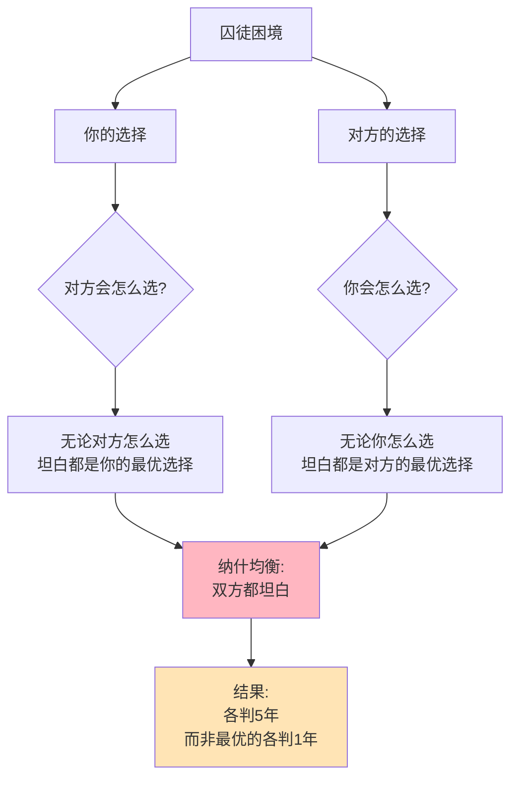

> 个人理性的悲剧，集体非理性的困局

---

## 打价格战的囚徒

2014年，滴滴和快的展开激烈价格战。

双方都明白：
- 继续打价格战，两败俱伤
- 停止补贴，都能盈利

但结果呢？
- 你补贴，我不补贴 → 我失去用户，我死
- 我补贴，你不补贴 → 你失去用户，你死
- 都补贴 → 都亏损
- 都不补贴 → **双赢**（但谁敢先停？）

**问题：** 为什么明明"都不补贴"是最好的，双方却持续"都补贴"？

这背后藏着一个博弈论经典困境：**囚徒困境（Prisoner's Dilemma）**。

---

## 囚徒困境

**定义：** 两个理性人各自追求最大利益，结果却导致双方都受损的局面。

**经典故事：**

警方逮捕了两个嫌疑人，但没有足够证据。警方分别审讯：

| 你的选择 | 对方坦白 | 对方不坦白 |
|----------|----------|------------|
| **坦白** | 各判5年 | 你判1年，对方判10年 |
| **不坦白** | 你判10年，对方判1年 | 各判1年 |

### 关键要点

**1. 纳什均衡（Nash Equilibrium）**

> 给定对方的选择，你无法通过改变自己的选择而变得更好的状态。

在囚徒困境中：
- 如果对方坦白，你最好也坦白（5年 < 10年）
- 如果对方不坦白，你最好坦白（1年 < 10年）
- **无论对方怎么做，坦白都是你的最优选择**

**2. 个人理性 vs 集体理性**

| 选择 | 你的结果 | 对方的结果 | 集体结果 |
|------|----------|------------|----------|
| 都不坦白 | 1年 | 1年 | **最优（2年）** |
| 都坦白 | 5年 | 5年 | 次优（10年） |
| 一方坦白 | 1年/10年 | 10年/1年 | 中等（11年） |

**3. 困境的根源**

| 困境 | 说明 |
|------|------|
| **无法沟通** | 被分别审讯，无法协调 |
| **无法承诺** | 即使口头承诺，也不能相信 |
| **个人理性** | 每个人都追求自己的最大利益 |

**历史小知识：** 囚徒困境由兰德公司的梅里尔·弗勒德（Merrill Flood）和梅尔文·德雷希尔（Melvin Dresher）在1950年提出。约翰·纳什（John Nash）后来将其形式化，提出了纳什均衡概念。1994年，纳什因其在非合作博弈理论方面的开创性工作获得诺贝尔经济学奖（与海萨尼、泽尔腾分享）。

---

### 为什么囚徒困境无处不在？

**本质：** 个人理性选择导致集体非理性结果。

**常见场景：**

| 场景 | 个人选择 | 集体结果 |
|------|----------|----------|
| **价格战** | 降价抢市场 | 都利润下降 |
| **军备竞赛** | 增加军备 | 都不安全 |
| **环境污染** | 排放降低成本 | 都环境恶化 |
| **加班文化** | 加班展现"努力" | 都过度劳累 |

---

## 囚徒困境的真实案例

### 滴滴vs快的：百亿补贴的战争

**背景：** 2014-2015年，滴滴和快的展开疯狂补贴战。

**收益矩阵（简化）：**

| 你的选择 | 对方补贴 | 对方不补贴 |
|----------|----------|------------|
| **补贴** | 各亏损50亿 | 你亏损30亿，对方退出 |
| **不补贴** | 对方亏损30亿，你退出 | 各盈利20亿 |

**为什么无法停止？**

| 顾虑 | 结果 |
|------|------|
| "如果我先停补贴，用户会流向对方" | 继续补贴 |
| "对方可能也在想同样的事" | 继续补贴 |
| "先停的一方会输" | 继续补贴 |

**数据支撑：**

| 时间 | 滴滴补贴 | 快的补贴 | 结果 |
|------|----------|----------|------|
| 2014年初 | 每单补贴10-20元 | 每单补贴10-20元 | 日订单百万级 |
| 2014年中 | 每单补贴20-30元 | 每单补贴20-30元 | 日订单千万级 |
| 2015年2月 | 累计补贴数十亿 | 累计补贴数十亿 | **合并，停止补贴** |

**结局：合并**

| 合并方 | 角色 | 结果 |
|--------|------|------|
| 滴滴 | 主导方 | 市场主导 |
| 快的 | 被合并 | 阿里作为股东 |
| **市场** | **结束价格战** | **消费者不再享受补贴** |

**关键洞察：**
> 滴滴快的的价格战是典型的囚徒困境。只有通过**合并**（将两个独立博弈者变成一个），才能打破困境。**合并后，滴滴获得了定价权，补贴停止，消费者受损**——这就是囚徒困境的残酷真相：打破困境往往通过垄断实现，消费者反而失去福利。

---

### 可乐双雄：默契的"和平"

**背景：** 为什么可口可乐和百事可乐从不打价格战？

**收益矩阵：**

| 你的选择 | 对方降价 | 对方不降价 |
|----------|----------|------------|
| **降价** | 利润都下降 | 你短暂获得市场份额，长期两败俱伤 |
| **不降价** | 对方短暂获得市场份额 | **都保持高利润** |

**为什么不打价格战？**

| 原因 | 说明 |
|------|------|
| **重复博弈** | 不是一次性博弈，是长期博弈 |
| **市场稳定** | 市场份额相对稳定 |
| **产品差异化** | 不是完全替代品 |
| **报复预期** | 降价会招致报复 |

**数据支撑：**

| 年份 | 可口可乐利润率 | 百事可乐利润率 |
|------|----------------|----------------|
| 2010-2020 | 20-25% | 15-20% |
| 价格变动 | 跟随通胀，不打价格战 | 同上 |

**关键洞察：**
> 可乐双雄展示了**如何打破囚徒困境**——通过**重复博弈**和**可信威胁**。当博弈不是一次性，而是长期重复时，合作可以成为均衡：
> - 如果你降价，我也会降价报复（你更惨）
> - 如果你维持价格，我也维持价格（双赢）
> **这种"默契合作"不需要合同，只需要"理性预期"**——我知道你不会降价，因为你知道降价会引发报复，对谁都不利。

---

## 如何破解囚徒困境？

### 方法1：重复博弈

| 条件 | 机制 |
|------|------|
| **无限次重复** | 未来足够重要，合作值得 |
| **折扣因子** | 如果未来价值折扣不高，合作稳定 |

**"以牙还牙"策略（Tit-for-Tat）：**

| 步骤 | 策略 |
|------|------|
| 第一步 | 先选择合作 |
| 之后 | 模仿对方上一步的选择 |

---

### 方法2：建立可信承诺

| 方法 | 例子 |
|------|------|
| **合同** | 签署协议，违约惩罚 |
| **抵押** | 支付保证金，违约没收 |
| **第三方监督** | 政府、行业协会监管 |

---

### 方法3：改变博弈结构

| 方法 | 例子 |
|------|------|
| **合并** | 滴滴合并快的 |
| **建立联盟** | OPEC石油限产 |
| **引入新参与者** | 威胁进入新竞争者 |

---

### 方法4：道德和社会规范

| 机制 | 例子 |
|------|------|
| **声誉机制** | 企业声誉、个人信用 |
| **社会压力** | 公开合作承诺 |
| **道德教育** | 培养合作文化 |

---

## 应用与决策

### 企业决策：何时合作，何时竞争？

| 情况 | 建议 |
|------|------|
| **一次性交易** | 价格竞争可能激烈 |
| **长期关系** | 建立合作机制 |
| **市场成熟** | 默契合作可能形成 |
| **市场增长** | 竞争可能更激烈 |

### 个人决策：避免囚徒困境

| 场景 | 建议 |
|------|------|
| **职场** | 建立长期合作关系 |
| **谈判** | 寻找双赢方案 |
| **团队** | 建立信任机制 |

---

### 常见误区

| 误区 | 正解 |
|------|------|
| "囚徒困境总是悲剧" | 可以通过机制设计破解 |
| "合作需要合同" | 重复博弈下，默契合作也可行 |
| "竞争总是好的" | 过度竞争是囚徒困境 |
| "合并总是坏事" | 有时是打破困境的唯一方式 |

---

## 延伸思考

1. **全球气候博弈**：各国减排是囚徒困境——如果其他国家减排，我搭便车更好；如果其他国家不减排，我减排也无效。如何破解？巴黎协议能解决问题吗？

2. **核武器威慑**：拥核国家陷入安全困境——如果我有核武器更安全，你也会发展核武器，最终都不安全。如何打破这个困境？

3. **AI军备竞赛**：各国和企业竞相发展更强大的AI。如果AI可能带来灾难性风险，这种竞赛是否是终极囚徒困境？如何国际合作？

**下期预告：** 我们来探讨**智猪博弈与搭便车**——为什么开源软件总有大量"白嫖党"？共享单车押金困境如何破解？

---

**数据来源：** 腾讯科技《滴滴快的合并案例分析》、QuestMobile《2015年中国移动出行市场报告》、可口可乐与百事可乐年度财报（2010-2020）、Flood & Dresher（1950）原始囚徒困境研究
- 囚徒困境：参考Flood, M. & Dresher, M.（1952），"Some Experimental Games"，兰德公司研究报告
- 重复博弈：参考罗伯特·奥曼（Aumann, 1959），"Acceptable Points in General Cooperative n-Person Games"（2005年诺贝尔经济学奖）
- 以牙还牙策略：参考Robert Axelrod（1984），《合作的演化》（The Evolution of Cooperation）
