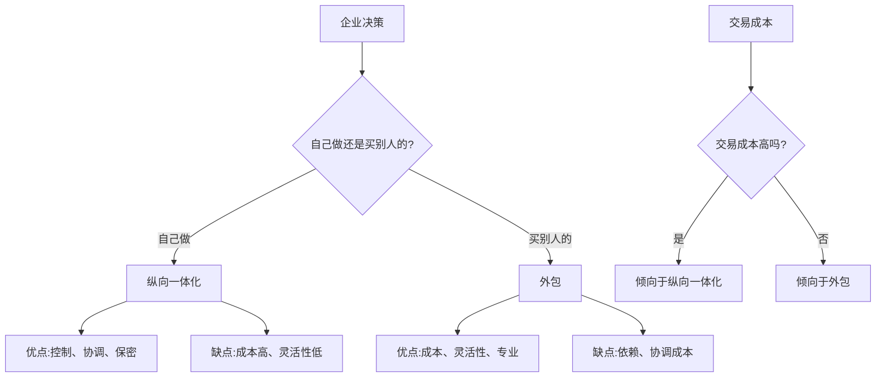

> Make or Buy，这是个问题

---

**数据来源：** Tesla财报（2018-2023）、比亚迪财报（2018-2023）、Apple供应链报告、富士康年报、罗纳德·科斯《企业的性质》（1937）、奥利弗·威廉姆森《市场与科层》（1975）

## 两条不同的路

Tesla：
- 自建工厂
- 自建超级充电桩
- 自研芯片
- 自营保险

Apple：
- 设计自己
- 制造全部外包（富士康）
- 零部件大部分采购
- 零售既自营又合作

**问题：** 为什么Tesla选择"什么都自己做"，Apple选择"外包"？
**更深的问题：** 什么决定了企业边界？

这背后藏着一个经济学核心问题：**Make or Buy（自制或外购）**。

---

## 纵向一体化与外包

**定义：**
- **纵向一体化**：企业自己生产上游或下游的产品/服务
- **外包**：企业从外部供应商购买产品/服务

**简单说就是：**
- 纵向一体化 = "自己做"
- 外包 = "买别人的"



### 关键要点

**决策框架：交易成本理论**

| 决策因素 | 倾向于自制 | 倾向于外购 |
|----------|------------|------------|
| **资产专用性** | 高 | 低 |
| **交易频率** | 高 | 低 |
| **不确定性** | 高 | 低 |
| **监管要求** | 严格 | 宽松 |
| **核心能力** | 是 | 否 |

**纵向一体化的类型：**

| 类型 | 定义 | 例子 |
|------|------|------|
| **后向一体化** | 进入上游（供应商） | Tesla自建电池厂 |
| **前向一体化** | 进入下游（分销/零售） | Adidas开直营店 |
| **完全一体化** | 从头到尾自己来 | Ford曾经的 Rouge 工厂 |

**外包的类型：**

| 类型 | 定义 | 例子 |
|------|------|------|
| **生产外包** | OEM | Apple、Nike |
| **服务外包** | IT、客服、物流 | 银行IT外包 |
| **业务流程外包** | 财务、人力 | 共享服务中心 |

**历史小知识：** 罗纳德·科斯1937年在《企业的性质》中提出"交易成本"概念。奥利弗·威廉姆森进一步发展了交易成本经济学，2009年获诺贝尔经济学奖。

---

### 为什么这个决策如此重要？

**错误的代价：**

| 错误 | 后果 |
|------|------|
| **该自制却外包** | 失去控制、被"卡脖子" |
| **该外包却自制** | 成本高、效率低、不灵活 |

**最优边界的意义：**

| 目标 | 说明 |
|------|------|
| **成本最小化** | 自制成本 vs 外购成本 + 交易成本 |
| **风险最小化** | 供应链风险、依赖风险 |
| **灵活性最大化** | 快速调整的能力 |

---

## 纵向一体化的真实案例

### Tesla：垂直整合的激进者

**背景：** 为什么Tesla选择垂直整合？

**Tesla的自制清单：**

| 领域 | 自制内容 | 外包内容 |
|------|----------|----------|
| **设计** | 全部 | - |
| **电池** | 自建4680电池厂 | 向松下、宁德时代采购 |
| **芯片** | 自研FSD芯片 | 向NVIDIA采购 |
| **制造** | 自建工厂（弗里蒙特、上海、柏林） | - |
| **充电** | 自建超级充电桩 | - |
| **销售** | 直营店 | - |
| **软件** | 全部自研 | - |

**为什么选择垂直整合？**

| 原因 | 说明 |
|------|------|
| **创新速度** | 自主控制，快速迭代 |
| **质量控制** | 不依赖供应商 |
| **成本控制** | 长期看成本更低 |
| **数据优势** | 软硬件一体化，数据更多 |
| **品牌形象** | "全栈自研"的高端形象 |

**数据支撑：**

| 指标 | Tesla | 行业平均 |
|------|-------|----------|
| 自制率 | ~80% | ~30% |
| 毛利率 | ~20% | ~15% |
| 研发投入占比 | ~5% | ~3% |

**风险与挑战：**

| 风险 | 说明 |
|------|------|
| **巨额投资** | 需要持续巨额资本投入 |
| **管理复杂度** | 管理众多不同业务 |
| **灵活性降低** | 难以快速调整 |

**关键洞察：**
> Tesla的垂直整合是**战略选择**，不是成本选择。Tesla选择"全栈自研"是因为：
> - **创新速度**：自动驾驶需要软硬件深度整合
> - **品牌差异化**：与传统车企区别开来
> - **长期成本优势**：虽然短期投资大，但长期看成本更低
> **Tesla证明了垂直整合的价值**：在需要快速创新、高度协同的行业，自制可能比外包更有效。**但这也需要巨额资本和管理能力**——不是所有公司都能复制。

---

### 比亚迪：供应链为王

**背景：** 为什么比亚迪能成为"中国新能源之王"？

**比亚迪的自制清单：**

| 领域 | 自制内容 |
|------|----------|
| **电池** | 刀片电池（完全自研自产） |
| **芯片** | IGBT功率半导体（自研） |
| **电机** | 自研自产 |
| **电控** | 自研自产 |
| **模具** | 自有模具工厂 |
| **零部件** | 大部分自制 |

**"电池-整车-芯片"一体化：**

```
上游：电池、芯片、电机
    ↓
中游：零部件制造
    ↓
下游：整车制造
    ↓
销售：直营+经销商
```

**为什么选择垂直整合？**

| 原因 | 说明 |
|------|------|
| **成本控制** | 不受供应商价格波动影响 |
| **供应安全** | 不被"卡脖子" |
| **规模经济** | 自己造越多，成本越低 |
| **利润留存** | 利润留在内部，而非给供应商 |

**数据支撑：**

| 指标 | 比亚迪 | 行业平均 |
|------|--------|----------|
| 自制率 | ~70% | ~30% |
| 电池成本 | 低20%+ | - |
| 毛利率 | ~20% | ~15% |

**关键洞察：**
> 比亚迪的垂直整合是**成本+安全战略**。与Tesla不同，比亚迪的垂直整合更注重：
> - **成本优势**：大规模制造降低成本
> - **供应链安全**：不受外部供应链波动影响
> - **风险分散**：不仅造车，还卖电池、芯片给其他车企
> **比亚迪证明了中国制造业的垂直整合价值**：通过"全产业链"优势，在全球竞争中取得成本和安全优势。

---

## 外包的成功案例

### Apple：外包大师

**背景：** 为什么Apple选择外包制造？

**Apple的外包清单：**

| 领域 | 自制 | 外包 |
|------|------|------|
| **设计** | ✅ 全部 | - |
| **芯片设计** | ✅ 自研 | - |
| **制造** | - | ✅ 富士康等 |
| **零部件** | 部分 | ✅ 大部分 |
| **软件** | ✅ 全部 | - |
| **零售** | ✅ 直营店 | ✅ 授权经销商 |

**为什么选择外包制造？**

| 原因 | 说明 |
|------|------|
| **成本优势** | 中国人工成本低（过去） |
| **灵活性** | 快速调整产量 |
| **专业能力** | 富士康是制造专家 |
| **资本效率** | 不需要投资工厂 |

**Apple的核心能力：**

| 能力 | 说明 |
|------|------|
| **设计** | 工业设计、用户体验设计 |
| **生态** | iOS、App Store、服务 |
| **品牌** | 高端品牌、创新形象 |
| **供应链管理** | 虽然外包，但深度管理 |

**数据支撑：**

| 指标 | 数据 |
|------|------|
| 外包比例 | ~90%（制造） |
| 毛利率 | ~40%（远高于行业平均） |
| 现金储备 | 2000亿美元+ |

**关键洞察：**
> Apple展示了**"设计+品牌"vs"制造"的分工**。Apple专注于高价值环节（设计、品牌、生态），将低价值环节（制造）外包。**这是交易成本理论的完美应用**：
> - 制造是"资产专用性低"的业务（谁都能造）
> - Apple通过合同和关系管理，控制了外包风险
> - Apple保留"设计"这个核心能力，建立了护城河
> **Apple证明了外包的成功**：关键是保留核心能力，外包非核心但必需的业务。

---

## 如何决策：Make or Buy？

### 决策框架

**步骤1：评估资产专用性**

| 专用性程度 | 决策倾向 | 例子 |
|------------|----------|------|
| **高** | 自制 | 专利技术、核心算法 |
| **中** | 视情况而定 | 部分零部件 |
| **低** | 外包 | 通用零部件、物流 |

**步骤2：评估交易成本**

| 成本类型 | 自制成本 | 外包成本 |
|----------|----------|----------|
| **生产成本** | 设备、人工、管理 | 采购价格 |
| **协调成本** | 内部协调 | 与供应商协调 |
| **风险成本** | 技术风险、市场风险 | 依赖风险、质量风险 |

**步骤3：评估战略价值**

| 问题 | 自制 | 外包 |
|------|------|------|
| 是核心能力吗？ | 是 | 否 |
| 需要保密吗？ | 是 | 否 |
| 需要快速响应吗？ | 是 | 视情况 |
| 需要大规模投资吗？ | 是（如果有资本） | 否 |

---

## 应用与决策

### 企业战略

| 情况 | 建议 |
|------|------|
| **核心能力** | 纵向一体化 |
| **非核心但必需** | 外包（深度管理） |
| **通用需求** | 外包 |
| **高度机密** | 自制 |

### 个人职业

| 选择 | 建议 |
|------|------|
| **核心技能** | 自己掌握（不可外包） |
| **辅助任务** | 外包（工具、服务） |
| **时间 vs 金钱** | 用金钱买时间（外包） |

---

### 常见误区

| 误区 | 正解 |
|------|------|
| "自制总是更好" | 自制成本高、灵活性低 |
| "外包总是更便宜" | 外包有协调和依赖成本 |
| "核心能力永远不变" | 核心能力可能转移 |
| "外包=放弃控制" | 深度管理可以保持控制 |

---

## 延伸思考

1. **中国的"全产业链"战略**：为什么中国强调"全产业链"？是因为地缘政治风险（"卡脖子"），还是有其他原因？

2. **Web3的"去中介化"理想**：Web3试图通过区块链消除中介（"代码即法律"）。但中介的存在正是因为"交易成本"——Web3能真的消除交易成本吗？

3. **AI对决策的影响**：当AI能快速学习任何技能，什么应该是"自制"（自己掌握AI），什么应该"外包"（使用AI服务）？

**下期预告：** 我们来探讨**规模经济与范围经济**——为什么Shein的供应链如此快反？Amazon AWS如何利用规模经济？

---

**数据来源：** Tesla财报（2018-2023）、比亚迪财报（2018-2023）、Apple供应链报告、富士康年报、罗纳德·科斯《企业的性质》（1937）、奥利弗·威廉姆森《市场与科层》（1975）
