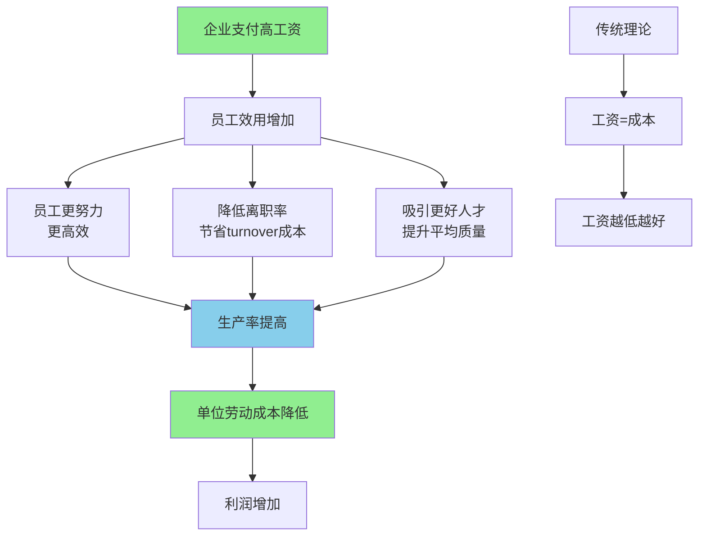

> 高工资不只是成本，更是投资

---

**数据来源：** 程序员薪资研究（2023）、Google福利研究（2018-2023）、索洛《劳动力市场的效率工资》（1979）、夏皮罗与斯蒂格利茨《失业的理论》（1984）

## 程序员的薪资之谜

2024年，某互联网大厂程序员：
- 基本工资：30万/年
- 奖金：20万/年
- 股票：30万/年（RSU）
- **总计：80万/年**

同期，传统行业程序员：
- 基本工资：15万/年
- 奖金：3万/年
- 股票：0
- **总计：18万/年**

**问题：** 为什么互联网公司付这么高的工资？
**更深的问题：** 高工资不只是成本，还是投资吗？

这背后藏着一个经济学概念：**效率工资理论（Efficiency Wage Theory）**。

---

## 效率工资

**定义：** 企业支付高于市场均衡水平的工资，以提高生产率、降低成本。

**简单说就是：** 高工资不是"成本"，而是"投资"——投资更高效的生产。



### 关键要点

**效率工资的来源：**

| 来源 | 说明 | 效果 |
|------|------|------|
| **努力程度提高** | 高工资→员工更努力 | 生产率↑ |
| **离职率降低** | 高工资→员工不愿离职 | Turnover成本↓ |
| **人才吸引** | 高工资→吸引更好人才 | 平均质量↑ |
| **健康改善** | 高工资→员工更健康 | 出勤率↑ |

**夏皮罗-斯蒂格利茨模型（Shapiro-Stiglitz Model）：**

> 企业支付高工资，员工因为害怕失业（失去高工资工作）而努力工作。

**均衡条件：**

```
效率工资 > 市场均衡工资
劳动边际产品 > 劳动边际成本
```

**效率工资 vs 市场工资：**

| 工资类型 | 定义 | 结果 |
|----------|------|------|
| **市场工资** | 劳动市场供需均衡 | 失业=0 |
| **效率工资** | 高于市场工资 | 失业>0，但企业仍获利 |

**历史小知识：** 效率工资理论源于19世纪（福特汽车），但由索洛（1979）、夏皮罗和斯蒂格利茨（1984）等形式化。约瑟夫·斯蒂格利茨因此获得2001年诺贝尔经济学奖。

---

### 为什么效率工资有效？

**机制1：营养模型（Nutrition Model）**

| 逻辑 | 链条 |
|------|------|
| 高工资 | → 更好的营养 |
| 更好的营养 | → 更健康的员工 |
| 更健康的员工 | → 更高的生产率 |

**机制2：离职模型（Turnover Model）**

| 逻辑 | 链条 |
|------|------|
| 高工资 | → 离职率降低 |
| 离职率降低 | → 招聘培训成本降低 |
| 成本降低 | → 整体成本可能下降 |

**机制3：礼物交换模型（Gift Exchange Model）**

| 逻辑 | 链条 |
|------|------|
| 高工资 | → 员工觉得"被公平对待" |
| 觉得"被公平对待" | → 回报公司（更努力） |
| 更努力 | → 生产率提高 |

---

## 效率工资的真实案例

### 程序员高薪

**背景：** 为什么程序员薪资如此之高？

**程序员薪资的效率工资逻辑：**

| 逻辑 | 说明 |
|------|------|
| **高生产力** | 程序员的劳动边际产品极高（一个人创造数百万收入） |
| **稀缺性** | 合格程序员供不应求 |
| **快速技术变化** | 需要持续学习，高工资补偿学习成本 |
| **高强度** | 加班、高压，需要补偿 |

**薪资对比：**

| 岗位 | 程序员 | 传统工程师 | 溢价 |
|------|--------|------------|------|
| **基础薪资** | 30万 | 15万 | 2x |
| **总薪酬（含奖金）** | 50万+ | 18万 | 2.8x |
| **劳动边际产品** | 数百万 | 几十万 | 10x+ |

**效率工资的计算：**

| 成本 | 传统工程师 | 程序员 |
|------|------------|--------|
| **工资** | 15万 | 30万 |
| **Turnover成本** | 5万 | 10万 |
| **单位劳动产出** | 30万 | 300万 |
| **单位劳动成本/产出比** | 20/30=67% | 40/300=13% |

**关键洞察：**
> 程序员的高薪是**高生产力+稀缺性+效率工资**的组合：
> - **高生产力**：程序员的劳动边际产品极高
> - **稀缺性**：合格程序员供不应求
> - **效率工资**：高工资吸引最好的人才，提高生产率
> - **这不是"过度支付"**：
>   - 程序员创造的价值远超工资
>   - 但这是"竞争性"效率工资（所有公司都付高工资）
> - **效率工资 vs 市场工资**：
>   - 如果所有公司都付市场工资，生产率会下降（优秀人才流失）
>   - 如果所有公司都付效率工资，竞争下，生产率提高
> - **效率工资的本质是"投资人才"**：
>   - 不是"成本最小化"
>   - 而是"单位劳动成本最小化"（生产率↑>工资↑）

---

### Google的福利

**背景：** 为什么Google提供如此丰厚的福利？

**Google的福利清单：**

| 福利 | 说明 |
|------|------|
| **免费餐饮** | 3顿免费、高质量 |
| **交通补贴** | 免费班车 |
| **健身设施** | 健身房、游泳池 |
| **家庭支持** | 产假、托儿所 |
| **20%时间** | 20%工作时间做自己的项目 |

**福利的效率工资逻辑：**

| 福利 | 效率工资效果 |
|------|----------------|
| **免费餐饮** | 节省时间，提高工作效率 |
| **交通补贴** | 减少通勤时间，提高出勤率 |
| **20%时间** | 创新激励，吸引创意人才 |
| **家庭支持** | 降低离职率，提高忠诚度 |

**成本收益分析：**

| 成本 | 收益 | 净收益 |
|------|------|--------|
| **福利成本** | 员工更满意 | **生产率↑ > 成本↑** |
| **高工资** | 吸引最好人才 | **创新↑ > 工资↑** |

**数据支撑：**

| 指标 | Google vs 行业平均 |
|------|---------------------|
| 员工满意度 | 90% | 70% |
| 离职率 | 5% | 15% |
| 人均产值 | $200万+ | $50万 |
| 福利成本/人 | $2万/年 | - |

**关键洞察：**
> Google的福利是**效率工资+企业文化建设**的组合：
> - **效率工资**：福利提高生产率、降低离职率
> - **企业文化**：20%时间、创新文化=吸引创意人才
> - **这不是"慷慨"**，而是"精明的投资"：
>   - 免费餐饮节省员工时间（更多时间工作）
>   - 20%时间激励创新（Gmail、AdSense来自20%时间）
>   - **效率工资 vs 非效率工资**：
>   - 非效率工资公司：最低成本，但生产率低，离职率高
>   - 效率工资公司：高成本，但生产率更高，离职率更低
>   - **Google的"20%时间"是终极效率工资**：
>     - 吸引最创意的人才
>     - 创新人才在20%时间创造巨大价值
>     - 这些价值远超工资成本
>   **对效率工资的启示**：
>   - **高工资不只是"成本"，更是"投资"**
>   - **福利不只是"慷慨"，更是"效率工具"**
>   - **最有效的效率工资是"差异化"的**：
>     - 针对不同员工，提供不同福利
>     - 20%时间吸引创意人才
>     - 稳定性吸引风险规避人才

---

## 如何应用效率工资？

### 企业策略

**策略1：识别高生产力员工**

| 特征 | 说明 |
|------|------|
| **高技能** | 稀缺技能、高生产力 |
| **高影响** | 一个人影响很多人（管理者、创意人才） |
| **高成长** | 未来成长空间大 |

**策略2：设计效率工资**

| 设计 | 说明 |
|------|------|
| **高于市场** | 但要计算ROI |
| **差异化** | 不同岗位不同溢价 |
| **长期激励** | 股权、归属期 |

**策略3：配套措施**

| 措施 | 说明 |
|------|------|
| **绩效文化** | 高绩效=高回报 |
| **透明晋升** | 晋升路径清晰 |
| **工作环境** | 支持创新、学习 |

---

### 个人视角

**策略1：投资自己的"效率"**

| 投资 | 说明 |
|------|------|
| **技能提升** | 提高劳动边际产品 |
| **持续学习** | 保持竞争力 |
| **品牌建设** | 建立个人品牌 |

**策略2：寻找"效率工资"雇主**

| 特征 | 说明 |
|------|------|
| **高生产力文化** | 重视效率、创新 |
| **高成长行业** | 互联网、科技、金融 |
| **股权激励** | 长期利益绑定 |

---

## 应用与决策

### 企业决策

| 决策 | 效率工资应用 |
|------|----------------|
| 定薪 | 核心岗位付效率工资 |
| 福利 | 投资"提高生产率"的福利 |
| 激励 | 长期激励（股权）vs 短期激励（奖金） |

### 个人决策

| 决策 | 效率工资视角 |
|------|----------------|
| 职业选择 | 选择"高生产力"行业 |
| 技能投资 | 投资"高边际产品"技能 |
| 雇主选择 | 选择"效率工资"雇主 |

---

### 常见误区

| 误区 | 正解 |
|------|------|
| "高工资=高成本" | 高工资可能提高生产率，降低单位成本 |
| "效率工资只适用于高科技" | 任何高生产力员工都适用 |
| "福利总是激励" | 只有影响生产率的福利才是"效率工资" |
| "效率工资=过度支付" | 效率工资=精确计算后的最优工资 |

---

## 延伸思考

1. **最低工资 vs 效率工资**：政府强制的"最低工资"是效率工资的一种形式吗？最低工资应该设在什么水平？

2. **CEO的效率工资**：CEO的高薪是"效率工资"还是"代理成本"？CEO的高薪真的能提高企业绩效吗？

3. **全球化的效率工资**：为什么发达国家工资高，但制造业仍然外包到发展中国家？是效率工资失效了，还是有其他因素？

**下期预告：** 我们来探讨**零工经济与平台工作**——为什么外卖骑手不断增长？滴滴司机、Upwork自由职业者的工作自由还是陷阱？

---

**数据来源：** 程序员薪资研究（2023）、Google福利研究（2018-2023）、索洛《劳动力市场的效率工资》（1979）、夏皮罗与斯蒂格利茨《失业的理论》（1984）
