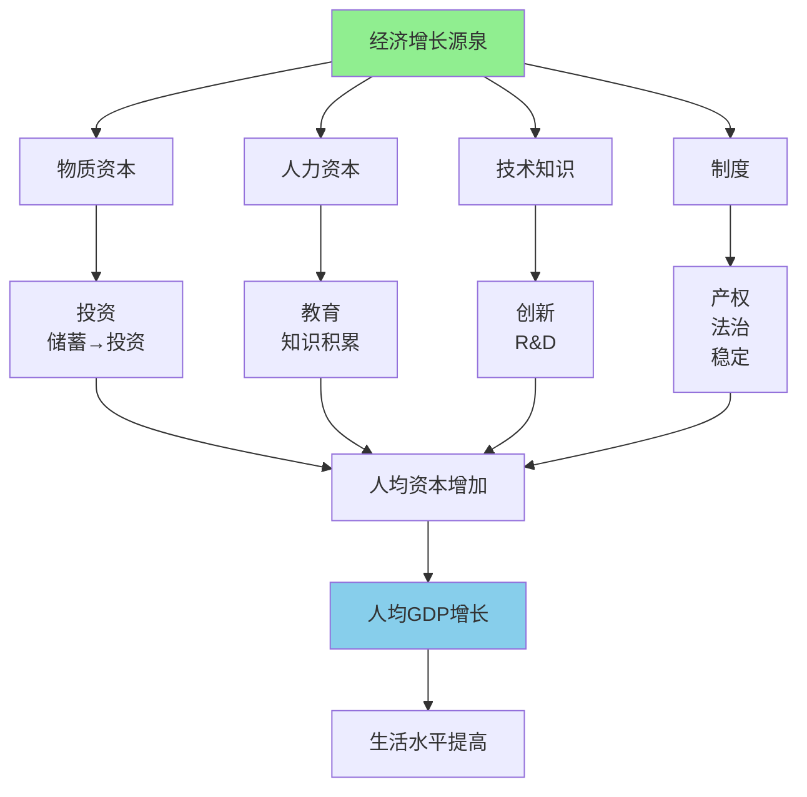

> 增长的奥秘

---

**数据来源：** 中国统计局、世界银行、硅谷创新研究（2020-2023）、罗伯特·索洛《经济增长理论》（1956）、保罗·罗默《内生增长理论》（1990）

## 国富国穷之谜

2023年，各国人均GDP：
- **美国**：$76,000
- **中国**：$12,700
- **印度**：$2,600
- **布隆迪**：$250

**问题：** 为什么国家间贫富差距如此巨大？
**更深的问题：** 什么决定了一个国家的经济增长？

这背后藏着一个经济学核心概念：**经济增长与源泉（Economic Growth and Sources）**。

---

## GDP与经济增长

**定义：**
- **GDP（国内生产总值）**：一个国家在一定时期内生产的所有最终产品和服务的市场价值
- **经济增长**：GDP的增加

**简单说就是：**
- GDP = 一个国家"生产+服务"的总价值
- 经济增长 = 这个总价值的增加

### 关键要点

**GDP的核算方法：**

| 方法 | 定义 | 例子 |
|------|------|------|
| **生产法** | 各行业增加值之和 | 农业+制造业+服务业 |
| **收入法** | 各种收入之和 | 工资+利润+税收 |
| **支出法** | 各种支出之和 | 消费+投资+政府+净出口 |

**经济增长的类型：**

| 类型 | 定义 | 例子 |
|------|------|------|
| **广度增长** | 投入增加（资本、劳动力） | 增加工人、加机器 |
| **深度增长** | 效率提高（技术、制度） | 技术进步、制度改革 |
| **粗放增长** | 依赖投入的增加 | 资源消耗型增长 |
| **集约增长** | 依赖效率的提高 | 创新驱动型增长 |

**增长源泉（Solow Model）：**

| 源泉 | 贡献 | 说明 |
|------|------|------|
| **劳动** | ~30-40% | 劳动力增长、教育（人力资本） |
| **资本** | ~40-50% | 投资增加资本存量 |
| **技术（索洛残差）** | ~10-20% | 创新、R&D、制度 |

**历史小知识：** 现代增长理论由罗伯特·索洛（1956）和保罗·罗默（1986）奠定基础。罗伯特·索洛1987年获诺贝尔经济学奖。保罗·罗默2018年获诺贝尔经济学奖。

---

### 为什么经济增长如此重要？

**个体层面：**

| 收益 | 说明 |
|------|------|
| **收入增加** | GDP增长=收入增长 |
| **就业机会** | 增长创造更多就业 |
| **公共服务** | 税收增加→教育、医疗、基础设施 |

**社会层面：**

| 收益 | 说明 |
|------|------|
| **贫困减少** | 增长是减少贫困的最有效方式 |
| **社会发展** | 教育、健康、性别平等 |
| **国家实力** | 经济实力→政治实力 |

---

## 经济增长的真实案例

### 中国增长模式

**背景：** 为什么中国能保持40年高速增长？

**中国增长的时间线：**

| 时期 | 增长率 | 特征 |
|------|--------|------|
| **1978-1990** | ~9% | 改革开放初期 |
| **1990-2010** | ~10% | 出口导向、工业化 |
| **2010-2020** | ~7% | 转型、消费驱动 |
| **2020-2023** | ~5% | 新常态、高质量发展 |

**中国增长的源泉：**

| 源泉 | 贡献 | 说明 |
|------|------|------|
| **资本积累** | ~50% | 高投资率（40-50%的GDP） |
| **人力资本** | ~20% | 教育普及、技能提升 |
| **技术进步** | ~20% | 技术、管理创新 |
| **制度变化** | ~10% | 市场化改革、对外开放 |

**中国模式的特征：**

| 特征 | 说明 |
|------|------|
| **出口导向** | 依靠出口市场拉动增长 |
| **投资驱动** | 高投资率（基础设施建设、制造业） |
| **政府引导** | 产业政策、五年规划 |
| **渐进改革** | 摸着石头过河、双轨制 |

**数据支撑：**

| 指标 | 1978 | 2023 | 增长 |
|------|------|------|------|
| 人均GDP | $156 | $12,700 | **80倍** |
| 贫困率 | >90% | <1% | **几乎消除** |
| 制造业占比 | ~20% | ~27% | **世界工厂** |

**关键洞察：**
> 中国的增长是**资本积累+人力资本+技术进步+制度改革**的组合：
> - **资本积累**：高投资率（40-50%的GDP）→基础设施、制造业产能扩张
> - **人力资本**：教育普及、技能提升→劳动力质量提高
> - **技术进步**：技术引进、消化、创新→生产率提升
> - **制度改革**：市场化改革、对外开放→激励机制改善
> - **但增长模式在转变**：
>   - **从粗放增长到集约增长**：
>     - 过去：依赖投入（资本、劳动力）
>     - 现在：依赖效率（创新、技术）
>   - **从投资驱动到消费驱动**：
>     - 过去：投资占50%的GDP
>     - 现在：消费占50%+的投资
>   - **从高速增长到高质量发展**：
>     - 过去：10%增长
>     - 现在：5%增长，但更可持续
> - **中国增长对经济增长的启示**：
>   - **没有"单一"秘诀**：增长是多重因素共同作用
>   - **制度很重要**：市场化改革、对外开放是关键
>   - **但"模式"需要转型**：粗放增长有极限

---

### 硅谷创新

**背景：** 为什么硅谷能成为全球创新的中心？

**硅谷的创新生态：**

| 要素 | 说明 |
|------|------|
| **人才聚集** | 全球最聪明的工程师、企业家 |
| **风险资本** | VC提供资金+网络+经验 |
| **大学研究** | 斯坦福、UC Berkeley的知识溢出 |
| **创业文化** | 失败可接受、创新崇拜 |
| **产业聚集** | 科技公司聚集（Google、Apple等） |

**创新的源泉：**

| 源泉 | 作用 | 例子 |
|------|------|------|
| **R&D投入** | 创造新知识 | Google搜索、Apple产品 |
| **人力资本** | 高技能劳动力 | 工程师、科学家 |
| **知识溢出** | 从同事、公司间学习 | 硅谷的咖啡文化、跳槽 |
| **竞争压力** | 不断创新生存 | 技术快速迭代 |

**数据支撑：**

| 指标 | 硅谷 | 其他地区 |
|------|------|----------|
| VC投资 | ~30%全美 | ~70%其他地区 |
| 专利数量 | ~1000/百万人口 | ~300/百万人口 |
| 独角兽数量 | ~200（全美约1000） | ~800（其他地区） |

**关键洞察：**
> 硅谷的创新是**人才聚集+风险资本+知识溢出+创业文化**的组合：
> - **人才聚集**：全球最聪明的人聚集在一起
> - **风险资本**：VC提供资金+网络+经验
> - **知识溢出**：公司间跳槽、咖啡文化、开放交流
> - **创业文化**：失败可接受、创新崇拜
> - **这不是"单个要素"**：
>   - 不是"VC"单独作用
>   - 不是"斯坦福大学"单独作用
>   - 而是"生态系统"整体作用
> - **创新的"自我强化"特征**：
>   - 成功案例→吸引更多人才→更多成功案例
>   - 股权文化→吸引创业者→更多成功→更多股权
> - **对经济增长的启示**：
>   - **创新不只是"钱"**：更是人才、文化、制度
>   - **"聚集"很重要**：人才、公司、VC的地理聚集
>   - **"失败文化"很重要**：没有失败容忍，就没有创新

---

## 如何促进经济增长？

### 策略1：投资人力资本

| 策略 | 说明 |
|------|------|
| **教育普及** | 基础教育普及、扫盲 |
| **高等教育** | 大学、职业教育、技能培训 |
| **终身学习** | 在职培训、在线学习 |

### 策略2：投资物质资本

| 策略 | 说明 |
|------|------|
| **基础设施** | 交通、通信、电力 |
| **设备投资** | 机械设备、数字设备 |
| **住房投资** | 提高生活质量 |

### 策略3：促进创新

| 策略 | 说明 |
|------|------|
| **R&D投入** | 企业、政府研发 |
| **专利保护** | 知识产权保护 |
| **教育+研究结合** | 大学-企业合作 |

### 策略4：制度改革

| 策略 | 说明 |
|------|------|
| **产权保护** | 保护私有产权 |
| **法治** | 公平、公正的法律体系 |
| **市场化** | 价格机制、减少管制 |
| **开放** | 对外开放、贸易自由 |

---

## 应用与决策

### 国家/地区决策

| 决策 | 增长源泉应用 |
|------|----------------|
| 教育政策 | 基础教育普及+高等教育 |
| 基础设施 | 交通、通信、电力 |
| 产业政策 | 优势产业+创新支持 |
| 制度改革 | 产权、法治、市场化 |

### 个人决策

| 决策 | 增长视角 |
|------|----------|
| 职业选择 | 选择"增长"行业 |
| 技能投资 | 投资"高生产力"技能 |
| 地理选择 | 选择"创新聚集"地区 |

---

### 常见误区

| 误区 | 正解 |
|------|------|
| "增长=GDP" | GDP不等于福祉，但是重要指标 |
| "增长=钱" | 增长是"物质资本+人力资本+技术" |
| "增长=投资" | 投资很重要，但效率更重要 |
| "增长=政府" | 政府重要，但市场是基础 |

---

## 延伸思考

1. **数字经济的增长源泉**：数字经济（AI、大数据、云）如何改变经济增长？数字经济的"边际成本=0"特征如何影响增长模式？

2. **中国增长的可持续性**：中国过去40年的高速增长能持续吗？还是需要转型到"创新驱动型"增长？

3. **全球增长收敛**：穷国会追上富国吗？还是"富者越富，穷者越穷"？增长会"收敛"吗？

**下期预告：** 我们来探讨**财政政策与税收**——为什么减税政策如此受欢迎？拉弗曲线告诉我们什么？

---

**数据来源：** 中国统计局、世界银行、硅谷创新研究（2020-2023）、罗伯特·索洛《经济增长理论》（1956）、保罗·罗默《内生增长理论》（1990）
