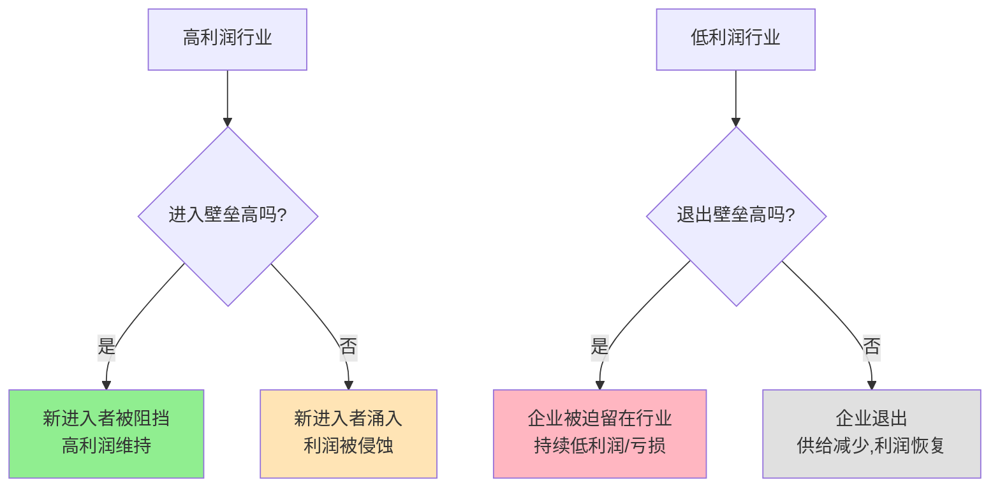

> 壁垒决定利润

---

**数据来源：** Facebook与Google+用户数据（2010-2019）、半导体行业投资报告（Gartner, 2023）、芯片制造成本数据、乔·贝恩《新竞争的壁垒》（1956）、奥利弗·威廉姆森《资本主义的经济制度》（1985）

## 想做社交APP？先看看这个故事

2010年，Google推出Google+，挑战Facebook。

Google投入巨额资源：
- 强制整合到所有Google服务
- 5亿用户注册
- 顶级工程师团队

2019年，Google+宣布关闭。

**问题：** 为什么Google这样的巨头都无法挑战Facebook？
**更深的问题：** 什么决定了行业的"进入难度"和"退出难度"？

这背后藏着一个经济学核心概念：**进入壁垒与退出壁垒（Entry and Exit Barriers）**。

---

## 进入壁垒与退出壁垒

**定义：**
- **进入壁垒**：阻碍新企业进入市场的因素
- **退出壁垒**：阻碍现有企业退出市场的因素

**简单说就是：**
- 进入壁垒 = 为什么"进不去"？
- 退出壁垒 = 为什么"出不来"？



### 关键要点

**进入壁垒的类型：**

| 类型 | 定义 | 例子 |
|------|------|------|
| **资本壁垒** | 需要巨额初始投资 | 芯片、航空、汽车 |
| **技术壁垒** | 需要专利/技术知识 | 制药、半导体 |
| **品牌壁垒** | 消费者忠诚度 | 奢侈品、可口可乐 |
| **渠道壁垒** | 分销网络控制 | 可口可乐、宝洁 |
| **网络效应壁垒** | 用户越多价值越高 | Facebook、微信 |
| **监管壁垒** | 政府许可/牌照 | 银行、电信、医疗 |

**退出壁垒的类型：**

| 类型 | 定义 | 例子 |
|------|------|------|
| **专用资产** | 设备/资产无法他用 | 航空（飞机）、钢铁 |
| **长期合同** | 无法取消的承诺 | 租赁合同、劳动合同 |
| **品牌声誉** | 退出损害其他业务 | 多品牌公司的单一品牌 |
| **情感因素** | 家族企业、创始人情感 | 家族企业 |
| **政府限制** | 破产/退出限制 | 公用事业、银行 |

**壁垒组合：**

| 进入壁垒 | 退出壁垒 | 行业特征 |
|----------|----------|----------|
| 高 | 低 | **高利润、稳定**（制药、软件） |
| 高 | 高 | **高利润、高风险**（芯片、汽车） |
| 低 | 低 | **利润平均、进出自由**（餐饮） |
| 低 | 高 | **利润低、容易产能过剩**（纺织、钢铁） |

**历史小知识：** 乔·贝恩1956年在《新竞争的壁垒》中系统阐述了进入壁垒理论。后来，产业组织理论（IO）进一步发展了这一领域。

---

### 为什么壁垒如此重要？

**进入壁垒的重要性：**

```
高进入壁垒 → 新进入者少 → 竞争不激烈 → 超额利润可持续
```

**退出壁垒的重要性：**

```
高退出壁垒 → 企业无法退出 → 产能过剩 → 价格战 → 持续低利润
```

---

## 壁垒的真实案例

### 社交网络：网络效应壁垒

**背景：** 为什么Google+失败了？

**社交网络的进入壁垒分析：**

| 壁垒类型 | Facebook | Google+ |
|----------|----------|---------|
| **网络效应** | 20亿+用户 | 虽有5亿注册，但日活低 |
| **切换成本** | 高（朋友都在） | 低（没有朋友在） |
| **数据优势** | 10+年用户数据 | 从零开始 |
| **品牌心智** | "社交网络"=Facebook | Google是"搜索" |

**网络效应的"鸡与蛋"困境：**

```
没有用户 → 没有内容 → 没有用户 → ...
```

**Facebook的优势：**

| 优势 | 说明 |
|------|------|
| **先发优势** | 2004年成立，积累了用户 |
| **梅特卡夫定律** | 网络价值 ≈ 用户数的平方 |
| **锁定效应** | 朋友都在，无法离开 |
| **数据飞轮** | 更多数据 → 更好算法 → 更多用户 |

**Google+的失败原因：**

| 原因 | 说明 |
|------|------|
| **太晚了** | Facebook已经太强大 |
| **不是真正的社交网络** | 被视为"又一个Google产品" |
| **没有解决"迁移问题"** | 用户为什么要离开朋友？ |
| **强迫式推广** | 引起反感 |

**数据支撑：**

| 平台 | 月活用户 | 用户停留时间 |
|------|----------|--------------|
| Facebook | 20亿+ | 高 |
| Google+ | 0（关闭） | - |

**关键洞察：**
> 社交网络的壁垒是**网络效应+切换成本**的组合。这不仅是"先发优势"，而是**自我强化的护城河**：
> - 用户越多 → 内容越多 → 用户越多（飞轮）
> - 朋友都在 → 切换成本高 → 无法离开（锁定）
> **Google+的失败证明：即使有Google的资源，也无法突破网络效应壁垒**。社交网络是"赢家通吃"的市场——第一名占据绝大部分份额，其他玩家生存困难。

---

### 芯片行业：资本+技术壁垒

**背景：** 为什么芯片行业如此难以进入？

**芯片行业的进入壁垒分析：**

| 壁垒类型 | 评估 |
|----------|------|
| **资本壁垒** | 极高（一座晶圆厂100亿美元+） |
| **技术壁垒** | 极高（需要数千项专利） |
| **人才壁垒** | 极高（需要全球顶尖工程师） |
| **规模经济** | 极高（需要极大产量才能盈亏平衡） |

**制程技术竞赛：**

| 代工 | 制程 | 投资额 | 年产能 |
|------|------|--------|--------|
| **台积电** | 3nm | 200亿美元 | 50万片 |
| **三星** | 3nm | 180亿美元 | 40万片 |
| **Intel** | 4nm | 150亿美元 | 30万片 |

**新进入者的困境：**

| 困境 | 说明 |
|------|------|
| **巨额投资** | 需要数十亿美元才能开始 |
| **技术追赶** | 台积电、三星领先2-3代 |
| **客户获取** | 没有客户 = 没有收入 = 无法投入研发 |
| **退出成本** | 工厂设备专用，无法转作他用 |

**数据支撑：**

| 指标 | 数据 |
|------|------|
| 新建晶圆厂成本 | 100亿美元+（3nm制程） |
| 全球代工市场CR3 | ~85%（台积电、三星、格芯） |
| 中国企业追赶时间 | 预计5-10年（中芯国际） |

**关键洞察：**
> 芯片行业展示了**资本+技术壁垒的极端案例**。这不是"有钱就能进入"的行业，而是需要：
> - **持续巨额投资**：不是一次投资，而是每年投入
> - **技术积累**：需要数千项专利和20+年经验
> - **规模经济**：只有极大产量才能盈亏平衡
> **结果是"寡头垄断"**——全球只有少数玩家（台积电、三星、Intel），新进入者几乎不可能。**退出壁垒也极高**——工厂设备专用，一旦投入无法转作他用，这意味着"赢了就赚，输了就全输"。

---

## 如何分析壁垒？

### 进入壁垒分析框架

**步骤1：识别壁垒类型**

| 问题 | 是/否 | 壁垒类型 |
|------|-------|----------|
| 需要巨额初始投资？ | 是 | 资本壁垒 |
| 需要专利/技术？ | 是 | 技术壁垒 |
| 消费者忠诚度高？ | 是 | 品牌壁垒 |
| 有网络效应？ | 是 | 网络效应壁垒 |
| 需要政府许可？ | 是 | 监管壁垒 |

**步骤2：评估壁垒高度**

| 评估 | 低壁垒 | 中壁垒 | 高壁垒 |
|------|--------|--------|--------|
| **资本** | <1000万 | 1000万-10亿 | >10亿 |
| **时间** | <1年 | 1-5年 | >5年 |
| **技术** | 通用技术 | 需要一些专利 | 大量专利/Know-how |

**步骤3：评估可跨越性**

| 壁垒类型 | 可跨越性 | 例子 |
|----------|----------|------|
| **资本** | 可跨越（如果有足够钱） | 特斯拉进入汽车 |
| **技术** | 可跨越（如果有人才/时间） | 华为进入芯片 |
| **网络效应** | **难以跨越** | Google+挑战Facebook失败 |
| **监管** | 难以跨越（除非政策变化） | 民航、银行 |

---

### 退出壁垒分析框架

**步骤1：识别退出成本**

| 成本类型 | 评估问题 |
|----------|----------|
| **资产专用性** | 设备/资产能转作他用吗？ |
| **合同义务** | 有哪些长期合同？ |
| **员工义务** | 裁员成本、遣散费 |
| **品牌影响** | 退出是否影响其他业务？ |

**步骤2：评估退出难度**

| 难度 | 低 | 中 | 高 |
|------|-----|-----|-----|
| **资产专用性** | 通用设备 | 部分专用 | 完全专用 |
| **退出成本** | <总资产10% | 10-30% | >30% |
| **时间** | <1年 | 1-3年 | >3年 |

---

## 应用与决策

### 企业战略

| 进入壁垒情况 | 战略建议 |
|--------------|----------|
| **高壁垒** | 谨慎进入，需要差异化或合作 |
| **低壁垒** | 快速进入，建立先发优势 |

| 退出壁垒情况 | 战略建议 |
|--------------|----------|
| **高壁垒** | 谨慎进入，考虑长期 |
| **低壁垒** | 可以试错，快速退出 |

### 个人职业

| 选择 | 建议 |
|------|------|
| **进入行业** | 选择高进入壁垒的行业（长期利润） |
| **建立壁垒** | 建立个人壁垒（技能、声誉、关系） |
| **退出选择** | 考虑退出成本，保持灵活性 |

---

### 常见误区

| 误区 | 正解 |
|------|------|
| "进入壁垒总是坏事" | 壁垒保护现有企业，是利润的来源 |
| "退出壁垒总是坏事" | 有时高退出壁垒能建立"承诺"可信度 |
| "壁垒不可跨越" | 技术变革可以降低壁垒 |
| "壁垒越高越好" | 过高壁垒可能吸引监管 |

---

## 延伸思考

1. **平台的双刃剑**：Amazon、淘宝的平台让小商家"进入壁垒"降低了（容易开店），但也创造了新的"平台壁垒"（依赖平台）。这是好事还是坏事？

2. **Web3的去壁垒化理想**：区块链试图降低进入壁垒（无需许可、去中心化）。但Web3项目本身也有壁垒（技术、社区、流动性）。去中心化真的能降低壁垒吗？

3. **中国的"壁垒"**：中国的"关系"、牌照、土地审批——这些是正式壁垒还是非正式壁垒？它们如何影响市场竞争和创新？

**下期预告：** 我们来探讨**纵向一体化与外包**——为什么Tesla要垂直整合？比亚迪为什么自建供应链？

---

**数据来源：** Facebook与Google+用户数据（2010-2019）、半导体行业投资报告（Gartner, 2023）、芯片制造成本数据、乔·贝恩《新竞争的壁垒》（1956）、奥利弗·威廉姆森《资本主义的经济制度》（1985）
