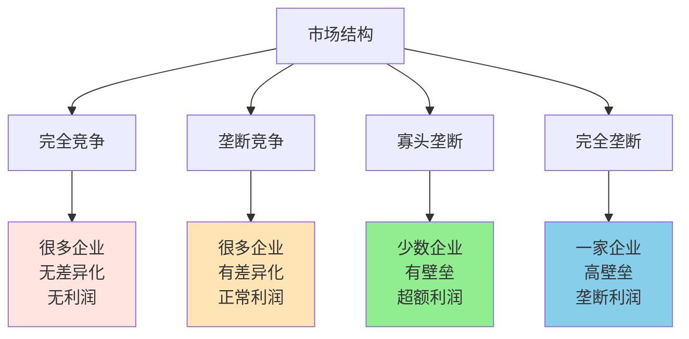

> 选对赛道比努力更重要

---

**数据来源：** 贵州茅台财报（2015-2023）、航空公司财务数据（2015-2023）、美国联邦航空管理局（FAA）数据、爱德华·张伯伦《垄断竞争理论》（1933）、琼·罗宾逊《不完全竞争经济学》（1933）、迈克尔·波特《竞争战略》（1980）

## 两个极端的行业

茅台2023年毛利率92%，净利润率50%+。
某航空公司同期毛利率10%，净利润率不到5%。

**问题：** 为什么同样是企业，利润差距如此巨大？
**更深的问题：** 行业结构如何决定企业命运？

这背后藏着一个经济学核心概念：**市场结构（Market Structure）**。

---

## 市场结构

**定义：** 市场中买者和卖者的数量、产品差异化程度、进入壁垒等因素的综合。

**简单说就是：** 你所在的行业，竞争有多激烈？



### 关键要点

**四种市场结构：**

| 结构 | 企业数量 | 产品差异化 | 进入壁垒 | 典型利润 | 例子 |
|------|----------|------------|----------|----------|------|
| **完全竞争** | 很多 | 无 | 无 | 接近0 | 农产品 |
| **垄断竞争** | 很多 | 有 | 低 | 正常 | 餐饮、服装 |
| **寡头垄断** | 少数 | 有/无 | 高 | 超额 | 汽车、航空 |
| **完全垄断** | 一家 | - | 极高 | 垄断利润 | 自来水、电力 |

**关键维度：**

| 维度 | 说明 | 影响 |
|------|------|------|
| **企业数量** | 多=竞争激烈，少=有定价权 | 利润空间 |
| **产品差异化** | 有差异化=有定价权 | 品牌溢价 |
| **进入壁垒** | 高壁垒=难以进入，利润维持 | 长期利润 |
| **退出壁垒** | 高=无法轻易退出，价格战风险 | 行业动荡 |

**历史小知识：** 市场结构理论源于20世纪30年代，爱德华·张伯伦和琼·罗宾逊分别提出了垄断竞争理论。后来，产业组织理论（IO）进一步发展了这一领域。

---

### 为什么市场结构决定利润？

**完全竞争的逻辑：**

```
很多企业 → 产品相同 → 价格战 → 利润→0
```

**垄断的逻辑：**

```
一家企业 → 定价权 → 高价格 → 垄断利润
```

**寡头的逻辑：**

```
少数企业 → 可能合谋/默契合作 → 超额利润
或
少数企业 → 价格战 → 低利润
```

---

## 市场结构的真实案例

### 中国白酒行业：利润的奇迹

**背景：** 为什么白酒行业如此赚钱？

**行业结构分析：**

| 维度 | 分析 |
|------|------|
| **企业数量** | 很多（全国性+区域性） |
| **产品差异化** | 极高（品牌、香型、历史） |
| **进入壁垒** | 极高（历史、品牌、渠道） |
| **退出壁垒** | 中等（库存、渠道） |

**利润对比：**

| 企业 | 毛利率 | 净利率 | 原因 |
|------|--------|--------|------|
| 茅台 | 92% | 50%+ | 奢侈品化、稀缺性 |
| 五粮液 | 75% | 30%+ | 高端品牌 |
| 泸州老窖 | 85% | 25%+ | 高端+次高端 |
| **区域品牌** | 60-70% | 10-15% | 中低端 |

**为什么这么赚钱？**

| 原因 | 说明 |
|------|------|
| **奢侈品化** | 茅台成为"奢侈品"和"投资品" |
| **社交刚需** | 商务宴请、礼品需求 |
| **供给受限** | 茅台产能有限，无法快速扩张 |
| **渠道控制** | 深度分销，渠道利润高 |

**数据支撑：**

| 指标 | 数据 |
|------|------|
| 茅台2023营收 | 1500亿+ |
| 茅台市值 | 2.5万亿+ |
| 白酒行业CR5 | ~40%（前5名集中度） |
| 高端酒利润率 | 行业平均30%+ |

**关键洞察：**
> 白酒行业展示了**寡头垄断+产品差异化**的威力。虽然企业数量很多，但高端市场被少数品牌垄断（茅台、五粮液、国窖1573）。**关键不是"竞争"或"垄断"，而是"分层"**——高端是寡头垄断（高利润），中低端是垄断竞争（低利润）。茅台的成功不是"做得更好"，而是占据了"最赚钱的细分市场"。

---

### 全球航空业：生死挣扎

**背景：** 为什么航空业长期低利润？

**行业结构分析：**

| 维度 | 分析 |
|------|------|
| **企业数量** | 很多（全球200+航空公司） |
| **产品差异化** | 低（基本服务相同） |
| **进入壁垒** | 中等（资本密集，但新航司不断进入） |
| **退出壁垒** | 极高（飞机、员工、航线） |

**利润对比：**

| 航空公司 | 净利率 | 说明 |
|----------|--------|------|
| 达美航空 | 10-15% | 美国最赚钱航司 |
| 美国航空 | 5-10% | 破产重组后改善 |
| 中国国航 | 5-8% | 中国最赚钱航司 |
| **大多数航司** | **<5%** | **长期挣扎** |

**为什么这么难赚钱？**

| 原因 | 说明 |
|------|------|
| **固定成本高** | 飞机、燃油、员工——不管卖不卖票都要花 |
| **边际成本低** | 多一个乘客的边际成本很低（餐食、燃油） |
| **价格敏感** | 乘客对价格敏感，容易打价格战 |
| **过剩产能** | 飞机太多，座位供过于求 |
| **同质化** | 从A到B，哪家航司都差不多 |

**数据支撑：**

| 指标 | 数据 |
|------|------|
| 全球航司平均净利率 | <5% |
| 全球航司破产数量 | 2000-2023年，约200家 |
| 客座率 | 80-85%（盈亏平衡点~75%） |
| 燃油成本占比 | 30-40% |

**关键洞察：**
> 航空业展示了**接近完全竞争的困境**。虽然不是完全竞争（有品牌、航线差异），但核心问题是"同质化+固定成本高+退出壁垒高"的组合：
> - 同质化 → 价格战
> - 固定成本高 → 必须卖足够多的票才能盈亏平衡
> - 退出壁垒高 → 不能轻易退出，只能"硬扛"
> **结果是"囚徒困境"**——所有人都知道不打价格战更好，但谁先停谁先死。航司破产重组是唯一的"出路"。

---

## 如何分析市场结构？

### 分析框架

**步骤1：识别市场边界**

| 问题 | 思考 |
|------|------|
| 你的产品是什么？ | 不要太窄或太宽 |
| 谁是你的直接竞争对手？ | 不要忽略间接竞争 |
| 地理范围是什么？ | 本地、全国、全球？ |

**步骤2：评估竞争强度**

| 维度 | 评估问题 |
|------|----------|
| **企业数量** | 有多少直接竞争对手？ |
| **市场份额分布** | 前几名集中度如何？ |
| **增长率** | 市场在增长还是萎缩？ |

**步骤3：分析进入壁垒**

| 壁垒类型 | 评估问题 |
|----------|----------|
| **资本** | 需要多少初始投资？ |
| **技术** | 需要什么技术能力？ |
| **监管** | 需要什么牌照/许可？ |
| **品牌** | 需要多少品牌建设？ |
| **渠道** | 需要什么渠道资源？ |

**步骤4：评估产品差异化**

| 差异化来源 | 评估问题 |
|------------|----------|
| **物理差异** | 产品真的不同吗？ |
| **品牌差异** | 消费者认为不同吗？ |
| **服务差异** | 服务有差异吗？ |
| **体验差异** | 使用体验有差异吗？ |

---

### 常见市场结构

| 行业 | 结构 | 原因 |
|------|------|------|
| **农产品** | 完全竞争 | 产品同质化、进入壁垒低 |
| **餐饮** | 垄断竞争 | 很多企业、有差异化、进入壁垒低 |
| **汽车** | 寡头垄断 | 资本密集、技术壁垒、品牌壁垒 |
| **水电** | 完全垄断 | 自然垄断、政府特许 |

---

## 应用与决策

### 企业战略

| 市场结构 | 战略建议 |
|----------|----------|
| **完全竞争** | 降低成本、差异化或退出 |
| **垄断竞争** | 强化差异化、品牌建设 |
| **寡头垄断** | 建立壁垒、寻求合谋/合作 |
| **完全垄断** | 维持垄断、防止进入 |

### 个人职业选择

| 选择 | 建议 |
|------|------|
| **进入行业** | 选择高壁垒、高利润的行业 |
| **进入时机** | 成长期进入，避免成熟期/衰退期 |
| **差异化** | 即使在竞争行业，也要找到细分差异 |

---

### 常见误区

| 误区 | 正解 |
|------|------|
| "竞争越少越好" | 垄断可能吸引监管和进入 |
| "差异化一定能赚钱" | 差异化需要消费者认可 |
| "高利润行业好进入" | 高利润通常有高壁垒 |
| "行业决定一切" | 同一行业内的企业差异也很大 |

---

## 延伸思考

1. **科技行业的市场结构**：Google、Amazon、Facebook——这些科技巨头是寡头还是垄断？他们是否构成了"平台垄断"——一种新的市场结构？

2. **医疗行业的特殊性**：为什么医生和医院不能完全市场化？是因为信息不对称，还是因为"人命关天"？

3. **新兴行业的演变**：电动车、AI、Web3——这些新兴行业目前是什么市场结构？未来会如何演变？

**下期预告：** 我们来探讨**差异化与定位**——为什么Starbucks能卖出高价？蜜雪冰城如何通过下沉策略成功？

---

**数据来源：** 贵州茅台财报、航空业市场数据（2015-2023）、美国联邦航空管理局（FAA）数据、爱德华·张伯伦《垄断竞争理论》（1933）、琼·罗宾逊《不完全竞争经济学》（1933）、迈克尔·波特《竞争战略》（1980）
