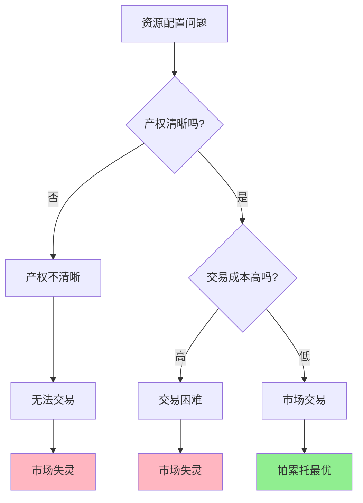

> 产权是市场的前提，交易成本决定市场的边界

---

## 音乐版权的困境

你在短视频平台刷到一个视频，背景音乐是周杰伦的《晴天》。
你非常喜欢，想用这首歌做自己的视频。

但平台提示："这首音乐受版权保护，使用需要付费。"

你可能会想：
- "就几十秒，至于吗？"
- "音乐本来就应该免费分享！"
- "版权保护阻碍了创作！"

**问题来了：** 为什么音乐需要版权？如果没有版权会怎样？

更深层的问题：**为什么有些东西市场能配置得很好（如手机、汽车），有些东西市场却失灵了（如空气、噪音）？**

这背后藏着一个经济学核心原理：**科斯定理（Coase Theorem）**。

---

## 科斯定理

**定义：** 如果产权界定清晰且交易成本为零，无论初始产权如何分配，市场交易都会达到资源最优配置。

**简单说就是：** 只要产权清晰、交易无成本，市场会自动找到最有效率的结果。



### 关键要点

**1. 产权（Property Rights）的三要素**

| 要素 | 定义 | 例子 |
|------|------|------|
| **使用权** | 使用资源的权利 | 你可以住自己的房子 |
| **收益权** | 获得资源收益的权利 | 你可以出租房子收租金 |
| **转让权** | 出售资源的权利 | 你可以卖掉房子 |

**2. 交易成本（Transaction Costs）**

| 类型 | 定义 | 例子 |
|------|------|------|
| **搜寻成本** | 找到交易对象的成本 | 找买家、卖家 |
| **议价成本** | 谈判价格的成本 | 讨价还价、律师费 |
| **执行成本** | 确保合同履行的成本 | 监督、诉讼、违约赔偿 |

**3. 科斯定理的两个条件**

| 条件 | 重要性 | 现实情况 |
|------|--------|----------|
| **产权清晰** | 没有清晰的产权，无法交易 | 很多资源产权不清晰 |
| **交易成本低** | 交易成本高会阻碍市场交易 | 现实中交易成本常常很高 |

**历史小知识：** 罗纳德·科斯（Ronald Coase, 1910-2013），1991年诺贝尔经济学奖得主。他在1960年发表于《法与经济学杂志》（The Journal of Law and Economics）的论文《社会成本问题》（"The Problem of Social Cost"）中，提出了著名的科斯定理。他的核心洞察是：**外部性问题不是单向的"损害"，而是双向的"冲突"**——工厂污染损害居民，但禁止工厂生产也损害工厂主。关键是如何以最低成本解决这种冲突。

---

### 为什么科斯定理很重要？

**1. 它重新定义了"外部性"**

传统观点：
- 工厂污染居民 → 工厂应该赔偿或被禁止

科斯观点：
- 工厂污染居民 ← 双向冲突
- 禁止工厂生产 ← 也损害工厂利益
- **关键是比较哪种方式成本更低**

**2. 它揭示了市场失灵的根源**

| 市场失灵类型 | 根源 | 解决方向 |
|--------------|------|----------|
| 公地悲剧 | 产权不清晰 | 界定产权 |
| 污染问题 | 交易成本太高 | 降低交易成本或政府干预 |
| 垄断 | 产权过于集中 | 反垄断或政府监管 |

**3. 它指出了制度的重要性**

> 好的制度能清晰界定产权、降低交易成本，让市场更高效。

---

## 科斯定理的真实应用

### 互联网版权：为什么需要付费？

**背景：** 音乐、电影、软件——这些数字产品为什么需要版权保护？

**无版权的情况：**

| 问题 | 后果 | 市场结果 |
|------|------|----------|
| 无法定价 | 创作者无法收费 | **没人创作** |
| 搭便车 | 所有人免费使用 | **创作者饿死** |
| 质量下降 | 低质量内容泛滥 | **劣币驱逐良币** |

**有版权的情况：**

| 机制 | 效果 |
|------|------|
| 创作者拥有产权 | 可以定价收费 |
| 平台购买版权 | 可以合法提供内容 |
| 用户付费或看广告 | 创作者获得收入 |

**交易成本的作用：**

| 时代 | 交易成本 | 版权使用方式 |
|------|----------|--------------|
| CD时代 | 很高（物理介质） | 购买整张专辑 |
| 下载时代 | 中等（按首下载） | iTunes按首购买 |
| **流媒体时代** | **很低（订阅制）** | **Spotify、Apple Music** |

**关键洞察：**
> 互联网版权问题的本质是**交易成本**。以前版权交易成本太高，要么全部购买，要么全部盗版。流媒体平台通过降低交易成本，实现了：
> 1. 创作者获得收入（有激励）
> 2. 用户便捷获取（低成本）
> 3. 平台赚取差价（可持续）
> **这就是科斯定理的完美应用**——清晰的版权 + 低交易成本 = 市场高效运作。

---

### 空气污染：为什么市场失灵？

**背景：** 某城市空气污染严重，PM2.5常年超标。

**为什么市场无法解决？**

**科斯定理视角分析：**

| 条件 | 现实情况 | 结果 |
|------|----------|------|
| **产权清晰？** | ❌ 谁拥有"清洁空气的产权"？ | 无法交易 |
| **交易成本？** | ❌ 成千上万污染源和受害者 | 无法谈判 |

**为什么交易成本太高？**

| 维度 | 具体问题 |
|------|----------|
| **污染者数量** | 成千上万家工厂、汽车 |
| **受害者数量** | 数百万居民 |
| **因果确认** | 很难确定是谁污染了谁 |
| **谈判成本** | 需要组织所有人谈判 |
| **执行成本** | 监督每个人是否遵守 |

**政府干预的必要性：**

当交易成本太高时，市场无法有效运作，需要政府介入：

| 政策工具 | 原理 | 效果 |
|----------|------|------|
| **排放标准** | 直接限制排放量 | 降低污染总量 |
| **排污税/碳税** | 将外部性内部化 | 污染者付费 |
| **碳交易市场** | **界定产权 + 创造市场** | **用市场机制减排** |

**碳交易市场的科斯逻辑：**

```
1. 政府设定总排放量
2. 分配排放许可证（产权）
3. 企业可以自由交易许可证
4. 减排成本低的企业多减排，出售许可证
5. 减排成本高的企业购买许可证
6. 结果：社会以最低成本实现减排目标
```

**数据支撑：**

| 碳交易市场 | 覆盖排放量 | 碳价 | 减排效果 |
|------------|------------|------|----------|
| 欧盟EU ETS | 40%欧盟排放 | ~80欧元/吨 | 根据European Environment Agency（2021）数据，2005-2020年减排35% |
| 中国全国市场 | 40%中国排放 | ~60元人民币/吨 | 中国生态环境部《全国碳排放权交易市场建设进展报告（2023）》显示刚启动，效果待观察 |

**关键洞察：**
> 空气污染市场失灵是因为**交易成本太高**——无法让成千上万的污染者和受害者互相谈判。政府的角色是通过**界定产权（排放许可）**和**创造市场（碳交易）**，将原本无法交易的东西变得可交易。这是科斯定理的延伸应用：当市场交易成本太高时，政府可以通过制度设计降低交易成本。

---

## 如何用科斯定理思维解决问题？

### 决策三步法

**步骤1：问"产权清晰吗？"**

| 问题 | 思考方向 |
|------|----------|
| 谁拥有这个资源的产权？ | 是否有法律明确界定？ |
| 产权可以交易吗？ | 是否有法律障碍？ |
| 产权可以被保护吗？ | 是否有执行机制？ |

**步骤2：问"交易成本高吗？"**

| 成本类型 | 评估问题 |
|----------|----------|
| 搜寻成本 | 找到交易对象容易吗？ |
| 议价成本 | 谈判成本高吗？需要律师吗？ |
| 执行成本 | 确保对方履行合约容易吗？ |

**步骤3：选择解决路径**

| 情况 | 解决方案 |
|------|----------|
| 产权清晰 + 交易成本低 | **让市场解决** |
| 产权不清晰 | **界定产权** |
| 交易成本高 | **政府干预或降低交易成本** |

---

### 常见误区

| 误区 | 正解 |
|------|------|
| "市场失灵 = 政府必须接管" | 首先问：能否通过界定产权、降低交易成本来修复市场？ |
| "产权私有化总是好的" | 有些资源无法私有化（如空气），需要其他机制 |
| "交易成本都是坏的" | 交易成本是社会运行的必要成本，关键是要合理 |
| "科斯定理说政府不重要" | 科斯定理恰恰说明政府的重要性——界定产权、降低交易成本 |

---

## 延伸思考

1. **数字时代的产权革命**：NFT（非同质化代币）声称可以"数字确权"。这是真的解决了数字产品的产权问题，还是一个泡沫？区块链能否真的降低交易成本？

2. **数据产权的困境**：你的个人数据属于谁？你、平台、还是公共品？如果数据产权不清晰，AI时代的"数据交易市场"能否建立？

3. **全球气候交易的科斯难题**：碳排放是全球性外部性，不同国家的"交易成本"（政治、法律、文化）差异巨大。全球碳交易市场是否可能？还是注定失败？

**下期预告：** 模块一完成！接下来进入**模块二：市场机制与价格**。我们将探讨**供需定律的威力**——双11价格机制如何运作？OPEC如何操纵石油定价？

---

**数据来源：** 版权研究报告（IFPI, 2023）、European Environment Agency《The EU ETS: Key Facts and Figures》（2021）、中国生态环境部《全国碳排放权交易市场建设进展报告（2023）》、科斯（Coase, 1960）《社会成本问题》（"The Problem of Social Cost"）
