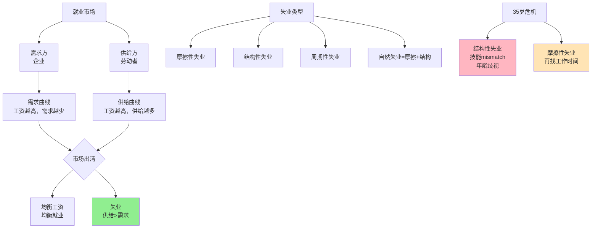

> 劳动市场的悖论

---

**数据来源：** 失业率研究、35岁危机研究、青年失业数据、凯恩斯《就业、利息与货币通论》（1936）、弗里德曼《自然失业率》（1968）、贝弗里奇《就业与失业》（1944）

## 35岁的职业危机

老张，35岁，互联网公司技术经理。

公司裁员，他失业了。

他投了100份简历，只有5个面试机会，2个offer：
- 一家公司薪资降30%
- 另一家公司是创业公司，风险高

老张很困惑："我有10年经验，技术也不错，为什么找工作这么难？"

**问题：** 为什么会"有人没工作，同时有工作没人做"？
**更深的问题：** 为什么"35岁危机"如此普遍？

这背后藏着一个经济学核心概念：**失业与就业市场（Unemployment and Labor Market）**。

---

## 失业与就业市场

**定义：**
- **失业（Unemployment）**：有劳动能力、想工作、但找不到工作
- **就业市场（Labor Market）**：劳动力买卖的市场

**简单说就是：**
- 失业 = "想工作，但找不到工作"
- 就业市场 = "劳动力"的"超市"

### 关键要点

**失业的类型：**

| 类型 | 定义 | 例子 |
|------|------|------|
| **摩擦性失业** | 短期找工作时间 | 毕业生找工作 |
| **结构性失业** | 技能不匹配 | 传统行业衰退，新兴行业缺人 |
| **周期性失业** | 经济衰退导致的失业 | 2008金融危机 |
| **自然失业** | 摩擦性+结构性（无法消除） | ~4-6% |

**劳动力市场的特征：**

| 特征 | 说明 |
|------|------|
| **异质性** | 劳动力不是"同质"的（技能、经验、偏好） |
| **分割性** | 劳动力市场分割（行业、地区、职业） |
| **粘性** | 工资具有"向下刚性"（难降） |
| **信息不对称** | 企业不知道员工真实能力 |

**贝弗里奇曲线（Beveridge Curve）：**

> 失业率与职位空缺的关系。

| 情况 | 失业率 | 职位空缺 | 说明 |
|------|--------|----------|------|
| **正常** | 5% | 2% | 摩擦性、结构性失业 |
| **严重不匹配** | 10% | 8% | 结构性失业严重 |
| **需求不足** | 8% | 1% | 周期性失业 |

**历史小知识：** 失业理论由凯恩斯1936年在《就业、利息和货币通论》中系统阐述。弗里德曼（1968）提出"自然失业率"概念。贝弗里奇曲线由威廉·贝弗里奇1944年提出。

---

### 为什么失业问题如此复杂？

**问题的根源：**

| 问题 | 说明 |
|------|------|
| **技能变化** | 技术进步、产业结构变化 |
| **地理不匹配** | 工作机会在A地，劳动者在B地 |
| **信息不对称** | 企业不知道工人能力，工人不知道企业需求 |
| **制度因素** | 最低工资、社保、工会 |

**失业的代价：**

| 代价 | 说明 |
|------|------|
| **个人** | 收入损失、技能下降、心理压力 |
| **社会** | 福利支出、社会不稳定 |
| **经济** | 产出损失、消费下降 |

---

## 失业与就业市场的真实案例

### 35岁危机

**背景：** 为什么35岁找工作这么难？

**35岁的"年龄歧视"：**

| 问题 | 说明 |
|------|------|
| **成本更高** | 35岁员工期望薪资高、家庭负担重 |
| **技能固化** | 技能可能不如年轻人灵活 |
| **管理能力** | 更适合做管理，但管理岗位少 |
| **年龄歧视** | 企业偏好年轻员工（便宜、灵活） |

**技能错配（Skills Mismatch）：**

| 行业 | 需求 | 35岁劳动者的供给 |
|------|------|------------------|
| **互联网** | 最新技术（AI、云计算） | 有经验，但技术可能过时 |
| **制造业** | 高级技工、工程师 | 有经验，但制造业衰退 |
| **创业** | 创业、合伙人 | 有资源，但创业风险高 |

**数据支撑：**

研究显示：
- 35岁+求职者的平均找工作时间是25岁的2-3倍
- 35岁+的平均薪资期望是25岁的1.5倍，但企业只愿意付1.2倍
- 约70%的35岁+求职者表示遭遇"年龄歧视"

**关键洞察：**
> 35岁危机是**技能错配+年龄歧视+期望差异**的组合：
> - **技能错配**：
>   - 35岁劳动者的技能可能"过时"
>   - 需要最新技术（AI、云计算、大数据）
> - **年龄歧视**：
>   - 企业偏好年轻员工（更便宜、更灵活）
>   - 35岁员工有家庭、期望薪资更高
> - **期望差异**：
>   - 35岁期望更高薪资、更好职位
>   - 但企业提供的可能是"平级甚至降职"
> - **这不是"能力问题"**，而是"结构性失业"：
>   - 35岁劳动者有经验、能力
>   - 但技能、期望与市场需求不匹配
> - **应对策略**：
>   - **技能更新**：学习新技术（AI、云计算）
>   - **降低期望**：接受"平级甚至降职"
>   - **地理移动**：去"机会更多"的地方
>   - **创业/副业**：创造自己的机会
> - **对就业市场的启示**：
>   - **年龄歧视是真实的**：但部分是"统计歧视"（有现实基础）
>   - **"终身学习"是必须**：技能会折旧，需要持续学习
>   - **"职业规划"很重要**：早期选择"长期增长"行业

---

### 青年失业

**背景：** 为什么青年失业率如此之高？

**青年的"双重劣势"：**

| 劣势 | 说明 |
|------|------|
| **经验不足** | 刚毕业，没有工作经验 |
| **技能不足** | 学校技能与企业需求不匹配 |
| **信息不足** | 不知道企业需要什么技能 |
| **人脉不足** | 没有职业网络 |

**青年失业的类型：**

| 类型 | 说明 |
|------|------|
| **摩擦性失业** | 刚毕业，找工作时间长 |
| **结构性失业** | 专业与市场需求不匹配 |
| **周期性失业** | 经济衰退时，青年最先被裁 |

**教育-技能错配：**

| 问题 | 说明 |
|------|------|
| **专业过时** | 传统专业需求少 |
| **技能不足** | 学校教的理论，企业要的实践 |
| **软技能不足** | 团队合作、沟通能力 |

**数据支撑：**

| 国家 | 青年失业率（15-24岁） | 整体失业率 |
|------|---------------------------|----------|
| **中国** | ~15-20% | ~5% |
| **美国** | ~8-10% | ~4% |
| **欧盟** | ~15-20% | ~6% |

**关键洞察：**
> 青年失业是**技能错配+经验不足+制度因素**的组合：
> - **技能错配**：
>   - 学校教的"理论"，企业要的"实践"
>   - "热门专业"（金融、计算机）供给过剩
>   - "冷门专业"（制造业、技工）供给不足
> - **经验不足**：
>   - 青年刚毕业，没有工作经验
>   - 但企业想要"有经验的"
>   - 这是"第22条"（"没有经验就无法获得经验"）悖论）
> - **制度因素**：
>   - 中国的"高考志愿"制度（大学专业选择错配）
>   - 劳动市场保护（正式工、劳务派遣）
> - **青年失业的代价巨大**：
>   - **失去的世代**（Lost Generation）：长期失业→技能永久性损失
>   - 社会不稳定：青年失业→犯罪、极端化
> - **对就业市场的启示**：
>   - **教育改革**：教育应该与企业需求匹配
>   - **实习制度**：提供"实践机会"
>   - **职业培训**：提供"实践技能"培训
>   - **创业支持**：青年创业是解决青年失业的重要途径

---

## 应对失业的策略

### 个人策略

**策略1：技能投资**

| 投资 | 说明 |
|------|------|
| **持续学习** | 在职学习、在线课程 |
| **技能认证** | 获得行业认可的证书 |
| **跨学科技能** | 复合型人才（技术+商业） |

**策略2：地理流动**

| 策略 | 说明 |
|------|------|
| **去机会多的地方** | 一线城市、新兴行业聚集地 |
| **国际化** | 去海外工作 |

**策略3：网络建设**

| 策略 | 说明 |
|------|------|
| **职业网络** | LinkedIn、行业协会 |
| **校友网络** | 大学同学、校友会 |
| **社区参与** | 行业论坛、meetup |

---

### 企业/政策

**策略1：培训**

| 策略 | 说明 |
|------|------|
| **在职培训** | 提升员工技能 |
| **学徒制** | 师徒制、职业培训 |
| **校企合作** | 学校+企业联合培养 |

**策略2：降低制度壁垒**

| 策略 | 说明 |
|------|------|
| **灵活就业** | 兼职、远程工作 |
| **减少保护** | 降低正式工、劳务派遣限制 |

**策略3：创业支持**

| 策略 | 说明 |
|------|------|
| **创业补贴** | 创业资金、孵化器 |
| **简化注册** | 降低创业门槛 |
| **失败容忍** | 破产保护、社会包容失败 |

---

## 应用与决策

### 个人决策

| 决策 | 就业市场视角 |
|------|----------------|
| 职业选择 | 选择"增长型"行业（技能需求增长） |
| 教育选择 | 选择"技能密集型"专业 |
| 地理选择 | 选择"就业机会多"的地区 |

### 企业/政策

| 策略 | 就业市场应用 |
|------|----------------|
| 招聘 | 避免"学历歧视"、"年龄歧视" |
| 培训 | 内部培训、职业培训 |
| 灵活用工 | 兼职、远程工作 |

---

### 常见误区

| 误区 | 正解 |
|------|------|
| "失业=懒惰" | 失业有结构性、周期性原因 |
| "失业可以完全消除" | 自然失业无法消除（4-6%） |
| "失业是个人问题" | 失业不只是个人技能问题，也是宏观问题 |
| "技能培训总是有效" | 技能培训需要与企业需求匹配 |

---

## 延伸思考

1. **AI与结构性失业**：AI会替代哪些工作？会创造哪些新工作？我们如何应对AI时代的"技能错配"？

2. **全球化的就业影响**：全球化让发达国家就业"去工业化"，但发展中国家就业"工业化"。这种趋势是否可持续？

3. **"零工经济"与失业**：零工经济（外卖、网约车）是"就业"还是"失业"？它如何改变传统的"雇佣关系"？

**下期预告：** 我们来探讨**经济周期与投资时钟**——中国行业轮动如何运作？美联储加息周期如何影响全球投资？

---

**数据来源：** 失业率研究、35岁危机研究、青年失业数据、凯恩斯《就业、利息与货币通论》（1936）、弗里德曼《自然失业率》（1968）、贝弗里奇《就业与失业》（1944）
