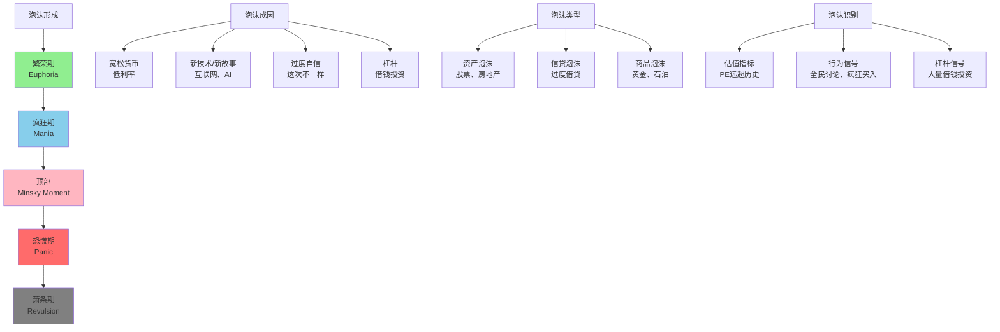

> 繁荣与萧条的循环

---

**数据来源：** 金融危机研究、泡沫历史数据、金德尔伯格《疯狂、恐慌与崩盘》（1978）、海曼·明斯基《金融不稳定假说》（1986）、罗伯特·席勒《非理性繁荣》（2000）

## 泡沫的警示

2000年，互联网泡沫：
- 任何带".com"的公司股价暴涨
- Amazon从$100涨到$600，又跌回$60
- 大量公司破产

2008年，房地产泡沫：
- 美国房价疯狂上涨
- 次贷危机爆发
- 雷曼兄弟破产，全球金融危机

2021年，加密货币泡沫：
- Bitcoin从$10,000涨到$69,000
- 又跌回$16,000

**问题：** 为什么泡沫总会形成？
**更深的问题：** 如何识别泡沫？如何避免泡沫破裂的伤害？

这背后藏着一个经济学核心概念：**金融危机与泡沫（Financial Crises and Bubbles）**。

---

## 金融危机与泡沫

**定义：**
- **泡沫（Bubble）**：资产价格远超其内在价值
- **金融危机（Financial Crisis）**：金融体系严重失灵，资产价格暴跌

**简单说就是：**
- 泡沫 = "价格远高于价值"
- 金融危机 = "泡沫破裂后的灾难"

### 关键要点

**泡沫的阶段（Minsky模型）：**

| 阶段 | 特征 | 例子 |
|------|------|------|
| **位移（Displacement）** | 新技术/新机会出现 | 互联网、AI、区块链 |
| **繁荣（Boom）** | 价格上涨、投资增加 | 股市上涨、房地产繁荣 |
| **狂热（Euphoria）** | 过度乐观、杠杆增加 | "这次不一样"、全民炒股 |
| **获利（Profit Taking）** | 精明投资者离场 | 内部人卖出 |
| **恐慌（Panic）** | 价格下跌、抛售 | 踩踏式下跌 |
| **崩盘（Crash）** | 价格暴跌、危机 | 资产价格跌80%+ |

**泡沫的成因：**

| 成因 | 说明 |
|------|------|
| **宽松货币** | 低利率→廉价信贷→过度投资 |
| **新技术/新故事** | "互联网改变一切"、"AI改变一切" |
| **过度自信** | "这次不一样"、"旧规则不适用" |
| **杠杆** | 借钱投资→放大收益和损失 |
| **羊群效应** | "别人买，我也要买" |
| **监管缺失** | 金融创新不受监管 |

**泡沫的识别：**

| 信号 | 指标 |
|------|------|
| **估值过高** | PE、PB远超历史均值 |
| **行为异常** | 全民讨论、疯狂买入、害怕错过（FOMO） |
| **杠杆过高** | 大量借钱投资、债务激增 |
| **供给过剩** | 大量新公司、新项目 |
| **媒体狂热** | 封面全是好消息、专家看多 |

**泡沫的后果：**

| 后果 | 说明 |
|------|------|
| **财富蒸发** | 资产价格暴跌→财富消失 |
| **债务危机** | 借款人无法还款→银行倒闭 |
| **经济衰退** | 消费、投资下降→GDP下降 |
| **失业增加** | 企业倒闭→裁员 |
| **社会动荡** | 贫富差距、社会不满 |

**历史小知识：** 查尔斯·金德尔伯格（1978）在《疯狂、恐慌与崩盘》中系统分析了金融危机。海曼·明斯基（1986）提出"金融不稳定性假说"（明斯基时刻）。罗伯特·席勒（2000）在《非理性繁荣》中预测了互联网泡沫。

---

### 为什么泡沫难以避免？

**心理因素：**

| 心理偏差 | 作用 |
|----------|------|
| **过度自信** | "我能识别顶部"、"我能及时逃顶" |
| **确认偏差** | 只关注支持自己观点的信息 |
| **羊群效应** | "别人都在买，我也要买" |
| **锚定效应** | 以高点为锚，认为"还会涨" |
| **损失厌恶** | 亏损时不肯卖出，希望反弹 |

**制度因素：**

| 因素 | 作用 |
|------|------|
| **顺周期政策** | 繁荣时放松监管，衰退时收紧 |
| **大而不能倒** | 政府救助→道德风险 |
| **激励扭曲** | 短期奖金→冒险行为 |
| **监管滞后** | 金融创新快于监管 |

**"这次不一样"综合症：**

| 泡沫 | "这次不一样"的理由 |
|------|---------------------|
| **互联网泡沫** | "互联网改变商业模式" |
| **房地产泡沫** | "土地永远稀缺"、"人口增长" |
| **加密货币泡沫** | "去中心化"、"数字黄金" |

---

## 金融危机与泡沫的真实案例

### 2008年金融危机

**背景：** 为什么美国房地产泡沫会引发全球金融危机？

**危机的链条：**

| 阶段 | 事件 |
|------|------|
| **2001-2003** | 美联储降息（6.5%→1%）→廉价信贷 |
| **2002-2006** | 房价上涨→次贷发放（借给信用差的人） |
| **2005-2006** | 房价见顶→利率上升→房贷违约上升 |
| **2007** | 次贷危机爆发→金融机构亏损 |
| **2008** | 雷曼兄弟破产→全球金融危机 |

**次贷的"创新"：**

| "创新" | 风险 |
|--------|------|
| **次贷（Subprime）** | 借给信用差的人（违约风险高） |
| **CDO（债务担保证券）** | 把次贷打包成证券（风险分散？） |
| **CDS（信用违约互换）** | 为CDO买保险（AIG卖太多） |
| **杠杆** | 投行杠杆30:1（亏损1%→破产） |

**危机的传播：**

| 机制 | 链条 |
|------|------|
| **银行间市场** | 雷曼破产→银行不信任银行→信贷冻结 |
| **全球联系** | 美国银行持有欧洲银行资产→欧洲危机 |
| **实体经济** | 信贷冻结→企业无法融资→裁员 |
| **财富效应** | 股市、房价暴跌→消费下降→衰退 |

**数据支撑：**

| 指标 | 2007年 | 2009年 | 变化 |
|------|--------|--------|------|
| **美国房价** | 峰值 | -30% | 暴跌 |
| **S&P 500** | 1500 | 700 | -53% |
| **失业率** | 4.6% | 10.0% | +5.4% |
| **GDP** | 增长+2% | 下降-2.8% | 衰退 |

**救助与后果：**

| 措施 | 作用 |
|------|------|
| **TARP（问题资产救助计划）** | 政府购买银行有毒资产 |
| **量化宽松（QE）** | 美联储买债券→注入流动性 |
| **零利率** | 美联储利率降至0-0.25% |
| **后果** | 避免了大萧条2.0，但债务激增、贫富差距扩大 |

**关键洞察：**
> 2008年危机是**次贷创新+杠杆放大+监管缺失+全球传播**的组合：
> - **次贷创新**：
>   - 次贷=借给信用差的人
>   - CDO=把次贷打包成证券
>   - 表面"分散风险"，实际"隐藏风险"
> - **杠杆放大**：
>   - 投行杠杆30:1（1元本金借30元）
>   - 房价跌5%→本金亏完→破产
> - **监管缺失**：
>   - CDO不受监管（场外交易）
>   - 评级机构给垃圾债券AAA评级
> - **全球传播**：
>   - 美国银行持有全球资产
>   - 欧洲银行持有美国CDO
>   - "美国打喷嚏，全球感冒"
> - **危机的教训**：
>   - **"金融创新"不一定是好事**：
>     - CDO"分散"了风险，但也"隐藏"了风险
>     - 复杂性→无人理解整体风险
>   - **杠杆是双刃剑**：
>     - 杠杆放大收益，也放大损失
>     - 系统重要性机构（如投行）不应高杠杆
>   - **监管很重要**：
>     - 金融创新需要监管
>     - 评级机构需要独立
>   - **"大而不能倒"是问题**：
>     - 政府救助→道德风险（银行知道会被救）
>     - 需要减少系统重要性机构

---

### 互联网泡沫

**背景：** 为什么1995-2000年的互联网泡沫如此疯狂？

**泡沫的形成：**

| 阶段 | 事件 |
|------|------|
| **1995-1997** | 互联网兴起→Netscape、Amazon上市 |
| **1998-1999** | "互联网改变一切"→疯狂投资 |
| **1999-2000** | 任何带".com"的公司都暴涨 |
| **2000-2002** | 泡沫破裂→纳斯达克跌80% |

**"这次不一样"的故事：**

| 故事 | 现实 |
|------|------|
| "互联网改变商业模式" | 确实，但不是所有公司都能赚钱 |
| "点击量比利润重要" | 但最终要盈利 |
| "赢家通吃" | 但不是所有领域都是 |
| "传统估值不适用" | 但最终还是盈利决定价值 |

**泡沫的信号：**

| 信号 | 例子 |
|------|------|
| **估值疯狂** | Amazon PE 1000倍， Pets.com（无盈利）市值$10亿 |
| **行为异常** | "辞职炒股"、"日内交易"成为风潮 |
| **供给过剩** | 大量.com公司，很多只是"有个网站" |
| **媒体狂热** | 杂志封面全是"互联网革命" |

**泡沫破裂的后果：**

| 后果 | 数据 |
|------|------|
| **纳斯达克** | 从5000点跌到1100点（-78%） |
| **财富蒸发** | $5万亿消失 |
| **公司倒闭** | 大量.com公司破产 |
| **但** | Amazon、Google、eBay存活并繁荣 |

**关键洞察：**
> 互联网泡沫是**新技术+过度乐观+资本过剩+媒体狂热**的组合：
> - **新技术**：
>   - 互联网确实"改变了一切"
>   - 但不是所有公司都能成功
> - **过度乐观**：
>   - "点击量比利润重要"（错误）
>   - "传统估值不适用"（错误）
> - **资本过剩**：
>   - 风险投资太多，不得不投资
>   - 任何.com公司都能拿到融资
> - **媒体狂热**：
>   - 杂志封面全是"互联网革命"
>   - "旧经济死了，新经济万岁"
> - **泡沫 vs 创新**：
>   - **泡沫是创新的"伴生品"**：
>     - 技术革命→过度乐观→泡沫
>     - 泡沫破裂→但留下有价值的公司
>   - **泡沫是创新的代价**：
>     - 泡沫浪费资源（失败公司）
>     - 但也催生了真正的创新（Amazon、Google）
>   - **不要把婴儿和洗澡水一起倒掉**：
>     - 互联网泡沫破裂，但互联网革命继续
>     - 不是所有公司都是泡沫
> - **对泡沫的启示**：
>   - **泡沫难以识别**：
>     - "这次不一样"有时是真的（互联网确实改变了世界）
>     - 但"估值太高"总会修正
>   - **泡沫后的机会**：
>     - 泡沫破裂后，优质公司便宜
>     - 2002年买入Amazon、Google是好的
>   - **长期" vs "短期**：
>     - 短期：泡沫和崩溃
>     - 长期：真正的创新创造价值

---

## 如何应对泡沫与危机？

### 个人策略

**策略1：识别泡沫**

| 信号 | 具体表现 |
|------|----------|
| **估值过高** | PE、PB远超历史均值 |
| **全民参与** | 从不炒股的人都在讨论股票 |
| **媒体狂热** | 杂志封面全是好消息 |
| **杠杆过高** | 大量借钱投资 |
| **供给过剩** | 大量新公司、新项目 |

**策略2：保护自己**

| 策略 | 说明 |
|------|------|
| **多元化** | 不要把所有鸡蛋放在一个篮子 |
| **避免杠杆** | 不要借钱投资 |
| **保持冷静** | 不要FOMO（害怕错过） |
| **长期投资** | 短期波动难以预测，长期价值决定回报 |

**策略3：泡沫后的机会**

| 策略 | 说明 |
|------|------|
| **等待底部** | 泡沫破裂后，等待市场稳定 |
| **买入优质资产** | 优质公司价格便宜时买入 |
| **逆向投资** | 恐慌时贪婪（巴菲特） |

---

### 政策应对

| 政策 | 作用 |
|------|------|
| **宏观审慎** | 限制杠杆、资本充足率 |
| **货币政策** | 危机时提供流动性 |
| **财政政策** | 危机时刺激需求 |
| **监管改革** | 减少系统性风险 |

---

## 应用与决策

### 个人投资

| 决策 | 泡沫视角 |
|------|----------|
| 资产配置 | 不要把所有资产投入"热门"资产 |
| 杠杆使用 | 避免借钱投资（尤其买入"热门"资产） |
| 投资时机 | "别人贪婪时我恐惧，别人恐惧时我贪婪" |

### 企业决策

| 决策 | 泡沫视角 |
|------|----------|
| 融资时机 | 泡沫时融资（估值高），衰退时现金为王 |
| 投资决策 | 泡沫时谨慎投资，衰退时寻找机会 |
| 风险管理 | 保持流动性，避免过度杠杆 |

---

### 常见误区

| 误区 | 正解 |
|------|------|
| "这次不一样" | 这次可能真不一样，但估值太高总会修正 |
| "我能及时逃顶" | 几乎没有人能持续预测顶部 |
| "泡沫只会上涨" | 泡沫总会破裂，只是时间问题 |
| "政府会救市" | 政府可能救市，但你可能先破产 |

---

## 延伸思考

1. **AI泡沫？**：当前的AI热潮是"技术革命"还是"泡沫"？ChatGPT、AI公司的高估值是否合理？

2. **加密货币的未来**：加密货币是"未来货币"还是"史上最大泡沫"？区块链技术有价值，但比特币是"数字黄金"吗？

3. **中国的房地产泡沫**：中国房价的高估程度如何？房地产泡沫破裂会有什么后果？

4. **"明斯基时刻"的不可避免性**：如果泡沫是资本主义的必然产物，我们应该如何减少其危害？

**本系列完**：感谢阅读《生活中的经济学原理》系列！

希望本系列帮助你：
- 理解经济学原理如何应用于日常生活
- 提升经济决策能力
- 成为更理性的思考者和决策者

**继续学习经济学，你会发现生活充满了"经济学智慧"！**

---

**数据来源：** 金融危机研究、泡沫历史数据、金德尔伯格《疯狂、恐慌与崩盘》（1978）、海曼·明斯基《金融不稳定假说》（1986）、罗伯特·席勒《非理性繁荣》（2000）
