> 周期是经济的必然

---

**数据来源：** 中国统计局、美联储数据、经济周期研究、哈耶克《货币的国家理论》（1931）、美林证券投资时钟（2004）、哈伯特《基钦周期》（1923）、朱格拉《商业周期》（1862）

## 投资者的困惑

2020年，中国股市大牛市。
2021年，市场震荡，分化严重。
2022年，市场下跌，新能源涨，其他跌。
2023年，市场反弹，AI相关暴涨。

**问题：** 为什么经济会周期性波动？
**更深的问题：** 投资者如何利用经济周期？

这背后藏着一个经济学核心概念：**经济周期与投资时钟（Business Cycle and Investment Clock）**。

---

## 经济周期与投资时钟

**定义：**
- **经济周期**：经济活动的周期性波动（扩张→衰退→复苏→繁荣）
- **投资时钟**：不同资产类别在经济周期不同阶段的表现

**简单说就是：**
- 经济周期 = 经济像四季一样，春夏秋冬循环
- 投资时钟 = 不同季节种不同的"庄稼"

```mermaid
graph TB
    A[经济周期] --> B[繁荣<br/>过热]
    A --> C[衰退<br/>收缩]
    A --> D[复苏<br/>复苏]
    A --> E[萧条<br/>底部]

    B --> F[高通胀<br/>利率↑]
    C --> G[需求不足<br/>利率↓]
    D --> H[需求恢复<br/>利率稳定]
    E --> I[需求崩溃<br/>利率最低]

    F --> J[债券不利<br/>股票有利]
    G --> K[债券有利<br/>股票不利]
    H --> L[债券中性<br/>股票有利]
    I --> M[债券极有利<br/>股票中性]

    N[行业轮动] --> O[周期型行业<br/>金融、资源]
    N --> P[成长型行业<br/>科技、消费]
    N --> Q[防御型行业<br/>公用事业、必需品]

    style B fill:#FFB6C1
    style C fill:#FFE4B5
    style D fill:#90EE90
    style E fill:#FFB6C1
```

### 关键要点

**经济周期的阶段：**

| 阶段 | GDP增长 | 通胀 | 利率 | 就业 | 特征 |
|------|---------|------|------|------|------|
| **复苏** | 上升 | 低 | 低 | 上升 | 需求恢复、企业补库存 |
| **扩张** | 快速 | 上升 | 上升 | 上升 | 投资、消费增长 |
| **过热** | 过热 | 高 | 高 | 下降 | 产能过剩、通胀 |
| **衰退** | 下降 | 下降 | 下降 | 下降 | 库存积压、失业增加 |
| **萧条** | 底部 | 下降 | 低 | 低 | 需求崩溃、失业严重 |

**经济周期的类型：**

| 类型 | 周期 | 原因 | 例子 |
|------|------|------|------|
| **基钦（4年）** | 短 | 库存周期 | 1990s |
| **朱格拉（15-20年）** | 中 | 投资周期 | 1990s-2000s |
| **康德拉季耶夫（50-60年）** | 长 | 技术革命 | 2000s- |

**投资时钟（美林投资时钟）：**

| 阶段 | 最佳资产 | 次佳资产 |
|------|----------|----------|
| **衰退** | 债券 | 防御性股票 |
| **复苏** | 股票 | 债券 |
| **过热** | 商品 | 价值股 |
| **滞胀** | 现金、商品 | 债券 |

**历史小知识：** 经济周期理论由朱格拉（1860s）、基钦（1923）提出。投资时钟由美林证券2004年提出。哈耶克（1931）解释了"货币幻觉"如何导致周期。

---

### 为什么经济会周期性波动？

**真实经济周期（RBC）的解释：**

| 冲击 | 传播 | 例子 |
|------|------|------|
| **技术冲击** | 劳动生产率波动 | AI、新能源 |
| **政策冲击** | 政策不确定性 | 监管、税收变化 |
| **偏好冲击** | 消费者偏好变化 | 疫情、战争 |

**凯恩斯主义的解释：**

| 冲击 | 放大机制 | 例子 |
|------|----------|------|
| **投资波动** | 乘数效应 | 2008金融危机 |
| **情绪波动** | 动物精神 | 过度乐观/悲观 |

**政策的选择：**

| 政策 | 作用 | 副作用 |
|------|------|--------|
| **财政政策** | 稳定经济 | 债务、赤字 |
| **货币政策** | 稳定经济 | 通胀、债务 |

---

## 经济周期的真实案例

### 中国的行业轮动

**背景：** 为什么中国行业会"轮动"？

**行业轮动的经济周期逻辑：**

| 周期 | 阶段 | 表现好的行业 | 表现差的行业 |
|------|------|------------|------------|
| **复苏初期** | 利率上升、需求恢复 | 金融、地产、可选消费 |
| **复苏后期** | 需求稳定、企业盈利 | 消费、科技 |
| **过热期** | 通胀上升、利率上升 | 资源、能源 |
| **衰退期** | 需求下降 | 防御性行业（公用、必需品） |

**中国行业轮动的例子：**

| 周期 | 领涨行业 | 滞后行业 |
|------|----------|----------|
| **2020年疫情期** | 医药、科技 | 旅游、餐饮 |
| **2021年复苏期** | 消费、科技 | 金融 |
| **2022年收紧期** | 能源、煤炭 | 消费、科技 |
| **2023年宽松期** | 科技（AI）、消费 | 能源 |

**投资时钟的应用：**

| 阶段 | 最佳策略 |
|------|----------|
| **衰退期** | 防御性股票、债券 |
| **复苏期** | 周期股、成长股 |
| **过热期** | 价值股、大宗商品 |
| **滞胀期** | 现金、黄金 |

**数据支撑：**

| 阶段 | GDP增长 | 行业表现 |
|------|---------|----------|
| **2020年（衰退）** | 2.3% | 医药、科技（因疫情需求） |
| **2021年（复苏）** | 8.1% | 消费、新能源、煤炭 |
| **2022年（过热）** | 3.0% | 煤炭、新能源、能源 |
| **2023年（复苏）** | 5.2% | AI、消费、传媒 |

**关键洞察：**
> 中国行业轮动是**经济周期+政策+产业升级**的组合：
> - **经济周期**：经济复苏→过热→衰退→复苏
> - **政策影响**：产业政策（如碳中和）加速某些行业
> - **产业升级**：传统产业→科技产业→数字经济
> - **投资时钟的应用**：
>   - **复苏期**：买入周期性股票（金融、地产、消费）
>   - **过热期**：买入资源、能源
>   - **衰退期**：持有防御性股票、债券
> - **行业轮动的"加速器"**：
>   - **政策加速**：如碳中和政策加速新能源
>   - **趋势加速**：如疫情加速数字化
>   - **资金加速**：如流动性泛滥加速某些板块（如A股核心资产）
> - **对投资的启示**：
>   - **"周期"是朋友**：理解经济周期，利用周期获利
>   - **行业轮动**：经济复苏→过热→衰退→复苏，每个阶段领涨行业不同
>   - **"政策"很重要**：政策可以加速或改变行业轮动节奏

---

### 美联储加息周期

**背景：** 为什么美联储加息周期影响全球资产价格？

**加息周期的资产配置：**

| 利率环境 | 最佳资产 | 最差资产 |
|----------|----------|----------|
| **加息前期** | 金融、周期性股票 | 成长股、债券 |
| **加息中期** | 大宗商品、价值股 | 成长股、债券 |
| **加息末期** | 现金、黄金 | 风险资产、债券 |
| **降息前期** | 成长股、周期性股票 | 现金 |
| **降息后期** | 风险资产、债券 | 现金 |

**2022-2023加息周期：**

| 时期 | 美联储政策 | 全球资产表现 |
|--------|------------|--------------|
| **2022年（加息预期）** | 预期加息 | 美元走强、新兴市场下跌 |
| **2022-2023（加息进行）** | 快速加息 | 全球股市下跌、债券下跌 |
| **2023年（加息末期）** | 加息见顶 | 股市反弹、黄金上涨 |
| **2024年（预期降息）** | 预期降息 | 债券上涨、成长股反弹 |

**加息传导机制：**

| 机制 | 链条 |
|------|------|
| **加息** | → 美元利率↑ |
| 美元利率↑ | → 全球资本流入美国 |
| 资本流入美国 | → 美元汇率↑ |
| 美元汇率↑ | → 其他货币贬值、资产价格下跌 |
| 资产价格下跌 | → 财富效应↓ → 消费↓ |

**数据支撑：**

| 时期 | 美联储利率 | 全球股市（MSCI） | 新兴市场股市 |
|------|------------|------------------|--------------|
| **2020年** | 0-0.25% | +15% | +10% |
| **2021年** | 0-0.25% | +18% | -5% |
| **2022年** | 0.25-4.25% | -18% | -25% |
| **2023年** | 4.25-5.25% | +20% | +10% |

**关键洞察：**
> 美联储加息周期是全球资产配置的"指挥棒"：
> - **加息周期的资产配置**：
>   - **加息前期**：金融、周期性股票（受益于利率上升、经济复苏）
>   - **加息中期**：大宗商品、价值股（受益于通胀）
>   - **加息末期**：现金、黄金（避险）
>   - **降息前期**：成长股、周期性股票（受益于流动性）
> - **对全球市场的影响**：
>   - **美国加息** → 资本回流美国 → 美元升值 → 全球资产重新定价
>   - **资本外流**：新兴市场股票、债券下跌
>   - **货币贬值**：新兴市场货币贬值 → 进口型通胀
> - **美联储的"影响力"**：
>   - **美元是我们的货币，但问题是你们的**：
>     - 美联储只考虑美国经济
>     - 但加息影响全球经济（资本流动、汇率、债务）
>   - **格林斯潘的戏谑**：
>     - "我知道你听懂了，但你不知道我在说什么"
>     - 美联储的信号影响市场预期
> - **对投资的启示**：
>   - **理解"美元周期"**：美元周期是全球资产配置的主导因素
>   - **理解"流动性周期"**：加息/降息影响全球流动性
>   - **多元化配置**：不要只看美国，也要看新兴市场

---

## 如何应对经济周期？

### 个人投资者

**策略1：理解"经济所处阶段"**

| 指标 | 经济阶段 |
|------|----------|
| **GDP增速** | 上升=扩张，下降=收缩 |
| **CPI/PPI** | 上升=通胀，下降=通缩 |
| **利率** | 上升=过热，下降=衰退 |
| **PMI** | >50=扩张，<50=收缩 |

**策略2：多元化配置**

| 配置 | 作用 |
|------|------|
| **跨资产类别** | 股票、债券、商品、房地产 |
| **跨地理** | 中国、美国、欧洲、新兴市场 |
| **跨行业** | 周期性、成长性、价值、防御性 |

**策略3：逆向投资**

| 情况 | 策略 |
|------|------|
| **极度乐观时** | 减少风险资产 |
| **极度悲观时** | 增加风险资产 |
| "别人恐惧时我贪婪，别人贪婪时我恐惧" | 巴菲特 |

---

### 企业决策

| 策略 | 应用 |
|------|------|
| **扩张期** | 谨慎投资，避免过度扩张 |
| **衰退期** | 保守策略，保持现金流 |
| **复苏期** | 积极投资、抢占市场 |
| **过热期** | 去库存、保守融资 |

---

## 应用与决策

### 个人投资

| 决策 | 经济周期应用 |
|------|----------------|
| 职业选择 | 选择"逆周期"行业（如经济衰退时，必需品稳定） |
| 技能学习 | 学习"反周期"技能（如经济不好时，破产法、审计） |
| 消费决策 | 经济繁荣时储蓄，经济衰退时消费（如果收入稳定） |

### 企业战略

| 策略 | 经济周期应用 |
|------|----------------|
| 投资决策 | 经济复苏期投资，过热期谨慎 |
| 融资决策 | 利率低时借债，利率高时融资 |
| 产品策略 | 经济繁荣时高端化，经济衰退时平价 |

---

### 常见误区

| 误区 | 正解 |
|------|------|
| "周期可以预测" | 周期难以精确预测（什么时候转折） |
| "周期可以消除" | 周期无法消除，只能管理 |
| "牛市永远持续" | 牛市总会结束，熊市总会到来 |
| "择时（Market Timing）" | 择时很难，长期投资更可靠 |

---

## 延伸思考

1. **AI对经济周期的影响**：AI是"生产力革命"还是"泡沫"？如果是革命，会如何改变经济周期？如果是泡沫，破裂时会怎样？

2. **债务超级周期**：1980年代以来，全球债务持续增长。这种"债务超级周期"何时终结？是"温和"还是"剧烈"？

3. **中国的经济周期**：中国的经济周期与美国是否"脱钩"？中国的房地产周期如何影响经济周期？

**下期预告：** 我们来探讨**利率与资产定价**——房贷利率如何选择？科技股估值模型是怎样的？

---

**数据来源：** 中国统计局、美联储数据、经济周期研究、哈耶克《货币的国家理论》（1931）、美林证券投资时钟（2004）、哈伯特《基钦周期》（1923）、朱格拉《商业周期》（1862）
