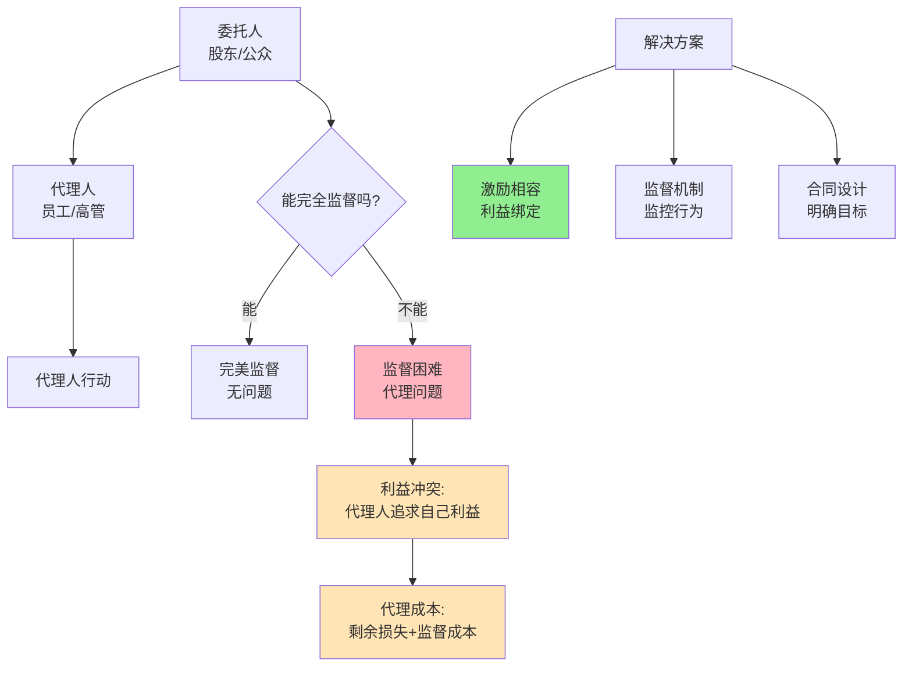

> 利益冲突的普遍性

---

**数据来源：** 国企高管薪酬研究（2018-2023）、科技公司股权激励研究（2015-2023）、詹森与麦克林《企业理论》（1976）、赫希与米尔格罗姆《委托-代理模型》（1987）

## 国企高管的薪酬争议

某国企高管年薪500万。
媒体报道："国企高管凭什么拿这么高？"
公众质疑："国企高管是'人民的打工仔'，年薪应该限制。"

**问题：** 为什么国企高管薪酬备受争议？
**更深的问题：** 如何让"代理人"（员工/高管）为"委托人"（股东/公众）的最大利益工作？

这背后藏着一个经济学核心概念：**委托代理问题（Principal-Agent Problem）**。

---

## 委托代理问题

**定义：** 委托人雇佣代理人做决策，但双方利益不一致，且委托人无法完全监督代理人行为。

**简单说就是：**
- 委托人 = 老板、股东、公众
- 代理人 = 员工、高管、政府
- 问题 = 代理人追求自己的利益，而非委托人的利益

### 关键要点

**委托代理问题的来源：**

| 来源 | 说明 | 例子 |
|------|------|------|
| **利益不一致** | 双方目标不同 | 老板想利润，员工想轻松 |
| **信息不对称** | 代理人知道更多 | 员工知道自己是否努力 |
| **不确定环境** | 结果不完全由代理人的行动决定 | 企业利润受市场影响 |
| **监督成本高** | 完全监督成本太高 | 无法每时每刻监督员工 |

**代理成本（Agency Cost）：**

| 成本类型 | 定义 | 例子 |
|----------|------|------|
| **剩余损失** | 代理人行为不符合委托人最优利益的损失 | 员工偷懒导致的利润损失 |
| **监督成本** | 监督代理人行为的成本 | HR、监控系统 |
| **保证成本** | 让代理人保证符合委托人利益的成本 | 激励、福利 |

**激励相容（Incentive Compatibility）：**

> 设计激励机制，让代理人追求自己利益的同时，也实现了委托人的利益。

| 不相容 | 相容 |
|----------|--------|
| 固定工资 | 绩效工资+股权 |

**历史小知识：** 委托代理理论由阿罗（Arrow）和德布鲁（Debreu）在1950-60年代奠定基础。詹森（Jensen）和麦克林（Meckling）1976年提出"企业理论"，系统阐述委托代理问题。

---

### 为什么委托代理问题如此普遍？

**问题的普遍性：**

| 关系 | 委托人 | 代理人 | 冲突 |
|------|--------|--------|------|
| **股东-高管** | 股东 | 高管 | 高管追求权力、声誉，而非股东价值 |
| **雇主-员工** | 雇主 | 员工 | 员工追求轻松、安全，而非效率 |
| **公众-政府** | 公众 | 政府 | 政府追求权力、预算，而非公众福利 |
| **患者-医生** | 患者 | 医生 | 医生追求收入，而非患者健康 |

---

## 委托代理问题的真实案例

### 国企高管薪酬

**背景：** 为什么国企高管薪酬备受争议？

**国企的委托代理链：**

| 委托人 | 代理人 | 问题 |
|--------|--------|------|
| **公众** | 政府 | 公众利益 vs 政府利益 |
| **政府** | 国企高管 | 政府目标 vs 高管利益 |
| **国企高管** | 员工 | 高管目标 vs 员工利益 |

**国企的特殊性：**

| 特征 | 影响 |
|------|------|
| **多目标** | 不只追求利润，还追求就业、稳定 |
| **软预算** | 不太可能破产，预算约束软化 |
| **政治干预** | 政府干预经营决策 |
| **公众监督** | 薪酬受公众舆论影响 |

**薪酬对比：**

| 类型 | 年薪 | 特点 |
|------|------|------|
| **国企高管** | 50-100万 | 受限、公众监督 |
| **民企高管** | 200-500万 | 市场化、绩效导向 |
| **外企高管** | 500-1000万+ | 全球竞争、高压力 |

**委托代理冲突：**

| 冲突 | 国企 | 民企 |
|------|------|------|
| **利润vs 就业** | 兼顾就业，利润不是唯一目标 | 利润是主要目标 |
| **短期vs 长期** | 政治周期vs 企业周期 | 股东价值=长期价值 |
| **风险vs 稳定** | 风险规避 | 风险承担 |

**数据支撑：**

研究显示：
- 国企高管薪酬是民企的20-30%
- 但国企高管的"非货币福利"（权力、地位、保障）可能更高
- 国企的"委托代理链"更长，代理成本更高

**关键洞察：**
> 国企高管的委托代理问题是**多重委托+多目标+公众监督**的组合：
> - **多重委托**：公众→政府→国企高管→员工，委托链长
> - **多目标**：不只是利润，还有就业、稳定、政治目标
> - **公众监督**：薪酬受公众舆论影响
> - **国企的"激励不相容"**：
>   - 高管薪酬受限，激励不足
>   - 但权力、地位、保障是"隐性激励"
>   - **结果是"低显性激励+高隐性激励"**
> - **改革方向**：
>   - **市场化薪酬**：与国际接轨，但保留"限高"
>   - **股权激励**：让高管分享股东价值
>   - **透明化**：让公众了解"隐性激励"

---

### 硅金手铐

**背景：** 为什么科技公司用股权留住人才？

**硅金手铐的委托代理机制：**

| 机制 | 说明 |
|------|------|
| **股权激励** | 员工获得股票、期权 |
| **归属期** | 4年归属期 |
| **继续归属** | 留任继续获得 |

**委托代理问题：**

| 问题 | 传统解决方案 | 硅金手铐 |
|------|--------------|----------|
| **短期主义** | 年度奖金 | 长期股权（4年归属） |
| **跳槽** | 合同、违约金 | 股权未归属=损失 |
| **搭便车** | 监督 | "留下才有股权" |

**硅金手铐的数学：**

| 年份 | 归属股权 | 累计归属 | 如果离职 |
|------|----------|----------|------------|
| 第1年 | 25% | 25% | 损失75%未归属 |
| 第2年 | 25% | 50% | 损失50%未归属 |
| 第3年 | 25% | 75% | 损失25%未归属 |
| 第4年 | 25% | 100% | 全部归属，可离职 |

**数据支撑：**

研究显示：
- 硅金手铐使科技公司员工流失率降低50%
- 约70%的科技公司员工在归属期内离职时，损失未归属股权
- 股权激励占科技公司总薪酬的30-50%

**关键洞察：**
> 硅金手铐是**激励相容+长期主义**的组合：
> - **激励相容**：员工追求自己利益（股权），也符合公司利益（长期价值）
> - **长期主义**：4年归属期让员工关注长期，而非短期
> - **绑定机制**：离职=损失未归属股权（"硅金手铐"）
> - **这不是"强迫"**：
>   - 员工仍然可以选择离职
>   - 但离职成本高（未归属股权）
> - **硅金手铐的本质是"自我选择"**：
>   - 短期主义者不会接受（因为归属期长）
>   - 长期主义者愿意接受（相信公司长期增长）
> - **这是一种筛选机制**：
>   - 筛选掉短期主义者
>   - 保留长期主义者
> **对委托代理问题的启示**：
> - **激励相容是关键**：让代理人追求自己利益，也符合委托人利益
> - **长期激励**：股权、归属期让代理人关注长期
> - **平衡短期和长期**：不是所有激励都应该是长期

---

## 如何解决委托代理问题？

### 解决方案1：激励相容

| 策略 | 例子 |
|------|------|
| **绩效工资** | 销售提成、绩效奖金 |
| **股权激励** | 股票、期权、RSU |
| **晋升机制** | 基于绩效的晋升 |

### 解决方案2：监督机制

| 策略 | 例子 |
|------|------|
| **财务监督** | 审计、财务报告 |
| **行为监督** | KPI、OKR、考核 |
| **透明化** | 公开信息、公示 |

### 解决方案3：合同设计

| 策略 | 例子 |
|------|------|
| **明确目标** | OKR、KPI |
| **奖励机制** | 奖金、股权 |
| **惩罚机制** | 解雇、降职 |

---

## 应用与决策

### 个人决策

| 决策 | 委托代理视角 |
|------|----------------|
| 选择工作 | 考虑"激励相容"程度（工资vs 绩效） |
| 谈判薪酬 | 争取"股权激励"（长期利益） |
| 职业规划 | 考虑"长期vs 短期"激励 |

### 企业/政策

| 策略 | 委托代理应用 |
|------|---------------------|
| 高管薪酬 | 基准+绩效+股权 |
| 员工激励 | 绩效工资+股权 |
| 国企改革 | 市场化薪酬+公众监督 |

---

### 常见误区

| 误区 | 正解 |
|------|------|
| "代理问题可以消除" | 可以降低，无法消除 |
| "激励总能解决问题" | 激励可能创造新问题（短期主义） |
| "监督越多越好" | 监督有成本，过度监督适得其反 |
| "股权激励总是好的" | 股权激励可能诱导风险行为 |

---

## 延伸思考

1. **AI时代的委托代理**：当AI能完成更多任务，委托代理关系会改变吗？AI是"代理人"还是"工具"？

2. **DAO的委托代理**：DAO（去中心化自治组织）试图通过代码消除委托代理问题。这是否可能？还是创造了新的委托代理问题（开发者 vs 投资者）？

3. **社会的多重委托代理**：政府不仅是"代理人"，还是"委托人"（代表公众）。这复杂的委托链如何影响政策制定？谁监督"监督者"？

**下期预告：** 我们来探讨**效率工资理论**——为什么程序员薪资如此之高？Google福利背后的经济学逻辑？

---

**数据来源：** 国企高管薪酬研究（2018-2023）、科技公司股权激励研究（2015-2023）、詹森与麦克林《企业理论》（1976）、赫希与米尔格罗姆《委托-代理模型》（1987）
