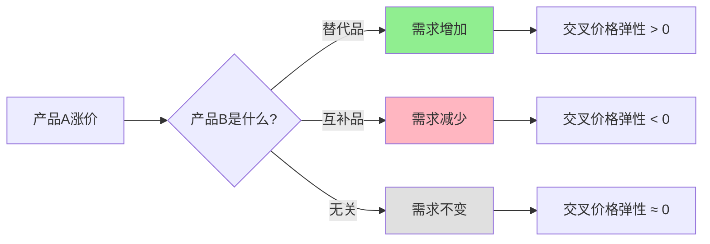

> 产品的命运，不只属于自己

---

## 咖啡店老板的意外之喜

2023年，茶叶价格因干旱上涨了30%。

某咖啡店老板发现，自家咖啡的销量莫名其妙增加了15%。

他很困惑："我的咖啡价格没变，品质也没变，为什么突然多这么多人来买？"

**答案很简单：** 茶叶涨价后，原来喝茶的一部分人，改喝咖啡了。

**更深的问题：** 为什么一个产品的价格变化，会影响另一个产品的销量？哪些产品是"敌人"（替代品），哪些是"盟友"（互补品）？

这背后藏着经济学的一个重要概念：**交叉价格弹性（Cross-Price Elasticity）**。

---

## 替代品与互补品

**定义：**

| 类型 | 定义 | 简单理解 |
|------|------|----------|
| **替代品** | 可以相互替代的产品 | A涨价，B的需求增加 |
| **互补品** | 需要一起使用的产品 | A涨价，B的需求减少 |

**交叉价格弹性：**

> 产品A的价格变化1%，对产品B需求量的影响。

| 弹性值 | 关系 | 例子 |
|--------|------|------|
| **正值** | 替代品 | 茶涨价 → 咖啡需求增加 |
| **负值** | 互补品 | 咖啡涨价 → 糖需求减少 |
| **接近0** | 无关 | 手机涨价 → 面包需求不变 |

### 关键要点

**1. 替代品的类型**

| 类型 | 定义 | 例子 |
|------|------|------|
| **直接替代** | 几乎可以完全替代 | 茶vs咖啡、可口可乐vs百事可乐 |
| **间接替代** | 部分功能替代 | 火车vs飞机、外卖vs自己做 |
| **跨类别替代** | 不同类别但满足相同需求 | 电影vs游戏（都是娱乐） |

**2. 互补品的类型**

| 类型 | 定义 | 例子 |
|------|------|------|
| **必需互补** | 缺一不可 | 手机+充电器、汽车+汽油 |
| **增强互补** | 一起使用更好 | 咖啡+糖、游戏+显卡 |
| **平台生态** | 构成生态系统 | iOS+App Store、微信+小程序 |

**3. 交叉价格弹性的大小**

| 弹性值 | 含义 | 商业启示 |
|--------|------|----------|
| > 1 | 强替代/互补关系 | 价格战杀伤力大 |
| 0.5-1 | 中等关系 | 有一定影响 |
| 0-0.5 | 弱关系 | 影响有限 |

**历史小知识：** 交叉价格弹性的概念源于20世纪中叶的需求理论研究。经济学家发现，产品的需求不只取决于自己的价格，还取决于相关产品的价格。这对企业定价策略有重大影响。

---

### 为什么替代品与互补品很重要？

**1. 它们改变了"定价权"**

| 情况 | 定价权 |
|------|--------|
| 无替代品 | 强（可以涨价） |
| 有强替代品 | 弱（涨价会流失客户） |

**2. 它们决定了"生态战略"**

| 战略 | 例子 |
|------|------|
| 打造互补品生态 | 苹果：iPhone + AirPods + Watch + 服务 |
| 消除替代品威胁 | 平台：独家内容、会员体系 |

**3. 它们影响了"市场边界"**

市场不只是同类产品竞争，还包括跨类别替代：
- 可口可乐的竞争对手不只是百事可乐
- 还有茶、咖啡、果汁、甚至水

---

## 替代品与互补品的真实案例

### 茶vs咖啡：永恒的对手

**背景：** 茶和咖啡是全球两大饮品，彼此是直接替代品。

**交叉价格弹性分析：**

| 场景 | 茶市场变化 | 咖啡市场反应 |
|------|------------|--------------|
| 茶叶产量下降 | 价格上涨30% | 咖啡需求增加15% |
| 咖啡店暴增 | 价格战，咖啡降价 | 茶叶需求减少10% |

**为什么替代关系不完全？**

| 因素 | 茶的特性 | 咖啡的特性 |
|------|----------|------------|
| 咖啡因含量 | 较低 | 较高 |
| 文化习惯 | 亚洲偏好 | 欧美偏好 |
| 消费场景 | 放松、社交 | 提神、工作 |
| 健康认知 | 更健康 | 可能不健康 |

**商业启示：**

| 策略 | 茶品牌 | 咖啡品牌 |
|------|--------|----------|
| 差异化 | 强调"健康"、"东方文化" | 强调"效率"、"提神" |
| 场景定位 | 下午茶、休闲 | 早晨、工作间隙 |
| 产品创新 | 奶茶、果茶（减少替代） | 冷萃、精精品咖啡 |

**数据支撑：**

根据艾瑞咨询《2023年中国咖啡市场报告》，茶和咖啡的交叉价格弹性约为 +0.5：
- 茶价格上涨10% → 咖啡需求增加约5%
- 咖啡价格上涨10% → 茶需求增加约5%

根据中国汽车工业协会《2023年新能源汽车数据报告》：
- 2020年电动车渗透率5.4% → 燃油车销量-1.9%
- 2021年渗透率13.4% → 燃油车销量-9.3%
- 2022年渗透率25.6% → 燃油车销量-16.4%
- 2023年渗透率31.6% → 燃油车销量-18.7%

根据苹果公司《2023年财报》分析，苹果生态系统的留存率高达90%以上：
- 一旦用户拥有3个以上苹果产品
- 换品牌的意愿降至10%以下

**关键洞察：**
> 茶和咖啡虽然是替代品，但替代关系并不完美（弹性只有0.5）。聪明的品牌会通过**差异化**减少替代性：定位不同场景、强调不同价值、创造不同体验。**品牌护城河的本质就是降低替代品的交叉价格弹性**——即使竞品降价，我的客户也不会流失。

---

### 电动车vs燃油车：历史性的替代

**背景：** 电动车正在替代燃油车，这是百年一遇的交通工具革命。

**替代关系分析：**

| 维度 | 燃油车 | 电动车 |
|------|--------|--------|
| **购买成本** | 较低 | 较高（但快速下降） |
| **使用成本** | 高（油费） | 低（电费） |
| **便利性** | 加油快、加油站多 | 充电慢、充电桩少 |
| **性能** | 成熟可靠 | 加速快、智能驾驶 |
| **环保性** | 污染 | 清洁 |

**交叉价格弹性变化：**

| 时期 | 电动车价格 | 对燃油车需求的影响 | 替代强度 |
|------|------------|---------------------|----------|
| 2015年 | 很贵 | 几乎无影响 | 弱替代 |
| 2020年 | 中等 | 开始影响 | 中等替代 |
| 2023年 | 接近燃油车 | **显著影响** | **强替代** |

**数据支撑：**

| 年份 | 电动车渗透率（中国） | 燃油车销量变化 |
|------|---------------------|----------------|
| 2020 | 5.4% | -1.9% |
| 2021 | 13.4% | -9.3% |
| 2022 | 25.6% | -16.4% |
| 2023 | 31.6% | -18.7% |

**燃油车的困境：**

| 策略 | 效果 |
|------|------|
| 降价促销 | 短期有效，长期无效（电动车也在降价） |
| 提升配置 | 增加成本，利润率下降 |
| **转向电动车** | **唯一的出路** |

**关键洞察：**
> 电动车对燃油车的替代，展示了"创新驱动型替代"的力量。当替代品不仅价格下降，还在性能、体验上全面超越时，被替代的产品将面临**不可逆转的衰退**。燃油车企的转型不是"选择"，而是"生存"——交叉价格弹性已经变得如此之强，不转型就意味着被淘汰。

---

### 手机APP生态：互补品的护城河

**背景：** 为什么苹果的生态如此"粘人"？

**苹果的互补品矩阵：**

| 产品 | 互补关系 | 离开成本 |
|------|----------|----------|
| iPhone | 核心设备 | - |
| AirPods | 完美配对 | 转Android需重买 |
| Apple Watch | 只能配iPhone | 转Android手表功能受限 |
| iCloud | 数据同步 | 转Android需迁移数据 |
| App Store | 应用和服务 | 转Android需重买应用 |

**交叉价格弹性的"负反馈"：**

| 场景 | 价格变化 | 对其他产品的影响 |
|------|----------|------------------|
| iPhone涨价 | 降低iPhone需求 | 同时降低AirPods、Watch等需求 |
| AirPods降价 | 增加AirPods需求 | **增强iPhone粘性，降低换机概率** |

**苹果的定价策略：**

| 产品 | 定价策略 | 原理 |
|------|----------|------|
| iPhone | 高价 | 高利润主产品 |
| AirPods | 中价 | 强化生态，增加粘性 |
| iCloud | 低价 | 高频服务，锁定用户 |

**数据支撑：**

研究显示，苹果生态系统的留存率高达90%以上：
- 一旦用户拥有3个以上苹果产品
- 换品牌的意愿降至10%以下

**关键洞察：**
> 苹果的高明之处在于构建了一个**互补品生态系统**。每个产品都强化其他产品的价值，离开任何一个产品都意味着离开整个系统。**互补品生态创造了负的交叉价格弹性**——即使竞品更便宜，用户也不会离开，因为"转换成本"太高了。这就是苹果的护城河。

---

## 如何用替代品与互补品思维做决策？

### 决策三步法

**步骤1：识别你的替代品**

问自己：**如果我的产品涨价10%，客户会去买什么？**

| 替代品类型 | 分析问题 |
|------------|----------|
| 直接替代品 | 谁是直接竞争对手？ |
| 间接替代品 | 有没有其他解决方案？ |
| 跨类别替代品 | 客户的根本需求是什么？ |

**步骤2：识别你的互补品**

问自己：**什么产品与我的产品一起被使用？**

| 互补品类型 | 分析问题 |
|------------|----------|
| 必需互补品 | 缺了它，我的产品还能用吗？ |
| 增强互补品 | 什么产品能提升我的产品价值？ |
| 潜在互补品 | 有没有未被开发的互补机会？ |

**步骤3：制定战略**

| 战略 | 适用情况 |
|------|----------|
| 差异化 | 替代品威胁大 |
| 构建生态 | 互补品机会多 |
| 打包销售 | 互补品可组合 |

---

### 常见误区

| 误区 | 正解 |
|------|------|
| "我的产品没有替代品" | 任何产品都有替代品，只是远近不同 |
| "互补品多多益善" | 互补品也会限制你的定价权 |
| "只要比对手便宜就能赢" | 替代品不只是价格竞争，还有价值竞争 |
| "生态护城河不可逾越" | 技术变革可能打破生态（如诺基亚） |

---

## 延伸思考

1. **AI的替代与互补**：AI是替代人类工作，还是增强人类能力？哪些工作会被替代，哪些会被增强？如何成为"AI互补型人才"？

2. **远程办公的替代效应**：远程办公替代了什么？不仅是办公室，还有城市、交通、房地产。这些行业的"交叉价格弹性"是多少？

3. **教育投资与替代品**：大学学历的替代品是什么？职业培训、在线课程、还是直接工作？如果大学学费持续上涨，替代品会变得更受欢迎吗？

**下期预告：** 我们来探讨**价格歧视的艺术**——为什么航空公司能对同一航班收取不同价格？外卖会员费为什么因人而异？三级价格歧视是如何运作的？

---

**数据来源：** 艾瑞咨询《2023年中国咖啡市场报告》、中国汽车工业协会《2023年新能源汽车数据报告》、苹果公司《2023年财报》、Cross-Price Elasticity研究（Allen & Hicks, 1934）
