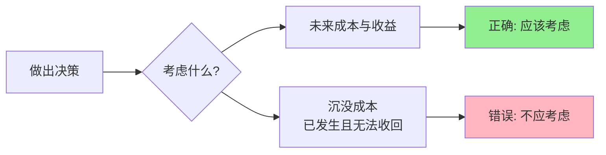

> 过去的投入，往往是未来的枷锁

---

## "这个项目已经投了500万，不能就这样放弃"

某创业公司创始人老张，做了一款SaaS产品。一年投入500万，用户增长远低于预期，续费率只有30%。

CFO建议砍掉项目止损，老张却说："都投了500万了，现在放弃太可惜，再坚持半年说不定能成。"

半年后又投了300万，用户依然没有起色。公司现金流紧张，其他业务也被拖累。

**为什么明明知道不该继续，却总是停不下来？**

这背后藏着一个经济学陷阱：**沉没成本谬误（Sunk Cost Fallacy）**。

---

## 什么是沉没成本？

**定义：** 已经发生且无法收回的成本。

**简单说就是：** 过去的投入，无论是金钱、时间还是精力，一旦花出去就回不来了。

**黄金法则：**
> 沉没成本**不应该**影响未来的决策。决策应该只看未来。

### 关键要点

| 维度 | 沉没成本 | 机会成本 |
|------|----------|----------|
| 定义 | 已发生且无法收回的成本 | 放弃的次优选择的价值 |
| 时间指向 | **向后看**（过去） | **向前看**（未来） |
| 决策作用 | **应该忽略** | **必须考虑** |

### 为什么沉没成本难以割舍？

**心理学解释：**

1. **损失厌恶**（Loss Aversion）
   - 放弃 = 承认失败 = 心理痛苦
   - 继续投入 = 还有希望 = 心理安慰

2. **一致性偏差**（Consistency Bias）
   - "我已经投入这么多，说明我当初的选择是对的"
   - 承认错误 = 否定过去的自己

3. **禀赋效应**（Endowment Effect）
   - 我们对自己拥有的东西（包括投入）估值更高
   - 放弃 = 失去"我的"投入

---

## 沉没成本如何影响决策

### 为什么项目越亏损越难停？

**背景：** 某互联网公司推出新业务，半年投入800万，用户增长远低于预期。

**沉没成本分析：**

| 决策视角 | 看到的内容 | 情绪反应 |
|----------|------------|----------|
| 沉没成本思维 | "已经投了800万，放弃太亏" | 不甘心、继续追加 |
| 理性决策思维 | "继续投入还需要500万，成功概率20%" | 果断止损 |

**数据支撑：**
- 根据哈佛商学院（Gino & Pisano, 2011）研究，创业项目在达到预算50%时，即使发现明显问题，仍有70%的创始人选择继续投入；继续投入的项目中，只有不到15%最终实现盈亏平衡

**关键洞察：**
> 沉没成本不是"成本"，而是"历史"。历史无法改变，能改变的只有未来。决策时不应该问"我投入了多少"，而应该问"从现在开始，值不值得继续"。

---

### 为什么股民总是"套住就不卖了"？

**背景：** 2024年A股市场，某股民以50元买入股票，股价跌至30元，跌幅40%。

**股民的心理活动：**

| 股价 | 理性决策 | 沉没成本思维 |
|------|----------|--------------|
| 50元（买入） | - | "看好这家公司" |
| 40元 | 考虑基本面是否变化 | "跌了20%，再等等反弹" |
| 30元 | 如果公司基本面恶化，立即止损 | "亏了40%，卖了就坐实亏损了" |
| 20元 | - | "都亏这么多了，不如等等看" |

**数据支撑：**
- 根据行为金融学研究（Odean, 1998, "Are Investors Reluctant to Realize Their Losses?"），散户在亏损10%时，只有30%选择止损；亏损达到30%时，止损率反而下降到15%；亏损超过50%时，绝大多数股民选择"躺平"

**为什么越亏损越不舍得卖？**

1. **处置效应**（Disposition Effect）
   - "卖出亏损股 = 承认投资失败"
   - "继续持有 = 还有翻盘希望"

2. **锚定效应**（Anchoring Bias）
   - 心理锚点：买入价50元
   - 当前价30元 → "亏了20元"
   - 如果不卖 → "只是账面亏损，不是实际亏损"

**启示：**
> 股票的每一分钱都是你的钱，无论是盈是亏。决策时不应该看"我当初买的价格"，而应该问"如果我现在没有这只股票，我会买入吗"。如果答案是NO，那就应该卖出。

---

## 如何用沉没成本思维改善决策？

### 决策三步法

**步骤1：识别沉没成本**

问自己：哪些投入已经发生且无法收回？

| 沉没成本类型 | 示例 |
|--------------|------|
| 金钱投入 | 项目已投入的资金、股票的买入成本 |
| 时间投入 | 在某家公司的工作年限、学习某项技能的时间 |
| 情感投入 | 一段关系的过往、对某个品牌的忠诚 |

**步骤2：切割"账面"与"实际"**

| 概念 | 定义 | 决策依据 |
|------|------|----------|
| 账面亏损 | 资产当前价值 vs 投入成本 | ❌ 不应考虑 |
| 实际价值 | 资产未来能产生的价值 | ✅ 应该考虑 |

**步骤3：从"现在"重新评估**

关键问题：**如果我没有之前的投入，从现在开始，我还会做这个选择吗？**

---

### 常见误区

| 误区 | 正解 |
|------|------|
| "都投入这么多了，放弃太可惜" | 沉没成本不影响未来决策，看未来收益 |
| "再坚持一下说不定能成" | 评估成功的客观概率，不要被"不甘心"驱动 |
| "卖出就坐实亏损了" | 不卖出也是亏损，而且可能继续扩大 |
| "我已经在这个公司干了5年" | 5年工作经验是你的资产，不是这家公司的锁链 |

---

## 延伸思考

1. **关系的沉没成本**：为什么一段已经不健康的关系，人们往往因为"在一起这么多年"而难以结束？

2. **教育的沉没成本**：为什么很多人选择了不适合自己的专业，却因为"已经读了3年"而不愿转专业？

3. **国家的沉没成本**：为什么一些明显没有效益的大型项目，政府却难以叫停？是"民生工程"还是"不甘心"？

**下期预告：** 我们来探讨**贴现与时间偏好**——为什么Costco会员模式让人"欲罢不能"？拼多多的"百亿补贴"为什么能疯狂获客？现在的100元和一年后的100元，真的不一样吗？

---

**数据来源：** 哈佛商学院（Gino & Pisano, 2011）、行为金融学研究（Odean, 1998, "Are Investors Reluctant to Realize Their Losses?"）、中国证券投资者保护基金公司《2023年投资者行为调查报告》
