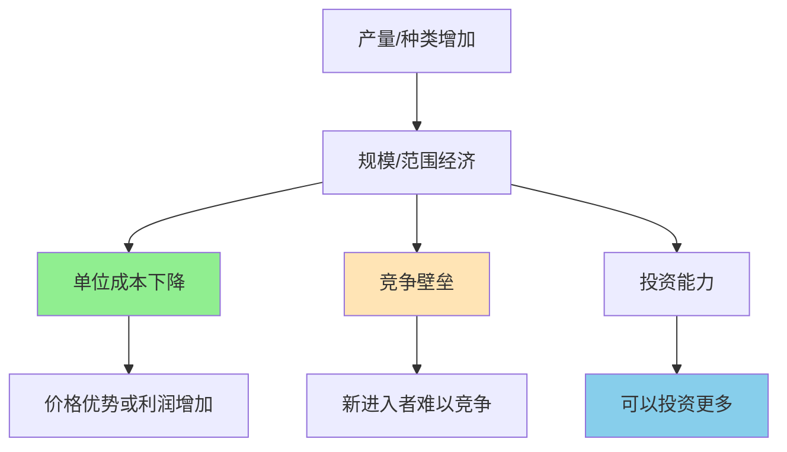

> 大不只是规模，更是成本优势

---

**数据来源：** Shein商业模式分析（2023）、Amazon财报与AWS数据（2018-2023）、亚当·斯密《国富论》（1776）、阿尔弗雷德·马歇尔《经济学原理》（1890）、保罗·克鲁格曼"规模经济、产品差异化与贸易模式"（1980）

## 同样的商品，为什么他们能更便宜？

同样的T恤：
- 小店卖：59元
- 优衣库卖：79元（质量更好）
- Shein卖：29元（款式更多）

**问题：** 为什么Shein能做到这么便宜还赚钱？
**更深的问题：** "大"有什么经济学优势？

这背后藏着两个经济学概念：**规模经济与范围经济**。

---

## 规模经济与范围经济

**定义：**
- **规模经济（Economies of Scale）**：产量增加，单位成本下降
- **范围经济（Economies of Scope）**：产品种类增加，单位成本下降

**简单说就是：**
- 规模经济 = "做得越多，成本越低"
- 范围经济 = "做得越杂，成本越低"



### 关键要点

**规模经济的来源：**

| 来源 | 说明 | 例子 |
|------|------|------|
| **固定成本分摊** | 固定成本被更多产量分摊 | 软件、工厂 |
| **专业化** | 大规模允许更细分工 | 流水线 |
| **采购优势** | 大批量采购价格更低 | 沃尔玛、Costco |
| **学习曲线** | 产量越大，经验越多，效率越高 | 制造业 |

**范围经济的来源：**

| 来源 | 说明 | 例子 |
|------|------|------|
| **共享资源** | 多种产品共享同一资源 | Amazon物流配送 |
| **共享技术** | 同一技术用于多种产品 | Google搜索+广告 |
| **品牌延伸** | 同一品牌用于多种产品 | Apple产品线 |
| **渠道共享** | 同一渠道销售多种产品 | 超市、电商平台 |

**长期平均成本曲线：**

```
单位成本
  |
  |    _________
  |   /         \
  |  /           \
  | /             \
  |/               \
  +--------------------- 产量
   规模经济   最小规模   规模不经济
```

**历史小知识：** 亚当·斯密1776年在《国富论》中通过"针厂"例子阐述了分工带来的规模经济。后来，阿尔弗雷德·马歇尔在1890年的《经济学原理》中系统阐述了规模经济和范围经济。

---

### 为什么规模与范围如此重要？

**规模经济的竞争优势：**

```
规模大 → 成本低 → 价格低 → 销量多 → 规模更大 → ...
```

**范围经济的竞争优势：**

```
种类多 → 客户一站式购买 → 客户忠诚度高 → 销量多 → 成本低 → ...
```

**规模与范围结合的"护城河"：**

| 优势 | 说明 |
|------|------|
| **成本优势** | 规模经济 → 成本更低 |
| **产品优势** | 范围经济 → 产品更多 |
| **渠道优势** | 规模+范围 → 渠道更强 |
| **数据优势** | 规模+范围 → 数据更多 → 更智能 |

---

## 规模与范围的真实案例

### Shein：规模经济的新范式

**背景：** 为什么Shein能做到如此快速和便宜？

**Shein的规模经济：**

| 维度 | Shein | 传统快时尚（Zara、H&M） |
|------|-------|------------------------|
| **SKU数量** | 100万+ | 1-2万 |
| **上新速度** | 每天1万+新品 | 每周2次上新 |
| **从设计到上架** | 7天 | 3-4周 |
| **小批量测试** | 100件起订 | 1000件起订 |

**Shein的"小单快反"模式：**

```
小批量生产（100件） → 测试市场 → 数据反馈 → 爆款加量 → 滞销停产
```

**规模经济如何运作？**

| 阶段 | 规模经济效应 |
|------|--------------|
| **设计** | 众多设计师共享数据、趋势 |
| **采购** | 巨大采购量，极低采购成本 |
| **生产** | 分散给小工厂，但整合订单 |
| **物流** | 规模化的跨境物流网络 |
| **营销** | 海量KOL，单位营销成本低 |

**数据支撑：**

| 指标 | Shein | 传统快时尚 |
|------|-------|------------|
| 平均单价 | $10-15 | $20-30 |
| 年SKU数 | 100万+ | 1-2万 |
| 利润率 | ~20% | ~10-15% |

**关键洞察：**
> Shein的规模经济不是"大规模生产"，而是**"大规模测试"的规模经济**。传统快时尚依赖设计师的"直觉"，Shein依赖数据的"规模"：
> - 测试100万个SKU，只有100个爆款
> - 爆款的数据反馈到设计和生产
> - 整个供应链被数据驱动
> **Shein证明了一种新的规模经济**：不是"大规模制造单一产品"，而是"大规模测试和迭代"。这种模式需要：
> - 数据规模（数百万用户数据）
> - 供应链规模（数千家供应商）
> - 技术规模（AI、算法、自动化）

---

### Amazon AWS：范围经济的典范

**背景：** 为什么Amazon能成为云计算霸主？

**AWS的范围经济：**

| 维度 | 说明 |
|------|------|
| **基础设施共享** | 同一数据中心服务于多个客户 |
| **技术共享** | 同一技术（数据库、存储、AI）用于多个服务 |
| **客户共享** | 同一销售/支持团队服务多个客户 |
| **数据共享** | 众多客户数据改进服务 |

**AWS的服务矩阵：**

| 服务类型 | 举例 |
|----------|------|
| **计算** | EC2、Lambda |
| **存储** | S3、EBS |
| **数据库** | RDS、DynamoDB |
| **AI/ML** | SageMaker、Rekognition |
| **分析** | Redshift、Athena |
| **IoT** | IoT Core、Greengrass |

**范围经济如何运作？**

| 机制 | 说明 |
|------|------|
| **基础设施复用** | 同一硬件运行多个服务 |
| **技术复用** | 研发投入被多个服务分摊 |
| **客户交叉销售** | 现有客户更容易购买新服务 |
| **数据飞轮** | 更多客户 → 更多数据 → 更好服务 → 更多客户 |

**数据支撑：**

| 指标 | AWS | 竞争对手 |
|------|-----|----------|
 | 服务数量 | 200+ | <100 |
| 客户数 | 数百万 | 数十万 |
| 市场份额 | ~32% | 追赶中 |
| 利润率 | ~30% | 更低 |

**关键洞察：**
> AWS的范围经济展示了**"平台模式"的威力**。通过提供200+服务，AWS实现了：
> - **基础设施复用**：同一硬件运行多个服务，成本被分摊
> - **技术复用**：研发投资被多个服务分摊
> - **客户锁定**：一旦使用多个服务，切换成本高
> **范围经济的护城河比规模经济更深**：竞争对手可以复制单一服务，但难以复制整个生态系统。**AWS不只是规模经济（大），更是范围经济（全）**——这就是为什么Google、Microsoft花了十年才追上。

---

## 如何利用规模与范围经济？

### 企业战略

**利用规模经济：**

| 策略 | 说明 |
|------|------|
| **扩大产能** | 增加产量，降低单位成本 |
| **标准化的产品** | 降低复杂度，提高效率 |
| **自动化** | 固定成本增加，变动成本降低 |
| **并购整合** | 通过并购获得规模 |

**利用范围经济：**

| 策略 | 说明 |
|------|------|
| **产品线延伸** | 用现有资源生产更多产品 |
| **渠道共享** | 用现有渠道销售更多产品 |
| **品牌延伸** | 用现有品牌推出新产品 |
| **平台模式** | 建立平台，连接多方 |

### 小企业的应对

| 策略 | 说明 |
|------|------|
| **利基市场** | 在细分市场做"小而美" |
| **差异化** | 避开规模经济竞争 |
| **灵活性** | 小企业更灵活 |
| **合作网络** | 通过合作获得"虚拟规模" |

---

### 常见误区

| 误区 | 正解 |
|------|------|
| "越大越好" | 超过一定规模，会出现规模不经济 |
| "规模经济=价格战" | 规模经济也可以用于创新或利润 |
| "范围经济=什么都做" | 范围经济需要协同效应 |
| "小企业无法利用规模经济" | 可以通过合作、平台获得虚拟规模 |

---

## 延伸思考

1. **AI的规模经济**：OpenAI、Google、Microsoft——为什么大公司在AI竞赛中占优？是因为数据规模、算力规模，还是人才规模？小公司还有机会吗？

2. **中国的"规模经济"优势**：中国制造业的"规模经济"是全球竞争优势。但随着成本上升，这种优势还能维持吗？未来会如何演变？

3. **规模不经济**：什么时候"大"反而成为劣势？过度多元化、过度官僚化、过度复杂化——什么时候规模变成了负担？

**下期预告：** 我们来探讨**先发vs后发优势**——为什么iPhone能颠覆手机市场？字节跳动如何后发制人？

---

**数据来源：** Shein商业模式分析（2023）、Amazon财报与AWS数据（2018-2023）、亚当·斯密《国富论》（1776）、阿尔弗雷德·马歇尔《经济学原理》（1890）、保罗·克鲁格曼"规模经济、产品差异化与贸易模式"（1980）
