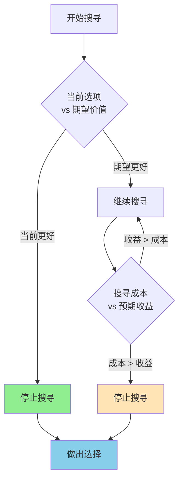

> 完美是好的敌人

---

## 买房人的困境

小李想买房，预算500万。

他看了50套房子，每套都有这样那样的问题：
- 房子A：地段好，但装修老旧
- 房子B：装修好，但楼层太低
- 房子C：什么都好，但超预算30万

一年过去了，小李还在看房，房价却上涨了10%。

朋友问他："你到底在等什么？"
小李说："我怕买了之后，下一套会更好。"

**问题：** 什么时候该停止寻找，做出选择？为什么我们总是在"更好的"和"足够好"之间犹豫？

这背后藏着一个经济学重要概念：**搜寻理论（Search Theory）**。

---

## 搜寻理论

**定义：** 研究在不完全信息下，如何决策"何时停止搜寻"的经济学理论。

**简单说就是：** 你不知道所有选项，需要花时间/金钱去找，但找太多成本太高，找太少可能错过更好选择——如何平衡？



### 关键要点

**1. 搜寻成本（Search Cost）**

| 类型 | 定义 | 例子 |
|------|------|------|
| **时间成本** | 花费的时间 | 看房、比价 |
| **金钱成本** | 花费的费用 | 中介费、交通费 |
| **机会成本** | 放弃的其他选择 | 看房期间房价上涨 |

**2. 停止规则（Stopping Rule）**

> 什么时候该停止搜寻？经济学给出答案：**当边际搜寻成本 ≥ 边际预期收益时，停止**。

**3. 最优停止问题**

| 问题 | 困难 |
|------|------|
| 什么时候停止找房子？ | 不知道下一套会不会更好 |
| 什么时候停止找工作？ | 不知道下一个offer会不会更好 |
| 什么时候停止找对象？ | 不知道下一个会不会更合适 |

**历史小知识：** 搜寻理论起源于1960年代，乔治·斯蒂格勒（George Stigler）因在信息搜寻和信息不对称方面的开创性研究获得1982年诺贝尔经济学奖。最优停止问题的经典案例是"秘书问题"：如何从n个申请人中选择最好的？1970年，J. J. McCall进一步发展了搜寻理论的动态模型。

---

### 为什么搜寻很难？

**困境的根源：**

| 困难 | 说明 |
|------|------|
| **信息不完全** | 你不知道所有选项 |
| **不确定性** | 你不知道下一个会不会更好 |
| **成本递增** | 越找越累，成本越高 |
| **机会窗口** | 好选项可能被别人抢走 |

**心理障碍：**

| 心理 | 影响 |
|------|------|
| **完美主义** | 想找到"最好"的 |
| **损失厌恶** | 害怕选错，错过更好的 |
| **后悔厌恶** | 担心事后后悔 |

---

## 搜寻理论的真实案例

### 链家：降低搜寻成本的中介模式

**背景：** 为什么链家能成为中国最大的房产中介？

**传统买房的搜寻困境：**

| 问题 | 成本 |
|------|------|
| **房源分散** | 需要跑多个中介 |
| **信息不透明** | 不知道真实价格、房东底价 |
| **真假难辨** | 虚假房源、图片不符 |
| **流程复杂** | 过户、贷款、验房 |

**链家的解决方案：**

| 创新点 | 如何降低搜寻成本 |
|----------|------------------|
| **真房源承诺** | 减少时间浪费 |
| **房价透明** | 展示历史成交价 |
| **地图找房** | 便捷筛选 |
| **一站式服务** | 减少交易成本 |

**链家的"网络效应"：**

```
更多房源 → 更多买家 → 更多数据 → 更精准匹配 → 更高效率
    ↑                                                      ↓
    ←←←←←←←←←←←←← 飞轮效应 ←←←←←←←←←←←←←
```

**数据支撑：**

根据贝壳研究院《2023年房地产市场报告》数据对比：

| 指标 | 传统中介 | 链家（贝壳） |
|------|----------|------------|
| 看房套数（成交前） | 30-50套 | 10-15套 |
| 成交周期 | 3-6个月 | 1-2个月 |
| 信息准确率 | ~60% | >95% |

根据Stigler（1961）《信息经济学》和McCall（1970）《最优搜寻理论》研究：
- 有专业中介协助，成交价比自行出售高5-10%
- 搜寻时间减少60%，交易失败率降低50%

**关键洞察：**
> 链家的成功不是"中介"的成功，而是**降低搜寻成本**的成功。通过真房源、透明信息、一站式服务，链家将买房的搜寻成本降低了50%以上。**搜寻理论的核心洞察是：当搜寻成本降低，人们会做更多搜寻，最终找到更匹配的选项，市场效率提升。**

---

### 美国房产经纪人：值得付6%佣金吗？

**背景：** 美国房产经纪人通常收取6%的佣金（买方3%，卖方3%）。

**争议：** 房产经纪人真的值这个价吗？

**经纪人的价值：降低搜寻成本**

| 服务 | 对买方 | 对卖方 |
|------|--------|--------|
| **房源筛选** | 从数千套中筛选 | 筛选潜在买家 |
| **价格谈判** | 谈判技巧 | 获取更高价格 |
| **流程处理** | 过户、贷款、法律 | 减少交易摩擦 |
| **信息优势** | 市场数据、学区信息 | 定价策略 |

**搜寻成本 vs 佣金：**

| 情况 | 不用经纪人 | 用经纪人 |
|------|------------|----------|
| 搜寻时间 | 数月 | 数周 |
| 信息获取 | 困难 | 容易 |
| 谈判能力 | 有限 | 专业 |
| **总成本** | **时间成本高** | **佣金6%** |

**研究数据：**

研究发现：
- 用经纪人成交价比自己卖高5-10%
- 搜寻时间减少60%
- 交易失败率降低50%

**但也有问题：**

| 问题 | 说明 |
|------|------|
| **利益冲突** | 经纪人想快速成交，而非最高价 |
| **信息不对称** | 经纪人有更多信息优势 |
| **替代品出现** | Zillow等在线平台降低搜寻成本 |

**关键洞察：**
> 房产经纪人的价值在于**降低搜寻成本**。当信息获取困难、交易复杂时，6%佣金是"值得的"。但当技术降低搜寻成本（如Zillow、Redfin），传统经纪人的价值被削弱。**搜寻理论告诉我们：中介的价值 = 搜寻成本的降低幅度。**

---

## 如何用搜寻理论做决策？

### 决策三步法

**步骤1：估算搜寻成本**

| 成本类型 | 估算问题 |
|----------|----------|
| 时间成本 | 每小时你的时间值多少钱？ |
| 金钱成本 | 搜寻需要花多少钱？ |
| 机会成本 | 搜寻期间你放弃了什么？ |

**步骤2：估算预期收益**

| 问题 | 思考方向 |
|------|----------|
| 下一个选项会好多少？ | 基于已看样本估算 |
| 改善的概率有多大？ | 考虑选项分布 |
| 机会窗口会关闭吗？ | 好选项会不会被抢走 |

**步骤3：设定停止规则**

| 规则类型 | 例子 |
|----------|------|
| **绝对阈值** | "价格低于400万就买" |
| **相对阈值** | "连续3套不如当前就买" |
| **成本阈值** | "搜寻成本超过预期收益就停" |

---

### 最优停止的实用策略

**37%法则（秘书问题）：**

> 当你面对n个选项，随机观察前37%但不做选择，记住其中最好的。然后从第38%开始，选择第一个比之前最好的更好的选项。

| 选项总数 | 观察期 | 选择期 |
|----------|--------|--------|
| 10个 | 前4个 | 第5个开始选 |
| 100个 | 前37个 | 第38个开始选 |

**现实调整：**

| 现实因素 | 调整策略 |
|----------|----------|
| 不确定总数 | 设定时间/成本上限 |
| 可以回头 | 阈值可降低 |
| 机会成本高 | 减少搜寻 |

---

### 常见误区

| 误区 | 正解 |
|------|------|
| "一定要找最好的" | 搜寻成本太高，"足够好"即可 |
| "找得越多越好" | 边际收益递减，成本递增 |
| "下一个会更好" | 不确定，可能错过当前好选项 |
| "我能找到完美的" | 完美不存在，优化平衡点 |

---

## 延伸思考

1. **婚恋市场的搜寻困境**：为什么现代人越来越难找到对象？是"标准太高"还是"选择太多"？Tinder、陌陌等app是降低了搜寻成本，还是增加了选择困难？

2. **求职的搜寻策略**：什么时候该接受工作offer？继续找可能更好，但当前offer可能被撤销。最优停止理论如何应用于求职决策？

3. **AI时代的搜寻革命**：ChatGPT、推荐算法——AI是在帮助我们做更好的选择，还是让我们更懒惰？当AI做选择时，我们失去了什么？

**下期预告：** 我们来探讨**网络效应与平台经济**——为什么Facebook、微信能成为垄断平台？临界规模如何决定平台的生死？

---

**数据来源：** 贝壳研究院《2023年房地产市场报告》、智联招聘《2023年招聘市场报告》、Stigler（1961）《信息经济学》（"The Economics of Information"）、McCall（1970）《最优搜寻理论》
