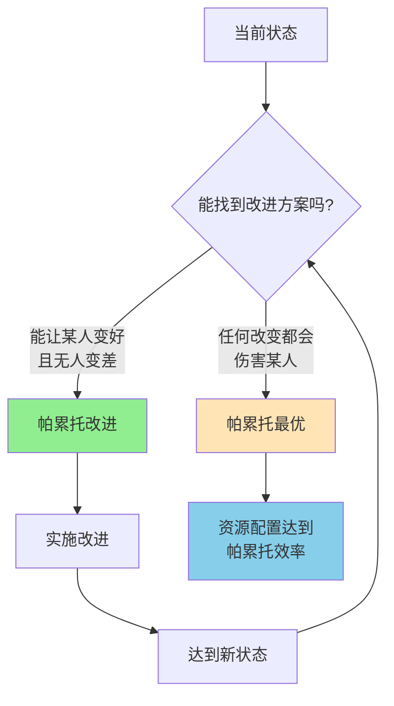

> 效率不等于公平，但公平也需要效率

---

## 这个改变让所有人受益，为什么还有人反对？

某公司提议改革：
- CEO薪资保持不变（1000万）
- 员工薪资翻倍（从10万到20万）

你会想：**这有什么问题？所有人都受益啊！**

但在内部投票时，却遭到了部分高管反对：
- "CEO责任这么大，薪资应该更高！"
- "高管和员工差距缩小了，激励机制失效了！"

**为什么一个让所有人受益的改变，还会有人反对？**

这背后藏着一个经济学核心问题：**什么是"最好"的资源配置？**

---

## 帕累托效率

**定义：** 一种资源配置状态，**无法再让任何人变得更好，而不使其他人变差**。

**简单说就是：** 资源配置已经"好到不能更好"——任何改变都会伤害至少一个人。

### 关键要点

**1. 帕累托改进（Pareto Improvement）**

> 改变资源配置，让至少一个人变好，且没有人变差。

**2. 帕累托最优（Pareto Optimality）**

> 无法再进行帕累托改进的状态——资源配置达到"效率边界"。

**3. 效率 vs 公平**

| 维度 | 帕累托效率 | 公平 |
|------|------------|------|
| 关注点 | 资源配置是否"无浪费" | 分配是否"合理" |
| 判断标准 | 能否让某人变好而不伤害他人 | 分配是否符合某种正义标准 |
| 可能状态 | 极度不平等但有效率 | 平等但可能低效 |

**举个例子：**

| 状态 | A | B | 是否帕累托最优 |
|------|---|---|----------------|
| 状态1 | 100 | 100 | ❌ 可以增加到（110, 100） |
| 状态2 | 110 | 100 | ❌ 可以增加到（110, 105） |
| 状态3 | 110 | 105 | ✅ 任何改变都会伤害某人 |
| 状态4 | 200 | 10 | ✅ 虽然极度不平等，但有效 |

**历史小知识：** 维弗雷多·帕累托（Vilfredo Pareto, 1848-1923），意大利经济学家、社会学家。他在研究收入分配时发现，80%的财富掌握在20%的人手中（帕累托法则/80-20法则），后来提出了帕累托效率概念。代表作：《政治经济学手册》（Manuale di economia politica, 1906）。

---

### 为什么帕累托效率很重要？

**1. 它是效率的"底线标准"**

> 如果一种改变能让人变好而无人变差，为什么不去做？

**2. 它揭示了"效率"与"公平"的张力**

| 决策 | 帕累托效率判断 | 公平判断 |
|------|----------------|----------|
| 给所有人加薪 | ✅ 帕累托改进 | ✅ 更公平 |
| 给穷人加税补贴富人 | ❌ 不是帕累托改进 | ❌ 不公平 |
| 给富人减税（不改变穷人收入） | ✅ 帕累托改进 | ❌ 更不公平 |
| 从富人转移财富给穷人 | ❌ 不是帕累托改进 | ✅ 更公平 |

**3. 它帮助理解"为什么有些改革困难"**

许多经济改革即使整体社会收益增加，但因为损害了某些人的利益，而遭到反对。

---

## 帕累托效率的真实应用

### 工资差距：必要还是不公？

**背景：** 2023年，某互联网公司CEO年薪5000万，普通员工年薪30万，差距超过160倍。

**争议：**
- 支持者："高薪激励高管创造更大价值，最终所有人受益"
- 反对者："差距太大，不公平！"

**帕累托效率视角：**

| 假设场景 | A. 高管高薪 | B. 高管降薪、员工加薪 | C. 高管降薪、公司解散 |
|----------|-------------|----------------------|----------------------|
| 高管收入 | 5000万 | 1000万 | 0 |
| 员工收入 | 30万 | 35万 | 0（失业） |
| **是否帕累托最优？** | ✅ 可能是 | ❌ 高管受损 | ❌ 所有人都受损 |

**为什么高管高薪可能是帕累托最优？**

**1. 人才市场竞争**

| 公司 | 高管薪资 | 结果 |
|------|----------|------|
| A公司 | 500万 | 人才被挖走 |
| B公司 | 5000万 | 留住顶级人才 |

如果B公司降低高管薪资：
- 高管跳槽到A公司
- B公司业绩下降
- 员工收入可能下降或失业

**2. 激励机制**

| 薪资结构 | 高管激励 | 公司业绩 | 员工收益 |
|----------|----------|----------|----------|
| 低固定+高股权 | 强 | 可能增长 | 增长时受益 |
| 高固定+低股权 | 弱 | 停滞 | 无增长 |

**3. 数据支撑：**

研究显示（Murphy & Jensen, 2009, "CEO Pay and Firm Size"；Edmans, 2021, "Growing the Pie"）：
- CEO薪资与公司规模正相关（管理更大规模企业需要更高能力）
- CEO薪资与公司业绩相关（但相关性有限，约0.2-0.4）
- 过度限制高管薪资可能导致人才流失和效率下降

**关键洞察：**
> 从帕累托效率视角，高管高薪可能是一种"必要的不平等"。如果降低高管薪资会导致他们离开，最终损害所有人利益，那么这种状态虽然不公平，但可能是帕累托最优的。**但这不意味着现状不能改变**——关键是如何设计"帕累托改进"：让高管继续有激励，同时让员工也受益。

---

### 城市拥堵：效率的困境

**背景：** 北京早晚高峰，环路堵成停车场。

**问题分析：**

| 时间 | 不拥堵（深夜） | 拥堵（早晚高峰） |
|------|----------------|------------------|
| 行驶速度 | 80km/h | 15km/h |
| 行驶时间（20公里） | 15分钟 | 80分钟 |
| 时间成本 | 低 | 极高 |

**为什么会拥堵？**

**个人决策 vs 集体结果：**

| 个人选择 | 私人收益 | 私人成本 | 社会成本 |
|----------|----------|----------|----------|
| 早晚高峰开车 | 便利 | 时间成本 | **时间成本 + 增加他人拥堵** |
| 转换到地铁 | 不便利 | 时间成本稳定 | **减少他人拥堵** |

**帕累托改进的困境：**

| 政策 | 对司机的影响 | 对整体的影响 | 是否帕累托改进 |
|------|--------------|--------------|----------------|
| 限制单双号 | ❌ 不便 | ✅ 减少拥堵 | ❌ 有人受损 |
| 收取拥堵费 | ❌ 多付钱 | ✅ 减少拥堵 | ❌ 有人受损 |
| 扩建道路 | ✅ 便利 | ❌ 可能增加拥堵（诱导需求） | ✅ 短期是，长期不是 |

**拥堵费的帕累托效率分析：**

| 收入 | 不收费 | 收取拥堵费 | 拥堵费收入返还 |
|----------|---------|------------|------------------|
| 高收入司机 | 损失时间 | 付费+省时间 | 付费+省时间+返还 = 可能受益 |
| 低收入司机 | 损失时间 | 转地铁 | 可能受益（返还>地铁成本） |
| **结果** | 所有人损失时间 | - | **可能实现帕累托改进** |

**关键洞察：**
> 城市拥堵是典型的"非帕累托最优"状态——所有人都可以通过改变变得更好。但困境在于：任何改变都会有人受损（司机付费或改乘地铁）。**解决之道是找到"帕累托改进"：用拥堵费收入补贴公共交通，让改乘地铁的人也受益。**

---

## 如何用帕累托效率思维做决策？

### 决策三步法

**步骤1：识别是否是帕累托最优**

问自己：**能否让某人变好而不伤害任何人？**

| 情况 | 判断 | 含义 |
|------|------|------|
| 可以 | ❌ 不是帕累托最优 | 资源配置有改进空间 |
| 不可以 | ✅ 是帕累托最优 | 已达效率边界 |
| 但不意味着"最好" | - | 可能极度不平等 |

**步骤2：区分效率问题 vs 公平问题**

| 问题 | 效率判断 | 公平判断 |
|------|----------|----------|
| 高管高薪 | 可能有效率 | 可能不公平 |
| 最低工资 | 可能降低效率 | 可能更公平 |
| 累进税 | 可能降低效率 | 可能更公平 |

**步骤3：寻找帕累托改进**

| 原则 | 例子 |
|------|------|
| 补偿受损者 | 拥堵费收入返还给改乘地铁的人 |
| 分阶段推进 | 先做大蛋糕，再重新分配 |
| 设计双赢机制 | 创新让所有人受益 |

---

### 常见误区

| 误区 | 正解 |
|------|------|
| "帕累托最优就是最好的状态" | 帕累托最优只代表效率，不代表公平 |
| "不平等就是低效的" | 有些不平等是有效率的（激励、补偿风险） |
| "公平的分配一定低效" | 好的公平机制可以兼顾效率（如基础教育） |
| "无法帕累托改进就不能改革" | 可以通过补偿机制设计帕累托改进 |

---

## 延伸思考

1. **技术变革的帕累托悖论**：AI技术让整体社会更高效，但许多人的工作被替代。这种"进步"是帕累托改进吗？如果不是，应该如何设计补偿机制？

2. **全球化的赢家与输家**：全球化让整体经济效率提升，但部分行业工人失业。如何让全球化成为帕累托改进？再培训、转移支付、还是限制全球化？

3. **帕累托最优的多重性**：理论上存在无数个帕累托最优状态。一个极度平等的状态和一个极度不平等的状态，都可以是帕累托最优。我们应该选择哪一个？谁来选择？

**下期预告：** 我们来探讨**产权与交易成本**——为什么有些问题市场能解决，有些不能？科斯定理告诉我们什么？

---

**数据来源：** 高管薪酬研究（Murphy & Jensen, 2009）、城市交通拥堵报告（北京市交通委, 2023）、帕累托效率理论文献（Pareto, 1906）
