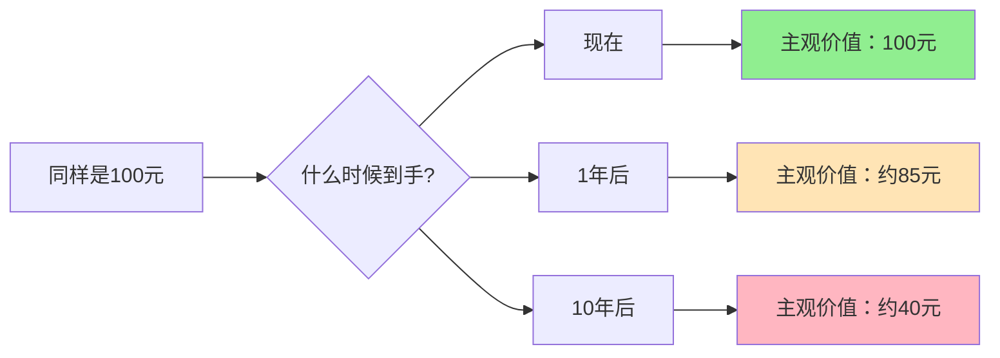

> 同样是100元，现在拿和一年后拿，差距远比你想象的大

---

## 一个让人上瘾的"数学陷阱"

2024年，拼多多推出限时补贴：**今天下单立减50元，明天恢复原价。**

大多数人会立刻下单，哪怕他们根本不急需这件商品。

为什么"今天省50元"的吸引力，远超"三个月后省50元"？

答案只有四个字：**时间偏好。**

这不是意志力问题，也不是消费观问题——它是人类大脑在漫长进化中刻入的底层程序。理解它，你才能看穿商家的定价逻辑，也才能做出真正对自己有利的决策。

---

## 什么是时间偏好？

**核心定义：** 人们天然倾向于选择"现在得到"而非"未来得到"，即使未来的回报更多。

用一个问题感受一下：

> **我给你两个选择：**
> - A：今天拿 100 元
> - B：一年后拿 120 元

理性上，B 明显更划算（相当于年化收益 20%，远超银行利率）。但大量研究显示，**超过一半的人会选 A。**

这就是时间偏好在起作用——我们的大脑会自动对"未来的钱"打折扣，让它在心理上变得不那么值钱。

### 核心概念

| 概念 | 定义 | 示例 |
| --- | --- | --- |
| **贴现（Discounting）** | 将未来价值换算成今天的主观价值 | 一年后的120元，在你心里可能只值今天的100元 |
| **贴现率（Discount Rate）** | 衡量你对未来贬值程度的比率 | 贴现率越高，未来在你眼中越不值钱 |
| **时间偏好率** | 你有多强烈地想"现在就得到" | 高时间偏好 = 及时行乐；低时间偏好 = 延迟满足 |

> **关键洞见：** 时间偏好不是坏习惯，而是一种理性策略的遗留——在食物可能腐烂、明天充满不确定的远古环境中，"现在就拿"确实是最优解。只是这个本能在现代金融世界里，开始让我们付出代价。

---

## 为什么我们天生"重今轻远"？

### 1. 即时满足偏好（Present Bias）

大脑的奖励回路对"立即得到"的反应，远强于"以后得到"。功能性核磁共振研究发现，当我们面对即时奖励时，负责情绪的边缘系统会率先激活；而面对未来奖励，则主要由理性的前额叶皮层处理。

简单说：**现在的诱惑是情绪在说话，未来的收益是理性在计算。情绪往往跑得更快。**

### 2. 未来不确定性（Future Uncertainty）

"明年的120元"有一个隐含前提——你得活到明年，那笔钱得真实兑现。不确定性本身就是一种成本。在潜意识层面，大脑会自动对"未来"打一个"风险折扣"。

### 3. 耐心是一种消耗品（Ego Depletion）

等待不是免费的。心理学研究显示，自我控制依赖有限的认知资源。一个人在工作中做了一天艰难决策，傍晚刷购物车时往往更容易冲动消费。**耐心会随时间耗尽。**

---

## 商家如何用时间偏好赚钱

### 案例一：拼多多"百亿补贴"的时间游戏

| 补贴形式 | 时间特征 | 消费者心理 |
| --- | --- | --- |
| 限时秒杀 | 即时满足 + 损失紧迫感 | "抢到就是赚到，错过就是亏" |
| 每日签到 | 持续的小额即时回报 | "每天都有小确幸" |
| 百亿补贴 | 把长期优惠包装成即时锁定 | "现在加购，随时都是最低价" |

**关键机制：** 拼多多深谙一个道理——同样是"优惠50元"，**今天就能省**的感知价值，是"下个月省"的三到五倍。它不降价，它只是把价值压缩到"现在"这个时间点上。

数据佐证：拼多多"百亿补贴"上线三个月，用户数从4亿增至6亿；补贴商品转化率是普通商品的3至5倍（来源：拼多多2024年Q3财报）。

---

### 案例二：Costco会员制的"沉没成本+即时获得感"组合拳

Costco的299元年费，表面看是时间偏好的应用，实质上是两种心理机制的叠加：

**第一层：沉没成本驱动。** 钱已经付了，大脑会产生"必须把它赚回来"的冲动，驱使你频繁消费。

**第二层：即时获得感强化。** 每次结账看到"会员价节省XXX元"的小票，给你一次即时的"赚到了"快感——这是对贴现心理的反向利用：把"长期的省钱"拆解成每次购物的即时奖励。

结果是：Costco全球会员续费率超过90%，会员年均消费额是非会员的两到三倍，会员费收入占总利润70%以上（来源：Costco 2023年报）。

---

### 案例三：养老金为什么总是存不够？

中国社科院数据显示，超过60%的年轻人没有养老储蓄计划。这不是因为他们不知道养老的重要性，而是**时间偏好让"30年后的自己"在心理账户中几乎没有重量。**

| 年龄段 | 即时消费倾向 | 典型心理 |
| --- | --- | --- |
| 25—30岁 | 极高 | "退休太遥远，先把当下过好" |
| 35—40岁 | 中等 | "开始焦虑，但月光惯了改不掉" |
| 50岁以上 | 较低 | "后悔当初没存钱" |

**核心问题不是"不想存"，而是现在消费100元的快感，大脑对它的估值，远超30年后养老账户里100元的价值。**

解决方案反而简单粗暴：**自动扣款，绕过大脑的即时判断。** 研究显示，采用自动扣款的养老储蓄计划，参与率从30%跃升至80%。行为经济学家理查德·塞勒（Richard Thaler）提出的"助推"（Nudge）理论被英国养老金改革采用后，储蓄率提升了15个百分点。

---

## 识别你自己的时间偏好类型

**一道测试题：**

> 你愿意今天拿100元，还是一年后拿多少元才会让你选择等待？

| 你的答案 | 说明的问题 |
| --- | --- |
| 100元（就要现在的） | 贴现率极高，时间偏好强烈 |
| 110—130元才愿意等 | 贴现率适中，属于平衡型 |
| 150元以上才愿意等 | 贴现率偏高，需要高额补偿才愿意延迟 |
| 105元就够了 | 贴现率很低，延迟满足能力强 |

没有绝对的对错。**问题在于：你的时间偏好是否与你的人生目标相匹配。**

---

## 如何与自己的时间偏好"谈判"

时间偏好是本能，试图用意志力硬刚它几乎注定失败。更聪明的做法是**设计系统，绕过本能**。

### 策略一：预先承诺（Pre-commitment）

在理性清醒时给未来的自己设置约束。

- 工资发放日自动转入储蓄账户，余额才是"可花的钱"
- 把健身卡放在公司而不是家里，增加"不去"的摩擦成本
- 公开宣布目标，利用社会压力替代意志力

### 策略二：把未来奖励即时化

大脑不在乎"未来的100元"，但它在乎"现在的感受"。

- 完成每周存款目标后立刻给自己一个小奖励
- 用可视化图表追踪进度，让"未来的钱"变成"今天的成就感"
- 把"退休后的生活"具象化——不是抽象数字，而是具体的画面和计划

### 策略三：提高"即时消费"的摩擦成本

- 冲动购物设置24小时冷静期
- 信用卡额度设低，取现需要额外操作
- 删除购物App，让"下单"多走两步

---

## 时间偏好与财富积累的真相

这里有一个残酷的事实：

**长期来看，低时间偏好率是财富积累最底层的变量之一。**

沃伦·巴菲特曾说，他的成功60%来自"足够早开始"——复利的本质，是时间在帮低时间偏好的人工作。

研究显示，频繁交易的投资者年化收益比市场平均低2—3个百分点；坚持定投10年以上的投资者，正收益概率超过90%（来源：Barberis & Thaler, 2003）。

差距不在于谁更聪明，而在于谁更愿意等待。

---

## 延伸思考

**24期免息分期是如何放大你的时间偏好的？** 分期付款把大额即时痛苦分散成小额延期痛苦，实质上降低了大脑对"总价"的感知，让你为同一件商品付出更高的实际成本。

**为什么我们都知道运动、早睡有益，却总是"从明天开始"？** 今天运动的痛苦是即时的，健康收益是遥远的——时间偏好让你永远在"明天"的门口徘徊。

**订阅制为什么正在取代买断制？** 对消费者而言，月费把高额一次性支出变成小额持续支出，降低了即时痛感；对企业而言，订阅捆绑了你未来的时间偏好，续费惰性远强于主动购买。

---

**下期预告：** 探讨**公地悲剧**——为什么共享单车总是被破坏？为什么海洋过度捕捞愈演愈烈？当个人理性遇上集体困境，出路在哪里？

---

*数据来源：Costco 2023年报、拼多多2024年Q3财报、中国社科院《养老金发展报告》、Barberis & Thaler (2003)、Richard Thaler & Cass Sunstein《助推》*
