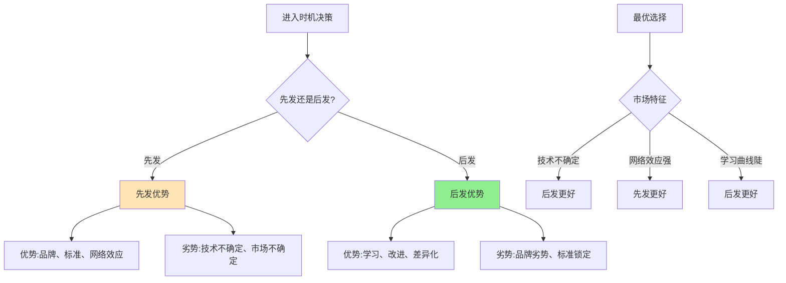

> 时机不对，一切都白费

---

**数据来源：** IDC智能手机市场份额数据（2007-2023）、字节跳动产品数据（2012-2023）、先发优势理论文献、迈克尔·波特《竞争战略》（1980）、约翰·梅纳德·凯恩斯"选美理论"（1936）
- 博弈论与时机：参考罗伯特·阿克塞尔罗德（Axelrod, 1984），《合作的演化》（The Evolution of Cooperation）

## 两个颠覆者的故事

2007年，iPhone发布，颠覆了手机行业。
2012年，今日头条上线，后来居上成为新闻霸主。
2016年，抖音上线，超越快手成为短视频王者。

**问题：** 为什么有时候先发者赢（iPhone），有时候后发者赢（字节跳动）？
**更深的问题：** 什么时候该先发，什么时候该后发？

这背后藏着经济学的一个重要概念：**先发优势与后发优势（First-Mover Advantage vs Late-Mover Advantage）**。

---

## 先发优势与后发优势

**定义：**
- **先发优势**：率先进入市场者获得的竞争优势
- **后发优势**：后进入市场者获得的竞争优势

**简单说就是：**
- 先发优势 = "第一个吃螃蟹"
- 后发优势 = "站在巨人肩膀上"



### 关键要点

**先发优势的来源：**

| 来源 | 说明 | 例子 |
|------|------|------|
| **品牌先入为主** | 消费者记住第一个品牌 | 可口可乐 |
| **标准制定** | 第一个定义标准 | USB、Wi-Fi |
| **网络效应** | 先发者积累用户 | Facebook、微信 |
| **资源占有** | 抢占稀缺资源 | 黄金地段、专利 |

**后发优势的来源：**

| 来源 | 说明 | 例子 |
|------|------|------|
| **搭便车** | 利用先发者教育市场 | 抖音借鉴Musical.ly |
| **避免错误** | 从先发者错误中学习 | Android从iPhone错误中学习 |
| **技术跨越** | 跳过先发者技术 | 中国直接到移动支付，跳过信用卡 |
| **差异化** | 针对先发者弱点定位 | 拼多多下沉市场 |

**学习曲线：**

```
单位成本
  |
  |    ___
  |   /   \
  |  /     \
  | /       \
  |/         \
  +-------------------  累计产量
   陡峭的学习曲线   平缓的学习曲线

陡峭 → 后发优势大
平缓 → 先发优势大
```

**历史小知识：** 先发优势的概念源于20世纪70年代的战略管理研究。后来，学者发现后发优势同样重要——关键在于"最优进入时机"而非"先发/后发"。

---

### 为什么时机如此重要？

**先发的风险：**

| 风险 | 说明 |
|------|------|
| **技术风险** | 技术可能不成熟 |
| **市场风险** | 市场可能不存在 |
| **资本风险** | 需要巨额投入 |
| **"靶子"风险** | 成为后发者的目标 |

**后发的风险：**

| 风险 | 说明 |
|------|------|
| **市场被占领** | 先发者已建立壁垒 |
| **标准锁定** | 先发者成为标准 |
| **品牌劣势** | 消费者认知已形成 |
| **资源受限** | 最好资源已被抢占 |

---

## 先发与后发的真实案例

### iPhone：先发优势的典范

**背景：** 为什么iPhone能颠覆手机行业？

**iPhone发布前（2007）的市场格局：**

| 品牌 | 市场份额 | 特点 |
|------|----------|------|
| Nokia | ~40% | 功能机王者 |
| Motorola | ~20% | 经典设计 |
| Samsung | ~15% | 跟随者 |
| BlackBerry | ~10% | 商务人士 |
| **智能手机** | **<5%** | **Palm、Win CE（复杂难用）** |

**iPhone的先发优势：**

| 优势 | 说明 |
|------|------|
| **重新定义品类** | "手机+iPod+互联网 communicator" |
| **触摸屏革命** | 多点触摸，物理键盘消失 |
| **App Store模式** | 重新定义"手机=电脑" |
| **品牌光环** | 苹果品牌延伸 |

**先发者的"靶子"风险：**

| 后发者 | 策略 | 结果 |
|--------|------|------|
| **Android** | 开源、多厂商 | 成功（市场份额超过） |
| **Samsung** | 大屏、差异化 | 成功（一度超越） |
| **小米** | 互联网手机、性价比 | 成功（中国） |

**数据支撑：**

| 年份 | iPhone市场份额 | 智能手机整体市场份额 |
|------|----------------|----------------------|
| 2007 | <1% | <1% |
| 2010 | ~15% | ~25% |
| 2015 | ~15% | ~85% |
| 2023 | ~20% | ~85% |

**关键洞察：**
> iPhone的先发优势不是"第一个智能手机"，而是**第一个定义智能手机**：
> - Nokia、BlackBerry早有智能手机，但复杂难用
> - iPhone不是技术先发，而是**体验/概念先发**
> - iPhone创造了新的品类（"现代智能手机"），而非改进现有品类
> **但这也有"靶子"风险**：Android通过"开源+多厂商"策略，最终在市场份额上超越。**先发优势不等于"永久优势"**——关键是在先发后，持续创新并建立护城河。

---

### 字节跳动：后发制人的大师

**背景：** 为什么字节跳动总能后来居上？

**字节跳动的产品矩阵：**

| 产品 | 上线时间 | 当时竞争对手 | 结果 |
|------|----------|--------------|------|
| **今日头条** | 2012 | 百度新闻、腾讯新闻 | 第一 |
| **抖音** | 2016 | Musical.ly、快手 | 第一 |
| **西瓜视频** | 2016 | 优酷、爱奇艺 | 第二 |
| **飞书** | 2019 | 钉钉、企业微信 | 追赶中 |

**今日头条的后发策略：**

| 策略 | 说明 |
|------|------|
| **算法推荐** | 传统新闻是编辑推荐，头条用算法 |
| **个性化** | 每个人看到的内容不同 |
| **内容生态** | 创造者激励机制，内容爆炸 |
| **下沉市场** | 三四线城市用户 |

**抖音的后发策略：**

| 策略 | 说明 |
|------|------|
| **降低创作门槛** | 模板、音乐、滤镜，人人可创作 |
| **全屏沉浸** | 更强的沉浸式体验 |
| **算法推荐** | 不是关注关系，而是内容质量 |
| **国际化** | TikTok直接全球化 |

**数据支撑：**

| 产品 | 字节跳动市场份额 | 最大对手 |
|------|------------------|----------|
| 今日头条 | ~30% | 百度新闻、腾讯新闻 |
| 抖音 | ~50% | 快手 |
| TikTok | 全球第一 | Meta Reels、YouTube Shorts |

**关键洞察：**
> 字节跳动的后发优势不是"跟随"，而是**差异化+技术超越**：
> - **今日头条**：不是"更好的新闻客户端"，而是"完全不同的模式"（算法推荐）
> - **抖音**：不是"更好的短视频APP"，而是"重新定义短视频创作"（模板+音乐+滤镜）
> **字节跳动的后发优势本质是"学习曲线"**：
> - 等待市场教育（用户接受短视频）
> - 学习对手优缺点（Musical.ly、快手）
> - 技术超越（算法、AI、大数据）
> - **后发者如果能"技术超越"或"模式创新"，后发可以成为优势**。

---

## 如何选择时机？

### 先发时机

| 适合先发的市场特征 | 原因 |
|---------------------|------|
| **网络效应强** | 先发者锁定用户 |
| **学习曲线平缓** | 后发者难以追赶 |
| **标准制定重要** | 先发者成为标准 |
| **专利保护强** | 先发者获得专利 |

### 后发时机

| 适合后发的市场特征 | 原因 |
|---------------------|------|
| **技术不确定** | 等技术成熟 |
| **市场不确定** | 等市场验证 |
| **学习曲线陡峭** | 后发者学习更快 |
| **消费者教育完成** | 后发者搭便车 |

### 决策框架

**步骤1：评估市场不确定性**

| 不确定性类型 | 高 | 低 |
|--------------|-----|-----|
| **技术** | 等技术成熟 | 可以先发 |
| **市场** | 等市场验证 | 可以先发 |
| **竞争** | 等策略清晰 | 可以先发 |

**步骤2：评估网络效应**

| 网络效应强度 | 后发成本 | 建议 |
|--------------|----------|------|
| **极强** | 极高 | 先发 |
| **中等** | 中等 | 视情况 |
| **弱或无** | 低 | 后发可接受 |

**步骤3：评估学习曲线**

| 学习曲线 | 后发优势 | 建议 |
|----------|----------|------|
| **陡峭** | 大 | 后发更好 |
| **平缓** | 小 | 先发更好 |

---

## 应用与决策

### 企业战略

| 情况 | 建议 |
|------|------|
| **新市场、高不确定性** | 等待，后发 |
| **网络效应强** | 先发，抢占市场 |
| **学习曲线陡** | 后发，学习后超越 |
| **专利保护重要** | 先发，申请专利 |

### 个人职业

| 选择 | 建议 |
|------|------|
| **新兴行业** | 先发者风险高、回报可能高 |
| **成熟行业** | 后发者可以差异化 |
| **快速变化行业** | 持续学习，保持"后发优势" |

---

### 常见误区

| 误区 | 正解 |
|------|------|
| "先发总是好的" | 先发风险高，失败率高 |
| "后发总是安全的" | 后发可能错过机会窗口 |
| "先发=创新" | 后发也可以创新（差异化） |
| "后发=跟随" | 后发可以是超越（技术跨越） |

---

## 延伸思考

1. **中国科技的"后发优势"**：中国在许多技术上都是"跟随者"（AI、电动车、5G），但正在"超越"。这是否证明了后发优势？还是有其他因素（规模、政策、文化）？

2. **AI时代的"先发优势"**：OpenAI的ChatGPT是先发者，但Google、Microsoft、百度等巨头后来跟上。在AI这个快速变化的领域，先发优势还能持续多久？

3. **Web3的"先发者诅咒"**：许多Web3项目（加密货币、NFT）都是先发者，但大多数失败了。为什么？是因为技术不确定，还是因为监管不确定，还是因为投机泡沫？

**下期预告：** 模块四完成！接下来进入**模块五：行为经济学**。我们将探讨**心理账户**——为什么双11囤货？为什么会员订阅总是自动续费？

---

**数据来源：** IDC智能手机市场份额数据（2007-2023）、字节跳动产品数据（2012-2023）、先发优势理论文献、迈克尔·波特《竞争战略》（1980）、约翰·梅纳德·凯恩斯"选美理论"（1936）
- 博弈论与时机：参考罗伯特·阿克塞尔罗德（Axelrod, 1984），《合作的演化》（The Evolution of Cooperation）
