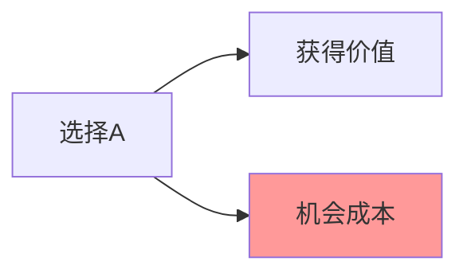

> 本规范基于2024年1月25日讨论确定，适用于系列文章的撰写和修改

---

## 一、文章结构规范

```
┌────────────────────────────────────┐
│ 1. 引入案例（生活场景/真实故事）   │
├────────────────────────────────────┤
│ 2. 核心概念讲解                    │
│    · 概念定义 + 简单理解           │
│    · Mermaid图表（可选）           │
│    · 关键要点/对比表格             │
│    · 为什么重要/容易被忽视         │
│    · 相关概念对比（如需要）         │
│    · 历史小知识（可选）            │
├────────────────────────────────────┤
│ 3. 真实案例（2个）                 │
│    · 国内/国际案例结合             │
│    · 数据支撑 + 关键洞察           │
├────────────────────────────────────┤
│ 4. 应用方法                        │
│    · 决策框架/步骤                 │
│    · 常见误区表格                  │
├────────────────────────────────────┤
│ 5. 延伸思考 + 下期预告             │
└────────────────────────────────────┘
```

### 结构原则

| ✅ 保留 | ❌ 删除 |
|--------|--------|
| 引入案例 | ❌ 3分钟精华版开头 |
| 核心概念深入讲解 | ❌ 不同场景的思考框架 |
| **2个真实案例** | ❌ "如何训练XX思维"部分 |
| 应用方法（三步法/误区/清单） | ❌ 推荐阅读 |
| 延伸思考 |  |
| 下期预告（统一用"我们来聊聊"） |  |

---

## 二、篇幅与阅读时长

| 指标 | 标准 | 说明 |
|------|------|------|
| 字数 | 2700-3000字 | 含markdown格式约4200-4500字符 |
| 阅读时长 | 5-7分钟 | 符合微信碎片化阅读黄金区间 |
| 预估完读率 | 50%+ | 超过8分钟完读率显著下降 |

---

## 三、语气风格：直接清晰

### 核心原则

> 文章直接讲解经济学原理，使用清晰明确的表达

### 标准用词

| 标准表达 | 说明 |
|----------|------|
| "简单说就是" | 概念通俗化解释 |
| "黄金法则" | 核心原则 |
| "关键要点" | 重要内容提炼 |
| "关键洞察" | 案例的核心发现 |
| "常见误区" | 易犯的错误 |
| "这背后藏着..." | 引出原理 |
| "致命特点" | 强调重要性 |
| "心理学解释" | 心理学层面分析 |
| "举个直观的例子" | 举例说明 |
| "如何应用这个原理" | 实践指导 |

### 标准表达模板

| 原逻辑 | 标准表达 |
|--------|----------|
| 机会成本是次优选择的价值 | （保持原表述，这是定义） |
| 决策时不应考虑沉没成本 | 沉没成本：已经发生且无法收回的成本，决策时**不应**考虑 |
| 必须考虑机会成本 | **必须考虑**机会成本 |
| 不要被"非此即彼"限制 | 不要被"非此即彼"限制 |
| 考研的机会成本不是学费 | 考研的机会成本不是学费 |

---

## 四、用词原则

### ✅ 使用 | 说明
| 直接明确 | 用"必须"、"应该"等明确词汇 |
| 逻辑清晰 | 经济学原理的核心逻辑清晰 |
| 专业术语 | 保留专业术语并通俗解释 |

### ❌ 避免 | 说明
| 过度探讨式 | 避免过度使用"或许"、"可能" |
| 模糊表达 | 避免表述含糊不清 |
| 教导式语气 | 避免居高临下的说教 |

---

## 五、段落与格式

### 段落原则

| 原则 | 说明 |
|------|------|
| 层层递进 | 从场景→概念→案例→应用，逐渐深入 |
| 段落简短 | 每个段落控制在3-5行，适合手机阅读 |
| 视觉化 | 使用表格、Mermaid图表、分隔线等 |

### 标题层级

```markdown
# 文章标题（问题式）
> 金句引用

## 一级标题
### 二级标题
**加粗强调**
> 引用/洞察
```

---

## 六、案例使用规范

### 案例部分标题

| 位置 | 格式 | 示例 |
|------|------|------|
| 案例章节标题 | `## [主题]如何影响决策` | `## 机会成本如何影响决策` |
| 子案例标题 | `### [案例标题]` | `### 考研 vs 工作的算账` |

**禁止使用的固定文案：**
- ❌ `## 真实案例：...`
- ❌ `### 案例一：...`
- ❌ `### 案例二：...`

### 案例数量

| 规则 | 数量 |
|------|------|
| **固定数量** | **2个** |
| 说明 | 删除第3个案例，保持精简 |

### 案例结构

```
**背景：** 简要交代

**分析/算账：** 数据支撑

**结果：** 实际效果

**关键洞察/启示：** 核心发现
```

### 案例来源

| 来源 | 比例 | 示例 |
|------|------|------|
| 国内案例 | ~50% | 考研、996、阿里腾讯 |
| 国际案例 | ~40% | Netflix、Amazon、Google |
| 中外对比 | ~10% | 同一主题并置分析 |

---

## 七、应用方法部分规范

### 应用部分标题

| 格式 | 示例 |
|------|------|
| `## 如何用[思维]改善决策？` | `## 如何用机会成本思维改善决策？` |
| `## 如何用[思维]改善决策？` | `## 如何用边际思维改善决策？` |
| `## 如何用[思维]改善决策？` | `## 如何用激励思维改善决策？` |

**禁止使用的固定文案：**
- ❌ `## 如何应用这个原理`
- ❌ `## 如何在工作和生活中应用这个原理`

### 1. 决策框架/步骤

```
**步骤X：标题**
- 要点1
- 要点2
```

### 2. 常见误区表格

| 误区 | 正解 |
|------|------|
| ... | ... |

### 3. 决策总结

- 要点1
- 要点2

---

## 八、结尾规范

### 延伸思考

1. **开放性问题1**
2. 开放性问题2
3. 开放性问题3

### 下期预告（固定格式）

```
**下期预告：** 我们来探讨**下一期主题**——简短吸引人的描述
```

**格式注意：** 加粗文本后不能加引号，正确格式为 `**下一期主题**` 而非 `**"下一期主题"**`

---

### 数据来源

```
**数据来源：** 来源1、来源2、来源3
```

### 作者注（固定格式）

已删除，不使用作者注。

---

## 九、Mermaid图表使用

### 适用场景

| 图表类型 | 使用场景 |
|----------|----------|
| graph LR | 概念关系、流程展示 |
| graph TD | 树状结构、分类展示 |

### 图表处理

| 步骤 | 说明 |
|------|------|
| 1. 文章中保留 Mermaid 代码 | 用于编辑和版本管理 |
| 2. 通过技能转换为图片 | 自动化处理，发布到公众号 |
| 3. 图片保存到 images/ 目录 | 按文章命名，如 `01-机会成本-图表.png` |

### 示例



---

## 十、修改检查清单

修改文章时，检查以下项目：

- [ ] 字数控制在2700-3000字
- [ ] 阅读时长5-7分钟
- [ ] 案例**固定为2个**
- [ ] 没有"3分钟精华版"开头
- [ ] 没有"推荐阅读"部分
- [ ] 没有"不同场景的思考框架"
- [ ] 没有"如何训练XX思维"部分
- [ ] 下期预告使用"我们来探讨"而非"聊聊"
- [ ] 加粗文本后不添加引号，如 `**主题名称**` 而非 `**"主题名称"**`
- [ ] CommonMark 加粗语法：** 右侧不能紧跟标点符号（全角括号（）、全角引号""、全角顿号、句号、逗号等）
- [ ] 删除"决策检查清单"部分
- [ ] 核心概念章节直接以小段标题开始，不用"核心概念："前缀
- [ ] 保持经济学原理的核心逻辑不变
- [ ] 段落简短，适合手机阅读
- [ ] 有表格、Mermaid图表等视觉化元素

---

## 十一、禁止事项

| ❌ 禁止 | 说明 |
|--------|------|
| 开头加精华版 | 打破层层递进结构 |
| 结尾加推荐阅读 | 增加篇幅，读者不关心 |
| 案例超过2个 | 保持精简 |
| 过度理论化 | 保持通俗，面向非专业读者 |
| 绝对化表述 | 经济学是社会科学，没有绝对 |

---

## 十二、CommonMark 加粗语法规范

### 规则说明

CommonMark 规范要求 `**` 结束时，其右侧不能紧跟标点符号，否则解析器会认为这个 `**` 不是有效的结束标记。

**被视为标点的字符：**
- 全角括号：（）、【】、〔〕、［］、｛｝
- 全角引号："", '', 『』, 「」
- 全角顿号、句号、逗号、分号、冒号
- 其他全角标点符号

**正确示例：**
- ✅ `**文本**（解释）` - 加粗后有空格再接括号
- ✅ `**核心要点**是...` - 加粗后有空格再接文字
- ✅ `**文本**。` - 加粗后有空格再接句号

**错误示例：**
- ❌ `**文本**（` - 右括号紧跟 ** 导致解析失败
- ❌ `**文本**（` - 全角括号紧跟
- ❌ `**"文本"**` - 引号紧跟

### 解决方案

1. **加粗后加空格**：在 `**` 结束后加一个空格再接标点
2. **使用英文标点**：使用英文半角括号 () 代替全角括号（）
3. **调整语序**：将标点移到加粗内容之前

---

## 十三、固定格式汇总

### 必须使用的固定表达

| 位置 | 固定表达 |
|------|----------|
| 下期预告开头 | **下期预告：** 我们来探讨 |
| 案例数量 | 固定2个 |
| 案例洞察标题 | **关键洞察** 或 **启示** |
| 加粗格式 | `**文本**` 而非 `**"文本"**` |
| CommonMark 加粗 | ** 结束右侧不能紧跟标点符号，如 `**文本**（` 而非 `**文本**（` |
| 核心概念章节 | 直接以小段标题开始，不用"核心概念："前缀 |

### 标题格式规范（2025年1月31日更新）

| 位置 | 格式 | 禁止使用 |
|------|------|----------|
| 案例章节标题 | `## [主题]如何影响决策` | `## 真实案例：...` |
| 子案例标题 | `### [案例标题]` | `### 案例一：...`、`### 案例二：...` |
| 应用部分标题 | `## 如何用[思维]改善决策？` | `## 如何应用这个原理`、`## 如何在工作和生活中应用这个原理` |

**禁止使用任何固定的章节前缀或标记用语，包括但不限于：**
- ❌ "案例一"、"案例二"、"案例三" 等编号
- ❌ "真实案例：" 前缀
- ❌ "以下案例说明..." 等引导语
- ❌ "核心概念：" 前缀
- ❌ "概念讲解：" 前缀
- ✅ 只需使用简洁的内容标题即可（如直接使用 `## 什么是边际思维？`）

---

**规范版本：** v2.5
**最后更新：** 2026年2月28日
**适用范围：** 《生活中的经济学原理》系列文章
