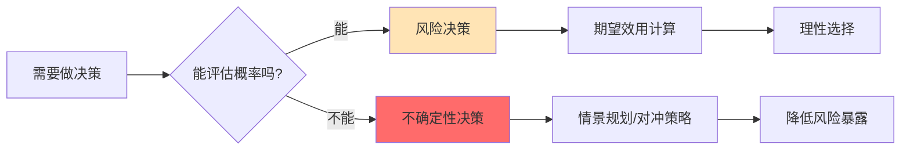
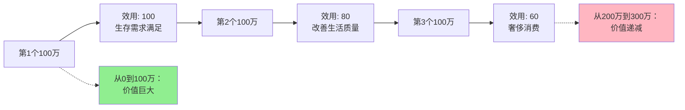

> 人生就是在风险与收益之间寻找平衡

---

## 30岁高管的人生十字路口

老林是一家互联网大厂的技术总监，年薪150万，股票价值500万。

30岁这年，他收到一个创业邀请：前同事邀请他联合创业，给他20%股权，但需要All-in投入，至少两年无收入。

身边的朋友分成两派：

**保守派**说："你现在多稳定，创业九死一生，别冒险了。"
**激进派**说："30岁还不拼一把，什么时候拼？富贵险中求啊！"

老林犹豫了很久：**一边是确定的稳定生活，一边是可能改变人生的机会——到底该怎么选？**

这背后藏着一个经济学核心问题：**如何理性地面对风险与不确定性？**

---

## 风险 vs 不确定性

**定义：**

| 类型 | 定义 | 特点 | 可计算概率 |
|------|------|------|------------|
| **风险**（Risk） | 知道可能的结果，且能估算概率 | 可量化、可管理 | ✅ 可以 |
| **不确定性**（Uncertainty） | 结果未知，概率也无法估算 | 不可量化、难预测 | ❌ 不能 |

**简单说就是：**
- **风险** = 知道骰子有6个面，每个面1/6概率
- **不确定性** = 不知道骰子有几个面，甚至不知道是不是骰子



### 关键要点

**1. 期望效用理论**

> 理性人不仅看期望收益，更看**期望效用**（Expected Utility）

**期望效用 = 各种结果的发生概率 × 该结果带来的效用之和**

**2. 风险溢价（Risk Premium）**

> 风险厌恶者需要"额外补偿"才愿意承担风险

**公式：** 风险溢价 = 无风险收益 - 风险投资的期望收益

**3. 风险态度的三种类型**

| 类型 | 特征 | 决策倾向 | 典型人群 |
|------|------|----------|----------|
| 风险厌恶 | 效用函数凹形，边际效用递减 | 偏好确定收益，需要风险溢价 | 大多数人 |
| 风险中性 | 效用函数线性，只看期望值 | 只比较期望收益，不考虑风险 | 专业投资者 |
| 风险偏好 | 效用函数凸形，享受风险 | 愿意为"赌博机会"付费 | 赌徒、部分创业者 |

---

### 为什么大多数人选择稳定？

**经济学解释：边际效用递减**



**失去的痛苦 > 得到的快乐**

- 从年薪50万到100万：效用提升巨大
- 从年薪200万到300万：效用提升有限
- **但如果从200万跌回100万，痛苦感却非常强烈**

**心理学解释：损失厌恶**

- 获得100万的快乐 < 失去100万的痛苦
- 稳定的150万 > 50%概率获得300万（期望值150万）

**历史小知识：** 1738年，丹尼尔·伯努利（Daniel Bernoulli）在《圣彼得堡科学院院刊》上发表论文《Exposition of a New Theory on the Measurement of Risk》（《风险度量新理论的阐述》），提出期望效用理论，解决了"圣彼得堡悖论"——为什么人们不愿花高价玩一个期望收益无限的赌局。

---

## 风险与不确定性如何影响决策

### VC的投资艺术：在不确定性中下注

**背景：** 硅谷顶级VC机构a16z的投资哲学——在高度不确定性中寻找超额回报。

**VC投资的真实数据：**

| 投资结果 | 占比 | 回报倍数 | 对整体收益的贡献 |
|----------|------|----------|------------------|
| 彻底失败 | 60% | 0x | 0% |
| 打平或小赚 | 30% | 1-3x | 10% |
| 成功 | 8% | 5-10x | 20% |
| **超级独角兽** | **2%** | **50-100x+** | **70%** |

根据PitchBook（2023）《全球风险投资报告》数据

**VC的决策逻辑：**

1. **不是"看对概率"，而是"看对赔率"**
   - 成功率可能只有10%
   - 但如果成功，回报是100倍
   - **期望收益 = 10% × 100x = 10x**

2. **投资组合思维**
   - 单个项目风险极高
   - 但20个项目的组合，整体风险可控
   - **只需要1个超级独角兽，就能覆盖所有失败成本**

3. **不对称信息的优势**
   - VC通过行业研究、人脉网络、尽调
   - 比普通创业者更了解行业趋势
   - **将"不确定性"转化为"可计算的风险"**

**关键洞察：**
> VC不是赌徒，而是精算师。他们在不确定性中寻找概率优势，通过投资组合分散风险，最终获得超额回报。普通人学VC，不是学"冒险"，而是学"如何管理不确定性"。

---

### 创业者All-in：勇敢还是鲁莽？

**背景：** 2023年，某大厂高管老张辞职创业，卖掉股票、房子All-in，加入一家AI创业公司。

**老张的算账：**

| 选项 | 确定收益 | 风险/机会 | 期望收益（主观估算） |
|------|----------|-----------|---------------------|
| 留在大厂 | 年薪200万稳定 | 职业天花板可见 | 200万/年 × 10年 = 2000万 |
| 创业All-in | 前2年0收入 | 80%失败，20%成功上市 | 20% × 1亿股权 = 2000万 |

**表面上看期望收益相同，但忽略了什么？**

1. **时间价值**
   - 创业成功需要5-10年
   - 未来的1亿 ≠ 现在的2000万

2. **风险厌恶成本**
   - 创业失败的代价不是"0收入"
   - 而是"失去职业竞争力"、"重新开始的成本"

3. **不确定性溢价**
   - VC分散投资20个项目，只需1个成功
   - 创业者只有1个项目，失败就是100%损失

**理性决策框架：**

| 问题 | 理性思考 |
|------|----------|
| 我的"风险承受能力"如何？ | 失败后能否接受最坏结果？ |
| 我有"信息优势"吗？ | 我是否比市场更了解这个领域？ |
| 我的"机会成本"是多少？ | 留在大厂10年能赚多少？ |
| 失败的"下行风险"是什么？ | 最坏情况是什么？能否承受？ |

**关键洞察：**
> 创业All-in不是"勇敢"，而是需要精确计算。问问自己：如果失败了，我能不能接受？如果答案是否定的，那不叫创业，叫赌博。

---

## 如何在不确定性中做出理性决策？

### 决策三步法

**步骤1：区分风险 vs 不确定性**

| 问题 | 风险 | 不确定性 |
|------|------|----------|
| 你知道可能的结果吗？ | ✅ 知道 | ❌ 不知道 |
| 你能估算概率吗？ | ✅ 能 | ❌ 不能 |
| 决策方法 | 期望效用计算 | 情景规划、对冲 |

**步骤2：评估你的风险承受能力**

关键问题：**我能承受的最坏结果是什么？**

| 风险承受能力 | 特征 | 决策建议 |
|--------------|------|----------|
| 低 | 有家庭负担、贷款压力、年龄较大 | 偏好稳定，避免All-in |
| 中 | 有一定积蓄、年轻、可重新开始 | 可适度承担风险 |
| 高 | 单身、积蓄充足、有退路 | 可考虑高风险机会 |

**步骤3：用期望效用做决策**

**公式：**
```
期望效用 = P(成功) × 效用(成功收益) + P(失败) × 效用(失败损失)
```

**举例：**
- 创业成功（20%概率）→ 获得1000万
- 创业失败（80%概率）→ 损失2年收入（100万）

如果你是风险厌恶者：
- 效用(1000万) = 500单位
- 效用(-100万) = -200单位
- **期望效用 = 0.2 × 500 + 0.8 × (-200) = -60 < 0**
- **结论：不创业**

---

### 常见误区

| 误区 | 正解 |
|------|------|
| "高风险=高收益" | 高风险需要**风险溢价**补偿，否则不值得 |
| "年轻就该冒险" | 冒险需要计算，不是盲目All-in |
| "富贵险中求" | 险中求的是**不确定性中的机会**，不是赌博 |
| "不创业就是没追求" | 稳定工作也可以通过投资参与高风险机会 |
| "失败了还能重来" | 失败有**隐性成本**：时间、机会、心理创伤 |

---

## 延伸思考

1. **职业选择的风险管理**：如果你渴望创业但又害怕风险，有没有"中间道路"？比如：先在业余时间试水、先加入创业公司积累经验、用小比例资金投资朋友创业？

2. **投资中的不确定性**：2020年疫情期间，有人All-in特斯拉赚了10倍，有人All-in加密货币归零。这两者的"不确定性"有何不同？如何区分"聪明的冒险"和"愚蠢的赌博"？

3. **人生的非财务风险**：稳定工作可能带来"职业停滞风险"，创业可能带来"财务崩溃风险"。哪种风险更可怕？如何平衡？

**下期预告：** 我们来探讨**比较优势与专业化**——为什么"全能型"人才反而不如"专才"？中国制造vs德国制造，背后的经济学逻辑是什么？

---

**数据来源：** PitchBook《全球风险投资报告》（2023）、创业公司存活率研究（Harvard Business Review, 2022）、行为经济学实验（Kahneman & Tversky, 1979）
