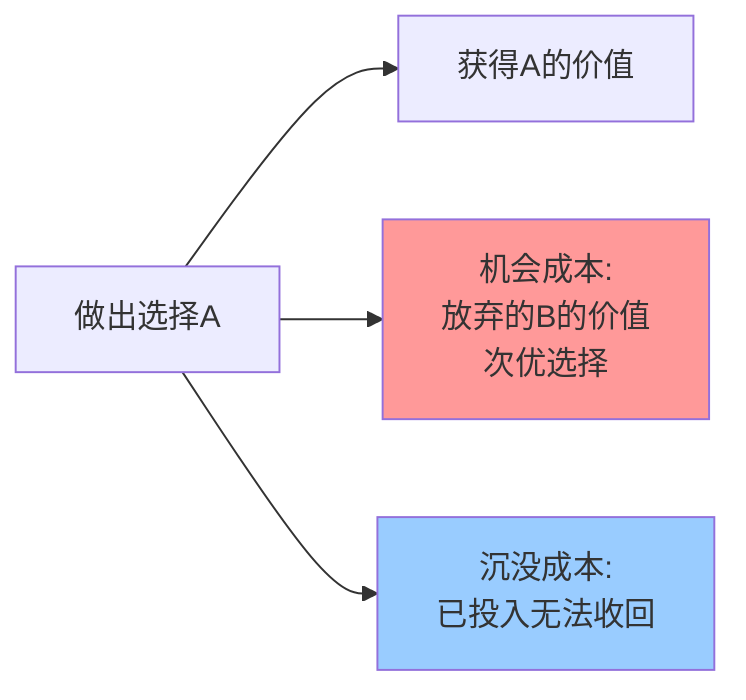

> 每一个选择背后，都隐藏着你放弃的另一种可能

---

## 毕业季的永恒难题

每年毕业季，数百万毕业生都面临同一个选择题：考研、考公，还是工作？

小王选了考研，放弃了字节跳动的offer——月薪2万，期权激励。一年后考研失利，重新求职时发现同样的岗位薪资降了40%。

小李选了工作，三年后年薪50万。但看着当年考研成功的同学进了阿里P7年薪百万，她开始怀疑：**如果当年我也考研，现在会不会更好？**

**为什么无论怎么选，我们总觉得选错了？**

这背后藏着一个经济学核心原理：**机会成本（Opportunity Cost）**。

---

## 什么是机会成本？

**定义：** 做出选择时，所放弃的其他选择中**价值最高的那个**。

**简单说就是：** 你得到一样东西的成本，是你为了它所放弃的一切。



### 三个关键要点

**1. 机会成本是次优选择的价值，不是所有放弃的总和**
- 选择了A，放弃了B、C、D
- 机会成本 = B的价值（次优选择）
- C和D的价值不算在内

**2. 显性成本 vs 隐性成本**
- 显性成本：实际支付的金钱（学费、房租）
- 隐性成本：时间、精力的机会成本

**3. 忽略沉没成本**
- 沉没成本：已经发生且无法收回的成本
- 决策时**不应**考虑沉没成本

---

### 为什么机会成本容易被忽视？

机会成本有一个致命特点：**它是"看不见"的**。

| 成本类型 | 特点 | 我们如何对待 |
|----------|------|--------------|
| 显性成本 | 看得见、可量化 | 高度重视 |
| 隐性成本 | 看不见、难量化 | 容易忽视 |
| **机会成本** | **完全看不见** | **几乎总是被忽略** |

**心理学解释：**

1. **可见性偏差**：我们更容易注意到"实际支付的"，而不是"可能得到的"
2. **损失厌恶**：放弃选项的"痛苦感"，往往小于直接支付的"痛苦感"

**举个直观的例子：**
- 花100元买电影票，电影烂透了 → 你会心疼那100元
- 有免费电影票，但放弃了朋友请的100元饭局 → 你几乎不觉得损失

经济学损失都是100元，但前者让你痛，后者你却毫无感觉。

---

### 机会成本 vs 沉没成本

这两个概念经常被混淆，但它们的决策指导完全相反：

| 维度 | 机会成本 | 沉没成本 |
|------|----------|----------|
| 定义 | 放弃的次优选择的价值 | 已发生且无法收回的成本 |
| 时间指向 | **向前看**（未来） | **向后看**（过去） |
| 决策作用 | **必须考虑** | **应该忽略** |

**考研失败的决策：**
```
❌ 沉没成本思维："都考了3年了，放弃太可惜" → 继续考第4年
✅ 机会成本思维："再考1年 = 放弃1年工作经验+30万收入" → 重新评估
```

**历史小知识：** 奥地利经济学家弗里德里希·冯·维塞尔在1914年系统提出这个概念。

---

## 机会成本如何影响决策

### 考研 vs 工作的算账

**背景：** 2024年考研报名438万人，录取约130万，300多万人落榜。同期互联网大厂校招年薪30-50万。

**算笔账：**

| 选择 | 获得收益 | 机会成本 | 净收益 |
|------|----------|----------|--------|
| 考研成功（3年） | 硕士学历 | 3年工作收入约100万+经验 | 需多年追平 |
| 考研失败（1年） | 无 | 1年工作收入约30万+校招机会 | 净损失30万+ |
| 直接工作 | 3年150万收入+经验 | 学历提升的长期收益 | 短期收益明确 |

**数据支撑：**
- 互联网大厂硕士起薪40-60万，本科30-45万
- 但3年工作经验的本科可达50-80万
- **考研的机会成本可能需要5-10年才能追回**

**关键洞察：**
> 考研的机会成本不是学费，而是**放弃的3年职业发展时间**和**同龄人积累的经验优势**。

---

### Netflix 豪赌《纸牌屋》

**背景：** 2011年，Netflix决定花1亿美元自制《纸牌屋》，这是首次尝试。当时核心业务是DVD租赁和流媒体授权。

**机会成本分析：**

| 选项 | 描述 |
|------|------|
| A | 花1亿美元自制《纸牌屋》 |
| B | 用1亿美元购买更多热门剧集授权 |
| C | 将1亿美元投入技术改进或市场扩张 |

**Netflix的决策逻辑：**
- 如果选择B：会受制于内容方，竞争对手也能购买
- 如果选择A：自制内容拥有独家版权，可以建立**内容护城河**

**结果：**
《纸牌屋》大获成功，Netflix市值从2013年的150亿美元增长到2023年的超过2000亿美元。

**启示：**
> Netflix不仅计算了显性成本（1亿制作费），更准确衡量了**机会成本**——如果不自制内容，长期来看会失去用户粘性和议价能力。

---

## 如何用机会成本思维改善决策？

### 决策三步法

**步骤1：列出所有选项**
不要被"非此即彼"限制。除了考研/工作，还有：工作+在职研究生、考研+实习、创业等

**步骤2：计算"全成本"**

| 成本类型 | 包含内容 |
|----------|----------|
| 显性成本 | 学费、培训费、生活成本 |
| 隐性成本 | 时间、精力、健康 |
| 机会成本 | 放弃的次优选择的价值 |

**步骤3：评估长期收益**
关键问题：**3年后、5年后、10年后，哪个选择的价值更高？**

---

### 常见误区

| 误区 | 正解 |
|------|------|
| 只看显性成本 | 加上隐性成本和机会成本 |
| 被沉没成本绑架 | 沉没成本不应影响未来决策 |
| 忽视路径依赖 | 评估具体行业的真实需求 |
| 盲目跟风 | 计算自己的机会成本 |

---

## 延伸思考

1. **延迟满足**是理性的吗？放弃高薪读MBA，5年后才能追平，划算吗？
2. 快速变化的时代，如何预测"长期收益"？3年前AI没人看好，今天成了最热方向
3. **幸福**的机会成本是什么？追求事业成功时，我们放弃了什么？

**下期预告：** 我们来探讨**边际思维与决策优化**——为什么996不一定有效？Amazon如何用边际思维定价？

---

**数据来源：** 教育部、拉勾招聘、BOSS直聘、Netflix财报
