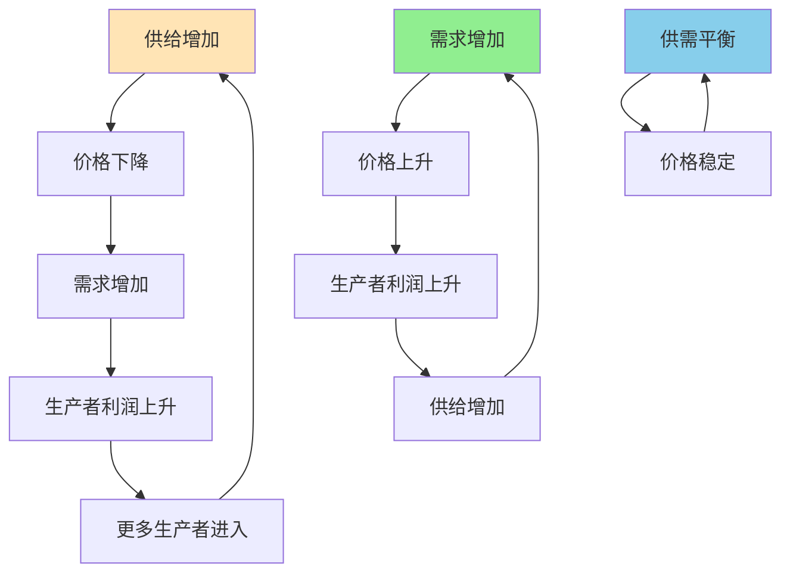

> 没有指挥家的交响乐，却比任何计划都更高效

---

## 每天上亿笔交易，谁在安排？

2024年双11，淘宝一天的交易额超过3000亿，涉及上亿买家和千万卖家。

你可能会问：
- 谁决定生产多少商品？
- 谁决定商品价格？
- 谁决定商品运往哪里？

**答案：没有人。**

没有中央指挥，没有统一调度，但数亿人的需求得到了精准满足。

**为什么没有指挥者，市场却能高效运转？**

这背后藏着一个经济学核心原理：**看不见的手（Invisible Hand）**。

---

## 什么是看不见的手？

**定义：** 价格机制在没有中央计划的情况下，自动协调供需，实现资源有效配置。

**简单说就是：** 价格像一只"看不见的手"，引导人们做出符合社会整体利益的行为。

### 关键要点

**1. 价格是信号**

| 价格变化 | 传递的信息 | 生产者的反应 | 消费者的反应 |
|----------|------------|--------------|--------------|
| 上涨 | 商品稀缺，需求旺盛 | 增加产量 | 减少购买 |
| 下跌 | 商品过剩，需求疲软 | 减少产量 | 增加购买 |

**2. 价格是激励**

| 价格水平 | 对生产者的激励 | 对消费者的激励 |
|----------|----------------|----------------|
| 高利润 | 吸引新进入者，扩大产能 | 谨慎购买，寻找替代品 |
| 低利润 | 淘汰低效生产者 | 大量购买，囤货 |

**3. 自发秩序（Spontaneous Order）**

> 没有人设计整体秩序，但每个人都追求自己的利益，最终形成了高效的秩序。

**三个机制：**

| 机制 | 功能 | 结果 |
|------|------|------|
| **价格机制** | 传递稀缺性信息 | 资源流向最需要的地方 |
| **竞争机制** | 淘汰低效者 | 整体效率提升 |
| **利润机制** | 激励创新和生产 | 持续供给增长 |

---

### 为什么看不见的手容易被忽视？

**心理学解释：**

1. **可见性偏差**
   - 我们看到的是"有形的组织"（公司、政府）
   - 看不到的是"无形的协调"（价格机制）

2. **控制幻觉**
   - 我们喜欢"有人负责"的感觉
   - 不相信"无人指挥"的系统

3. **复杂性不可理解**
   - 市场涉及亿万人的决策
   - 大脑无法理解这种复杂协调

**历史小知识：** 1776年，亚当·斯密（Adam Smith）在《国民财富的性质和原因的研究》（简称《国富论》, An Inquiry into the Nature and Causes of the Wealth of Nations）中首次提出"看不见的手"概念："由于他追求自己的利益，他经常促进了社会的利益，其效果比他真正想促进社会利益时更好。"

---

## 看不见的手如何运作

### 淘宝为什么能繁荣？

**背景：** 2003年淘宝创立时，eBay已占据中国90%的电商市场份额。但不到5年，淘宝彻底击败eBay。

**淘宝的"无为而治"：**

| 维度 | eBay模式 | 淘宝模式 |
|------|----------|----------|
| 收费模式 | 收交易佣金 + 登录费 | **全免费** |
| 价格机制 | 集中定价 | **卖家自由定价** |
| 评价机制 | 简单评分 | **详细信用体系** |
| 即时通讯 | 无 | **旺旺（买卖双方直接沟通）** |

**看不见的手如何起作用？**

**1. 价格机制自动调节供需**

**2. 信用体系解决信息不对称**

| 问题 | 传统市场 | 淘宝解决方案 |
|------|----------|--------------|
| 不知道卖家可信吗？ | 只能碰运气 | **好评率、纠纷率、退货率** |
| 不知道商品质量？ | 看了才知道 | **买家秀、详细评价、问大家** |
| 担心被骗？ | 自认倒霉 | **支付宝担保交易** |

**3. 自由进入激发竞争**

- 门槛极低：任何人都能开店
- 竞争激烈：同类商品可能有上万个卖家
- **结果：价格持续下降，质量不断提升**

**数据支撑：**

| 年份 | 淘宝GMV | 卖家数量 | 商品数量 |
|------|---------|----------|----------|
| 2003 | 10亿 | <1万 | <100万 |
| 2010 | 4000亿 | 500万 | 8亿 |
| 2023 | 8万亿 | 1000万+ | 20亿+ |

根据阿里巴巴集团《2023年财报》数据

**关键洞察：**
> 淘宝的成功不是因为"管理得好"，而是因为"管得少"。让价格自由调节，让卖家自由竞争，让买家自由选择——看不见的手比任何CEO都更聪明。

---

### 计划经济为什么失败？

**背景：** 苏联和改革开放前的中国，都尝试过中央计划经济。

**计划经济的逻辑：**

| 问题 | 计划经济的回答 |
|------|----------------|
| 生产什么？ | 中央计划委员会决定 |
| 生产多少？ | 根据"需求预测"制定配额 |
| 价格多少？ | 政府统一定价 |
| 谁来生产？ | 国有企业垄断生产 |

**为什么失败了？**

**1. 信息问题（Information Problem）**

| 信息类型 | 市场如何获取 | 计划经济如何获取 |
|----------|--------------|------------------|
| 消费者偏好 | 价格实时反映 | 依靠过时的统计报告 |
| 资源稀缺性 | 价格实时反映 | 依靠行政指令 |
| 技术创新 | 市场竞争激励 | 依靠官僚审批 |

**2. 激励问题（Incentive Problem）**

| 主体 | 市场经济中 | 计划经济中 |
|------|------------|------------|
| 企业家 | 利润激励创新 | 完成配额即可 |
| 工人 | 效率决定收入 | 大锅饭、铁饭碗 |
| 消费者 | 用钱投票 | 被动接受配给 |

**3. 计算问题（Calculation Problem）**

**市场经济：**
- 亿万个体独立决策
- 价格汇总所有信息
- **复杂度：分布式，自动优化**

**计划经济：**
- 需要中央处理所有信息
- 无法计算合理的相对价格
- **复杂度：集中式，无法计算**

**数据对比：**

| 指标 | 中国（1978，计划经济） | 中国（2023，市场经济） |
|------|------------------------|------------------------|
| 人均GDP | 156美元 | 12700美元 |
| 消费品种类 | 基本生活品 | 超过1亿种商品 |
| 粮食产量 | 3亿吨 | 6.8亿吨 |
| 恩格尔系数 | 60% | 28% |

**关键洞察：**
> 计划经济的失败不是因为"计划者不聪明"，而是因为"没有人能掌握足够的信息"。价格机制之所以有效，不是因为"聪明"，而是因为"分布式处理"——每个人只知道自己那部分信息，但通过价格，这些信息被汇总成最优决策。

---

## 看不见的手的应用

### 什么时候应该让市场决定？

| 场景 | 市场有效的原因 | 案例 |
|------|----------------|------|
| 普通商品定价 | 供需明确，竞争充分 | 超市商品、电商价格 |
| 创新激励 | 利润驱动冒险 | 科技创业、风险投资 |
| 资源配置 | 价格反映稀缺性 | 能源、土地、劳动力 |

### 什么时候需要政府干预？

| 场景 | 市场失灵的原因 | 需要的干预 |
|------|----------------|------------|
| 垄断 | 缺乏竞争 | 反垄断法 |
| 污染等外部性 | 社会成本≠私人成本 | 环保税、排放权交易 |
| 公共品 | 无法收费，供给不足 | 政府提供（国防、基础设施） |
| 贫富差距 | 市场不关心公平 | 税收、转移支付 |

---

## 延伸思考

1. **平台经济的"新计划经济"**：算法推荐、大数据预测，让平台能够"计划"商品分配。这是否意味着计划经济在技术层面变得可行？还是算法本身也是市场机制的一部分？

2. **价格信号的失灵**：房价、医疗、教育——这些领域的价格似乎无法有效调节供需。为什么看不见的手在这些领域失灵了？应该如何修复？

3. **危机中的市场**：2008金融危机、疫情期间，政府大规模干预经济。这证明看不见的手失败了吗？还是临时干预是为了让市场机制重新起作用？

**下期预告：** 我们来探讨**贴现与时间偏好**——为什么现在的快乐比未来的更重要？为什么Costco的会员费让人欲罢不能？如何利用时间偏好做更好的决策？

---

**数据来源：** 阿里巴巴集团《2023年财报》、中国国家统计局《改革开放以来中国经济发展报告》（2023）、苏联经济史（Maddison, 2001）、诺贝尔经济学奖得主弗里德里希·哈耶克（Friedrich Hayek, 1945）《知识在社会中的利用》（"The Use of Knowledge in Society"）
